# 022：配对 t 置信区间示例 📊


在本节课中，我们将学习如何利用 R 语言对配对数据构建 t 置信区间。我们将使用经典的“睡眠”数据集，通过一个具体的例子，演示如何计算配对差异的置信区间，并理解其背后的统计原理。

---

## 数据加载与查看

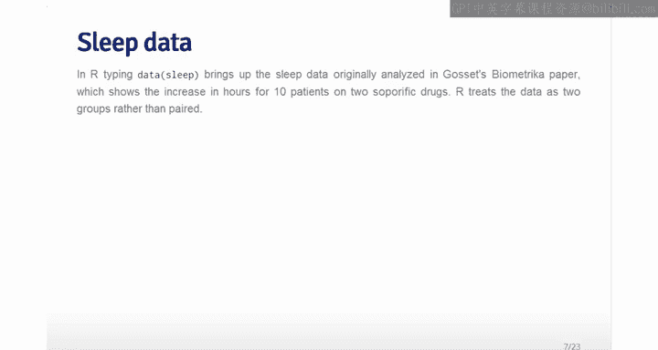

首先，我们在 R 中加载并查看“睡眠”数据集。该数据集最初由 Gossett 在其生物统计学论文中分析，记录了患者服用两种不同安眠药后睡眠时间的增加量。

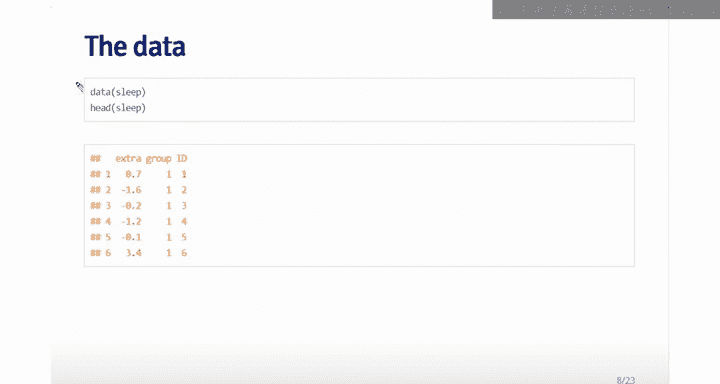

在 R 中，输入 `data(sleep)` 即可加载数据。输入 `head(sleep)` 可以打印数据框的前几行。

数据框包含以下变量：
*   `extra`：增加的睡眠小时数。
*   `group`：组别标识（1 或 2）。
*   `ID`：受试者标识（1 到 10）。

需要注意的是，R 默认将此数据视为两个独立组。但在本教程中，我们将把它当作**配对数据**来处理，即每个受试者都接受了两种药物的测试。

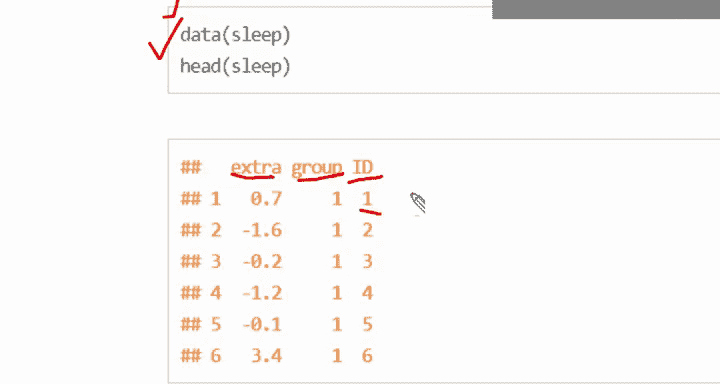

---

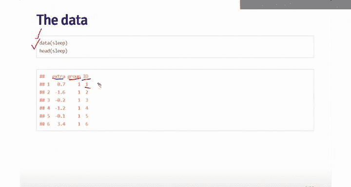

## 数据可视化与配对分析

为了直观理解配对设计的重要性，我们可以将数据绘制出来。下图将每个受试者在两种药物下的结果用线连接起来。


从图中可以清晰地看出，考虑数据配对性的好处。如果不考虑配对，我们比较的是**组1内部的变异**与**组2内部的变异**。如果考虑配对，我们比较的则是每个受试者自身的**个体差异**。由于同一个受试者内的观测值高度相关，这些差异的变异程度要低得多，从而使比较更加精确。

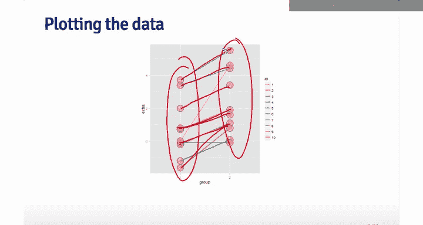

---

## 手动计算配对 t 置信区间

上一节我们通过可视化理解了配对数据的优势，本节中我们来看看如何具体计算置信区间。以下是手动计算配对 t 置信区间的步骤：

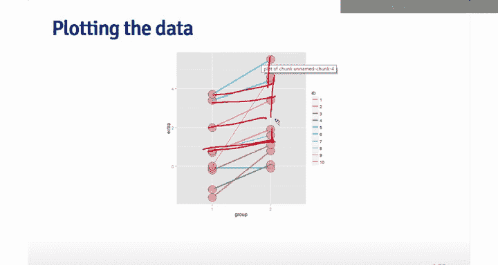

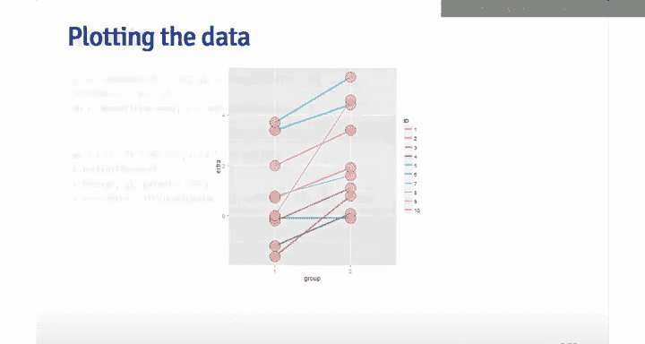

首先，提取两组数据。`g1` 包含前10个测量值（受试者1-10使用第一种药物），`g2` 包含后10个测量值（相同的受试者1-10使用第二种药物）。

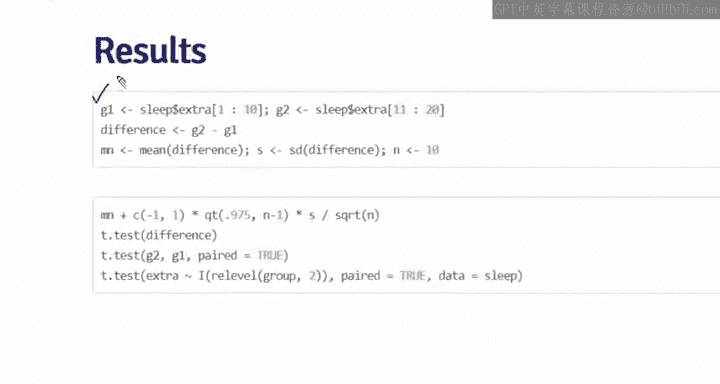

```r
g1 <- sleep$extra[1 : 10]
g2 <- sleep$extra[11 : 20]
```

接着，计算配对差异（第二组减第一组），并求其均值与标准差。

```r
difference <- g2 - g1
mn <- mean(difference)
s <- sd(difference)
n <- 10
```

然后，根据 t 置信区间公式进行计算。置信区间为均值加减 t 分位数与标准误的乘积。

```r
mn + c(-1, 1) * qt(.975, n-1) * s / sqrt(n)
```
**公式**：`均值 ± t(α/2, n-1) * (标准差 / √n)`

---

## 使用 R 内置函数计算

当然，我们不需要每次都手动计算。R 提供了 `t.test` 函数来快速完成此任务。

以下是两种等效的调用方式：
1.  直接对差异向量进行单样本 t 检验。
2.  使用公式语法并指定 `paired = TRUE` 参数。

```r
# 方法一：对差异向量做检验
t.test(difference)

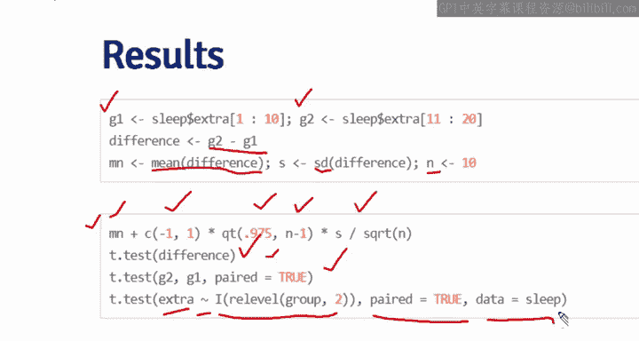

# 方法二：使用公式，指定配对
t.test(extra ~ group, data = sleep, paired = TRUE)
```

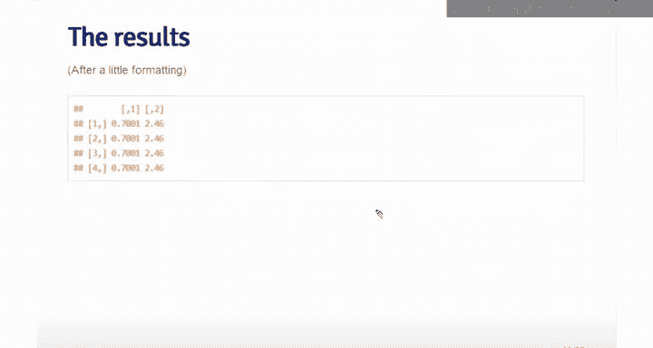

执行上述命令会得到丰富的输出结果。将其关键信息整理后，我们可以得到配对差异的95%置信区间约为 **0.70 到 2.46 小时**。

---

## 置信区间的解释

现在我们已经计算出了置信区间，让我们来理解它的含义。这个区间的解释是：如果我们能够从感兴趣的总体中重复抽取独立的样本，并对每个样本执行相同的配对 t 区间构建程序，那么大约有 **95%** 的区间会包含真实的平均差异（`μ`）。

这个结论的前提是，我们当前的样本（这10位受试者）能够代表我们感兴趣的目标总体。

---

## 总结

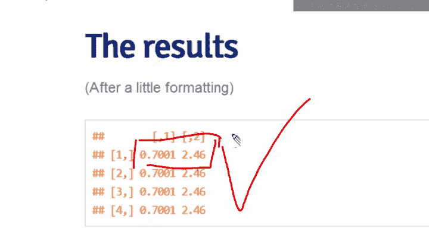

本节课中，我们一起学习了如何为配对数据构建 t 置信区间。我们从加载和探索“睡眠”数据集开始，通过可视化理解了配对设计的统计效力。接着，我们手动演示了区间计算的全过程，并介绍了使用 R 内置函数 `t.test` 的简便方法。最后，我们讨论了如何正确解释所得的置信区间。掌握配对分析的方法，能让我们在处理重复测量或匹配样本数据时，做出更准确、更高效的统计推断。