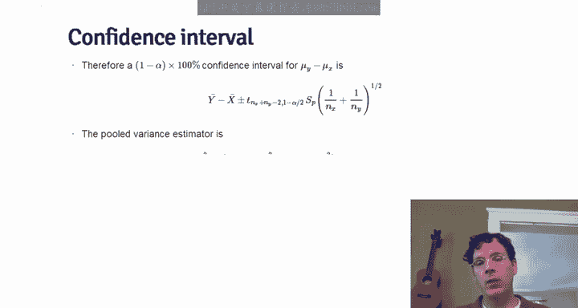
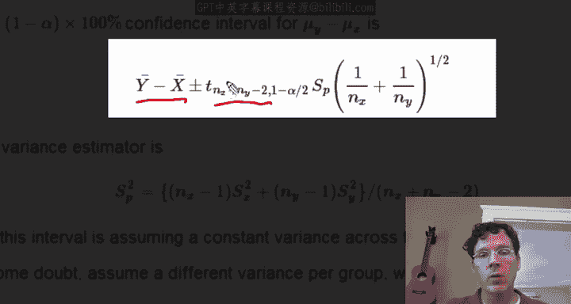
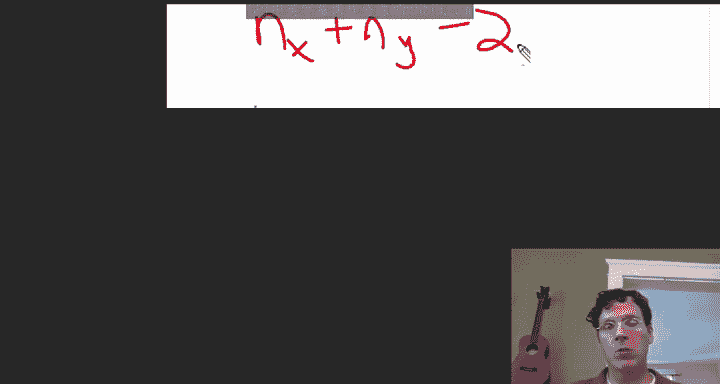
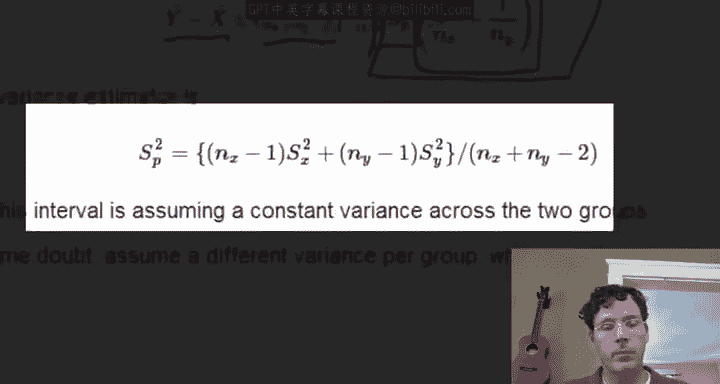
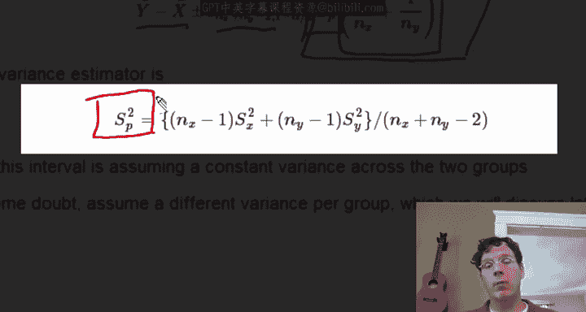
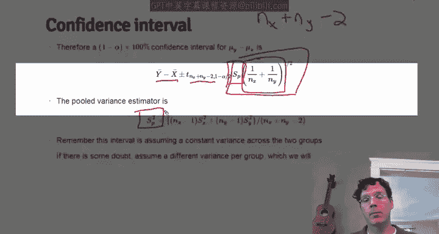
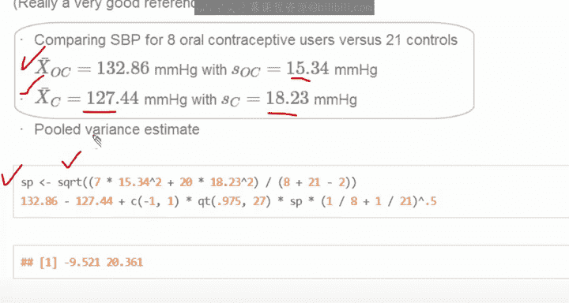
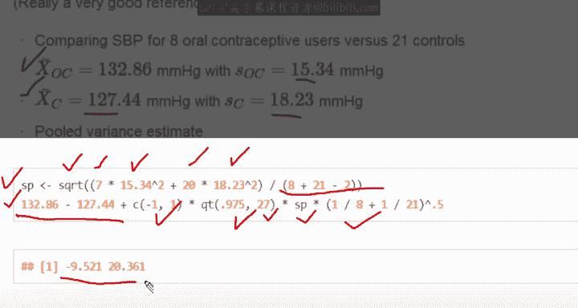
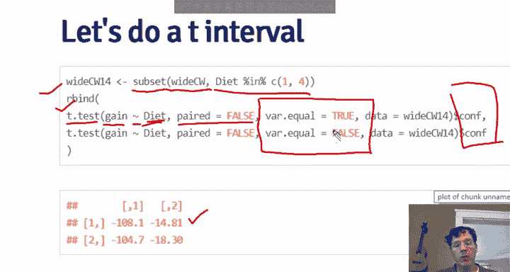

# 023：独立组t区间 🧮

在本节课中，我们将学习如何比较两个独立组的均值，例如在随机试验中比较治疗组和安慰剂组的平均血压。我们将重点介绍构建置信区间的方法，并解释其背后的核心概念。

## 概述

假设我们想比较一项随机试验中两组（接受治疗组和接受安慰剂组）的平均血压。这与数据科学中常说的A/B测试非常相似。无论是A/B测试还是随机试验，进行随机化的目的是平衡可能影响结果的未观测协变量。由于执行了随机化，我们可以合理地使用T置信区间或T检验来比较两组。但我们不能使用配对t检验，因为两组之间没有受试者的匹配。

因此，我们现在介绍比较独立组的方法。

## 标准置信区间公式

在这种情况下，标准置信区间公式为：

**公式：**
`置信区间 = (ȳ - x̄) ± t * SE`

其中：
*   `ȳ - x̄` 是一组的平均值减去另一组的平均值。
*   `t` 是相关的t分位数。
*   `SE` 是差异的标准误。

这里的自由度计算稍复杂，公式为 `df = n_x + n_y - 2`，其中 `n_x` 是X组的观测数，`n_y` 是Y组的观测数。

## 标准误与合并方差

标准误的计算公式为：

**公式：**
`SE = s_p * sqrt(1/n_x + 1/n_y)`

您会注意到，随着我们收集更多数据，`1/n_x` 和 `1/n_y` 会变得非常小，从而缩小置信区间。

这里的 `s_p` 是合并标准差。`s_p²` 被称为合并方差，其平方根即为合并标准差。

如果我们愿意假设两组的方差相同（这在执行随机化后是合理的），那么我们对方差的估计在某种程度上应该是组1方差估计和组2方差估计的平均值。然而，如果样本量不同，我们希望给予样本量更大的组其方差估计更高的权重。这正是合并方差估计所做的。

如果两组观测数相等（`n_x = n_y`），那么合并方差就是X组方差和Y组方差的简单平均值。

**公式：**
`s_p² = [(n_x - 1) * s_x² + (n_y - 1) * s_y²] / (n_x + n_y - 2)`

但请记住，这个区间假设两组方差恒定。如果这个假设被违反，那么该区间将无法提供正确的覆盖率。如果有疑问，可以假设每组方差不同，我们将在后面介绍一个稍有不同的区间。

## 实例解析：口服避孕药与血压

接下来，我们通过Rosner的《生物统计学基础》一书中的一个例子进行解析。这是一个很好的参考书，但非常厚重。

书中一个例子比较了8名口服避孕药使用者与21名对照者的血压。
*   口服避孕药使用者的平均收缩压为133 mmHg，标准差为15.34。
*   对照组的平均收缩压为127 mmHg，标准差为18.23。

让我们手动构建一次独立组区间以了解计算过程。在实际操作中，您通常会使用 `t.test` 等函数，因为您拥有原始数据。

首先，计算合并标准差估计值。我们需要对方差估计进行加权平均：

**计算过程：**
1.  计算合并方差 `s_p² = [(8-1)*15.34² + (21-1)*18.23²] / (8+21-2)`
2.  然后开方得到合并标准差 `s_p`。

接着，构建置信区间：
*   均值差为 `133 - 127 = 6`。
*   自由度为 `8 + 21 - 2 = 27`。
*   查找相应的t分位数。
*   计算标准误 `SE = s_p * sqrt(1/8 + 1/21)`。
*   最终区间为 `6 ± t * SE`。

计算得到的区间大约为 `[-10, 20]`。由于该区间包含0，我们不能排除两组总体差异为0的可能性。

## 另一个例子：睡眠药物数据（非配对情况）

让我们重新审视睡眠药物的例子，但假设受试者没有匹配。这里，两组样本量 `n1` 和 `n2` 都是10。

以下是构建过程：
1.  计算合并标准差估计值 `s_p`。
2.  计算均值差。
3.  计算均值差的标准误：`SE = s_p * sqrt(1/n1 + 1/n2)`。
4.  置信区间为：`均值差 ± t分位数 * 标准误`。

在R中，我们可以使用 `t.test` 函数，设置 `paired = FALSE` 和 `var.equal = TRUE` 来获得相同结果。为了对比，我们也运行 `paired = TRUE` 的情况。结果显示，忽略配对会得到一个包含0的区间，而考虑配对时，区间完全在0以上。从数据图中可以清楚地看出原因：组间变异很大，但匹配受试者后，差异的变异中很大一部分可由受试者间的变异解释。

## 小鸡体重数据实例

R中的 `ChickWeight` 数据集包含了小鸡从出生到几周后的体重数据。

首先，我们需要加载并整理数据。我们使用 `reshape2` 包将数据从“长格式”转换为“宽格式”，以便每个时间点有一列。然后，使用 `dplyr` 包计算每只小鸡从时间0开始的总体重增益（即最终体重减去基线体重），我们将分析这个体重变化值。

在分析之前，先查看数据。我们为四种饮食方案绘制了“意大利面条图”。图中显示，饮食方案1的平均体重增益似乎比饮食方案4慢一些。

为了进行正式比较，我们绘制饮食方案1和4的体重变化小提琴图。从图上看，等方差的假设似乎值得怀疑。

在R中，使用 `t.test` 函数进行比较。我们通过 `subset` 命令仅选取饮食方案为1或4的记录。以下是两种情况的比较：
*   **假设方差相等 (`var.equal = TRUE`)**：得到区间约为 `[-108, -14]`。
*   **假设方差不相等 (`var.equal = FALSE`)**：得到区间约为 `[-104, -18]`。

两种情况下，区间都完全低于0，表明饮食方案1的体重增益小于饮食方案4。然而，具体的区间会因是否假设方差相等而略有变化。由于这可能很重要，我们也需要介绍方差不假设相等时的t区间。

## 方差不相等时的区间（韦尔奇区间）

当不能假设两独立组的方差相等时，我们使用韦尔奇t区间。其公式与之前类似，但标准误和自由度的计算不同。

**公式：**
`置信区间 = (ȳ - x̄) ± t_df * sqrt(s_x²/n_x + s_y²/n_y)`

其中，标准误为两组方差估计的独立和。自由度 `df` 的计算更为复杂，使用韦尔奇-萨特斯韦特公式：

**公式：**
`df = (s_x²/n_x + s_y²/n_y)² / [ (s_x²/n_x)²/(n_x-1) + (s_y²/n_y)²/(n_y-1) ]`

这个调整后的自由度通常不是整数。在R中，`t.test` 函数默认 (`var.equal = FALSE`) 就是计算这个区间，如前例所示。

## 总结

本节课我们一起学习了如何为两个独立组的均值差构建置信区间。
*   我们首先介绍了标准区间，它假设两组方差相等，并使用合并方差估计。
*   我们通过口服避孕药与血压的例子演示了手动计算过程。
*   接着，用睡眠药物数据对比了配对与非配对分析的不同结果。
*   最后，通过小鸡体重数据的实例，探讨了当方差相等假设不成立时，如何使用韦尔奇t区间，并比较了两种假设下的结果差异。

关键要点是：选择正确的区间类型（配对/独立、等方差/异方差）对于得出有效结论至关重要，应基于研究设计和数据特征来决定。