# 024：关于不等方差t检验的说明 📊

在本节课中，我们将学习如何处理两组数据方差不等情况下的t检验问题。我们将重点探讨不等方差t检验的公式、自由度计算方法，以及在实际应用中如何执行此类检验。

## 不等方差t检验的公式

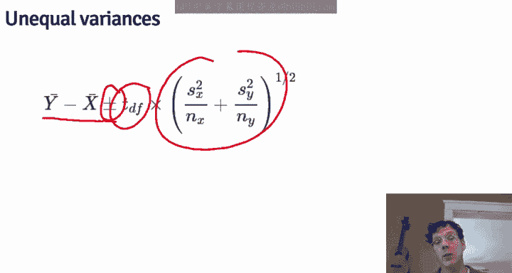

上一节我们介绍了等方差假设下的t检验，本节中我们来看看当两组数据方差不等时，置信区间的构建方法。

不等方差情况下的置信区间公式与之前的形式相似，但标准误的计算方式不同。其核心公式为：

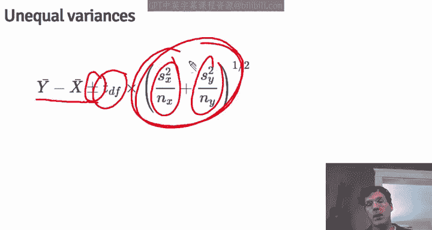

**均值差 ± t分位数 × 标准误**

其中，标准误的计算基于两组数据可能具有不同方差的假设。具体公式如下：

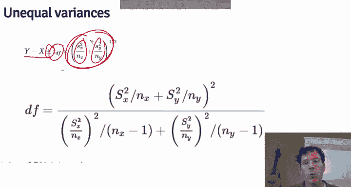

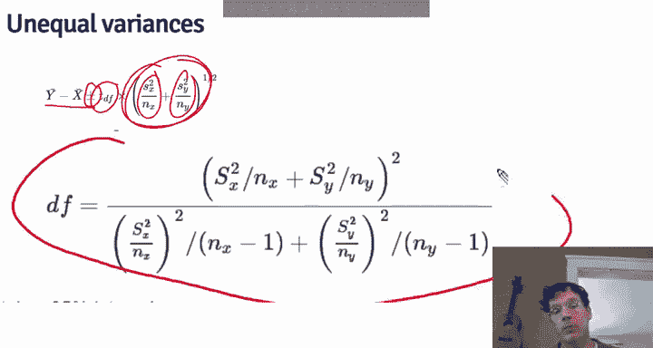

## 统计量的分布近似

如果X观测值和Y观测值独立同正态分布，但可能具有不同的均值和方差，那么其标准化统计量并不严格遵循t分布。

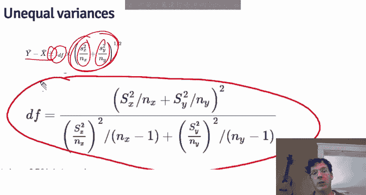

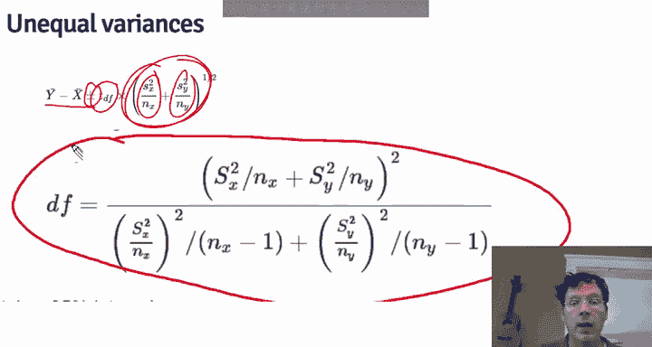

实际上，该统计量可以通过t分布来近似，但需要计算一个较为复杂的自由度公式。

## 自由度的计算

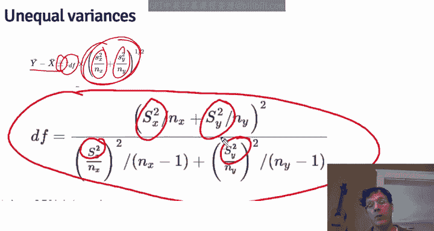

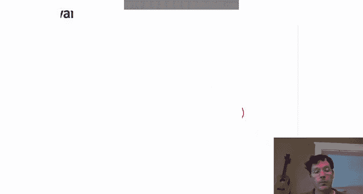

以下是自由度计算公式的特点：

*   该公式通常无人能记住，因为它计算方式独特。
*   它不仅涉及样本量，还包含了来自两组的估计标准差和方差。

尽管如此，如果代入这个可能为小数的自由度，得到的t统计量计算可以很好地近似真实分布。事实证明，这种方法足够有效，因此可以给出一个实用建议：当您不确定方差是否相等时，直接使用不等方差区间。

## 实例计算与R语言实现

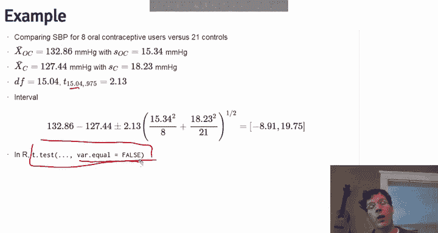

为了加深理解，我们可以手动计算之前口服避孕药例子中的相关数值。

您可能希望进行这个计算，以便确认自己能够代入标准差公式。在这个案例中，计算得到的自由度是15.04。

然而在实际操作中，当我们想要进行不等方差t检验时，通常只需使用R语言中的`t.test`命令，并设置参数`var.equal = FALSE`。该命令会自动执行不等方差t检验，并生成基于不等方差假设的相应t分位数。

## 课程总结

本节课中我们一起学习了利用t分布构建置信区间，这是统计学中非常实用的工具。

当我们拥有单样本观测值或已计算差值的配对观测值时，我们使用t区间来构建对数据分布的基本假设具有高度稳健性的区间。

然而，我们也讨论了在某些情况下，可能更适合使用t分布和t区间之外的其他方法：

*   当数据高度偏斜时，您可能需要对数据取对数或寻找其他不同的程序。
*   当数据是二元的，您可以考虑使用比值比等方法，这将在回归课程中的广义线性模型部分进行讲解。
*   同样，对于计数数据，我们将讨论泊松模型和用于比率的广义线性模型，这些内容同样出现在我们的回归课程中。

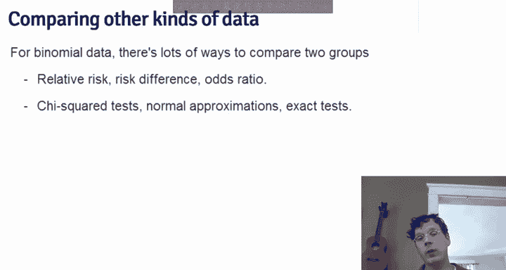

对于其他一些两组比较的特殊情况，Coursera上的另一门课程《数理统计速成课2》涵盖了许多相关内容。

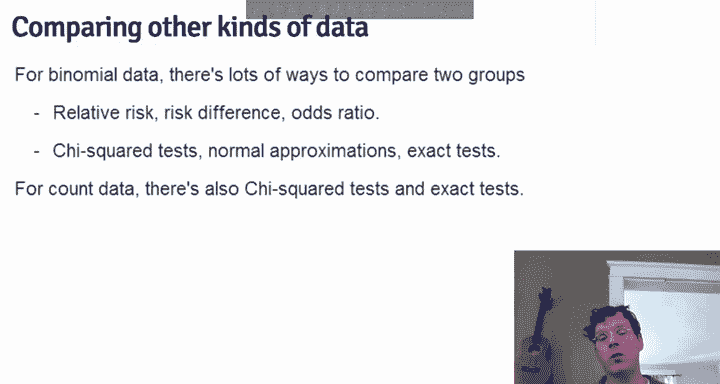

