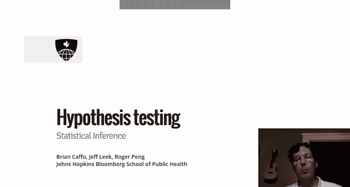
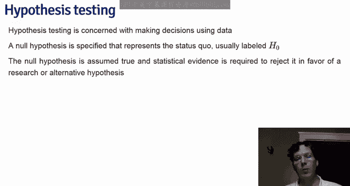
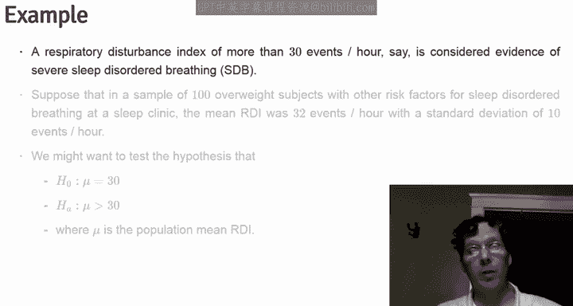
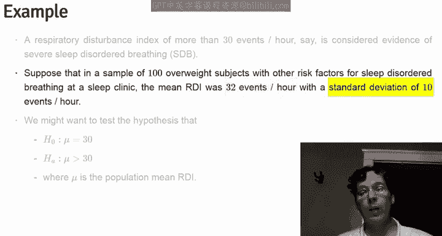
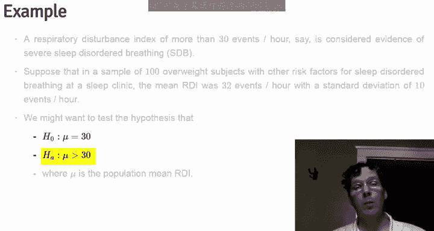
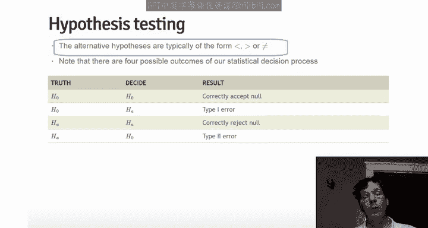
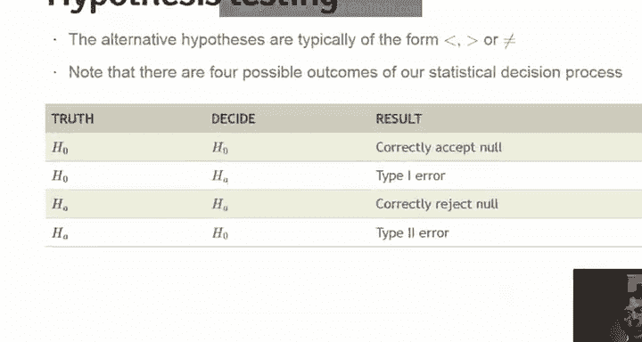
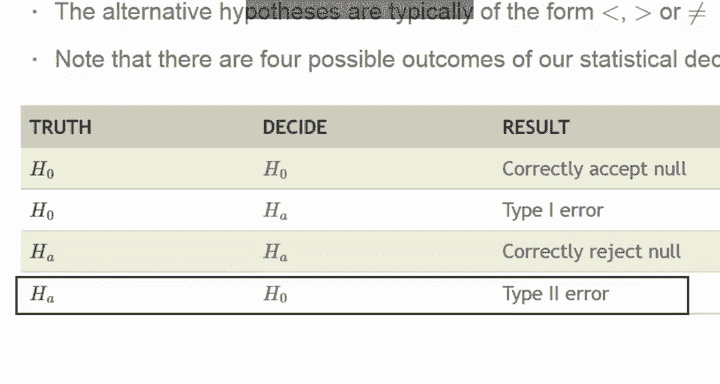
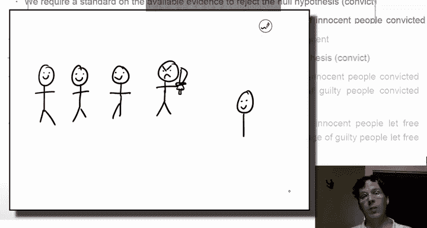
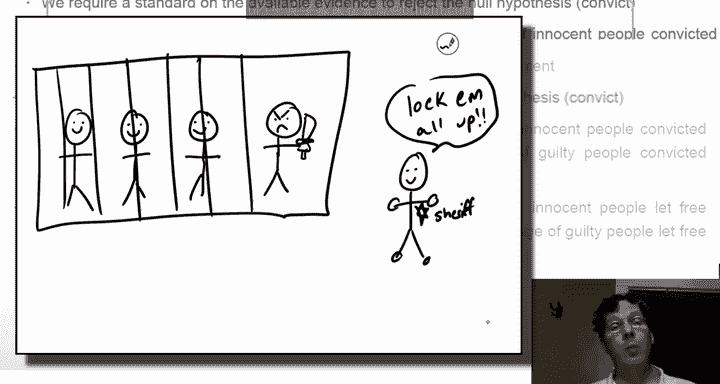

# 025：假设检验 🧪

在本节课中，我们将要学习假设检验的基本概念。假设检验是统计学中用于根据数据做出决策的重要工具。我们将从定义零假设和备择假设开始，然后讨论两类错误，最后介绍如何执行假设检验。

---

## 假设检验简介

上一节我们介绍了置信区间，本节中我们来看看假设检验。假设检验与置信区间密切相关，因此理解起来会相对容易。

假设检验关注的是利用数据做出决策。通常，假设检验从一个代表现状的**零假设**开始，它通常标记为 **H₀**。零假设被假定为真，需要统计证据来拒绝它，以支持一个**备择假设**（或称研究假设）。

---

## 一个简单的例子

让我们通过一个简单的例子来理解假设检验。

呼吸紊乱指数大于每小时30次事件被认为是严重睡眠呼吸障碍的证据。

假设在一个睡眠诊所中，从100名有其他睡眠呼吸障碍风险因素的超重受试者中抽取样本，测得平均RDI为每小时32次事件，标准差为每小时10次事件。

我们想检验：我们抽取样本的总体均值是否等于30（严重睡眠呼吸障碍的基准值），或者是否大于30。

因此，我们设定：
*   零假设 **H₀: μ = 30**
*   备择假设 **Hₐ: μ > 30**

在我们的例子中，我们设定的备择假设是μ大于30。然而，根据具体的研究问题，备择假设也可以是小于或不等于。

---

## 决策与错误

请注意，事实要么是H₀为真，要么是Hₐ为真。而我们的决策要么是H₀，要么是Hₐ。因此，只有四种可能性。

以下是四种可能的情况：

*   **正确接受零假设**：如果H₀为真，我们决定H₀。
*   **第一类错误**：如果H₀为真，我们决定Hₐ。
*   **正确拒绝零假设**：如果Hₐ为真，我们决定Hₐ。
*   **第二类错误**：如果Hₐ为真，我们决定H₀。

在我们即将介绍的假设检验版本中，我们将控制**第一类错误**的概率，使其保持在一个较小的水平。

---

## 两类错误的关系

第一类错误率和第二类错误率是相关的：当第一类错误率增加时，第二类错误率会下降，反之亦然。

我们可以通过考虑法庭审判来轻松说明这一点。在大多数法庭中，零假设是“被告无罪，除非被证明有罪”。在这里，拒绝零假设就是判定被告有罪。

*   如果我们设定一个非常低的标准（即不需要太多证据就定罪），那么我们会增加无辜者被定罪（第一类错误）的百分比。但同时，也会增加有罪者被定罪（正确拒绝零假设）的百分比。
*   如果我们设定一个非常高的标准（例如，必须人赃并获才定罪），那么我们会增加无辜者被释放（正确接受零假设）的百分比。但同时，也会增加有罪者被释放（第二类错误）的百分比。

这说明了第一类错误和第二类错误是如何相互关联的。当然，理想情况是在给定标准下获得更好的证据，这就是增加样本量等方法的出发点。但在讨论这些问题之前，让我们先谈谈如何进行假设检验。

---

## 总结

本节课中我们一起学习了假设检验的基础。我们定义了零假设和备择假设，并通过一个睡眠呼吸障碍的例子进行了说明。我们详细讨论了在假设检验中可能出现的两类错误——第一类错误和第二类错误，并解释了它们之间的权衡关系。最后，我们以法庭审判为例，生动地展示了设定不同证据标准如何影响这两类错误的发生率。