# 026：选择拒绝区域的示例 📊

在本节课中，我们将通过一个具体的呼吸障碍指数示例，学习如何为假设检验选择拒绝区域。我们将重点理解第一类错误率（α）的概念，并学习如何计算一个临界值（C），使得在原假设为真时错误地拒绝它的概率被控制在可接受的水平（例如5%）。

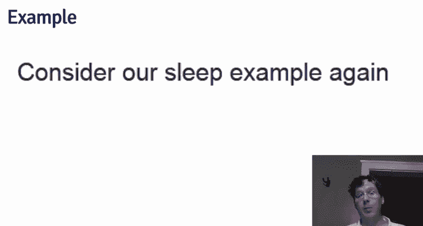

---

## 回顾示例与设定目标

上一节我们介绍了假设检验的基本框架。本节中我们来看看一个具体的应用。

再次考虑我们的呼吸障碍指数示例。

一个合理的策略是：如果我们的样本平均呼吸障碍指数大于某个常数，就拒绝原假设。我们把这个常数标记为 **C**。常数 **C** 需要考虑样本均值 **X̄** 的变异性。

通常，**C** 的选择使得第一类错误率（我们标记为 **α**）保持在一个较低的水平。在假设检验中，5% 已成为一个基准值。

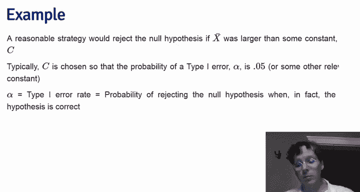

重申一下，**α** 是第一类错误率，即当原假设实际上正确时，我们却拒绝它的概率。这是一个我们不希望犯的错误。但就像在法庭案例中一样，我们也不希望把这个比率设得太低，因为那样我们将永远无法拒绝原假设。

我们的目标是选择这个常数 **C**，使得我们拒绝原假设的概率被控制在可容忍的低水平，比如 5%。

## 计算标准误与确定分布

以下是计算所需的关键参数。

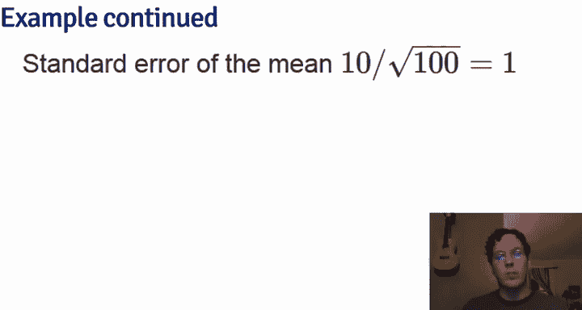

均值的标准误是 1。这是由总体假设标准差（10）除以样本量的平方根（√100）得出的。这里我们设定了一个方便计算的情景。

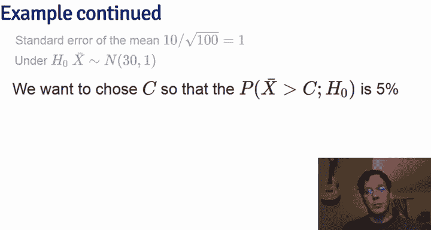

在原假设 **H₀: μ = 30** 下，样本均值 **X̄** 的分布是正态分布，其均值为 30，方差为 1（即我们刚刚计算出的标准误的平方）。

因此，我们需要选择常数 **C**，使得在原假设下 **X̄** 大于 **C** 的概率为 5%。

## 确定临界值 C

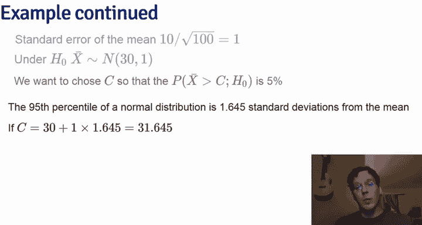

现在我们来具体计算这个临界值 **C**。

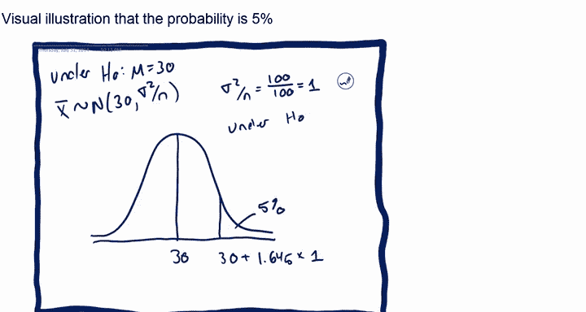

标准正态分布的 95% 分位数是距离均值 1.645 个标准差。因此，如果我们设定常数 **C** 为在原假设均值基础上加上 1.645 个标准误，我们就能得到一个临界点，使得从这个总体中随机抽取的样本均值大于此值的概率为 5%。

具体计算如下：
**C = 30 + 1 × 1.645 = 31.645**

所以，一个均值为30、方差为1的正态随机变量大于常数31.645的概率是5%。

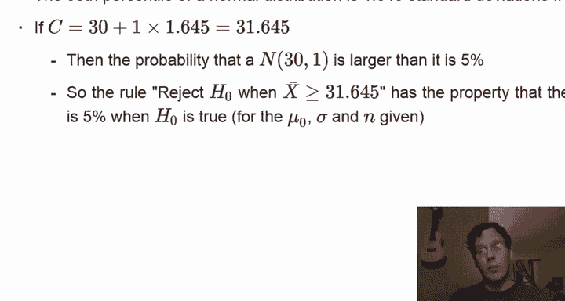

因此，规则“当观测到的平均值大于 31.645 时拒绝原假设”具有以下性质：当原假设为真时，我们将在 5% 的情况下拒绝它。这正好是在样本量恰好为100、总体标准差恰好为10的设定下。

## 转换为标准化统计量

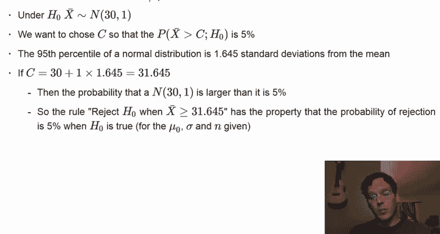

上一张幻灯片中，我们将拒绝区域 **C** 的计算转换回了数据的原始单位。然而，我希望你从这个问题中领会到要点：基本上，无论何时你在检验“大于”的情况，如果样本均值距离假设均值超过 1.645 个标准误，你就会拒绝。这里的30和标准误为1并没有什么特殊性。

因此，我们通常不将常数计算回原始数据单位，而是倾向于将我们的样本均值转换为它距离假设均值有多少个标准误。

以下是一个具体的计算示例。

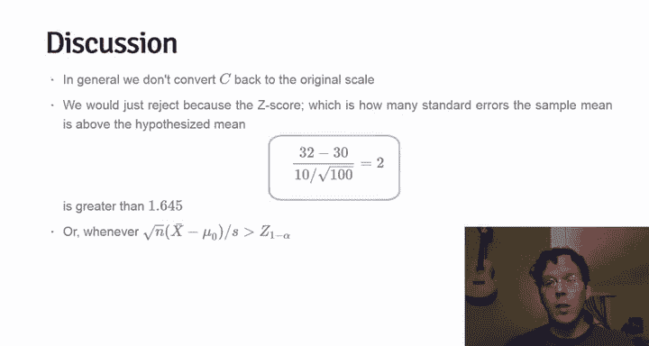

假设我们观测到的样本均值是 32。
我们的假设均值是 30。
我们的标准误是 **10 / √100 = 1**。（在实际问题中，10 会是从数据中估计的样本标准差。）

计算标准化统计量：
**(32 - 30) / 1 = 2**

这个值 2 大于 1.645。在原假设下，发生这种情况的概率小于 5%。因此，我们将拒绝原假设，支持备择假设。

## 总结拒绝规则

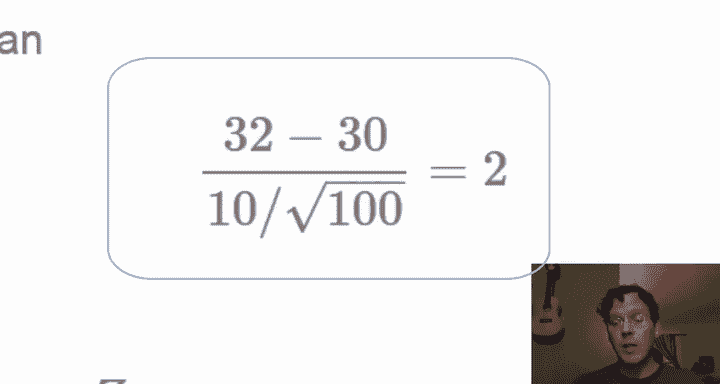

最后，我将拒绝规则再次写在这里：

我们将拒绝原假设，只要满足：
**(X̄ - μ₀) / SE > Z₁₋α**

其中：
*   **X̄** 是样本均值。
*   **μ₀** 是假设的总体均值（原假设下的值）。
*   **SE** 是均值的标准误。
*   **Z₁₋α** 是标准正态分布的上侧分位数，它使得上尾概率为 **α**（例如，当 α=0.05 时，Z₀.₉₅ = 1.645）。

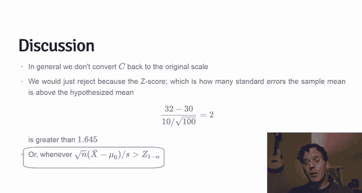

---

本节课中，我们一起学习了如何为单侧（上侧）假设检验确定拒绝区域。我们通过一个呼吸障碍指数的例子，演示了如何利用第一类错误率 **α**（通常设为5%）和标准正态分布的分位数来计算临界值 **C**。更重要的是，我们学会了将问题标准化，通过计算 **Z 统计量**（样本均值与假设均值的差，除以标准误）并与临界 **Z 值**（如1.645）进行比较来做出决策。这种方法更具通用性，是假设检验的核心步骤。