# 029：P值详解 📊


在本节课中，我们将学习统计学中一个核心概念：P值。P值是衡量统计显著性的最常见指标，几乎所有进行假设检验的统计软件都会输出P值。我们将了解P值的基本思想、计算方法以及如何正确解读它。


---

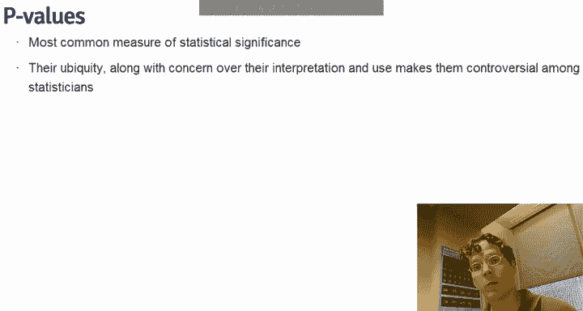

## P值的基本思想 💡

上一节我们提到了P值的普遍性，本节中我们来看看它的核心定义。

P值的基本思想是：首先假设**零假设**成立，即“没有发生任何事情”，然后计算在此假设下，获得与实际观测到的证据**同样极端或更极端**的证据的概率。换句话说，如果零假设为真，我们得到当前这个结果的“不寻常”程度有多大。


---


## 计算P值的三个步骤 🔢

以下是计算P值的一般性步骤：

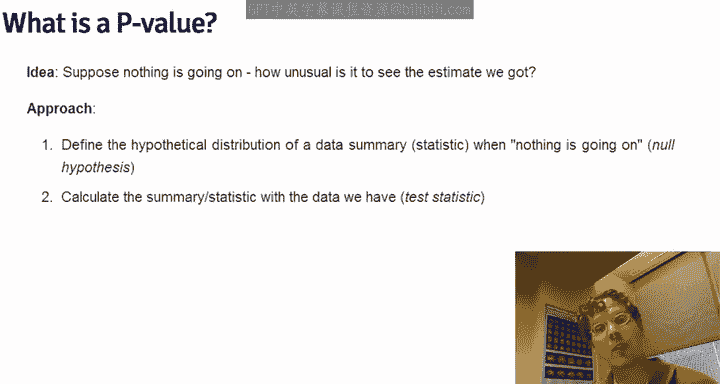

1.  **确定统计量的零分布**：在零假设（“无事发生”）下，确定你所使用的数据摘要统计量（例如t检验中的t统计量）的理论分布。这被称为统计量的**零分布**。
2.  **计算实际统计量**：使用你手头的数据，计算出实际的统计量值。例如，在t检验中，你会代入样本均值，减去假设的均值，再除以标准误。
3.  **计算极端概率**：将你计算出的实际统计量值与零分布进行比较，计算获得一个**同样极端或更极端**（通常指更支持备择假设方向）的统计量的概率。这个概率就是P值。

如果P值很小，意味着在零假设为真的前提下，观察到像我们实际得到这样极端的检验统计量是非常不可能的。

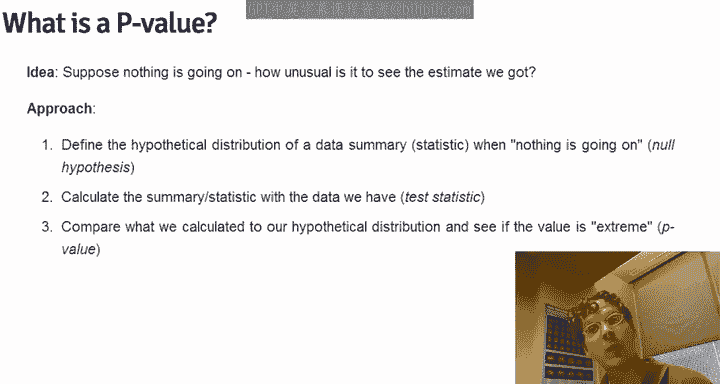


---

## P值的正式定义与解读 📝

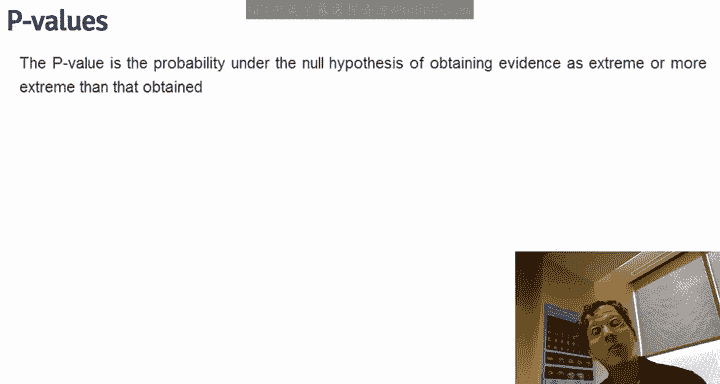

上一节我们介绍了计算步骤，本节中我们来看看更正式的定义。

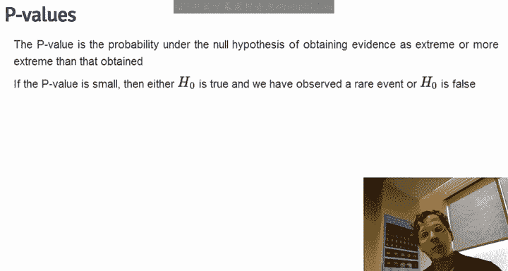


P值的正式定义是：在零假设成立的条件下，获得**与实际证据同样极端或更极端**的证据的概率。这里的“证据”通常指检验统计量。

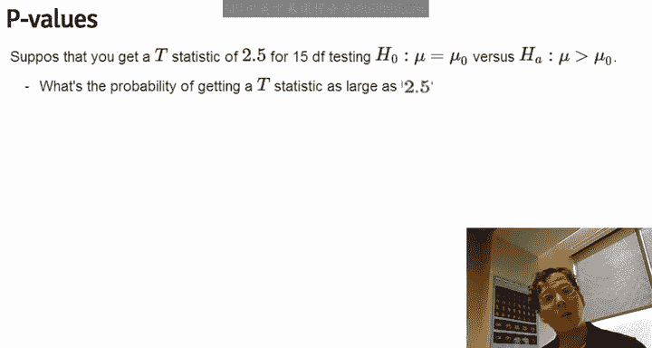

因此，一个小的P值意味着两种可能：
*   零假设是**真的**，但你观察到了一个非常支持备择假设、且极不可能发生的结果。
*   零假设是**假的**。

---

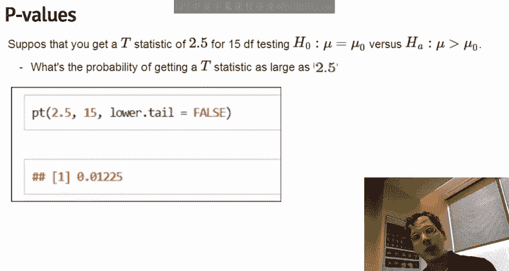

## 计算示例：单侧t检验 🧮


让我们通过一个具体的数值例子来巩固理解。假设我们进行一个t检验，零假设为 `H0: μ = μ0`，备择假设为 `Ha: μ > μ0`。


我们计算出的t统计量为 `t = 2.5`，自由度为 `15`。那么，在零假设下，获得一个大于或等于2.5的t统计量的概率是多少？

在R语言中，我们可以使用以下代码计算：
```r
# 计算P值：P(T >= 2.5)，其中T服从自由度为15的t分布
p_value <- pt(2.5, df = 15, lower.tail = FALSE)
```
计算结果约为 `0.01` 或 `1%`。


因此，在零假设下，观察到如此极端或更极端证据的概率是1%。这要么说明零假设成立时我们碰巧遇到了一个极罕见的“大”t值，要么说明零假设本身可能不成立。

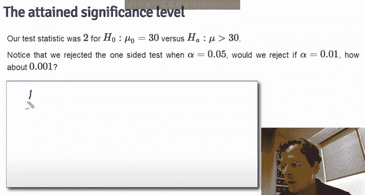

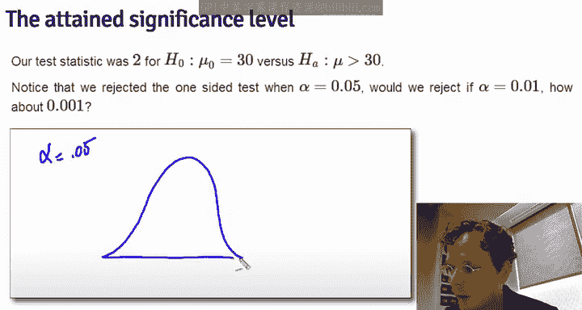

---

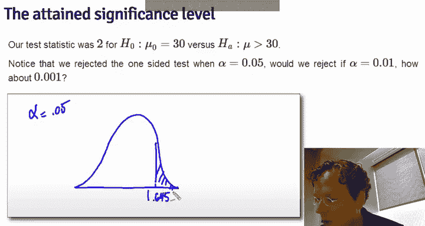

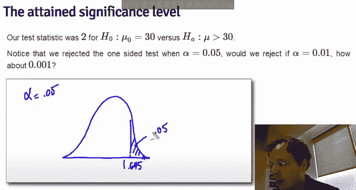

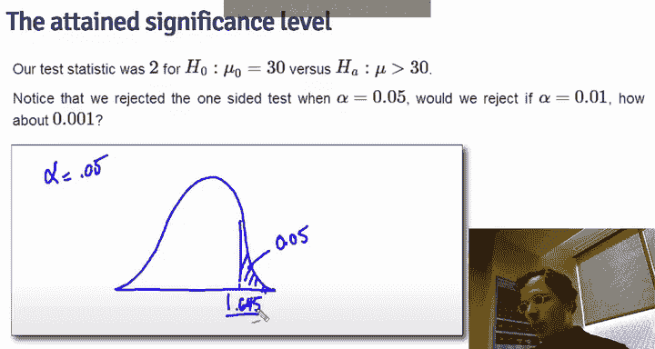

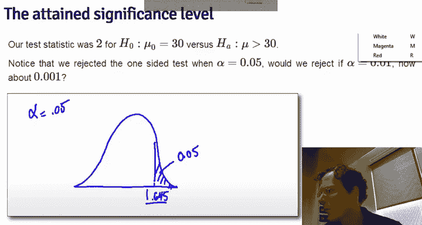

## P值的另一视角：达到的显著性水平 ⚖️

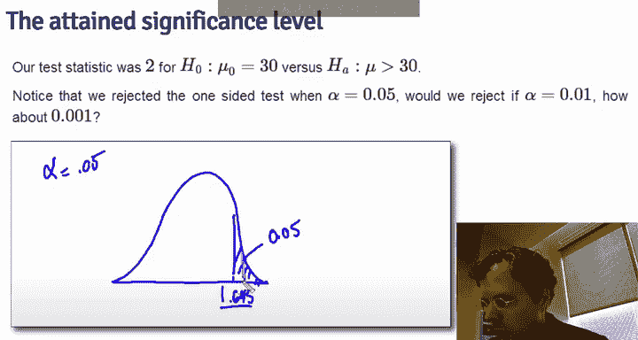

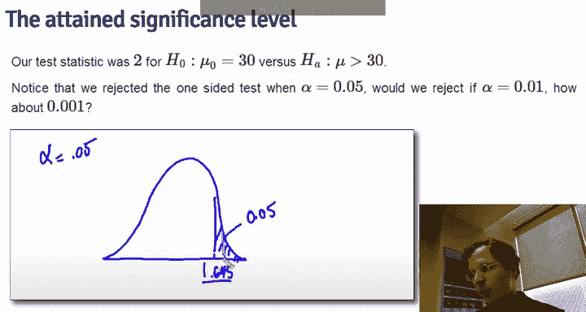

P值还有另一种理解方式，称为“达到的显著性水平”。


回顾之前的例子：我们的检验统计量 `Z = 2`（为简化，假设其服从标准正态分布），用于检验 `H0: μ = 30` vs `Ha: μ > 30`。

*   如果我们设定显著性水平 `α = 0.05`，对应的临界值（分位数）是 `1.645`。因为 `2 > 1.645`，所以我们拒绝零假设。
*   现在想象，我们不断调整 `α` 值，直到其临界值恰好等于我们实际得到的统计量 `2`。这个使临界值等于 `2` 的 `α` 值，正是我们计算出的P值（即 `P(Z >= 2)`）。

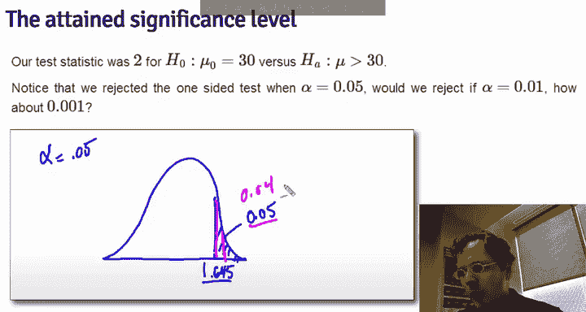

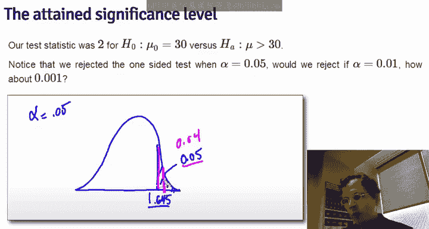

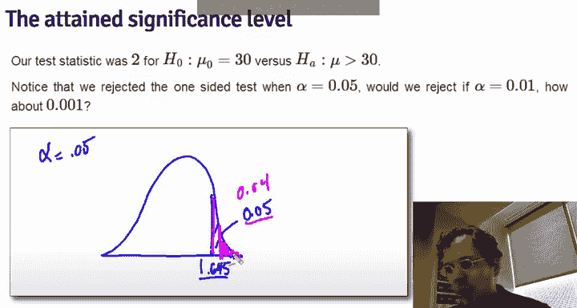


因此，**P值是可以拒绝零假设的最小 `α` 值**。这使得P值成为一个非常方便的沟通工具：当你报告一个P值时，读者可以将其与他们自己选择的任何 `α` 水平进行比较。

简单的规则是：
*   如果 **P值 < α**，则拒绝零假设。
*   如果 **P值 ≥ α**，则未能拒绝零假设。

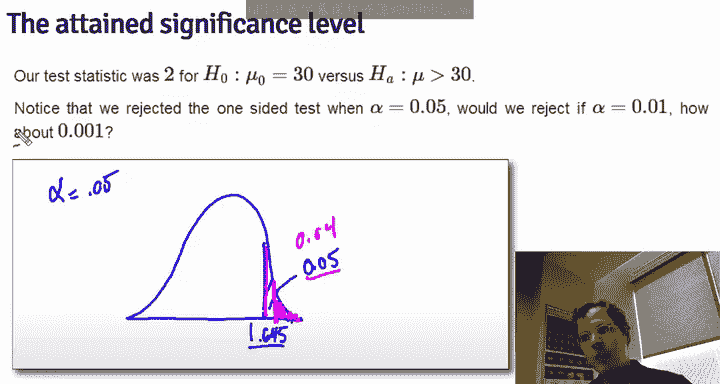

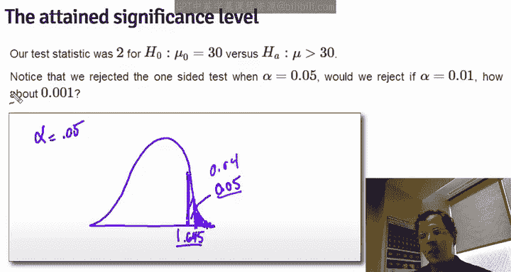

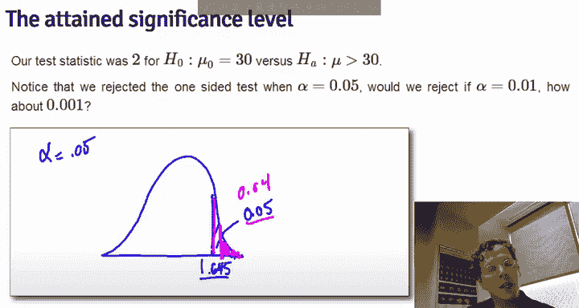

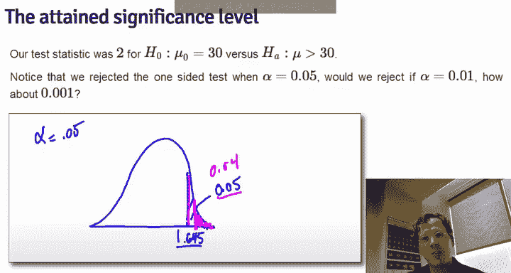

---


## 关于双侧检验的注意事项 🔄

我们之前计算的P值都是针对**单侧**假设检验（如 `Ha: μ > μ0`）。

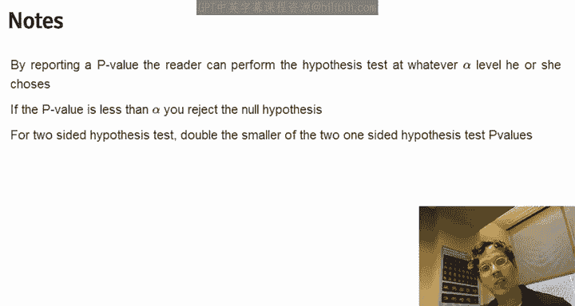

对于**双侧**检验（如 `Ha: μ ≠ μ0`），你需要考虑两个方向上的极端证据：既包括过大，也包括过小（负值过大）。由于正态或t分布的双侧尾部概率相等，通常的做法是将单侧P值**乘以2**来得到双侧P值。

需要注意：
*   大多数统计软件在输出结果时，**默认计算的是双侧检验的P值**，并通常会注明“two-sided p-value”。
*   对于一些其他检验（如卡方检验），其P值本身在定义上就是“双侧”的，无需进行加倍操作。

---

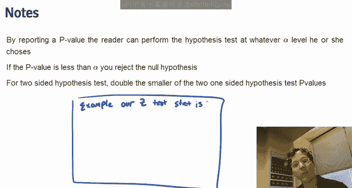

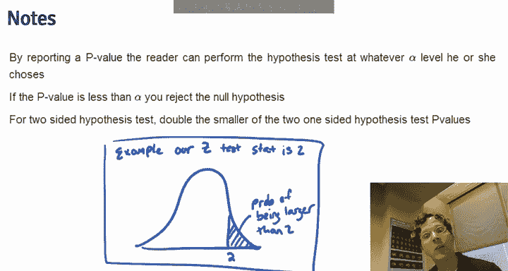

## 总结 🎯

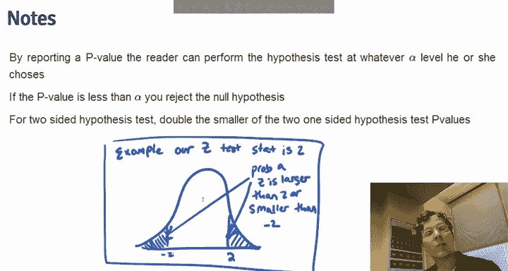


本节课中我们一起学习了P值。我们了解到P值是在零假设为真的前提下，观察到与实际数据同样极端或更极端结果的概率。它是一个衡量证据反对零假设强度的指标。我们学习了计算P值的基本步骤，并通过t检验的例子进行了演示。同时，我们也认识到P值可以作为“达到的显著性水平”来理解，这使其便于在不同预设的α水平下进行结果解读。最后，我们提醒了在单侧与双侧检验中处理P值的区别。正确理解和计算P值，是进行统计推断的重要基础。