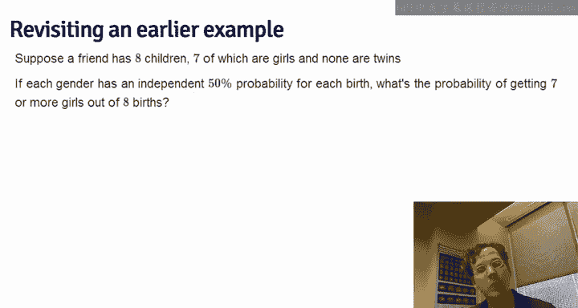
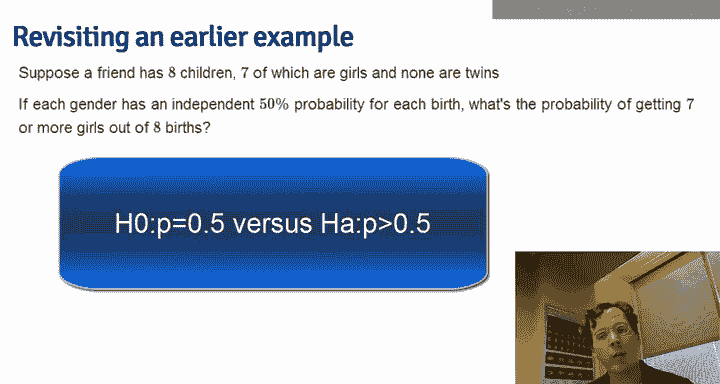
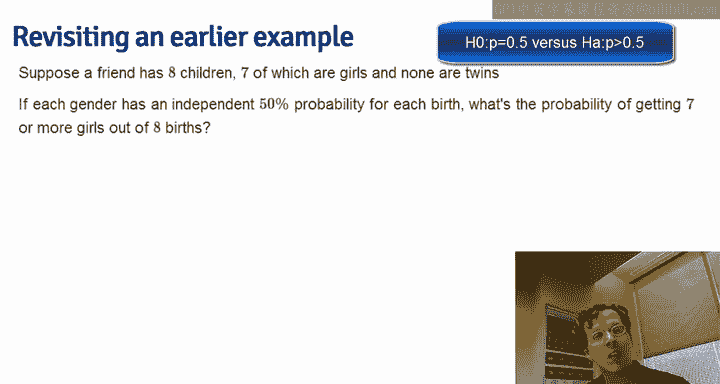
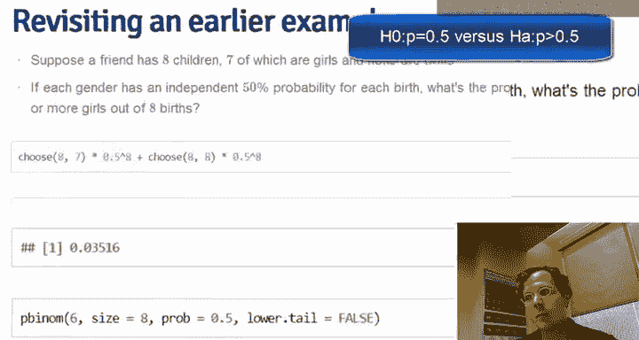
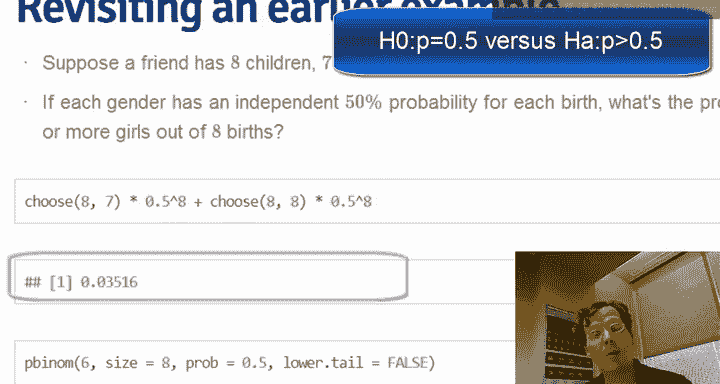
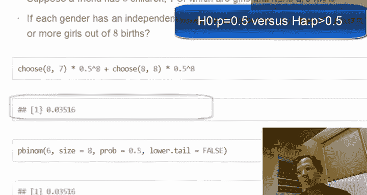
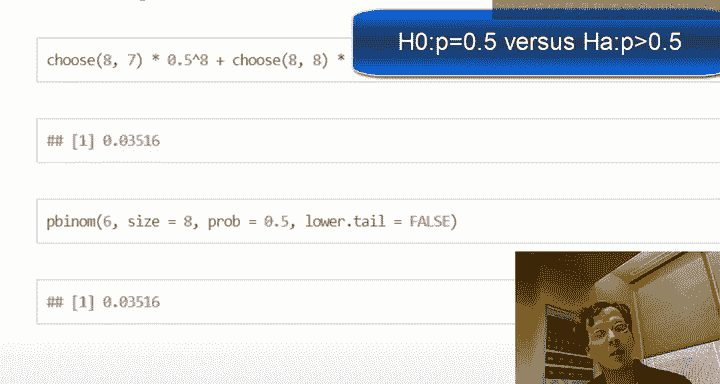
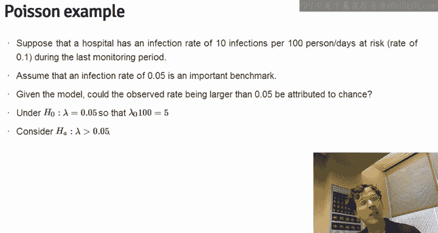
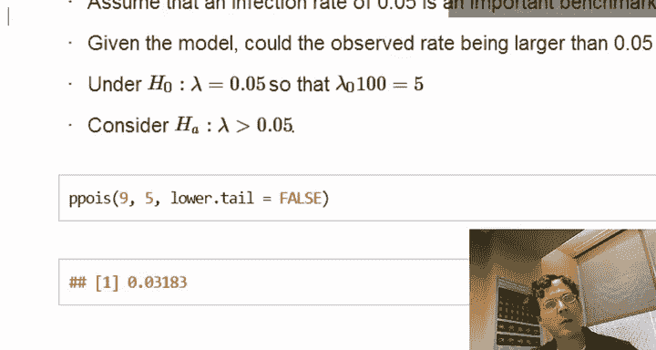

# 030：P值深入示例 🧮


在本节课中，我们将通过两个具体的统计检验示例，深入学习P值的计算和应用。我们将回顾一个二项分布的例子，并探讨一个新的泊松分布案例，以巩固对P值概念的理解。

## 概述

P值是假设检验中的核心概念，它量化了在零假设成立的前提下，观察到当前数据（或更极端数据）的概率。上一节我们介绍了P值的基本定义和计算逻辑，本节中我们来看看如何在实际的二项分布和泊松分布问题中应用这一概念。





## 二项分布示例：新生儿性别比例

假设我们考虑一个家庭新生儿的性别问题。为了简化，我们将其类比为抛硬币：生女孩的概率 `P` 相当于硬币正面朝上的概率。现在，你的一个朋友有8个孩子，其中7个是女孩。我们想知道，生女孩的概率 `P` 是否等于0.5（零假设），还是大于0.5（备择假设）。



**零假设**：`H0: P = 0.5`
**备择假设**：`Ha: P > 0.5`





在零假设成立的前提下，我们希望计算获得与观察结果同样极端或更极端证据的概率。此例中最合理的检验统计量是女孩的数量。因此，“同样极端或更极端”指的是观察到7个或8个女孩的情况。



P值的计算就是在零假设（`P=0.5`）下，二项分布中取得7个或8个女孩的概率之和。

以下是具体的计算过程：

```r
# 使用二项分布公式计算
# P(X >= 7) = P(X=7) + P(X=8)
p_value <- pbinom(6, size=8, prob=0.5, lower.tail=FALSE) # 计算大于6的概率，即7或8
# 或者直接计算：
# p_value = choose(8,7)*(0.5^8) + choose(8,8)*(0.5^8)
```

计算结果约为3.5%。如果我们的显著性水平（第一类错误率）设为5%或4%，我们会拒绝零假设；但如果设为3%，则不会拒绝。



**关于双侧P值**：在这个具体问题中，双侧P值的定义并不直观。这里提供一个简单技巧：如果你想检验 `P ≠ 0.5`，可以先计算两个单侧P值（即 `P(X ≥ 7)` 和 `P(X ≤ 7)`），取其中较小的一个，然后将其乘以2，即可得到双侧P值。这是精确二项检验中获取双侧P值的常用方法。

## 泊松分布示例：医院感染率监控

现在让我们看一个泊松分布的例子。假设一家医院以往的感染率是每100个风险人日发生10次感染，即 **0.1次感染/风险人日**。

医院设定了一个重要基准：**0.05次感染/风险人日**。如果感染率超过这个基准，就需要启动昂贵的质量控制程序。但我们不希望仅仅因为随机波动就启动这些程序，因此需要利用数据进行正式的假设检验，此处我们假设感染次数服从泊松分布。

**零假设**：`H0: λ = 0.05`（感染率等于基准值）
**备择假设**：`Ha: λ > 0.05`（感染率高于基准值）

考虑到本次监控期正好是100个风险人日，我们可以将假设具体化为：
- 零假设：`λ * 100 = 5`
- 备择假设：`λ * 100 > 5`



我们要计算的是：如果真实的感染率确实是0.05（即100风险人日期望感染数为5），那么观察到**10次或更多**感染的概率是多少？

这是一个泊松概率计算问题。我们需要计算上尾概率（即大于等于10的概率）。对于离散分布，计算严格大于某个值的概率时需要注意。

以下是使用R语言计算此P值的方法：

```r
# 计算 P(X >= 10)，其中 X ~ Poisson(λ=5)
# 使用 ppois 并注意：要计算 P(X > 9)，即 X >= 10
p_value <- ppois(9, lambda = 5, lower.tail = FALSE)
# lambda = 0.05 * 100 = 5
```

计算结果显示，这个概率大约为3%。这意味着，如果真实的感染率确实是每100风险人日5例，那么观察到10例或更多感染的概率只有3%。这是一个相对较低的概率，因此医院或许应该考虑执行那些质量控制程序。

## 总结

本节课中我们一起学习了P值在两个不同分布场景下的应用计算。

1.  在**二项分布**示例中，我们检验了新生儿性别比例是否偏离公平概率，通过计算在零假设下获得极端结果的概率（约3.5%）来做出统计推断。
2.  在**泊松分布**示例中，我们评估了医院感染率是否显著超过安全基准，通过计算在基准感染率下观察到高感染数量的概率（约3%）来为管理决策提供依据。



通过这两个例子，我们巩固了P值的核心计算逻辑：**在零假设成立的条件下，计算获得当前观测数据（或更支持备择假设的极端数据）的概率**。无论是简单的Z检验、T检验，还是需要我们自己推导的二项、泊松检验，所有P值的计算都遵循这一根本原则。