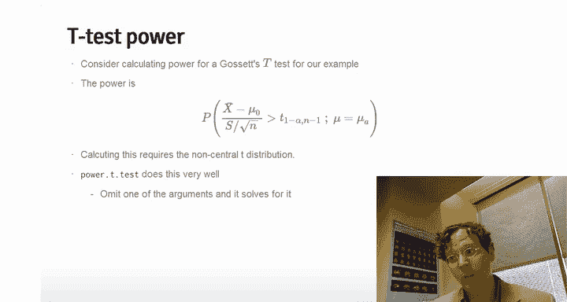
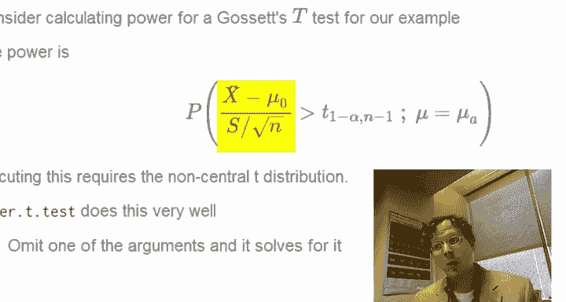
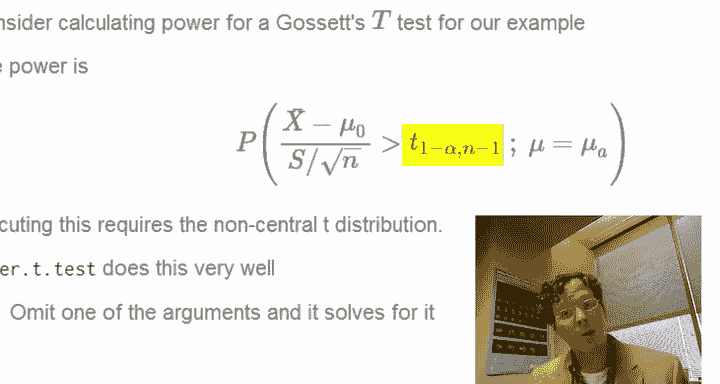
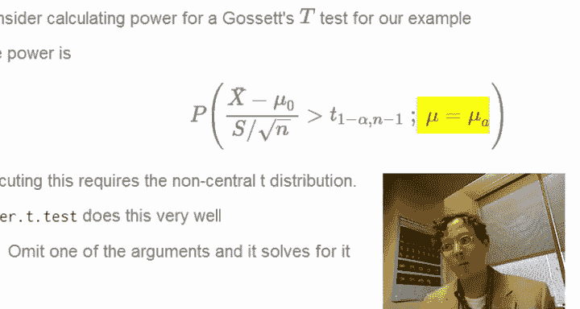
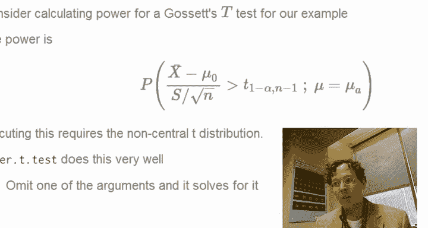
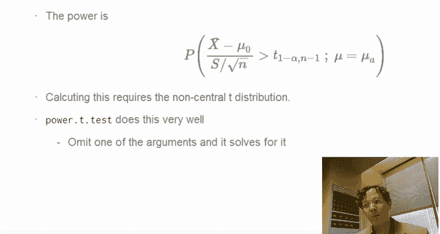
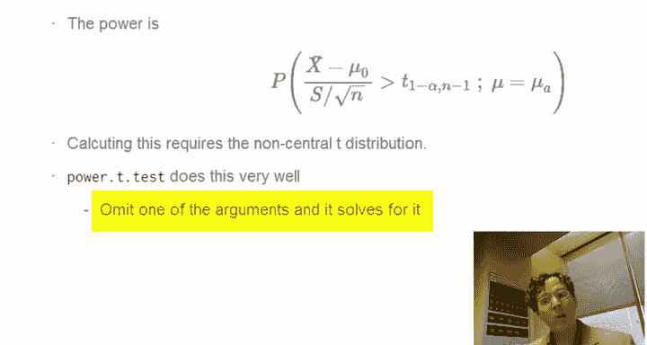
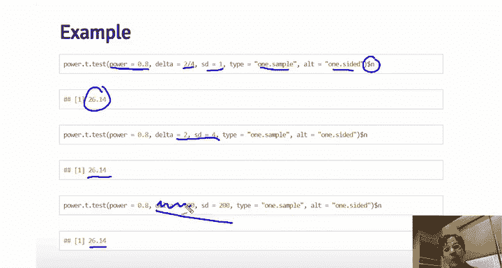

# 035：t 检验功效计算 🧮


在本节课中，我们将学习如何计算 t 检验的功效。功效是当备择假设为真时，正确拒绝原假设的概率。我们将重点介绍如何使用 R 语言中的 `power.t.test` 函数来简化计算过程，并理解其背后的核心概念。

---



## 理解 t 检验功效的计算基础

上一节我们介绍了功效的基本概念。本节中我们来看看 t 检验功效计算的特殊之处。





与之前讨论的正态分布情况不同，t 检验使用样本标准差来估计标准误。因此，我们的检验统计量服从 t 分布，而非标准正态分布。



我们拒绝原假设的规则是：当检验统计量 **`(x̄ - μ₀) / (s/√n)`** 大于某个 t 分布的分位数时。



然而，在计算功效时，我们是在备择假设 `μ = μₐ` 为真的前提下进行计算。在这种情况下，统计量 **`(x̄ - μ₀) / (s/√n)`** 不再服从标准的 t 分布，而是服从一种称为“非中心 t 分布”的分布。

计算功效需要评估这个非中心 t 分布，这正是 `power.t.test` 函数为我们完成的工作。



---

## 使用 `power.t.test` 函数



`power.t.test` 函数的设计非常直观。它涉及几个参数：原假设均值 `μ₀`、显著性水平 `α`、备择假设均值 `μₐ`、标准差 `σ` 以及样本量 `n`。

该函数的一个优点是，如果你省略其中一个参数（例如 `n` 或 `μₐ`），但指定了其他所有参数（包括你想要的功效值），它可以为你解出被省略的那个参数。

以下是使用 `power.t.test` 的几种常见场景示例。

### 示例 1：计算给定条件下的功效

首先，我们来看如何计算在特定样本量、效应量和标准差下的检验功效。

```r
# 计算功效
# delta 是 μₐ 与 μ₀ 的差值
# sd 是标准差
# n 是样本量
# 设定为单样本、单侧检验
result <- power.t.test(n = 50, delta = 0.5, sd = 1, sig.level = 0.05,
                       type = "one.sample", alternative = "one.sided")
result$power
```

运行上述代码，你可能会得到一个大约 0.6（即 60%）的功效值。

**关键点**：功效本质上取决于“效应大小”，即 **`delta / sd`**。因此，`delta=0.5, sd=1` 与 `delta=2, sd=4` 或 `delta=100, sd=200` 具有相同的效应大小（0.5），并会产生相同的功效。

### 示例 2：计算所需样本量

更常见的情况是，我们想知道需要多大的样本量才能达到预期的功效（例如 80%）。

```r
# 计算所需样本量以达到 80% 功效
result <- power.t.test(power = 0.8, delta = 0.5, sd = 1, sig.level = 0.05,
                       type = "one.sample", alternative = "one.sided")
result$n
```

函数会返回一个数值（例如 26.2）。在样本量计算中，我们应采取保守原则，**总是向上取整到最近的整数**。所以，在这个例子中，你需要 27 个样本才能有 80% 的把握检测出效应大小为 0.5 的差异。

同样，只要效应大小 `delta/sd` 相同，无论具体的 `delta` 和 `sd` 是多少，计算出的所需样本量都是相同的。

### 示例 3：计算最小可检测差异

你也可以固定样本量和期望功效，来求解能够检测到的最小差异（`delta`）。

```r
# 计算在给定样本量和功效下，能检测到的最小差异
result <- power.t.test(n = 30, power = 0.8, sd = 1, sig.level = 0.05,
                       type = "one.sample", alternative = "one.sided")
result$delta
```

这可以帮助你理解，基于你拥有的或计划收集的数据，你的检验有多敏感。

---

## 实践建议与总结

在本节课中，我们一起学习了 t 检验功效的计算原理以及如何使用 `power.t.test` 工具。

功效分析涉及许多“旋钮和刻度”（变量），很容易错误地高估功效或低估所需样本量。因此，提出以下建议：

*   **从简单开始**：在尝试复杂的功效分析之前，始终先使用 `power.t.test` 进行基本的 t 检验功效计算，或针对二项分布问题使用基本的功效计算。这能为你提供一个可能略微保守但易于理解的基础估计。
*   **理解效应大小**：牢记功效取决于标准化的效应大小（`delta/sd`），而非 `delta` 或 `sd` 的绝对值。
*   **保守取整**：计算样本量时，结果总是向上取整。



通过掌握这些基础而强大的工具，你可以为研究设计做出更明智的样本量规划，并更好地理解统计检验的检测能力。