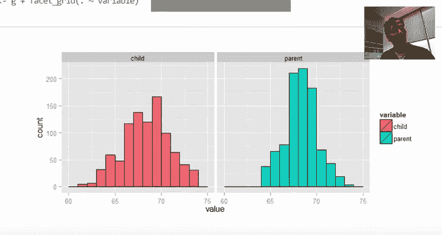
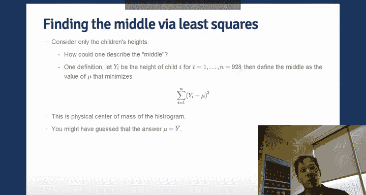
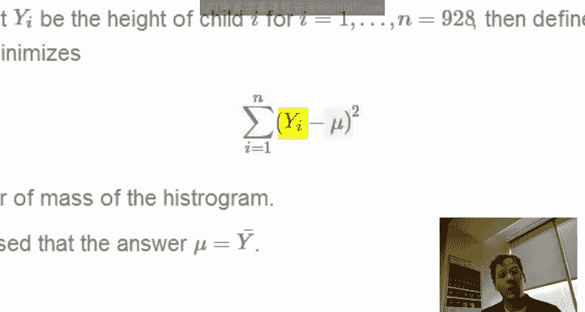
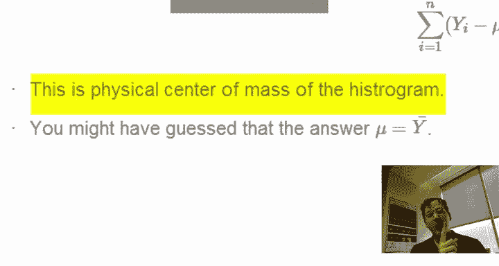
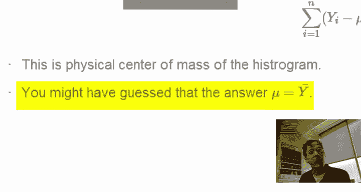
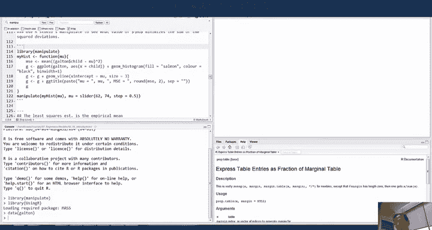
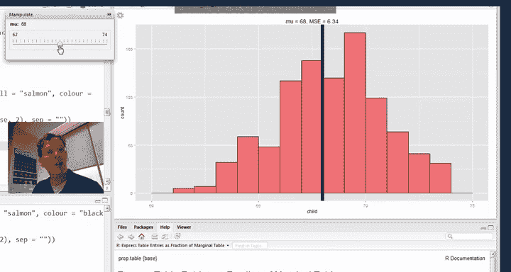
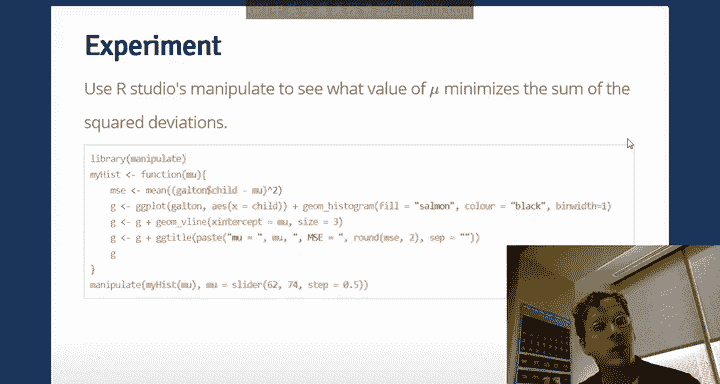
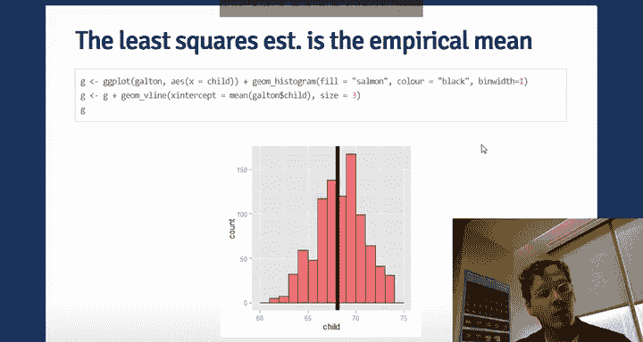

# 042：基本最小二乘法介绍 📊

在本节课中，我们将学习统计学中的一个核心概念——最小二乘法。我们将通过分析弗朗西斯·高尔顿的历史身高数据，直观地理解如何寻找数据的“中心”，并以此为基础介绍最小二乘法的基本原理。

---

## 数据背景与准备

首先，我们来看看弗朗西斯·高尔顿的数据。需要指出的是，他首次使用这些数据是在1885年。弗朗西斯·高尔顿本人是历史上一位非常有趣的人物，尤其在统计学史上，他的个性充满奇特性，发明了许多伟大的事物，当然也有一些不那么伟大的。

为了进行数据分析，我们需要在R中安装并使用 `UsingR` 包。`UsingR` 是一本优秀入门统计书籍的配套R包，它非常友好地将本书用到的所有数据集打包在一起。因此，我们需要先运行 `install.packages("UsingR")`，然后通过 `library(UsingR)` 来加载这个包，以获取我们将要讨论的许多数据集。

---

## 观察边际分布

在探讨变量间关系之前，我们先分别观察父母和子女身高的边际分布。换句话说，就是先不考虑子女去看父母身高的分布，以及不考虑父母去看子代身高的分布。

父母身高的分布是针对所有异性夫妇进行计算的，并通过将女性身高乘以1.08来校正性别差异。

以下是使用 `ggplot2` 创建的两个直方图的R命令。左侧是子女身高的直方图，X轴单位是英寸，范围从60到75英寸，Y轴是落入每个身高区间的子女数量。右侧蓝绿色直方图展示的是父母身高。这里我们通过不绘制散点图，而仅分别查看子女和父母的边际分布，暂时打破了父母与子女之间的关联。

我们将利用这些分布来引入最小二乘法的概念，之后在此基础上再建立对双变量关联的理解。

---

## 寻找数据的“中心”

现在，让我们暂时只考虑子女身高，先忘记用父母身高来预测子女身高这件事。我们只想在没有任何其他信息的情况下，找到对子女身高的最佳预测值。这个最佳预测值很可能就是数据的“中心”。那么，如何定义这个“中心”呢？

下面给出一个具体的数学定义。我会简要介绍一些符号数学，如果不喜欢数学，稍后我们会通过一个可视化的物理实验来解释。

从数学角度，设 **Y_i** 为第 **i** 个孩子的身高，其中 **i** 从1到 **N**（在这个特定数据集中，N=928，即有928个孩子）。那么，这个“中心”就是能够最小化观测数据 **Y_i** 与该值 **μ** 之间平方距离之和的那个 **μ** 值。

用公式表示，即寻找 **μ**，使得下式最小化：

这个定义也与物理学中的“质心”概念相关。如果把之前幻灯片上的直方图条形看作有质量的物理实体，那么寻找能使其平衡的那个支点，就是物理上的质心。

你可能已经猜到，答案必须是**均值**。没错，数据的中心就是均值，这确实就是答案。我们甚至会过一遍证明过程，当然，如果对此不感兴趣，可以不必担心证明细节。

---

## 可视化实验：寻找质心

让我们使用RStudio的 `manipulate` 函数来做个实验，尝试找到那个质心。

我已经加载了 `manipulate` 包和 `Galton` 数据集，并定义了一个绘制直方图的函数，它接受我们试图寻找的参数 **μ** 作为输入。

运行 `manipulate` 命令后，我可以通过滑动条调整 **μ** 值。界面上方会显示当前 **μ** 值以及对应的**均方误差**——即所有观测数据点与该 **μ** 值之间平方距离的平均值（我除以了n，得到均方误差，而不是平方和）。

当我移动滑动条时，可以观察到，随着 **μ** 接近直方图的中心，均方误差会减小。在某个位置（大约68.34英寸附近），误差似乎达到最小。如果我将 **μ** 移向两端，误差又会增大（例如移到很高时，误差可达14）。通过这样交互式地探索，你可以亲身体验到，最小化观测数据点与 **μ** 之间平方距离的点，正是使这个直方图“平衡”的点。

虽然我们知道答案就是子女身高的平均值，但通过这个实验，你可以直观地看到它确实最小化了那个函数。

---

## 代码与资源

这里再次给出了相关代码。需要提醒大家的是，本专业所有课程讲稿均以R Markdown格式提供。你可以找到一个名为 `index.Rmd` 的文件，其中嵌入了所有课程的全部R代码，方便查阅和学习。

---

## 结论：最小二乘估计即样本均值

这里再次重申，**最小二乘估计就是经验均值（样本均值）**。下图直观地展示了这个均值的位置，并附上了用于创建相同图形的 `ggplot2` 命令。

用公式表示，对于一组数据 **Y_1, Y_2, ..., Y_n**，其最小二乘估计的中心值 **μ_hat** 为：
**μ_hat = (1/n) * Σ_{i=1}^{n} Y_i**

---

## 总结

本节课中，我们一起学习了最小二乘法的基本思想。我们从弗朗西斯·高尔顿的身高数据出发，首先观察了单变量的边际分布。然后，我们定义了通过最小化平方误差和来寻找数据“中心”的方法，并发现这个“中心”就是数据的**样本均值**。最后，我们通过一个交互式实验直观验证了这一结论。这为后续学习如何利用一个变量（如父母身高）通过最小二乘法来预测另一个变量（如子女身高）奠定了重要基础。

