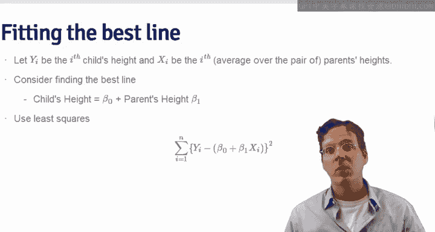
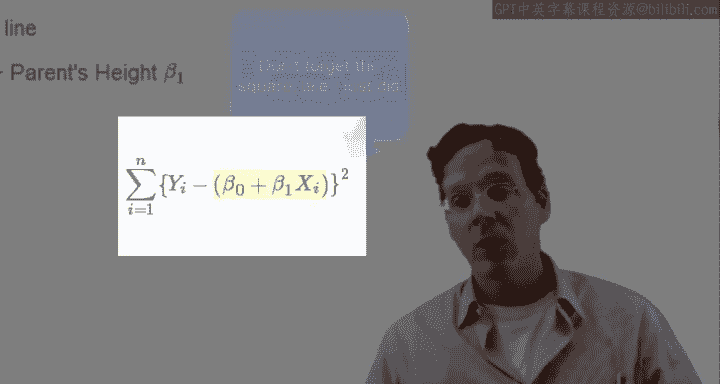
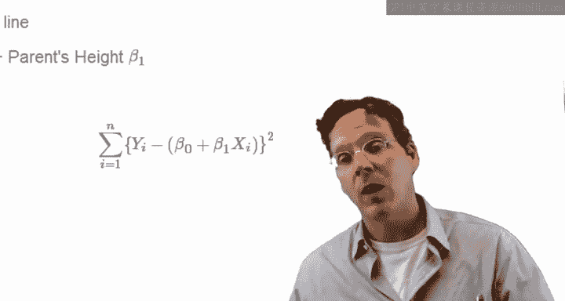
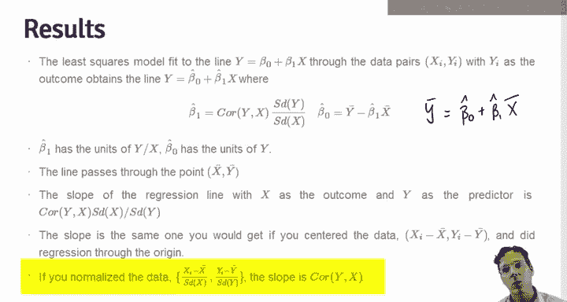

# 046：线性最小二乘法 📈

在本节课中，我们将学习线性回归的核心方法——最小二乘法。我们将了解如何通过最小化误差平方和来找到数据的最佳拟合直线，并推导出斜率和截距的估计公式。

---

## 概述

线性回归旨在用一条直线来描述两个变量之间的关系。本节将介绍如何通过最小二乘法找到这条“最佳”直线，并解释其数学原理和几何意义。

---

## 最小二乘法的基本思想

上一节我们介绍了线性回归模型的基本形式。本节中我们来看看如何确定模型中的参数。

考虑高尔顿数据中父母身高与子女身高的散点图。我们希望用父母身高（X）来解释子女身高（Y），模型为：
`Y_i = β_0 + β_1 * X_i + ε_i`
其中，`β_0` 是截距，`β_1` 是斜率，`ε_i` 是误差项。

我们需要一个标准来定义“最佳”拟合线。最小二乘法的标准是：**最小化所有数据点的垂直距离（残差）的平方和**。

其数学表达式为：
`min Σ [Y_i - (β_0 + β_1 * X_i)]^2`

这个公式的含义是，我们寻找使预测值 `(β_0 + β_1 * X_i)` 与实际观测值 `Y_i` 之间差异的平方和最小的 `β_0` 和 `β_1`。

---

## 最小二乘法的几何解释

为了更好地理解最小二乘法，我们通过一张图来看它的工作原理。

假设我们有一个数据集和一条拟合直线。对于每一个数据点 `(X_i, Y_i)`：
*   该点的垂直距离（残差）是 `Y_i - (β_0 + β_1 * X_i)`。
*   这个距离可正可负，因此我们将其平方，使所有误差都变为正数。
*   最小二乘法就是找到一条直线，使得所有这些平方距离的总和最小。

每个数据点对总误差的贡献是平等的。通过最小化这个总误差，我们就得到了数据的最佳线性拟合。

---

## 最小二乘估计的解

当我们求解上述最小化问题时，可以得到斜率和截距的估计值。

拟合的直线方程为：`Ŷ = β̂_0 + β̂_1 * X`
其中，`β̂_1` 和 `β̂_0` 是估计值。

它们的计算公式如下：
*   **斜率 `β̂_1`**：`β̂_1 = Cor(Y, X) * (S_y / S_x)`
    *   `Cor(Y, X)` 是 Y 和 X 的相关系数。
    *   `S_y` 是 Y 的标准差。
    *   `S_x` 是 X 的标准差。
*   **截距 `β̂_0`**：`β̂_0 = Ȳ - β̂_1 * X̄`
    *   `Ȳ` 是 Y 的均值。
    *   `X̄` 是 X 的均值。

---

## 解的性质与讨论

根据上述公式，我们可以推导出最小二乘估计的几个重要性质。

以下是关于解的几个关键点：

1.  **斜率的单位**：斜率 `β̂_1` 的单位是 Y 的单位除以 X 的单位。这符合“斜率=ΔY/ΔX”的直观理解。
2.  **均值点**：拟合直线必然通过数据的中心点 `(X̄, Ȳ)`。从截距公式 `Ȳ = β̂_0 + β̂_1 * X̄` 可以直接看出。
3.  **角色互换**：如果将 X 和 Y 的角色互换（用 Y 预测 X），得到的斜率将是 `Cor(X, Y) * (S_x / S_y)`，这与用 X 预测 Y 的斜率不同。
4.  **数据中心化**：如果先将数据中心化（即每个值减去其均值），再拟合一条通过原点的直线，得到的斜率与原始数据的斜率 `β̂_1` 相同。
5.  **数据标准化**：如果先将数据标准化（中心化并除以标准差，使标准差为1），那么斜率 `β̂_1` 就等于相关系数 `Cor(Y, X)`。

---

## 总结

本节课我们一起学习了线性回归中的最小二乘法。
我们首先定义了“最佳”拟合线的标准——最小化残差平方和。
然后，我们通过几何图示直观地理解了这个过程。
最后，我们推导并解释了斜率和截距估计值的计算公式 `β̂_1 = Cor(Y, X) * (S_y / S_x)` 和 `β̂_0 = Ȳ - β̂_1 * X̄`，并讨论了该解的几个重要数学性质。
最小二乘法为理解变量间的线性关系提供了一个强大而清晰的基础框架。