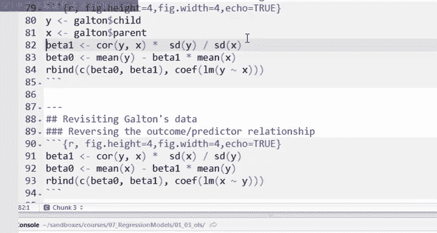
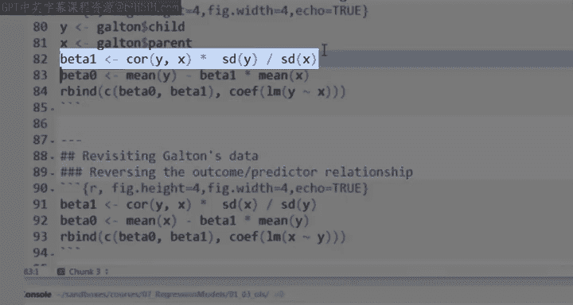
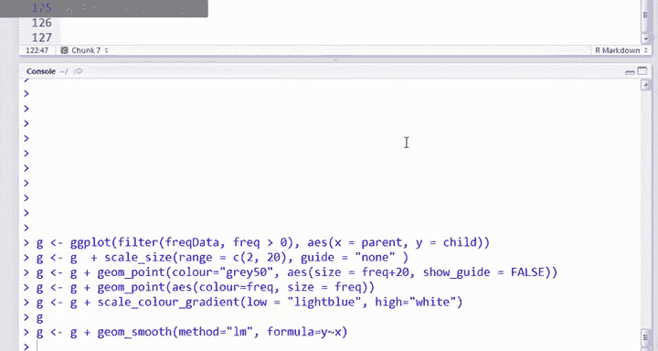

# 047：线性最小二乘法编码示例 📊

在本节课中，我们将通过一个具体的R语言编码示例，学习如何实现线性最小二乘法。我们将使用高尔顿父母与子女身高数据集，从数据可视化开始，逐步计算回归系数，并将其与R内置函数的结果进行比较，最后学习如何在图形中添加回归线。

---

## 数据可视化

首先，我们加载并绘制将要分析的数据。这里使用的是高尔顿的父母身高与子女身高数据。

以下是绘制散点图的代码：

```r
library(ggplot2)
# 假设数据已加载到名为 Galton 的数据框中
g <- ggplot(Galton, aes(x = parent, y = child)) +
  geom_point()
print(g)
```

运行上述代码，我们将得到父母身高与子女身高的散点图，这是我们分析的起点。

---

## 手动计算回归系数



上一节我们绘制了数据，本节中我们来看看如何手动计算线性回归的斜率和截距。

根据公式，斜率 \(\beta_1\) 和截距 \(\beta_0\) 的计算方法如下：



**斜率公式：**
\[
\beta_1 = Cor(Y, X) \times \frac{Sd(Y)}{Sd(X)}
\]

**截距公式：**
\[
\beta_0 = \bar{Y} - \beta_1 \times \bar{X}
\]

以下是具体的R代码实现：

```r
# 为方便起见，定义变量
y <- Galton$child
x <- Galton$parent

# 计算斜率 beta1
beta1 <- cor(y, x) * (sd(y) / sd(x))

# 计算截距 beta0
beta0 <- mean(y) - beta1 * mean(x)

# 输出结果
c(beta0, beta1)
```

运行代码后，我们将得到手动计算的回归系数。

---

## 与R内置函数对比

手动计算的结果是否正确？我们可以使用R内置的 `lm()` 函数进行验证。

以下是使用 `lm()` 函数进行线性回归的代码：

```r
# 使用lm函数拟合线性模型
fit <- lm(child ~ parent, data = Galton)

# 提取系数
coefficients(fit)
```

我们将看到，`lm()` 函数返回的系数与我们手动计算的结果完全一致，这验证了我们公式和计算的正确性。

---

## 探讨变量关系反转

一个有趣的问题是，如果我们将X和Y的角色互换，公式是否依然成立？本节我们来验证这一点。

当我们将父母身高作为因变量（Y），子女身高作为自变量（X）时，斜率公式变为：
\[
\beta_1^{reverse} = Cor(Y, X) \times \frac{Sd(X)}{Sd(Y)}
\]
截距公式相应调整为：
\[
\beta_0^{reverse} = \bar{X} - \beta_1^{reverse} \times \bar{Y}
\]

以下是验证代码：

```r
# 反转X和Y的角色
beta1_rev <- cor(y, x) * (sd(x) / sd(y))
beta0_rev <- mean(x) - beta1_rev * mean(y)

# 使用lm函数拟合反转后的模型
fit_rev <- lm(parent ~ child, data = Galton)

# 对比结果
c(beta0_rev, beta1_rev)
coefficients(fit_rev)
```

运行代码后，我们会发现两种方法得到的斜率依然相同，这证明了公式的普适性。

---

## 中心化与过原点回归

在讲座中曾提到，如果先将Y和X中心化（减去各自的均值），那么过原点回归的斜率将与带截距的线性回归斜率相同。

以下是验证这一点的步骤：

首先，我们需要将数据中心化。

```r
# 中心化Y和X
y_centered <- y - mean(y)
x_centered <- x - mean(x)
```

接着，我们计算过原点回归的斜率。其公式为：
\[
\beta_1^{origin} = \frac{\sum{(Y_i \times X_i)}}{\sum{X_i^2}}
\]

```r
# 计算过原点回归的斜率
beta1_origin <- sum(y_centered * x_centered) / sum(x_centered^2)
beta1_origin
```

最后，我们将其与使用中心化数据、但强制截距为0的 `lm()` 拟合结果进行比较。

```r
# 使用lm进行过原点回归（两种等效方法）
fit_origin1 <- lm(y_centered ~ x_centered - 1)
fit_origin2 <- lm(child ~ parent, data = Galton) # 标准回归的斜率与之相同

# 提取斜率进行比较
coefficients(fit_origin1)
coefficients(fit_origin2)[2] # 取第二个系数，即斜率
```

我们将看到，所有方法得到的斜率估计值都是一致的。

---

## 标准化与相关系数

另一个要点是，如果将Y和X标准化（均值为0，标准差为1），那么回归斜率就等于二者的相关系数。

以下是验证过程：

首先，我们对Y和X进行标准化。

```r
# 标准化Y和X
y_normalized <- (y - mean(y)) / sd(y)
x_normalized <- (x - mean(x)) / sd(x)

# 验证标准差是否为1
sd(y_normalized)
sd(x_normalized)
```

然后，我们比较三者的值：
1.  原始Y和X的相关系数。
2.  标准化后Y和X的相关系数。
3.  用标准化数据拟合线性回归得到的斜率。

```r
# 比较三个值
c(cor(y, x),
  cor(y_normalized, x_normalized),
  coefficients(lm(y_normalized ~ x_normalized))[2])
```

运行代码后，我们会发现这三个数值完全相同，这直观地展示了标准化后斜率与相关系数的等价关系。

---

## 在图形中添加回归线

最后，我们学习如何将计算出的回归线添加到之前的散点图上，这能帮助我们直观地理解模型与数据的拟合情况。

使用 `ggplot2` 可以非常便捷地实现这一点。以下是添加回归线及置信区间的代码：



```r
# 在之前的散点图g上添加回归线
g_with_line <- g + geom_smooth(method = "lm", formula = y ~ x)
print(g_with_line)
```

`geom_smooth(method = “lm”)` 会自动使用线性模型拟合数据并绘制回归线，同时还会生成该回归线的置信区间带（默认显示），这很好地体现了统计中的不确定性。我们将在后续课程中讨论置信区间的生成原理。

---

## 总结

本节课中我们一起学习了线性最小二乘法的完整编码实现。我们从**数据可视化**开始，然后**手动计算**了回归系数，并通过与R内置的 `lm()` 函数对比验证了其正确性。我们还探讨了**变量关系反转**、**数据中心化与过原点回归**以及**数据标准化与相关系数**的关系。最后，我们掌握了如何在 `ggplot2` 图形中**添加回归线**及其置信区间。通过这个具体的例子，我们巩固了对线性回归模型计算和应用的实践理解。