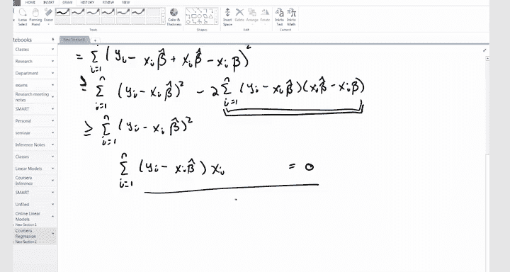
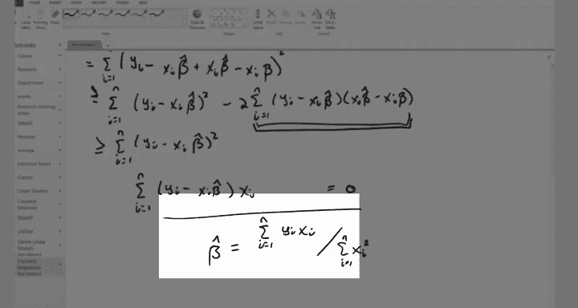
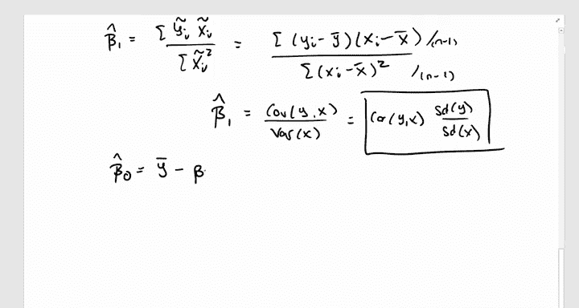

# 048：线性回归斜率公式推导详解

在本节课中，我们将深入探讨线性回归斜率估计公式的数学推导过程。我们将从回归过原点这一简化模型入手，逐步推导出一般线性回归的斜率公式，并最终展示其与相关系数、标准差之间的关系。

---

## 🔍 回归过原点的推导

上一节我们介绍了线性回归的基本概念，本节中我们来看看如何推导回归过原点的斜率估计公式。假设我们希望拟合一条形式为 **y = xβ** 的直线，使其通过数据点 **(x₁, y₁) 到 (xₙ, yₙ)**。

我们的目标是最小化以下最小二乘准则：

**∑ (yᵢ - xᵢβ)²**，其中求和从 **i = 1** 到 **n**。

令 **β̂** 为该最小化问题的解。为了找到 **β̂**，我们对准则进行如下变换：

**∑ [yᵢ - xᵢβ]² = ∑ [ (yᵢ - xᵢβ̂) + (xᵢβ̂ - xᵢβ) ]²**

展开平方项并分配求和符号，我们得到：

**∑ (yᵢ - xᵢβ̂)² - 2∑ (yᵢ - xᵢβ̂)(xᵢβ̂ - xᵢβ) + ∑ (xᵢβ̂ - xᵢβ)²**

如果 **β̂** 能使中间项为零，那么对于任何其他 **β** 值，其对应的最小二乘准则值都将大于或等于 **β̂** 对应的值。因此，**β̂** 就是我们要找的最小化解。

我们需要解以下方程：

**∑ (yᵢ - xᵢβ̂) * xᵢ * (β̂ - β) = 0**

由于 **(β̂ - β)** 与 **i** 无关，我们可以将其从方程两边消去。解这个方程，我们得到 **β̂** 的表达式：

**β̂ = (∑ yᵢxᵢ) / (∑ xᵢ²)**

这就是回归过原点模型的斜率估计公式。

---

## 📈 从特例到一般线性回归

在理解了回归过原点的推导后，我们现在可以将其应用于一般线性回归。一般线性回归的模型形式为：

**y = β₀ + β₁x**

我们的目标是最小化准则：

**∑ (yᵢ - β₀ - β₁xᵢ)²**

首先，我们假设 **β₁** 是已知的固定值。那么，准则可以重写为：

**∑ [ (yᵢ - β₁xᵢ) - β₀ ]²**

这可以看作是以 **yᵢ* = yᵢ - β₁xᵢ** 为结果变量的均值回归问题。我们知道，这个问题的解是 **β₀** 等于 **yᵢ*** 的平均值，即：

**β₀ = ȳ - β₁x̄**

这个关系表明，拟合的回归线必须穿过点 **(x̄, ȳ)**。

将 **β₀** 的这个表达式代回原准则，我们得到：

**∑ [ (yᵢ - ȳ) - β₁(xᵢ - x̄) ]²**

现在，我们定义中心化的变量：**ỹᵢ = yᵢ - ȳ** 和 **x̃ᵢ = xᵢ - x̄**。那么准则变为：

**∑ (ỹᵢ - β₁x̃ᵢ)²**

这恰好是一个回归过原点的问题，其中结果变量是 **ỹᵢ**，预测变量是 **x̃ᵢ**。根据我们之前推导的公式，**β₁** 的最小二乘估计为：

**β₁̂ = (∑ ỹᵢ x̃ᵢ) / (∑ x̃ᵢ²)**

将中心化变量的定义代入，我们得到：

**β₁̂ = [ ∑ (yᵢ - ȳ)(xᵢ - x̄) ] / [ ∑ (xᵢ - x̄)² ]**

---

## 🧮 最终公式的转换

上述表达式可以进一步转换。分子是 **y** 和 **x** 的样本协方差，分母是 **x** 的样本方差。因此，我们可以写出：

**β₁̂ = Cov(y, x) / Var(x)**

此外，我们知道样本相关系数 **r** 的定义为：

**r = Cov(y, x) / (s_y * s_x)**

其中 **s_y** 和 **s_x** 分别是 **y** 和 **x** 的样本标准差。因此，我们可以将 **β₁̂** 表示为：

**β₁̂ = r * (s_y / s_x)**

这就是我们最终要证明的公式。而截距 **β₀̂** 则由下式给出：

**β₀̂ = ȳ - β₁̂ x̄**

---

## ✅ 总结

本节课中我们一起学习了线性回归斜率估计公式的完整推导过程。我们从回归过原点这一简化模型开始，推导出其斜率估计公式。然后，通过将一般线性回归问题转化为中心化变量的回归过原点问题，我们最终证明了斜率估计 **β₁̂** 等于 **y** 和 **x** 的相关系数乘以 **y** 的标准差与 **x** 的标准差之比，即 **β₁̂ = r * (s_y / s_x)**。这个推导过程清晰地展示了线性回归中几个核心统计量之间的内在联系。