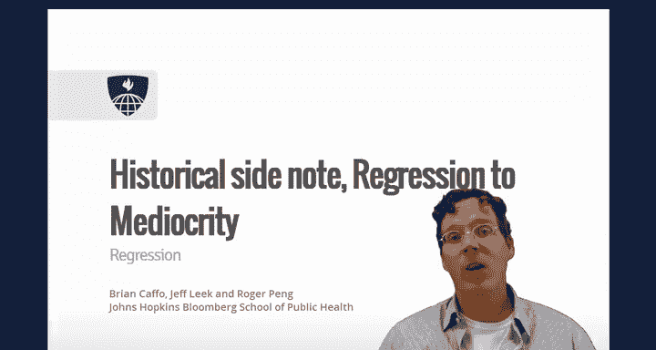
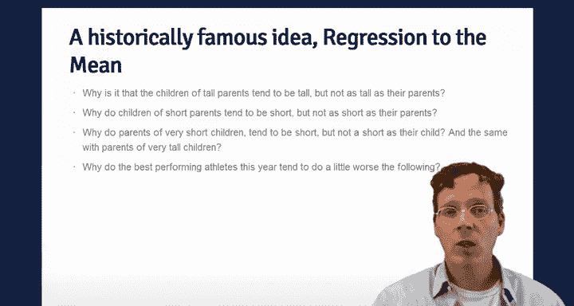
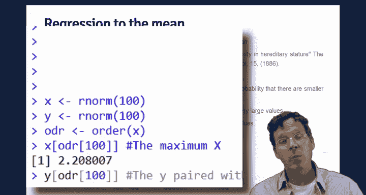
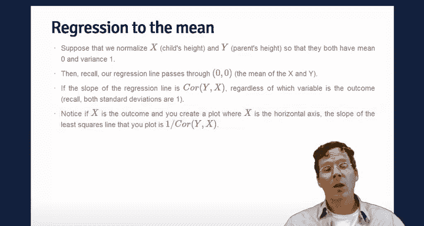
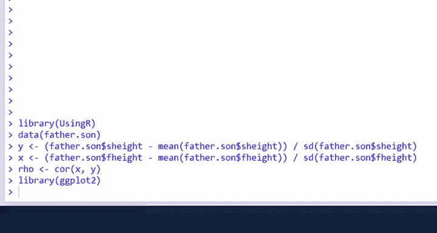
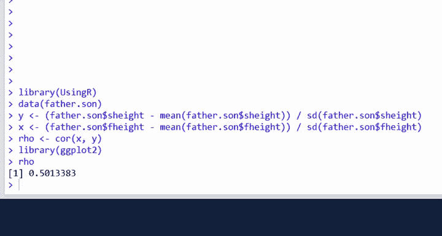
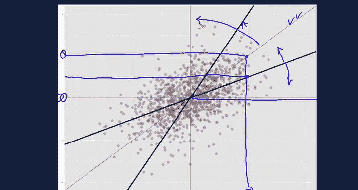

# 049：回归到均值

在本节课中，我们将学习“回归到均值”这一重要概念。回归到均值是回归分析发展史上的一个里程碑，由弗朗西斯·高尔顿发现。我们将探讨其含义、常见例子，并通过数据可视化来理解其量化方式。

---

## 🧬 回归到均值的发现与含义

上一节我们提到了回归到均值的历史地位。本节中，我们来看看它的具体含义。

回归到均值探讨的问题包括：为什么非常高的父母所生的孩子也往往很高，但通常没有父母那么高？为什么非常矮的父母所生的孩子也往往很矮，但通常没有父母那么矮？同样，我们也可以从父母的角度提问：为什么非常矮的孩子的父母也往往较矮，但通常没有孩子那么矮？为什么非常高的孩子的父母也往往较高，但通常没有孩子那么高？

这种现象在讨论运动员表现时也经常出现。某年表现最佳的运动员次年表现往往会稍差一些，而某年表现最差的运动员次年表现往往会稍好一些。股票市场也常被如此讨论。一些表现最佳的股票往往会下跌。

我们将探讨这种现象的原因，并区分其是内在因素还是回归到均值效应，这是一个重要问题。

---

## 📈 回归到均值的例子与思考

这些现象都是所谓的“回归到均值”的例子。正如上一张幻灯片提到的，回归到均值由弗朗西斯·高尔顿在其著名论文《遗传身高的回归平庸性》中提出。

我喜欢通过考虑100%回归到均值的极端情况来理解这个概念。

想象我模拟生成两对独立的标准正态分布随机变量。在我生成的第一组标准正态随机变量中，如果我取最大值，那么它在第二组中的配对值更小的概率会很高。

这简单地说明了，给定一个非常大的X值，Y小于X的概率会随着X趋向于非常大的值而增大。换句话说，给定一个非常小的X值，Y大于X的概率会随着X趋向于非常小的值而增大。

然而，在大多数情况下，是内在因素和噪声的混合。例如，如果我给班上每个学生进行两次非常难的测验。表现最好的学生很可能确实更懂材料。但是，测验是不完美的工具，测验本身会包含很多误差，即存在噪声。因此，表现最好的学生可能确实比别人更懂一点材料，但也可能受益于一些噪声，所以在第二次测验中，他们的表现可能会稍差一些（可能仍然很好，但稍差）。表现最差的学生情况类似。

思考体育讨论中有多少内容实际上只是在谈论回归到均值，这常常很有趣。一个棒球运动员某年的打击率非常高，次年往往会稍低一些。这仅仅是回归到均值吗？如果能找到量化它的方法就好了。这正是弗朗西斯·高尔顿在首次处理回归到均值时用回归所做的事情。

---

## 🔍 如何量化回归到均值

上一节我们介绍了回归到均值的现象。本节中，我们来看看弗朗西斯·高尔顿如何使用回归，特别是相关系数（我们知道它与线性回归密切相关）来量化回归到均值。我们将主要通过一张图来理解，但在展示R代码之前，我想先设置好这张图。

在这个案例中，我的X将是孩子的身高，Y将是父母的身高。我将使用一个数据集，其中父母是单亲，即父亲。这些数据中的Y和X都已标准化，因此均值为0，方差为1。我们现在应该对此非常熟悉了。

回顾一下，如果我已经这样做了，那么我的回归线将通过点(0,0)。并且，无论孩子的身高是结果变量还是父母的身高是结果变量，斜率现在都简单地等于相关系数。

我还想提一下创建图表时的一个小技巧：如果X是结果变量，而你恰好将结果变量绘制在横轴上，那么你绘制的直线的斜率需要是1除以相关系数。这只是因为我将结果变量绘制在了X轴上，所以如果你对代码感到困惑，请记住这一点。

---

## 💻 代码实现与可视化

让我们来看代码，然后一旦得到我要展示的图，我们将通过图的不同部分来讨论如何通过观察相关系数量化回归到平庸性。

以下是创建图表的代码步骤：

1.  数据集位于`UsingR`库中，名为`father.son`。
2.  我将定义Y为儿子的身高，但会减去均值并除以标准差。
3.  我将定义X为父亲的身高，并进行同样的处理。现在X和Y都应该均值为0，方差为1，你可以自行检查。
4.  `ρ`（rho）是我们用来表示相关系数的标准希腊字母，因此我将`rho`定义为X和Y之间的相关系数。
5.  我需要加载`ggplot2`库。

在展示图表之前，让我们检查几件事。

相关系数`rho`计算结果约为0.5。因此，父亲身高和儿子身高之间的相关系数是0.5。

现在回到代码，我将创建我的图表。我将创建一个`ggplot`对象并赋值给变量`g`。我会添加点，但我会以背景为黑色、前景为鲑鱼色的方式添加，并且使用alpha混合使点变得半透明。我希望X轴和Y轴的范围都是-4到+4，并且希望坐标轴相同。我知道-4到+4应该几乎能涵盖所有数据。例如，标准正态分布在-4以下或+4以上的概率极低，切比雪夫定理也有助于说明这一点。如果你上过推断课程，你会知道一个标准化随机变量的-4到+4范围已经相当深入尾部了。

在添加更多图层之前，我先展示这个基础散点图。然后，我将添加一条作为基准的恒等线（y=x）。接着，我将添加横轴和纵轴。现在，我有了两个坐标轴。

接下来，我将创建两条回归线。第一条线，我将儿子的身高作为结果变量，父亲的身高作为预测变量。第二条线，我将儿子的身高作为预测变量，父亲的身高作为结果变量。当然，正如上一张幻灯片讨论的，坐标轴是旋转的，因此第二条线的斜率需要是`1/rho`。我已经将拟合线的宽度加倍以便观察。

---

## 📊 从图中理解回归到均值

现在，让我们利用这张图来讨论回归到均值。

如果观测值完美地落在一条线上，那么在这张图上，它必须是恒等线，因为我们已经将X和Y都标准化了。它们会恰好落在这条恒等线上。提醒一下，父亲的身高被绘制为X变量，儿子的身高被绘制为Y变量。

所以，如果我们有一个父亲身高为2（代表比父亲平均身高高2个标准差），并且没有噪声，我们将预测儿子的身高也为2（代表比儿子平均身高高2个标准差）。然而，当我们看数据时，存在很多噪声。

因此，现在的预测值不是2，而是在回归线上这里。由于我们的设置方式，这简单地等于2乘以斜率，即相关系数。现在预测值落在这里，介于2和0之间。实际上，它正好等于2乘以相关系数。这就是回归到均值。这种乘法关系就是弗朗西斯·高尔顿测量回归到均值的方式。

这条相关系数线向水平线“收缩”的程度，就给出了回归到均值的程度。如果我们讨论没有噪声的情况，这条线将完美地落在恒等线上。考虑全是噪声的情况，父亲身高对儿子身高没有任何信息，那么相关系数将为0，这条线将正好在水平轴上。那么，如果你必须根据父亲身高来预测儿子身高，你最终总会得到0的预测值。所以，这种现象就是回归到均值。

当然，我们也可以将其翻转过来考虑。如果我们把儿子的身高作为预测变量，父亲的身高作为结果变量，你可以在这张图上可视化这一点，因为我基本上已经通过这条线展示了那个图。回归到均值在这里表现为它向纵轴“收缩”的程度。

这是一个相当巧妙的想法。我认为这是导致我们现在所认为的现代回归的基本思想之一。然而，回归到均值的概念在统计学中仍然占有重要地位，例如，在研究纵向数据时，思考回归到均值的概念非常重要。

---

## 🎯 课程总结

本节课中，我们一起学习了“回归到均值”这一核心概念。我们了解了它的历史背景、常见生活实例，并通过父亲与儿子身高的数据案例，使用相关系数和回归线可视化地理解了如何量化回归到均值。关键在于认识到，当两个变量存在相关但并非完全相关（相关系数小于1）时，对极端值的预测会向平均值方向“收缩”，收缩的程度由相关系数决定。这是理解许多自然和社会现象中观察到的“趋中”趋势的重要统计视角。