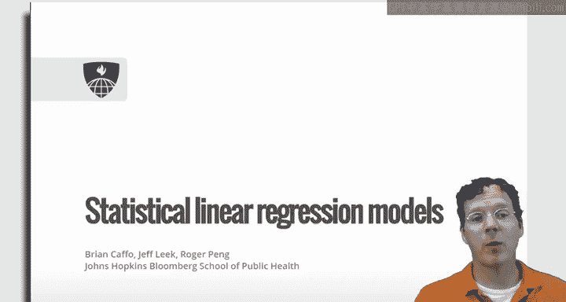
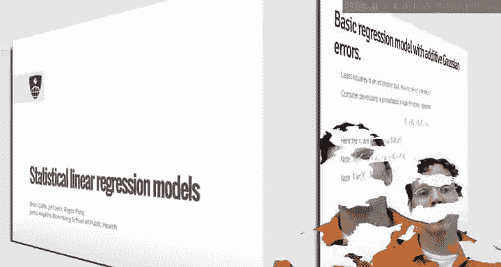
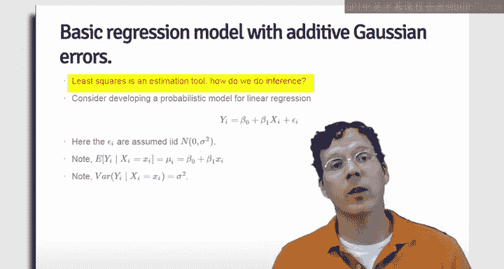
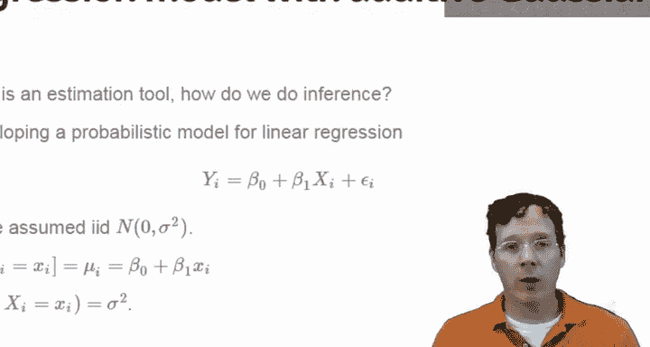
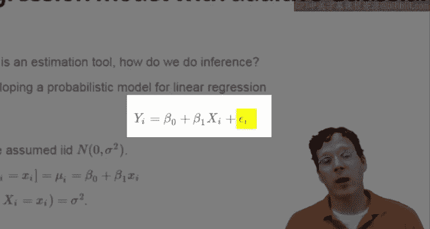
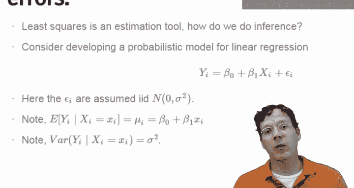

# 050：统计线性回归模型 📊

在本节课中，我们将学习如何为线性回归构建统计模型，以便从数据中得出推断并推广到总体。我们将介绍概率模型、误差假设以及如何估计模型参数。

---

上一节我们介绍了使用最小二乘法寻找回归线的数学过程。本节中，我们将探讨如何为线性回归建立统计模型，以便进行统计推断。

## 概率模型

我们考虑一个简单的线性回归概率模型。模型设定如下：

**公式：**  
`Yi = β₀ + β₁Xi + εi`

其中：
- `Yi` 是响应变量。
- `β₀` 和 `β₁` 是未知的总体参数，我们需要估计它们。
- `Xi` 是已知的解释变量。
- `εi` 是独立同分布的高斯误差项，假设 `εi ~ N(0, σ²)`。

## 误差项解释

误差项 `εi` 可以理解为许多未建模变量的累积效应，这些变量共同作用于响应变量，其效果可以建模为独立同分布的高斯误差。目前，我们暂时搁置这些复杂的解释问题，专注于回归统计推断的机械过程。

## 期望与方差

给定解释变量 `Xi` 的特定值，响应变量 `Yi` 的期望值为回归线在该点的值：

**公式：**  
`E[Yi | Xi] = β₀ + β₁Xi`

响应变量 `Yi` 在给定 `Xi` 的条件下的方差为 `σ²`：

**公式：**  
`Var(Yi | Xi) = σ²`

需要注意的是，这里的方差是围绕回归线的方差，而不是响应变量本身的总体方差。通过条件于 `Xi`，我们解释了一部分变异，因此条件方差通常小于响应变量的边际方差。

此外，期望值和方差都是总体量。我们将通过样本数据来估计它们，但这些是我们真正希望了解的总体参数。

---

本节课中，我们一起学习了线性回归的统计模型基础，包括概率模型的设定、高斯误差项的假设，以及响应变量的条件期望和方差。这些概念为后续的参数估计和统计推断奠定了基础。