# 052：用于预测的线性回归 📈

在本节课中，我们将学习如何利用线性回归模型进行预测。我们将通过一个具体的钻石价格数据集案例，详细解读回归系数，并演示如何使用R语言生成预测值。

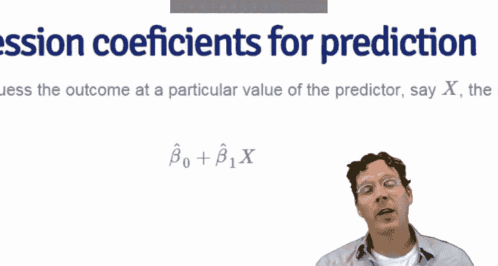

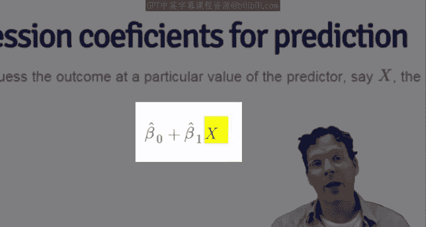

---

## 概述

线性回归不仅用于描述变量间的关系，更是一个强大的预测工具。通过拟合的回归方程，我们可以输入新的预测变量值，从而得到对应的结果变量预测值。

上一节我们介绍了线性回归的基本概念，本节中我们来看看如何具体应用它进行预测和解释。

---

## 预测的基本公式

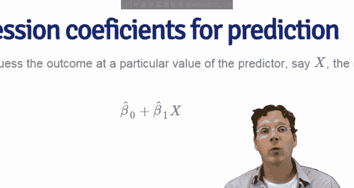

我们可以通过以下公式获得Y的预测值：取估计的截距 \(\hat{\beta_0}\) 加上估计的斜率 \(\hat{\beta_1}\)，再乘以我们想要预测的X值。

**预测公式**：
\[
\hat{Y} = \hat{\beta_0} + \hat{\beta_1} X
\]

如果我们代入观测到的X值，就会得到拟合值。这些拟合值是我们试图使其尽可能接近观测数据的值。

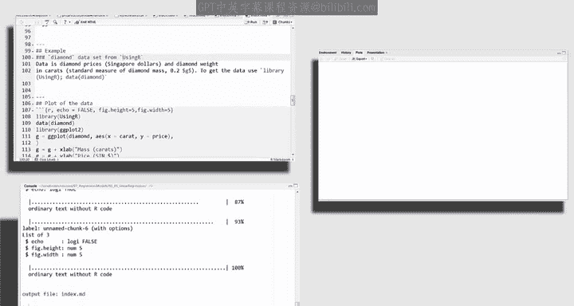

但这并不意味着我们只能在拟合值处进行预测。我们可以将任何我们想要预测的X值代入方程。

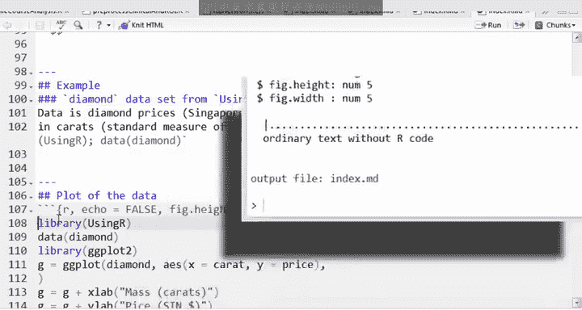

然而，如果我们代入的X值位于用于构建模型的数据范围内，预测将更为合理。稍后我们还将讨论如何使用**预测区间**来量化这类不确定性。

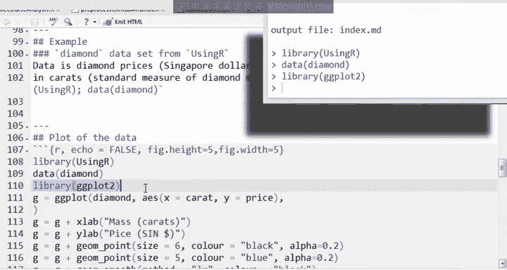

目前，我们先讨论如何获得预测值。在接下来的几张幻灯片中，我们将通过一个具体的回归建模案例来解读截距、斜率并生成预测。

---

## 案例：钻石价格分析

现在，让我们通过一些代码来解读回归系数，并实时展示回归系数的运行过程。数据集来自`UsingR`包中的钻石数据集。数据包含钻石价格（新加坡元）和钻石重量（克拉）。

### 加载数据与绘图

以下是加载数据并创建散点图的步骤：

1.  加载必要的R包和数据。
2.  使用`ggplot2`创建散点图并添加回归线。

```r
# 加载UsingR包和钻石数据集
library(UsingR)
data(diamond)

# 加载ggplot2用于绘图
library(ggplot2)

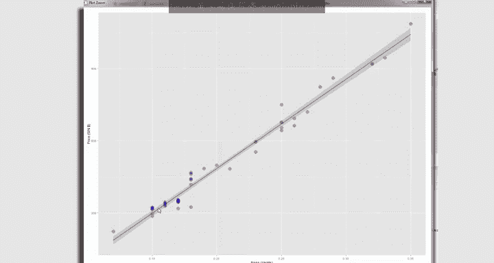

# 创建散点图基础图层
g <- ggplot(data = diamond, aes(x = carat, y = price)) +
  xlab("Mass (carats)") +
  ylab("Price (Singapore dollars)")

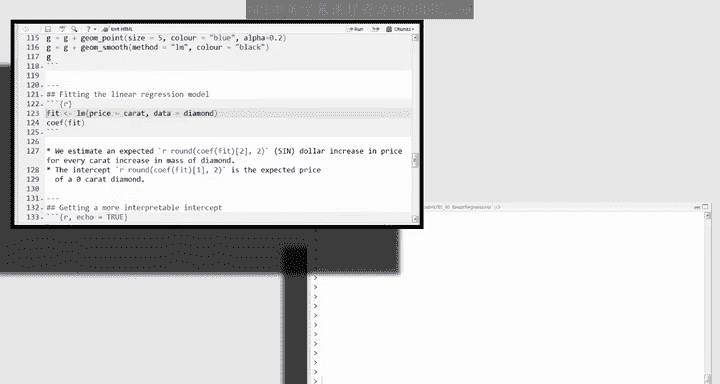

# 添加数据点
g <- g + geom_point(colour = "black", alpha = 0.2)

# 添加线性回归线
g <- g + geom_smooth(method = "lm", colour = "black")

# 显示图形
print(g)
```

生成的图形中，X轴是质量（克拉），Y轴是价格。图中的直线是拟合线，即最小化所有点到该线垂直距离平方和的那条线。

### 拟合回归模型

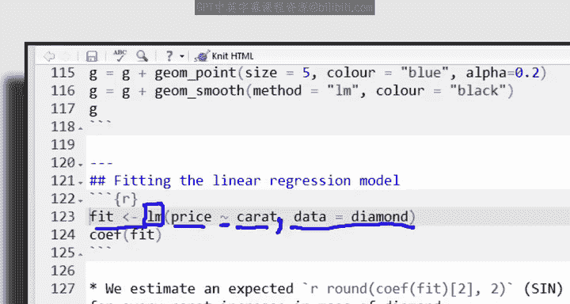

现在，让我们实际拟合回归线。`lm`函数是R的线性模型程序，回归是它的一个特例。

```r
# 拟合线性回归模型：价格 ~ 克拉
fit <- lm(price ~ carat, data = diamond)

# 查看模型拟合的系数
print(fit)

# 获取更详细的模型摘要
summary(fit)

# 直接提取系数向量
coef(fit)
```

运行`coef(fit)`会得到一个向量，其中包含标记为`(Intercept)`的截距和`carat`变量的斜率。

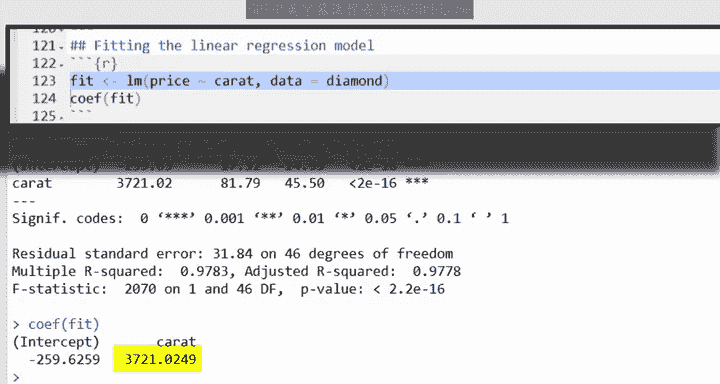

### 解读回归系数

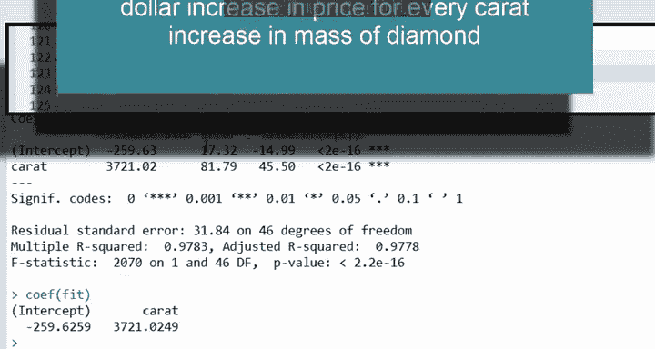

观察系数，斜率约为3721。这意味着，**钻石质量每增加1克拉，我们预计其价格将增加3721新加坡元**。

截距约为-259。这**代表一颗0克拉钻石的预期价格**。这个解释通常不具实际意义，因为我们不关心0克拉的钻石。

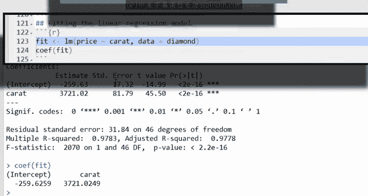

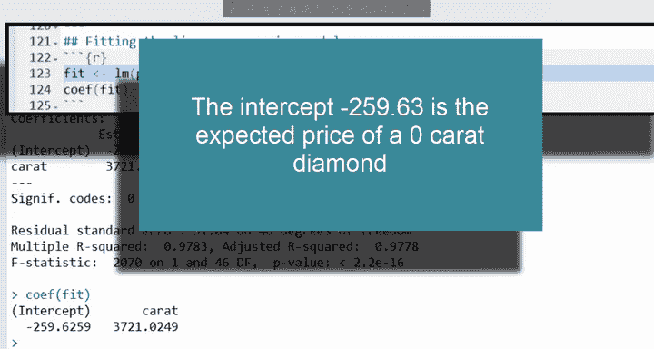

### 中心化预测变量

为了使截距在更可解释的尺度上，我们可以对预测变量`carat`进行中心化处理（减去其均值）。

```r
# 对克拉变量进行中心化后拟合模型
fit2 <- lm(price ~ I(carat - mean(carat)), data = diamond)
coef(fit2)
```

运行后，斜率保持不变（3721），但截距变为约500。因此，**500新加坡元是数据集中平均大小钻石（约0.2克拉）的预期价格**。

### 改变单位

1克拉的增加实际上相当大。如果我们把单位改为0.1克拉呢？我们可以简单地将系数除以10来理解：预计钻石质量每增加0.1克拉，价格将增加372新加坡元。

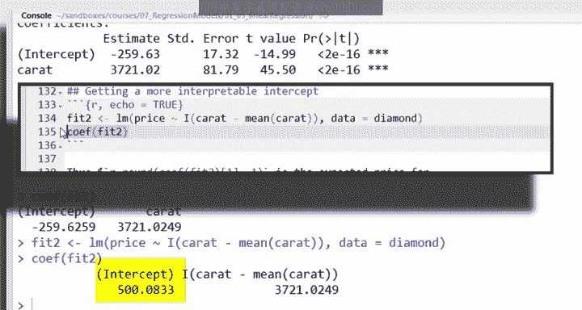

我们也可以在R中直接拟合以0.1克拉为单位的模型：

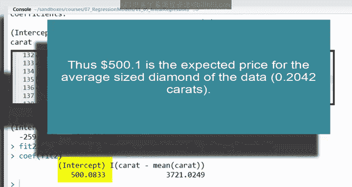

```r
# 将预测变量单位改为0.1克拉后拟合模型
fit3 <- lm(price ~ I(carat * 10), data = diamond)
coef(fit3)
```

现在，斜率系数变为约372，这与我们的计算一致。

---

## 生成预测

假设有人向你咨询三颗新钻石的估价，重量分别为0.16克拉、0.27克拉和0.34克拉。

以下是生成预测的几种方法：

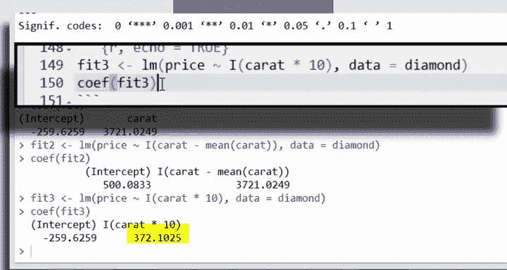

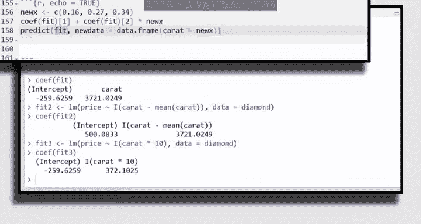

### 方法一：手动计算

你可以手动获取系数，然后使用公式计算：截距 + 斜率 × 新值。

```r
# 新钻石的重量
new_carats <- c(0.16, 0.27, 0.34)

# 使用原始模型fit的系数进行手动预测
intercept <- coef(fit)[1]
slope <- coef(fit)[2]
manual_predictions <- intercept + slope * new_carats
print(manual_predictions)
```

根据拟合的线性回归模型（从散点图看拟合得相当好），你将预测这三颗钻石的价格分别约为336、745和1006新加坡元。

### 方法二：使用`predict`函数

通常，尤其是在有多个回归变量或更复杂的设置中，你不想进行太多手动编码。R提供了一个通用方法`predict`，它可以处理多种模型拟合的输出（线性模型是其中之一）。

```r
# 创建一个包含新预测值的数据框
new_data <- data.frame(carat = new_carats)

# 使用predict函数进行预测
auto_predictions <- predict(fit, newdata = new_data)
print(auto_predictions)
```

使用`predict`函数会得到相同的答案，但这种方式在回归变量很多、设置更复杂时更具扩展性。因此，通常建议使用`predict`函数进行预测。

**注意**：如果省略`newdata`参数，直接运行`predict(fit)`，函数将在观测到的X值处进行预测，即返回拟合值 \(\hat{Y}\)。要想在新的X值处预测，必须提供`newdata`参数。

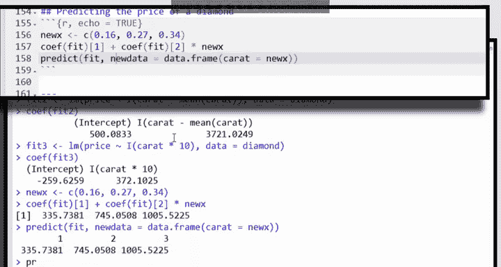

---

## 预测过程的可视化解释

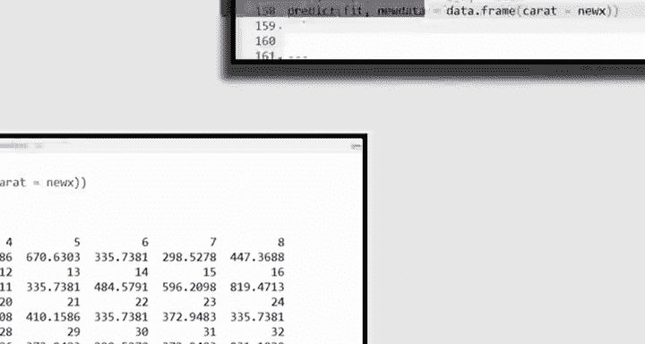

我想简要说明一下预测完成了什么。下图展示了我们的观测数据点（蓝色）、拟合值（红色，即`predict`命令在观测X值处得到的结果），以及在新X值（0.16, 0.27, 0.34）处的预测过程。

1.  **蓝色点**：观测数据点。
2.  **红色点**：拟合值。如果从观测数据点向拟合线画垂直线，垂足就是这些红点。
3.  **新值预测**：当我们在新的X值处预测时，过程是：在水平轴上找到我们给出的新值（0.16, 0.27, 0.34），向上画一条垂直线到达拟合回归线，然后水平移动到价格轴（美元），这些交点就是预测的价格金额。

这个过程直观地展示了如何从模型外推到新的数据点。

---

## 总结

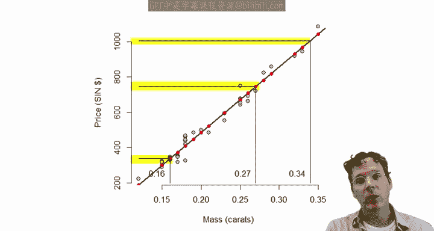

本节课中我们一起学习了线性回归在预测中的应用。我们通过钻石价格案例，详细解读了回归系数（斜率和截距）的实际含义，并演示了如何对预测变量进行中心化或单位转换以改善解释性。最重要的是，我们掌握了两种生成预测值的方法：手动使用回归公式计算以及使用R内置的`predict`函数。后者是更通用、可扩展的方法。记住，虽然可以在任何X值处进行预测，但在用于建模的数据范围内进行预测通常更为可靠。