# 055：14_残差方差 📊


在本节课中，我们将学习线性回归中一个核心概念：残差方差。我们将探讨其定义、计算方法，以及它与模型整体拟合优度指标R平方的关系。

---

## 残差方差的定义

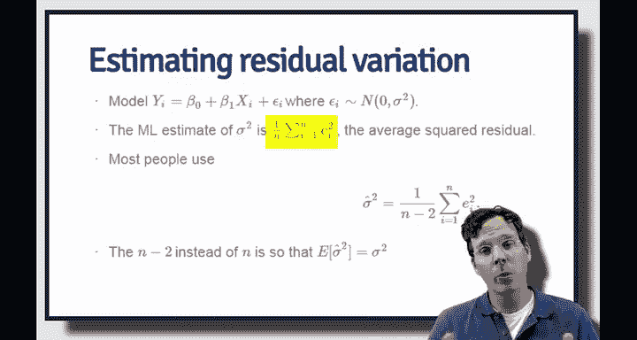

上一节我们讨论了回归线，本节中我们来看看残差方差。

残差方差是数据点围绕回归线的变异程度。残差是观测结果与拟合回归线之间的垂直距离。

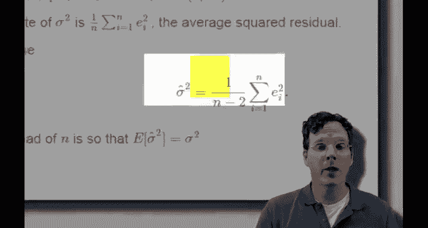

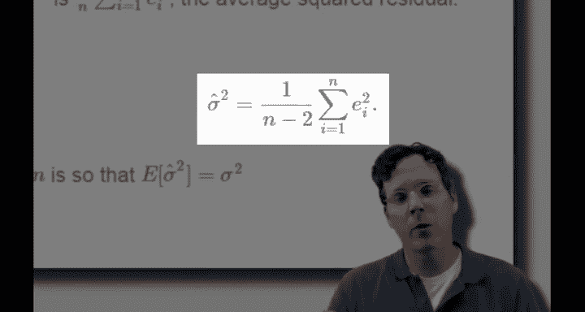

如果模型中包含截距项，残差之和必须为零，这意味着残差的均值为零。因此，要计算残差的方差，只需计算其平方的平均值。

残差方差σ²的估计公式为：
`σ² ≈ (1/n) * Σ(residual_i)²`

然而，更常见的做法是使用`n-2`作为分母，而非`n`。对于大样本量`n`，`1/(n-2)`与`1/n`的差异可以忽略不计，但对于小样本量，这种差异可能很重要。

---

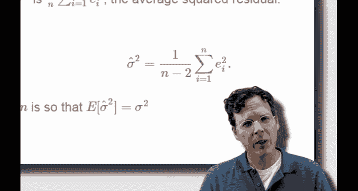

## 自由度与分母选择

为什么使用`n-2`？这涉及到自由度的概念。

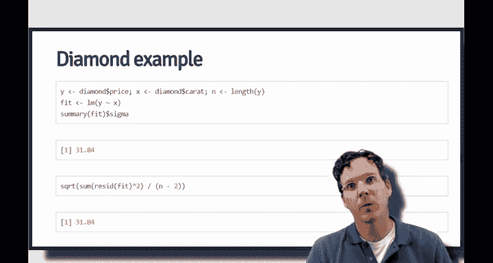

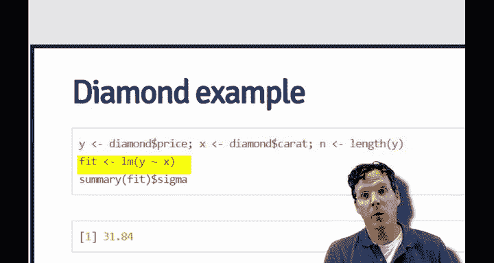

如果模型包含截距项，残差之和为零，这构成了一个约束条件。如果你知道`n-1`个残差，就能推算出最后一个。
此外，如果模型中包含一个协变量（预测变量），这会对残差施加第二个约束条件，因此我们失去了两个自由度。
每增加一个回归变量，就会增加一个约束，失去一个自由度。

本质上，这相当于说你并没有`n`个独立的残差，而是只有`n-2`个。因为如果你知道`n-2`个残差，就能推算出最后两个。这就是分母使用`n-2`的原因。

---

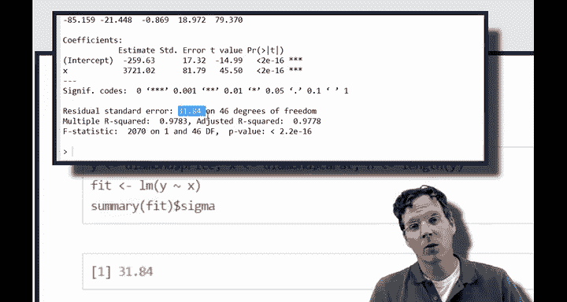

## 在R中获取残差方差

以下是如何从你的`lm`拟合对象中提取残差标准差（即残差方差的平方根）的方法。

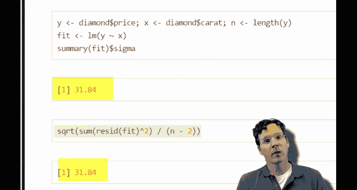

首先，定义数据并拟合模型：
```r
y <- c(...) # 定义因变量
x <- c(...) # 定义自变量
fit <- lm(y ~ x) # 拟合线性回归模型
```


如果直接运行`summary(fit)`，会在输出结果中看到残差标准差的估计值。
但如果想将其作为一个可以赋值的对象在程序中使用，可以使用`$sigma`：
```r
sigma_hat <- fit$sigma # 将残差标准差赋值给变量 sigma_hat
```


在本例中，计算出的值约为31.84。

我们可以手动验证这个公式：
```r
# 计算残差，求平方和，除以n-2，再开方
sqrt(sum(resid(fit)^2) / (length(y) - 2))
```
计算结果应与`fit$sigma`一致，证实了公式的正确性。

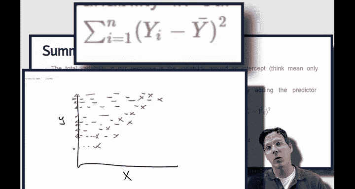

---

## 总变异、回归变异与残差变异

现在让我们回到钻石价格的例子，比较总变异与回归线解释后的剩余变异。

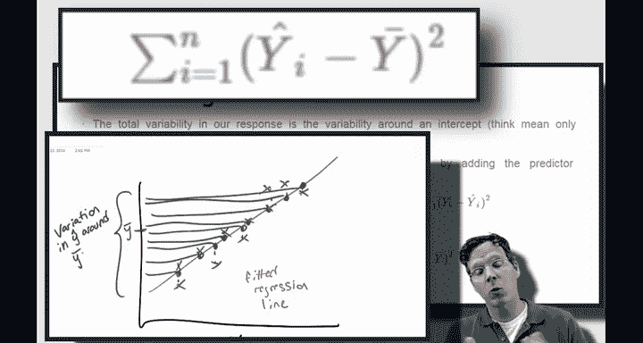

总变异是数据点围绕其均值（中心）的平均平方偏差。为简化，我们暂时忽略分母，只讨论平方和。

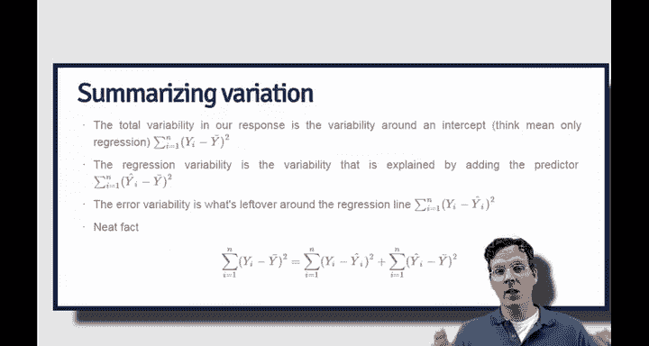

我们可以将总变异分解为两部分：
1.  **回归变异**：由回归线解释的那部分响应变量的变异。即，回归线上预测值围绕响应变量均值的变异。
2.  **残差变异**：回归线未能解释的、数据点围绕回归线的剩余变异。

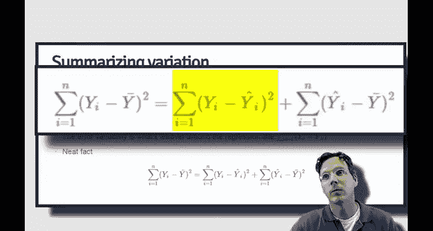

一个重要的恒等式是：
**总变异 = 回归变异 + 残差变异**

---

## R平方：模型解释的变异比例

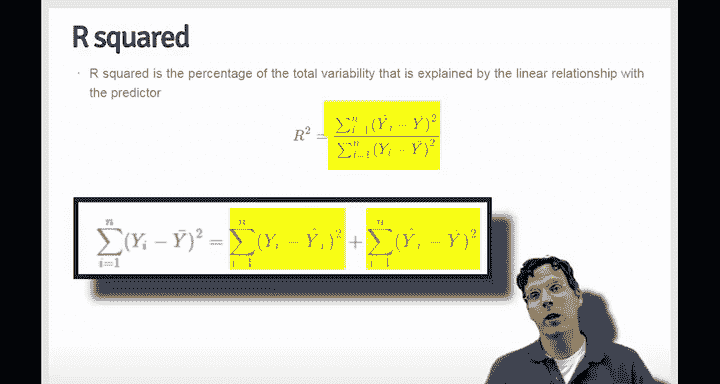

由于残差变异与回归变异之和等于总变异，我们可以定义一个量，来表示模型所解释的总变异的百分比。

只需将回归变异除以总变异：
`R² = 回归变异 / 总变异`

对于钻石的例子，R平方表示钻石价格变异中，能被与质量（克拉数）的线性回归关系所解释的百分比。

关于R平方，需要记住以下几点事实：
*   R平方是因变量变异中，能被与自变量的线性关系所解释的百分比。
*   R平方的值必须在0和1之间。因为回归平方和与残差平方和都是正数，且相加等于总平方和。
*   如果定义`R`为预测变量与结果之间的样本相关系数，那么`R平方`恰好等于该相关系数的平方，即`R²`。
*   R平方可能误导对模型拟合度的判断。例如，删除数据中间的大量点，或随意向线性模型添加变量，都可能人为地提高R平方。因此，评估模型拟合度时需要谨慎。

---

## 安斯库姆四重奏的启示

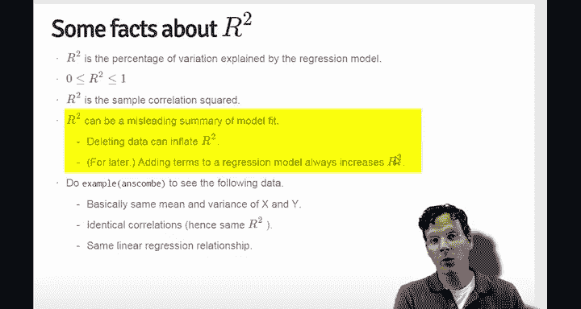

安斯库姆构造了一个特别鲜明的例子，展示了四组数据集。它们具有：
*   相同的R平方值。
*   自变量和因变量具有相同的均值和方差。
*   具有相同的回归关系（斜率和截距）。

但观察散点图时，你会发现每种情况下的拟合意义截然不同：

以下是四组数据的情况：
1.  第一组是典型的、略带噪声的线性关系，符合我们对线性回归的常规认知。
2.  第二组数据明显存在曲线趋势，表明模型中缺少了某个项（如二次项）。
3.  第三组数据中存在一个明显的离群值。
4.  第四组数据中，几乎所有点都堆积在一个位置，仅有一个点远离。

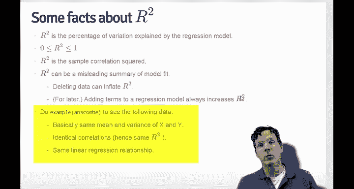

在所有情况下，你都会得到相同的R平方值。但单一的数字摘要显然丢弃了从简单散点图中可以获得的大量重要信息。这强调了可视化在数据分析中的不可替代性。

---

## 总结

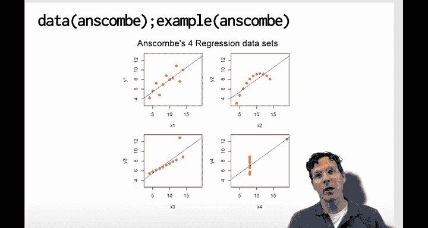

本节课中我们一起学习了残差方差的概念及其在线性回归中的核心地位。我们明确了其定义和用`n-2`作为分母进行估计的原因。我们探讨了总变异如何分解为回归变异和残差变异，并由此引出了衡量模型拟合优度的关键指标——R平方。最后，通过安斯库姆四重奏的例子，我们认识到R平方虽然有用，但绝不能替代对数据的直观图形检查。理解这些概念对于正确解释和评估线性回归模型至关重要。