# 056：回归中的推断 📊

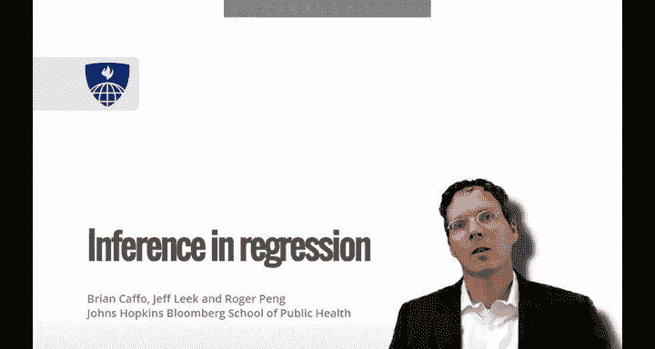

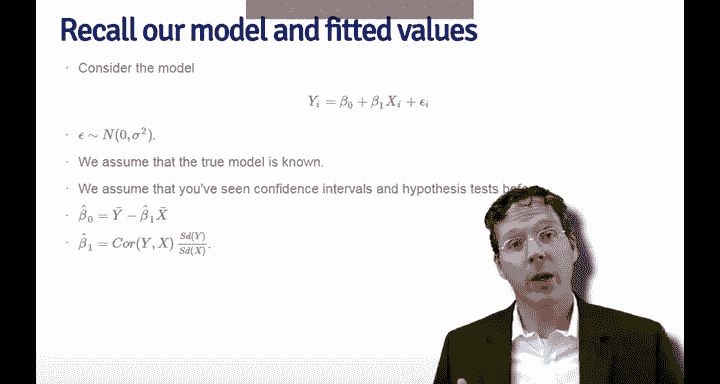

在本节课中，我们将学习如何在回归分析的背景下进行统计推断。我们将回顾线性回归模型的基本假设，并探讨如何对回归系数（如斜率和截距）进行假设检验和构建置信区间。

---

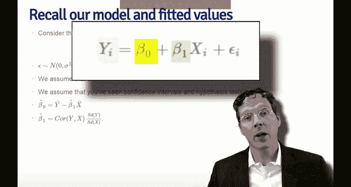

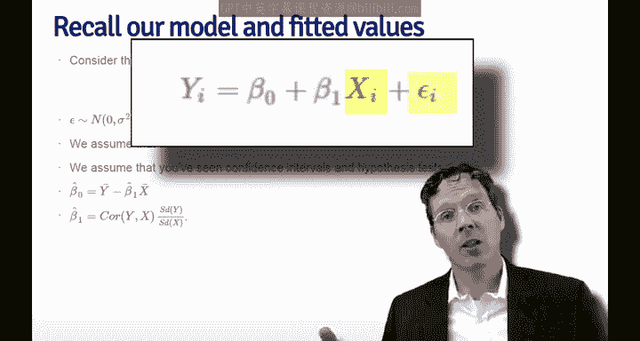

## 模型回顾

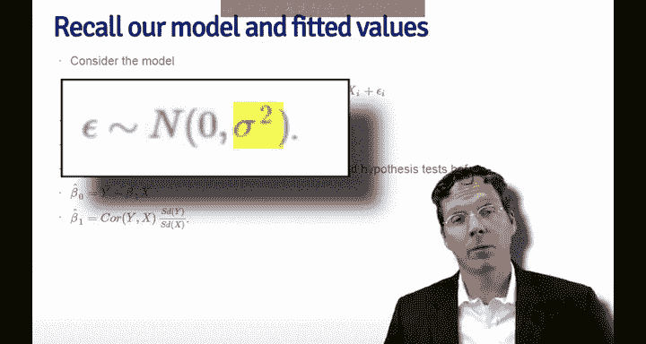

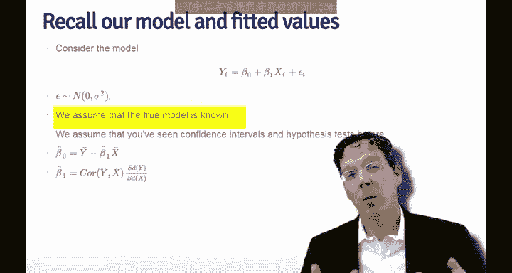

在开始讨论推断之前，我们先回顾一下线性回归模型，以便加深印象。

我们的模型假设响应变量 **Yᵢ** 由以下公式决定：
`Yᵢ = β₀ + β₁ * Xᵢ + εᵢ`

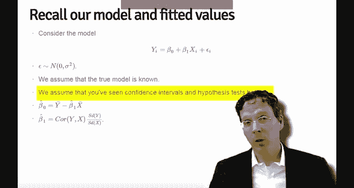

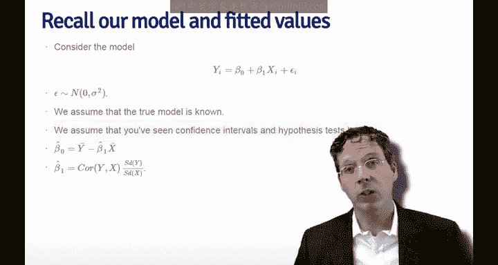

其中：
*   **β₀** 是截距。
*   **β₁** 是斜率。
*   **Xᵢ** 是预测变量。
*   **εᵢ** 是误差项。

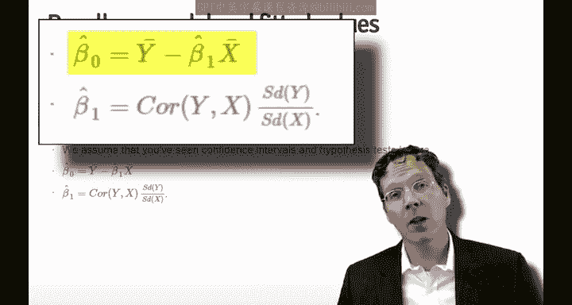

我们假设误差项 **εᵢ** 服从均值为0、方差为 **σ²** 的正态分布，即 `εᵢ ~ N(0, σ²)`。这是本课程大部分内容的基础。

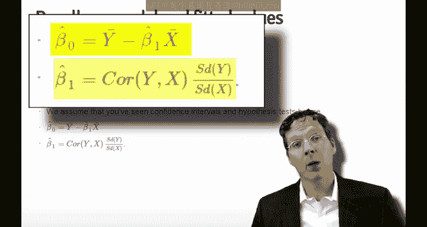

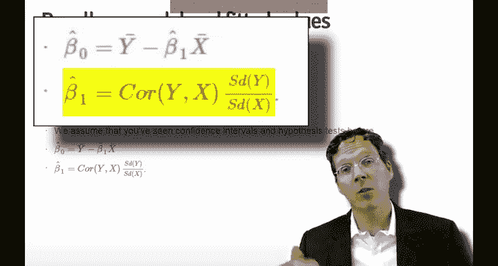

---

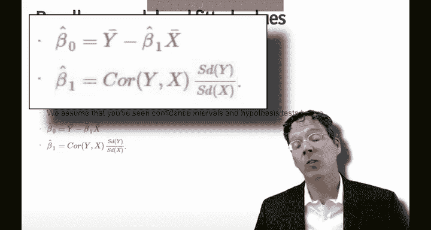

## 统计推断基础回顾

我假设你已经学习过一些统计推断知识，因此了解置信区间和假设检验的概念。

在回归分析的背景下，若满足独立同分布（IID）抽样和正态误差的假设，推断过程与你之前学过的内容非常相似。

以下是进行推断时常用的统计量形式：
`(θ̂ - θ) / SE(θ̂)`

该统计量通常具有以下性质：
1.  在大样本下，它通常服从正态分布。
2.  在有限样本中，如果用估计方差代替真实方差，它通常服从 **t 分布**。

这个统计量可以用于：
*   **假设检验**：检验参数 θ 是否等于某个特定的原假设值。
*   **构建置信区间**：区间形式为 `估计值 ± Q * 标准误`，其中 **Q** 是相应的分位数（例如，对于95%的置信区间，取 t 分布的 97.5% 分位数）。

---

## 回归系数的方差

回归斜率 **β̂₁** 的方差公式非常有启发性：
`Var(β̂₁) = σ² / ∑(Xᵢ - X̄)²`

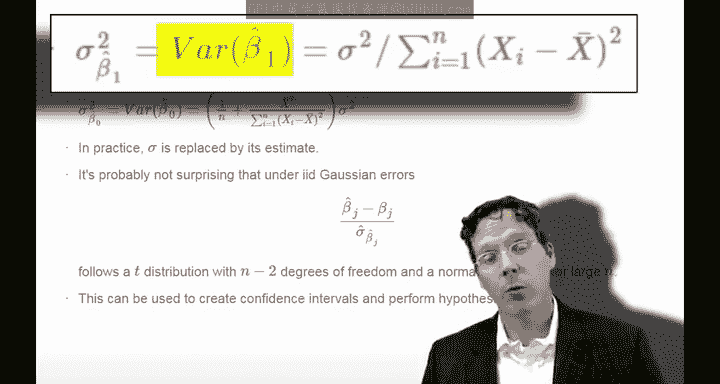

这个公式包含两个关键部分：

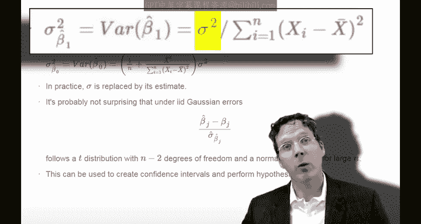

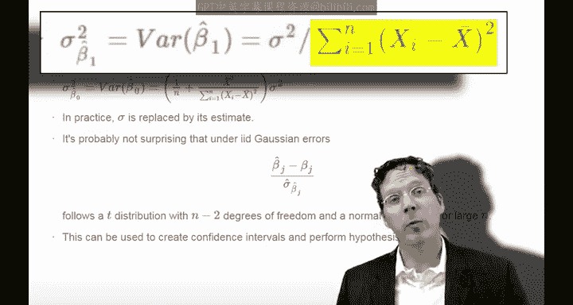

1.  **σ²**：数据点围绕真实回归线的变异程度。这个值越小，我们对斜率的估计就越精确。
2.  **∑(Xᵢ - X̄)²**：预测变量 **X** 的变异程度。这个值越大，斜率估计的方差就越小。

为什么预测变量的变异程度很重要？我们可以通过图示来理解。

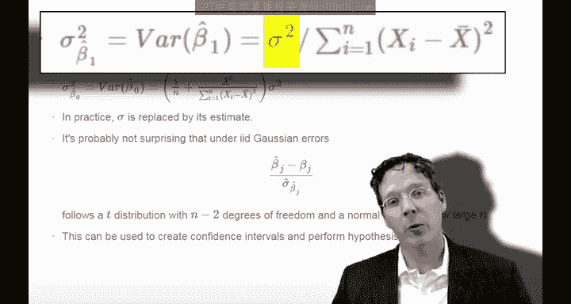

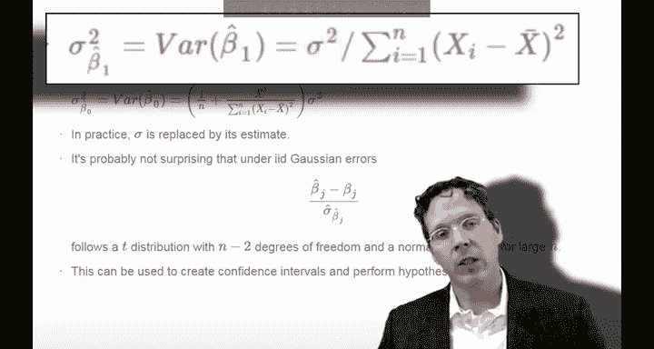

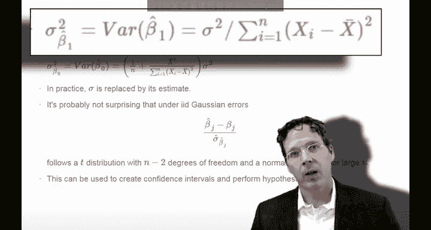

*   如果所有的 **X** 值都紧密地聚集在一起，那么拟合的回归线很容易在数据点云中摆动，导致估计不稳定。
*   如果 **X** 值分布得更开，我们就能得到更稳定、方差更小的斜率估计。

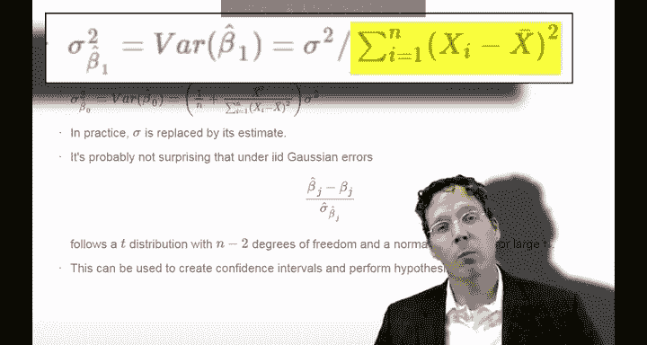

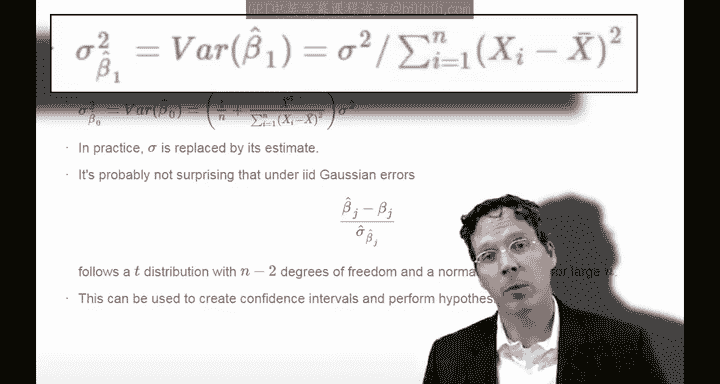

理论上，最小化斜率方差的方法是将一半的观测值放在一端，另一半放在另一端。但这假设了两点之间的线性关系成立，而中间区域没有数据来验证这一点。

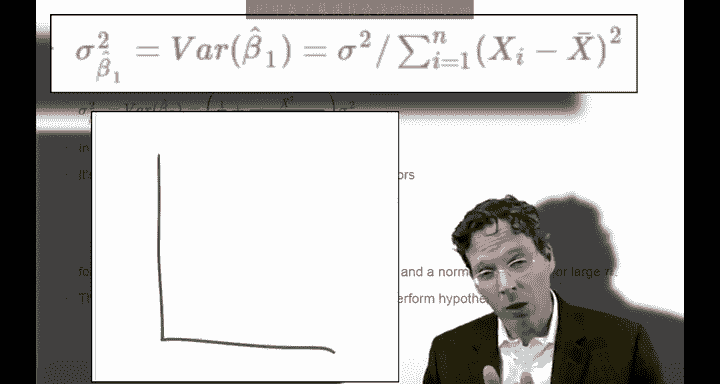

类似地，截距 **β̂₀** 的方差公式如下（虽然截距通常不如斜率受关注）：
`Var(β̂₀) = (1/n + X̄²/∑(Xᵢ - X̄)²) * σ²`

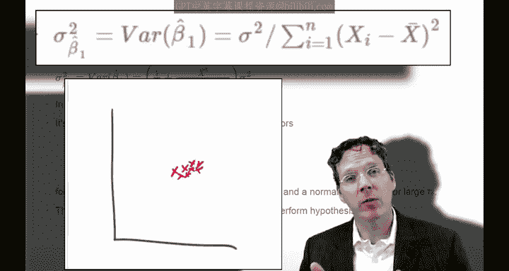

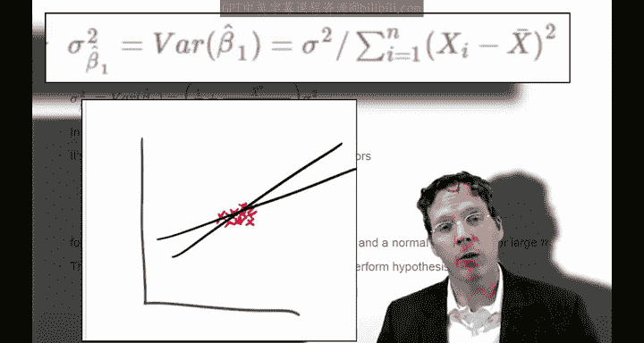

在实际计算中，我们用其合理的估计量 **σ̂²** 来替换未知的 **σ²**：
`σ̂² = (1/(n-2)) * ∑(Yᵢ - Ŷᵢ)²`
其中，`Ŷᵢ` 是预测值，`(Yᵢ - Ŷᵢ)` 是残差。

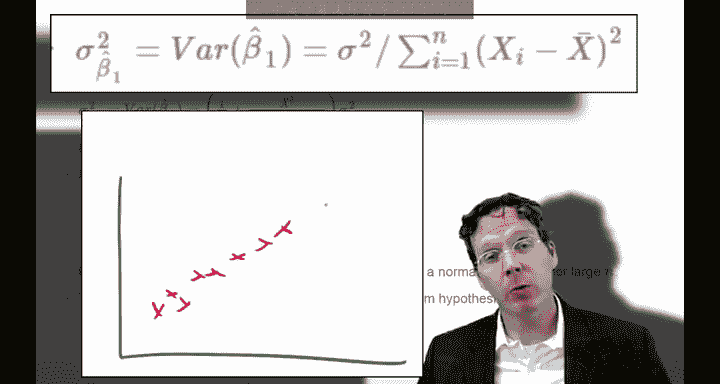

---

## t 检验与置信区间

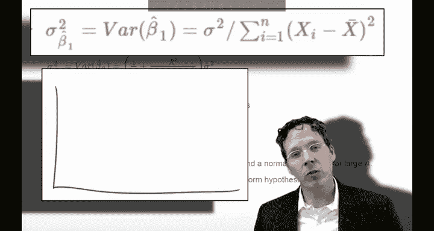

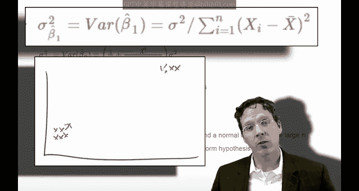

基于上述理论，我们的斜率或截距估计值进行标准化后，服从自由度为 **n-2** 的 **t 分布**：
`(β̂ⱼ - βⱼ) / SE(β̂ⱼ) ~ tₙ₋₂`

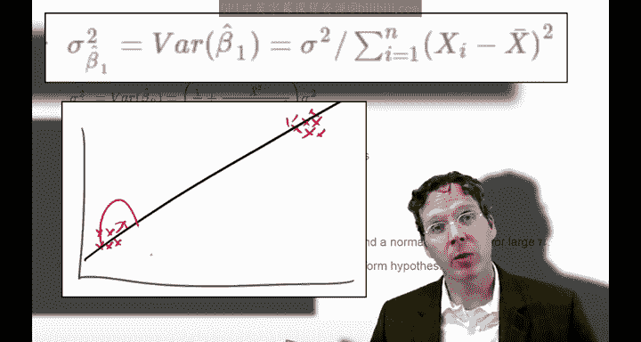

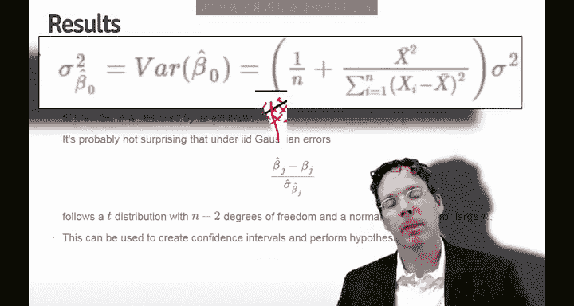

其中，**j** 可以是 0（截距）或 1（斜率）。这个结果可以用来创建置信区间和进行假设检验。

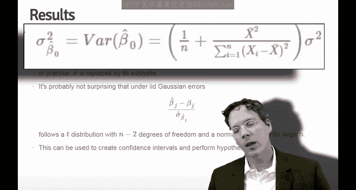

R 语言等统计软件在输出回归分析结果时，报告的标准误、t 值和 p 值正是基于这些公式计算得出的。

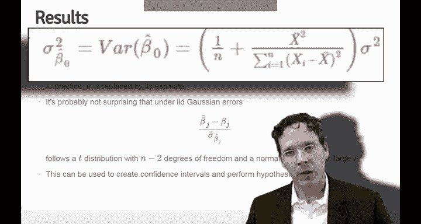

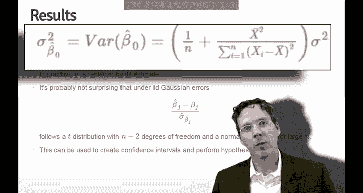

---

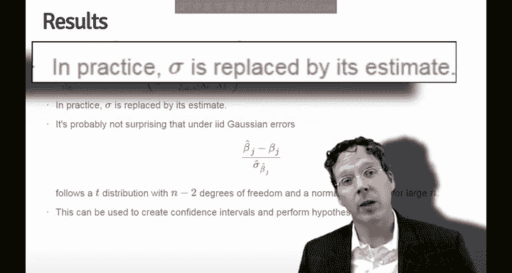

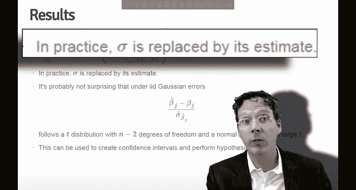

## 总结

本节课中，我们一起学习了线性回归中的统计推断。

1.  我们首先回顾了线性回归模型及其正态误差假设。
2.  接着，我们复习了统计推断的基础概念，包括利用 t 统计量进行假设检验和构建置信区间。
3.  然后，我们深入探讨了回归系数（特别是斜率）的方差公式，并理解了预测变量的变异程度对估计精度的重要影响。
4.  最后，我们指出在模型假设成立的情况下，回归系数的标准化估计值服从 t 分布，这为所有推断提供了理论基础。

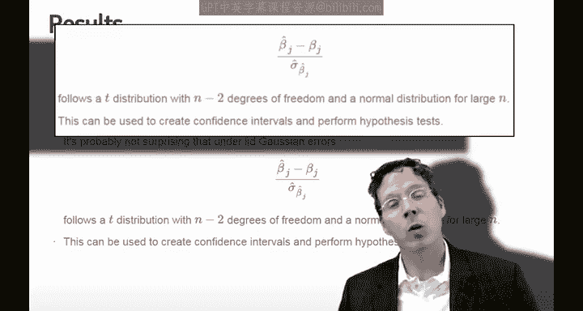

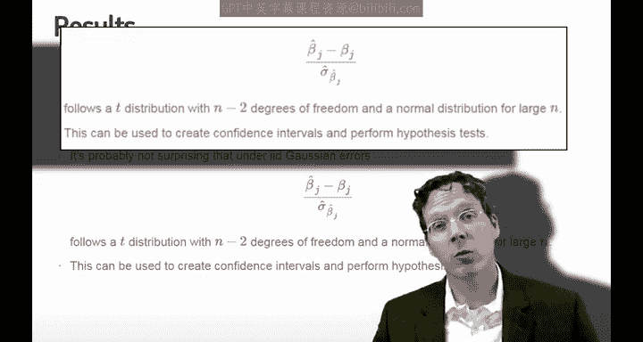

掌握这些知识，你就能理解并解释统计软件输出的回归结果，并对模型参数做出有效的统计推断。