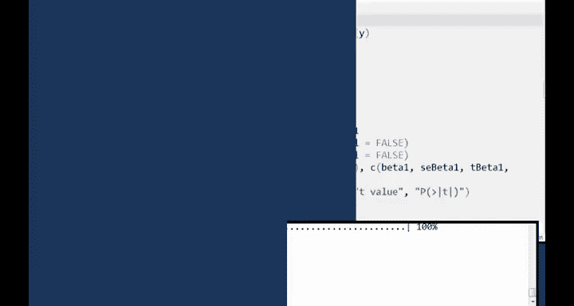
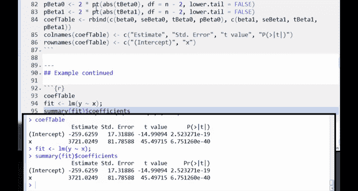
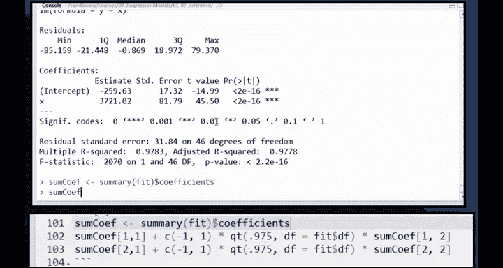

# 057：16_编码示例 📊



在本节课中，我们将通过一个具体的编码示例，演示如何手动计算简单线性回归中的关键统计量，并验证这些计算结果与R语言内置函数`lm()`的输出完全一致。我们将使用`diamond`数据集，逐步计算回归系数、残差、标准误差、t统计量和p值，最后展示如何计算置信区间。

---

## 概述

我们将使用R语言和`diamond`数据集，手动实现简单线性回归的所有核心计算步骤。这包括计算斜率（`beta1`）和截距（`beta0`）、残差、残差标准误差（`sigma`）、回归系数的标准误差、t统计量以及p值。完成手动计算后，我们将使用R的`lm()`函数进行验证，确保我们的公式与软件内部计算完全一致。最后，我们将学习如何从模型输出中提取信息并计算回归系数的置信区间。

---

## 手动计算回归统计量

首先，我们需要加载必要的库和数据，并定义关键变量。

```r
# 加载所需库和数据
library(UsingR)
data(diamond)

# 定义变量
y <- diamond$price  # 响应变量：价格
x <- diamond$carat  # 预测变量：克拉数
n <- length(y)      # 样本量
```

### 计算回归系数

根据公式，斜率 `beta1` 是y和x的相关系数乘以y的标准差与x的标准差之比。截距 `beta0` 是y的均值减去 `beta1` 乘以x的均值。

```r
# 计算斜率 beta1
beta1 <- cor(y, x) * sd(y) / sd(x)

# 计算截距 beta0
beta0 <- mean(y) - beta1 * mean(x)
```

### 计算残差和残差标准误差

残差是观测值y与预测值（`beta0 + beta1 * x`）之间的差异。残差标准误差 `sigma` 是残差方差的平方根，其中方差计算时除数是 `n-2` 而非 `n`。

```r
# 计算残差
residuals <- y - (beta0 + beta1 * x)

# 计算残差标准误差 sigma
sigma <- sqrt(sum(residuals^2) / (n - 2))
```

### 计算x的平方和

x的平方和是计算斜率标准误差所需的关键量，它是每个x值与其均值之差的平方和。

```r
# 计算x的平方和
sum_x_squares <- sum((x - mean(x))^2)
```

### 计算标准误差、t统计量和p值

截距 `beta0` 和斜率 `beta1` 都有其对应的标准误差。t统计量是估计值除以其标准误差。p值则通过t分布计算得到，用于检验系数是否显著不为零。

以下是计算过程：

```r
# 计算截距 beta0 的标准误差
se_beta0 <- sigma * sqrt(1/n + mean(x)^2 / sum_x_squares)

# 计算斜率 beta1 的标准误差
se_beta1 <- sigma / sqrt(sum_x_squares)

# 计算t统计量（假设检验中，原假设通常为系数等于0）
t_beta0 <- beta0 / se_beta0
t_beta1 <- beta1 / se_beta1

# 计算双侧检验的p值
p_beta0 <- 2 * pt(abs(t_beta0), df = n-2, lower.tail = FALSE)
p_beta1 <- 2 * pt(abs(t_beta1), df = n-2, lower.tail = FALSE)
```

### 手动创建系数表

现在，我们可以将上述所有计算结果整理成一个系数表，使其格式与R的`lm()`函数输出类似。

```r
# 创建系数表
coef_table <- matrix(c(beta0, beta1, se_beta0, se_beta1, t_beta0, t_beta1, p_beta0, p_beta1),
                     nrow = 2, byrow = FALSE)
rownames(coef_table) <- c("(Intercept)", "x")
colnames(coef_table) <- c("Estimate", "Std. Error", "t value", "Pr(>|t|)")

# 打印手动计算的系数表
print(coef_table)
```

---

## 使用R的`lm()`函数验证

上一节我们手动计算了所有统计量。本节中，我们来看看如何使用R内置的`lm()`函数轻松完成相同的分析，并验证我们的手动计算结果。

```r
# 使用lm()函数拟合线性模型
fit <- lm(y ~ x)

# 获取模型的详细摘要，其中包含系数表
summary_fit <- summary(fit)



# 提取并打印系数表
print(summary_fit$coefficients)
```

运行上述代码后，你会发现`lm()`函数输出的系数表与我们手动计算的`coef_table`在数值上完全一致。这验证了我们所使用的公式是正确的。

---

## 计算置信区间

在验证了基本计算后，我们进一步学习如何为回归系数计算置信区间。`summary()`函数提供了丰富的模型信息，但我们需要从中提取特定部分来计算区间。

首先，让我们查看`summary(fit)`的完整输出，它包含了残差信息、系数估计、标准误差、t值和p值等。

```r
# 查看完整的模型摘要
print(summary(fit))
```

为了计算置信区间，我们主要关注系数估计值和它们的标准误差。我们可以从摘要中提取系数表。

```r
# 将模型摘要赋值给一个对象
model_summary <- summary(fit)

# 仅提取系数表部分
coef_summary <- model_summary$coefficients
print(coef_summary)
```

### 手动计算置信区间

对于截距和斜率，其95%置信区间的计算公式为：**估计值 ± t临界值 × 标准误差**。其中t临界值由自由度和置信水平决定。



以下是计算过程：

```r
# 获取模型的自由度
df <- fit$df.residual

# 计算97.5%分位数的t临界值（用于双侧95%置信区间）
t_critical <- qt(0.975, df = df)

# 计算截距的置信区间
ci_intercept <- coef_summary[1, 1] + c(-1, 1) * t_critical * coef_summary[1, 2]

# 计算斜率的置信区间
ci_slope <- coef_summary[2, 1] + c(-1, 1) * t_critical * coef_summary[2, 2]

# 打印置信区间
print("95% CI for Intercept (beta0):")
print(ci_intercept)
print("95% CI for Slope (beta1) per 1-carat increase:")
print(ci_slope)
```

### 解释与应用

斜率 `beta1` 的置信区间解释为：对于预测变量（钻石克拉数）每增加一个单位，响应变量（价格）的平均变化范围。

在实际分析中，有时预测变量变化一个单位可能过大。例如，钻石克拉数增加1克拉是一个很大的变化。因此，我们可能更关心每增加0.1克拉的价格变化。这可以通过将整个斜率的置信区间除以10来得到。

```r
# 计算每增加0.1克拉的价格变化置信区间
ci_slope_per_0.1_carat <- ci_slope / 10
print("95% CI for Slope (beta1) per 0.1-carat increase:")
print(ci_slope_per_0.1_carat)
```

根据计算结果，我们可以有95%的置信度认为，钻石克拉数每增加0.1克拉，其价格平均会增加356至389新加坡元。

---

## 总结

本节课中我们一起学习了简单线性回归的核心计算过程。我们从手动计算回归系数、残差、标准误差、t统计量和p值开始，逐步验证了这些公式与R语言`lm()`函数内部计算的一致性。随后，我们探讨了如何从模型输出中提取信息，并手动计算回归系数的置信区间。通过将斜率置信区间缩放，我们还学会了如何根据实际需求解释预测变量单位变化的影响。这个过程不仅加深了对统计公式的理解，也增强了对统计软件输出结果的解读能力。