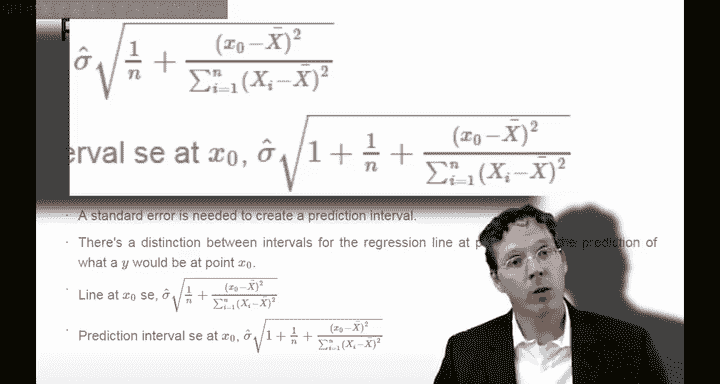
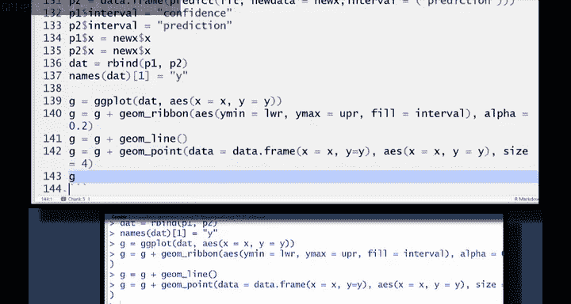
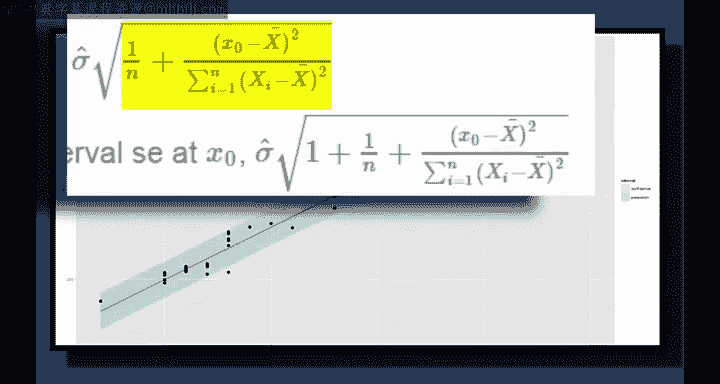
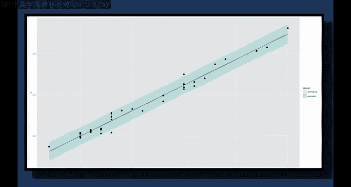

# 058：预测 📊


在本节课中，我们将要学习回归分析中的核心概念——预测。我们将探讨如何使用回归模型进行预测，并理解预测区间与置信区间的区别及其重要性。

预测是数据科学家的核心任务之一。事实上，我们有一门完整的课程《实用机器学习》专门讲解高级预测技术。然而，回归和广义线性模型（我们将在课程后期介绍）是执行预测的一些最核心的技术。它们通常能产生非常好的预测结果，模型简洁且可解释性强。此外，作为额外的好处，你可以在不做任何数据重采样的前提下，在预测的基础上进行统计推断。

这里所说的“推断”是指，我们不仅可以得到预测值，还可以得到例如预测值的置信区间，以此来评估这些预测的不确定性。这在回归分析中非常容易实现，在广义线性模型中相对容易，但在一些更高级的机器学习算法中则相当困难，可能需要数据重采样等方法。

## 预测的基本概念

上一节我们介绍了预测的重要性，本节中我们来看看如何进行具体的预测。我们可能想要预测一个响应变量，例如特定克拉数钻石的价格，或者根据父母身高预测孩子的身高。

在这两种情况下，最直接的估计是取我们想要预测的预测变量值 `x0`（如克拉数或父母身高），乘以相关的估计斜率 `β1_hat`，然后加上截距 `β0_hat`。

但如果我们想成为优秀的统计学家，就需要评估该预测中的一些不确定性。因此，最好有一个预测区间。

这里有一个细微的差别：预测回归线在特定点的值，与预测该点的一个未来 `y` 值，是两个不同的概念。我们将在后面的图表中描述这一点，但先让我描述一下公式。

## 预测方差公式

我们的预测方差首先与数据点围绕回归线的变异性 `σ_hat` 有关，这很合理，它应该包含在我们的预测误差中。

然而，这里我们有 `1/N` 这一项。这也有一定道理，通常我们的标准误差以 `1/√N` 的速率减小，所以在平方根中出现 `1/N` 似乎是合理的。

如果我们预测一个新的 `Y` 值，那么我们在前面会多一个 `+1`。因此，相比于预测回归线在该点的值，预测该点的一个新值会得到一个更宽的区间。



我们稍后会详细讨论这一点，但让我也关注一下两个公式中都存在的最后一项：`(x0 - x̄)² / Σ(xi - x̄)²`。

考虑这个统计量的分子：当 `x0` 等于 `x̄` 时，我们的预测误差将是最低的。也就是说，当我们在钻石的平均克拉数或父母的平均身高处进行预测时，预测方差最小。

需要注意的第二点是分母 `Σ(xi - x̄)²`，这基本上衡量了 `x` 的变异性。我的 `x` 变异性越大，这一项就越小，我的预测误差也就越低。这与我们的斜率估计类似：回归变量的变异性越大，斜率估计的变异性就越小，我们的预测误差也是如此。

## 使用 R 代码生成预测区间

现在，让我们通过一些图表来巩固这些概念。这是使用回归进行预测的一个重要部分，你可以轻松便捷地获得与简洁预测因子相关的预测不确定性。

让我们为钻石数据集生成一些预测区间。我将在这里讲解代码。实际上，大部分代码只是一些数据整理，以便将其转换为适合 ggplot2 的格式（至少就我所知的 ggplot2 而言）。我不会对此进行太仔细的讲解，因为上过 Roger 的课之后，你们在这方面都比我强。

让我讲解一下这段代码中最相关的部分，那就是这里的 `predict` 函数。对于许多预测算法，尤其是线性模型和广义线性模型，以及 R 中的随机森林等其他方法，`predict` 函数是一个适用于它们的通用方法。在这里，我将给它我的 `lm` 函数的输出。

然后，我需要一个比观测数据更密集的 `x` 值网格来进行绘图预测。所以我给它一些新的 `x` 值。在这里，我指定 `interval = "confidence"`，这不是预测区间。这段代码表示我想要特定 `x` 值处估计线周围的区间，而不是该 `x` 值处潜在新 `y` 的区间。如果我想要该 `x` 值处潜在新 `y` 的区间，我需要将 `interval = "confidence"` 改为 `interval = "prediction"`，我在下面这行代码中正是这样做的。

运行完所有数据整理代码后，让我来讲解我的 ggplot。我喜欢这样做，只是因为一开始我觉得 ggplot 有点令人困惑，但一旦习惯了，我就非常喜欢它。完成数据整理后，请注意这个有点复杂的绘图只需要几行代码。



以下是绘图代码的核心部分：

```r
# 假设 `fit` 是 lm 模型对象，`newdata` 是包含预测变量‘mass’的新数据框
# 计算置信区间（针对回归线）
conf_int <- predict(fit, newdata = newdata, interval = "confidence")
# 计算预测区间（针对新观测值）
pred_int <- predict(fit, newdata = newdata, interval = "prediction")

# 使用 ggplot2 绘图
library(ggplot2)
ggplot() +
  geom_ribbon(data = newdata_with_intervals, aes(x = mass, ymin = pred_lwr, ymax = pred_upr, fill = "预测区间"), alpha = 0.2) +
  geom_ribbon(data = newdata_with_intervals, aes(x = mass, ymin = conf_lwr, ymax = conf_upr, fill = "置信区间"), alpha = 0.2) +
  geom_line(data = newdata_with_intervals, aes(x = mass, y = fit), color = "black") +
  geom_point(data = diamonds, aes(x = mass, y = price)) + # 添加原始数据点
  scale_fill_manual(values = c("预测区间" = "blue", "置信区间" = "salmon")) +
  labs(x = "质量（克拉）", y = "价格", fill = "区间类型")
```



## 解读预测与置信区间

现在切换到显示图表的大窗口。这是我的图表，蓝色是预测区间（用于预测新 `y`），鲑鱼色是用于预测特定 `x` 值处回归线的区间（置信区间）。

你会看到，对回归线的预测（`predict` 命令中所谓的置信区间）比预测区间窄得多。我喜欢这样理解这一点，我们从数学上知道情况确实如此：预测区间公式中有那个 `+1`，而回归线的置信区间公式中没有。

想象一下，如果我在沿着这条线的所有不同 `x` 值处收集无限多的数据。那么，我几乎就能精确地知道回归线。如果是这样，我对线上特定 `x` 值处的预测会非常有信心。随着我收集越来越多的数据，那个鲑鱼色的置信区间会变得越来越窄，直到变成线本身。这很好，这正是我们所期望的，这就是统计抽样工作的理念。

另一方面，预测区间中 `Y` 的变异性与我估计 `β0` 或 `β1` 的好坏无关。事实上，想象一下，如果我直接给你正确的 `β0` 和 `β1`，`Y` 中仍然存在变异性，因为存在那个误差项。所以，如果我想预测一个新的 `Y`，有一些不确定性并不会因为更好的估计而消失。这是回归线中残留的变异，这种变异性将始终存在于预测区间中。这就是为什么公式中有 `+1`，它不随 `n` 增大而消失，也不随我收集更多 `x` 数据而消失，它是固有的。这就是为什么预测区间有一定的宽度，永远不会消失。

最后我想说，你可能在置信区间中比在预测区间中更能清楚地看到这一点：这两个区间都在数据云的中心附近变窄，然后在你进入尾部时变宽。这仅仅说明，我们越接近 `x` 的均值，对我们的预测就越有信心。由于那个 `+1`，蓝色区间（预测区间）的这种“变窄”效应可能不如鲑鱼色区间（置信区间）明显，你在鲑鱼色区间中可以更清楚地看到它向内收缩。如果我们预测远远超出我们收集数据范围的点，这些区间会变得非常宽，这正是我们想要的，因为我们在外推，我们想在未收集数据的地方进行预测。

## 总结

本节课中我们一起学习了回归分析中的预测。我们了解到：

*   回归是进行预测的核心、简洁且可解释的技术。
*   预测时，区分**预测回归线本身的值**（置信区间）和**预测一个新观测值**（预测区间）至关重要。
*   预测区间总是比置信区间宽，因为它包含了模型固有的残差变异，这部分不确定性不随样本量增加而消失。
*   预测的不确定性在预测变量 `x` 的均值处最小，并随着远离均值而增大。
*   在 R 中，可以使用 `predict()` 函数并指定 `interval` 参数来方便地计算这两种区间。



理解这些概念对于正确使用和解释回归模型的预测结果至关重要。接下来，我们将继续学习回归中更复杂的主题，并推广到拥有更多预测变量的情况。