# 060：19_多元回归 第1部分 📊

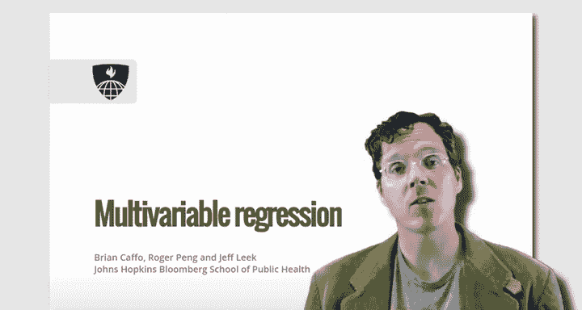

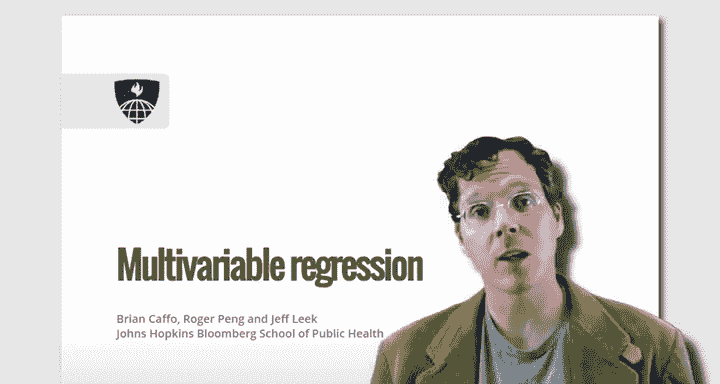

在本节课中，我们将学习多元回归分析。多元回归是简单线性回归的扩展，用于处理同时有多个预测变量对结果变量进行建模的情况。我们将探讨其核心概念、应用场景以及如何通过最小二乘法进行参数估计。

---

上一节我们介绍了多元回归的基本概念，本节中我们来看看多元回归的具体应用场景。

多元回归的一个主要用途是控制混杂变量。例如，当发现某个预测变量（如口香糖使用量）与结果变量（如肺功能）存在显著关系时，我们可能需要考虑是否存在其他变量（如吸烟状况）同时影响预测变量和结果变量，从而造成虚假关联。多元回归可以在模型中同时纳入多个变量，从而在“控制”或“调整”了其他变量（如吸烟状况）后，评估目标预测变量（如口香糖使用量）与结果的独立关联。

除了用于控制混杂、进行解释性建模外，多元回归也是强大的预测工具。在预测任务中，我们通常关心模型的整体预测准确性，而非单个系数的具体解释。通过纳入大量相关的预测变量，多元回归可以构建出性能优异的预测模型。

---

以下是多元线性回归模型的数学表达形式。

多元线性回归模型的一般形式如下：

**公式：**
`Y = β₀ + β₁X₁ + β₂X₂ + ... + βₚXₚ + ε`

其中：
*   `Y` 是结果变量（因变量）。
*   `X₁, X₂, ..., Xₚ` 是 `p` 个预测变量（自变量）。
*   `β₀` 是截距项。
*   `β₁, β₂, ..., βₚ` 是各个预测变量对应的回归系数，表示在控制其他变量的情况下，该变量每变化一个单位对 `Y` 的期望影响。
*   `ε` 是随机误差项。

模型的关键在于其对于系数 `β` 是线性的。这意味着即使预测变量本身经过非线性变换（例如 `X²` 或 `log(X)`），只要系数以一次方的形式出现，该模型仍被视为线性模型。

---

上一节我们定义了模型，本节中我们来看看如何估计模型中的参数。

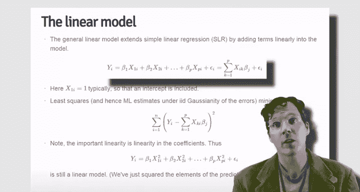

与简单线性回归类似，我们使用最小二乘法来估计回归系数 `β₀, β₁, ..., βₚ`。其目标是找到一组系数值，使得模型预测值与实际观测值之间的残差平方和最小。

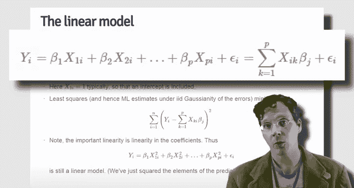

**公式：**
最小化 `∑(Yᵢ - Ŷᵢ)²`，其中 `Ŷᵢ = β₀ + β₁X₁ᵢ + β₂X₂ᵢ + ... + βₚXₚᵢ`。

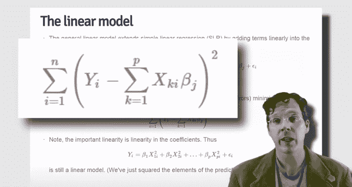

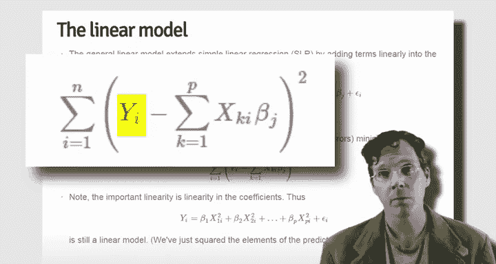

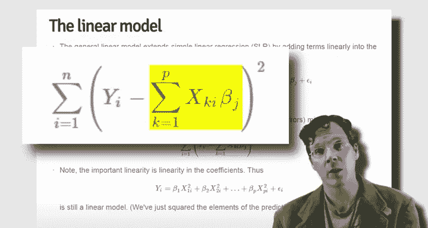

这相当于求解一个优化问题，通过数学推导（如求偏导数并令其为零）可以得到系数的最优解。在多元情况下，这通常通过矩阵运算来实现。

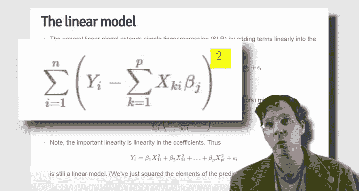

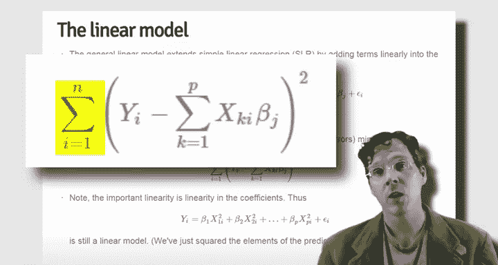

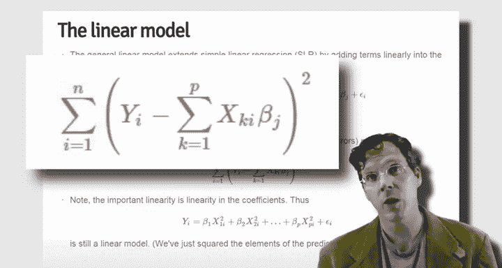

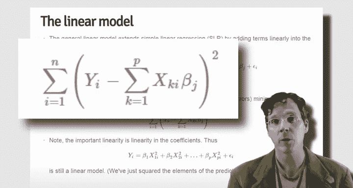

---

本节课中我们一起学习了多元回归分析的第一部分。我们了解了多元回归的两个主要用途：在解释性模型中控制混杂因素，以及在预测性模型中提升预测精度。我们定义了多元线性回归模型的数学形式，并介绍了使用最小二乘法进行参数估计的基本原理。在接下来的课程中，我们将深入探讨如何解释回归系数、进行模型选择以及理解模型的局限性。