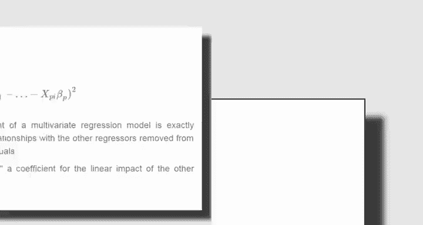
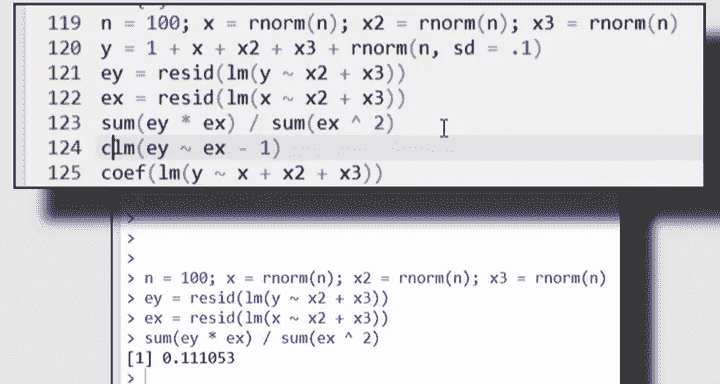
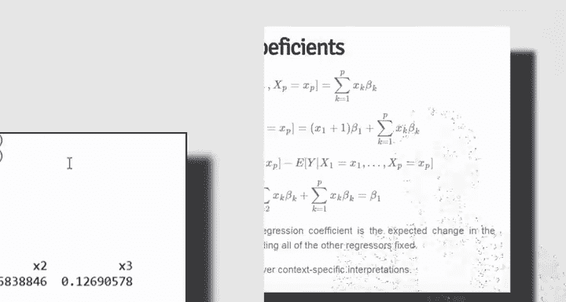
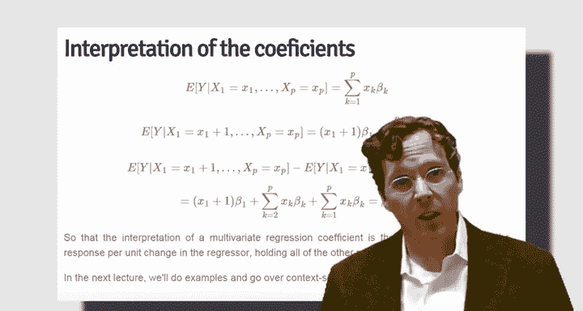
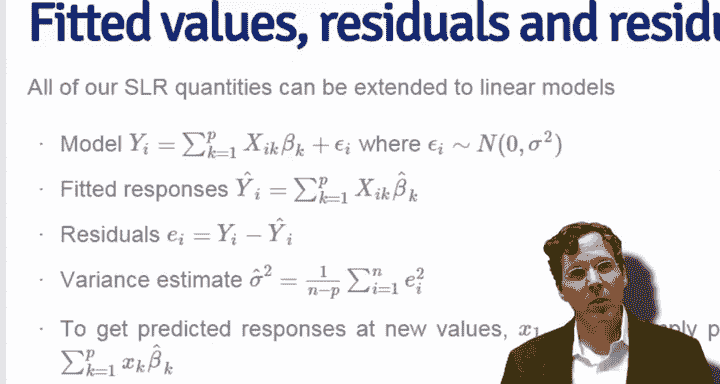

# 062：多元回归（续）📈



在本节课中，我们将继续学习多元回归。我们将通过一个模拟演示来理解回归系数是如何计算的，并深入探讨多元回归系数的解释。最后，我们将回顾线性模型的基本组成部分及其重要性。

---

## 模拟演示：回归系数的计算

上一节我们介绍了多元回归的基本概念，本节中我们来看看如何通过模拟数据来理解回归系数的计算过程。



我将进行一个模拟，其中包含100个观测值，并生成三个预测变量：`x`、`x2`和`x3`。它们都服从标准正态分布。

我的响应变量 `y` 由以下公式生成：
`y = 1 + x + x2 + x3 + ε`
其中，`ε` 是随机噪声（误差项）。理论上，所有回归系数（包括截距）都为1。

首先，我们获取在回归模型中剔除 `x2` 和 `x3` 影响后 `y` 的残差。`lm` 函数默认包含截距项。
```r
resid_y <- resid(lm(y ~ x2 + x3))
```

接着，对预测变量 `x` 做同样处理，即剔除 `x2` 和 `x3` 的影响。
```r
resid_x <- resid(lm(x ~ x2 + x3))
```



然后，我们使用这两个残差进行过原点的回归，得到 `x` 的系数估计值。这个值是 **0.11053**。



我们也可以用 `lm` 函数直接验证，将 `resid_y` 对 `resid_x` 进行回归（并移除截距项）。
```r
coef(lm(resid_y ~ resid_x - 1))
```
你会发现，这个系数与直接进行多元回归 `y ~ x + x2 + x3` 得到的 `x` 的系数完全相同。

这说明了线性模型在调整其他变量影响时的机制：**其他变量的效应已同时从预测变量和响应变量中被剔除**。

---

## 多元回归系数的解释

理解了系数的计算后，我们来看看如何解释多元回归的系数。下一讲我们将结合具体情境示例进行深入分析。

给定一组协变量取值 `x1, x2, ..., xp`，我们的回归预测值为：
`E[Y | X] = β₀ + β₁x₁ + β₂x₂ + ... + βₚxₚ`

现在，假设第一个预测变量 `x₁` 增加一个单位，变为 `x₁ + 1`，而其他所有预测变量 `x₂, ..., xₚ` 保持不变。

那么，新的期望响应值为：
`E[Y | X'] = β₀ + β₁(x₁+1) + β₂x₂ + ... + βₚxₚ`

将两者相减：
`E[Y | X'] - E[Y | X] = β₁`

因此，**多元回归系数 β₁ 的解释是：在保持所有其他预测变量不变的情况下，预测变量 x₁ 每增加一个单位，响应变量 Y 的期望变化量**。关键在于“保持其他变量恒定”，这也可以理解为“针对其他变量进行调整”。

下一讲我们将通过多个具体例子来加深理解。



---

## 线性模型的基本组成部分

由于多元线性模型是简单线性模型的扩展，其许多基本属性是相似的。以下是这些核心组成部分的简要回顾：

我们的模型是：
`Y = β₀ + β₁X₁ + ... + βₚXₚ + ε`，其中 `ε ~ N(0, σ²)`

以下是模型的关键要素列表：

*   **拟合值**：在任意特定预测变量值下的拟合响应值 `Ŷ`，通过将值代入拟合模型得到。
    *   `Ŷ = β̂₀ + β̂₁x₁ + ... + β̂ₚxₚ`


*   **残差**：观测值 `Y` 与拟合值 `Ŷ` 之间的差异。
    *   `e = Y - Ŷ`
    *   模型通过最小化残差平方和来拟合。


*   **方差估计**：残差方差的估计，近似为平均残差平方和，但自由度为 `n - p`。
    *   `σ̂² = Σ eᵢ² / (n - p)`

*   **预测**：对于一组新的预测变量值，将其代入拟合模型即可得到预测响应值。


*   **系数标准误与检验**：每个回归系数估计 `β̂ⱼ` 都有其标准误 `SE(β̂ⱼ)`。我们可以使用 **t 检验** 来检验某个系数是否显著不为零（例如，`H₀: βⱼ = 0`）。
    *   检验统计量：`t = (β̂ⱼ - 0) / SE(β̂ⱼ)`，服从自由度为 `n-p` 的 t 分布。


*   **预测区间**：与简单线性回归类似，我们也可以为新的预测值计算预测区间。


希望这些内容对您来说并不陌生。它们与简单线性回归几乎完全相同，只是现在我们有了更多的项（预测变量）。


---

## 线性模型对数据科学的重要性 🎯


在进入具体示例之前，我们想强调线性模型对数据科学家的重要性。


在尝试任何复杂的机器学习算法之前，**线性模型应该是你的首选工具**。

以下是线性模型的主要优势：

*   **简洁且易于理解**：它们以清晰、可解释的方式描述了预测变量与响应变量之间的关系。
*   **强大的基础**：许多高级技术可以视为线性模型的扩展或变体。
*   **功能灵活**：你可能会惊讶于线性模型的强大能力。例如：
    *   你可以分解时间序列（如音频信号）为其谐波分量（离散傅里叶变换可视为线性模型拟合）。
    *   你可以使用线性模型灵活地拟合复杂的函数和曲线。
    *   你可以将因子变量作为预测变量，此时方差分析（ANOVA）和协方差分析（ANCOVA）都是线性模型的特殊形式。
    *   你可以揭示响应变量内部复杂的多变量关系，并构建相当准确的预测模型。

---

## 总结

本节课中，我们一起学习了多元回归的核心内容。我们通过模拟演示了回归系数的计算原理，理解了其“剔除其他变量影响”的几何意义。我们明确了多元回归系数的解释：**在控制其他所有变量的情况下，某一预测变量的单位变化对响应变量的期望影响**。我们还回顾了线性模型的基本组成部分，包括拟合值、残差、假设检验等，这些是理解模型输出的基础。最后，我们强调了线性模型在数据科学中的基础性和重要性，它是进行分析和预测的一个强大而可靠的起点。在下一讲中，我们将通过具体的实际案例来应用这些概念。