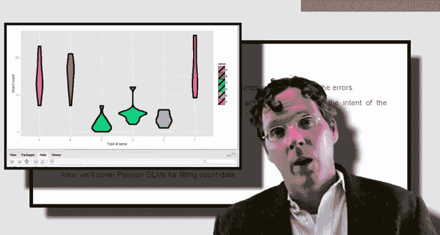
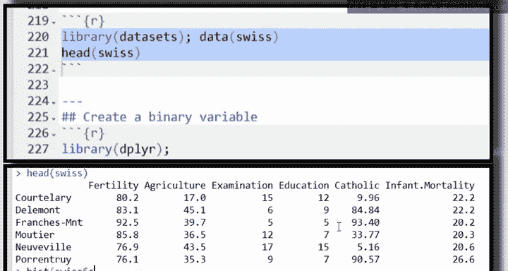
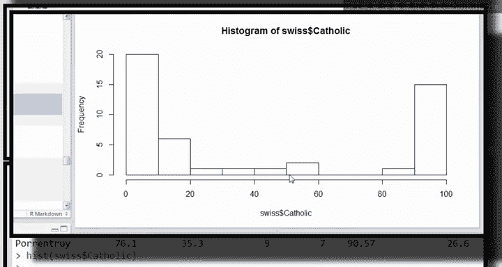
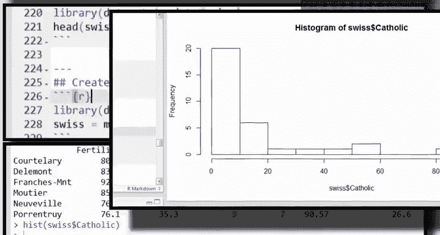
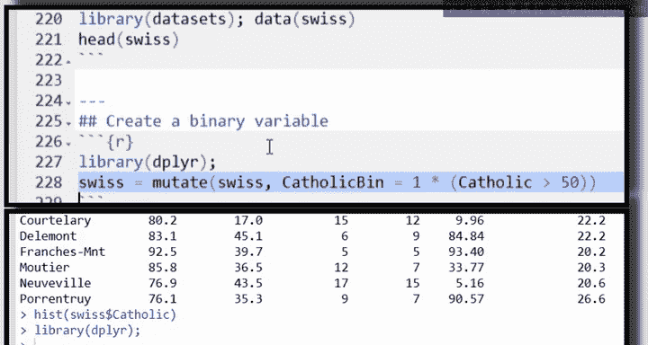
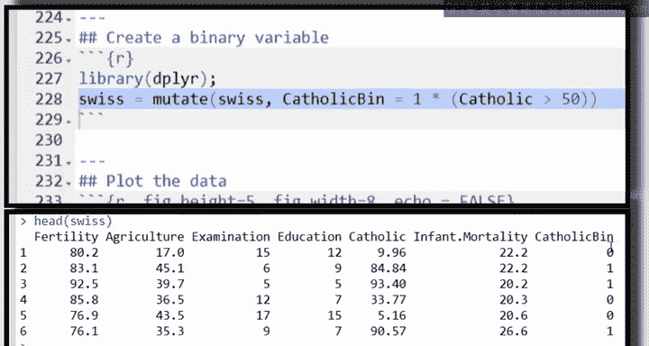
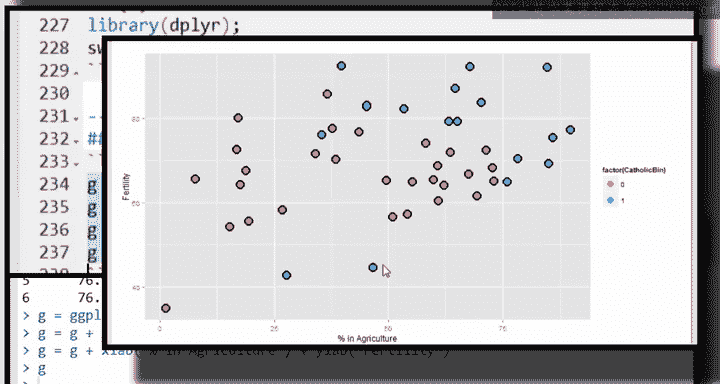
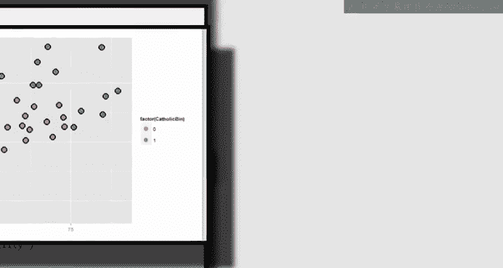
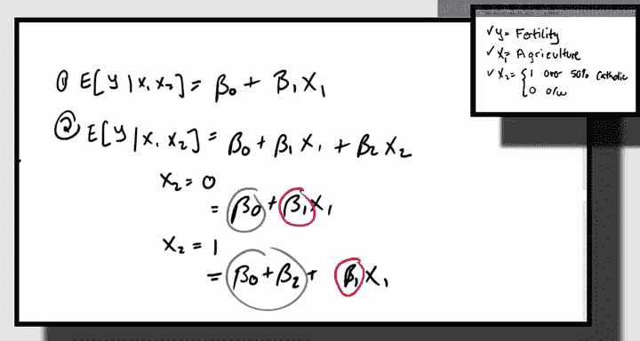
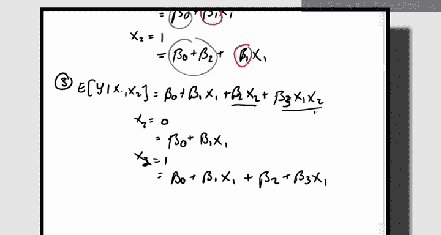

# 065：多元回归示例 第3部分 📊



在本节课中，我们将学习多元回归中的一个重要应用：协方差分析。我们将通过一个具体示例，演示如何为不同组别拟合具有不同截距和斜率的回归线。

## 概述

上一节我们讨论了多元回归的基本概念。本节中，我们将使用瑞士数据集，以生育率为因变量，农业人口比例为自变量，并引入一个表示省份主要宗教信仰的二元变量，来演示如何拟合多条回归线。



## 数据准备





首先，我们使用瑞士数据集。我们关注生育率与农业人口比例的关系，并暂时忽略教育和考试等其他变量的影响。我们的目标是展示如何为不同组别拟合不同的回归线。

我们关注“Catholic”变量。通过绘制其直方图，可以发现该变量呈明显的双峰分布，因为大多数省份要么以天主教徒为主，要么以新教徒为主。





以下是创建二元分类变量的步骤：

```r
# 使用dplyr创建二元变量
Swiss <- Swiss %>%
  mutate(CatholicBin = ifelse(Catholic > 50, 1, 0))
```

执行`head(Swiss)`命令后，可以看到数据集中新增了`CatholicBin`变量。该变量在省份以新教徒为主时为0，以天主教徒为主时为1。

随后，我们绘制数据散点图。图中显示了两个组别的数据点。虽然存在一些潜在的异常值，并且其他变量可能对模型有影响，但为了当前演示的清晰性，我们暂时忽略这些问题，专注于拟合不同组别的回归线。





## 模型构建

现在，我们描述几种可以拟合的模型。设：
*   **Y** 为生育率。
*   **X1** 为农业人口比例。
*   **X2** 为二元变量（1表示天主教省份，0表示新教省份）。


以下是三种模型：

**模型 1：忽略宗教差异**
该模型完全忽略省份的宗教信仰，只拟合一条回归线。
`E[Y | X1, X2] = β₀ + β₁X₁`

**模型 2：包含组别变量，无交互项**
该模型为两个组别拟合具有相同斜率但不同截距的回归线。
`E[Y | X1, X2] = β₀ + β₁X₁ + β₂X₂`
*   当 `X₂ = 0`（新教省份）：`E[Y] = β₀ + β₁X₁`
*   当 `X₂ = 1`（天主教省份）：`E[Y] = (β₀ + β₂) + β₁X₁`

**模型 3：包含组别变量和交互项**
该模型为两个组别拟合具有不同斜率和不同截距的回归线。
`E[Y | X1, X2] = β₀ + β₁X₁ + β₂X₂ + β₃(X₁ * X₂)`
*   当 `X₂ = 0`（新教省份）：`E[Y] = β₀ + β₁X₁`
*   当 `X₂ = 1`（天主教省份）：`E[Y] = (β₀ + β₂) + (β₁ + β₃)X₁`



在模型3中，系数 **β₂** 表示从新教省份切换到天主教省份时，回归线**截距**的变化量。系数 **β₃** 则表示从新教省份切换到天主教省份时，回归线**斜率**的变化量。

## 代码实现

理论部分可能有些抽象，接下来我们通过实际代码来运行这些模型，这会让理解变得更加直观。

```r
# 拟合模型1
fit1 <- lm(Fertility ~ Agriculture, data = Swiss)



# 拟合模型2
fit2 <- lm(Fertility ~ Agriculture + CatholicBin, data = Swiss)

# 拟合模型3
fit3 <- lm(Fertility ~ Agriculture * CatholicBin, data = Swiss)
# 等价于 Fertility ~ Agriculture + CatholicBin + Agriculture:CatholicBin
```

运行代码后，可以查看每个模型的摘要，观察系数（β₀, β₁, β₂, β₃）的估计值，从而验证我们关于截距和斜率变化的解释。

## 总结


本节课中，我们一起学习了多元回归在协方差分析中的应用。我们通过瑞士数据的示例，逐步构建了三个模型：从忽略组别差异的单一线条，到为不同组别拟合平行线，最后到为不同组别拟合完全独立的线条。核心在于理解如何通过引入**二元变量**和**交互项**，在同一个回归模型中灵活地刻画不同组别的特征。