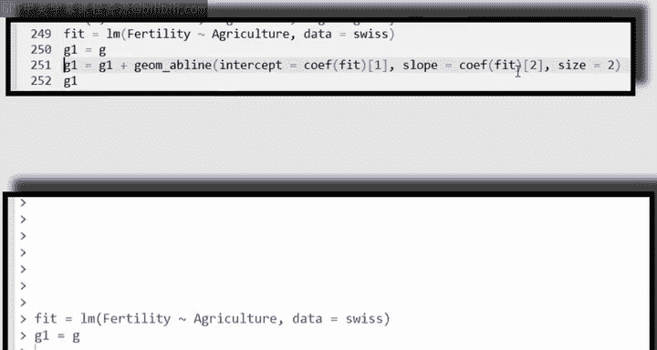
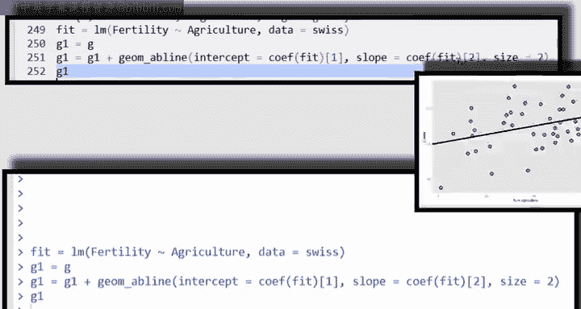
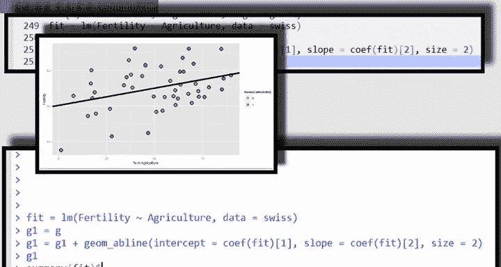
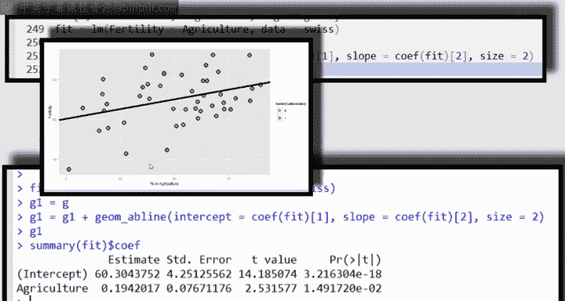
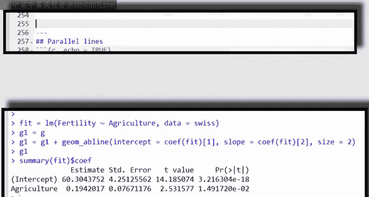
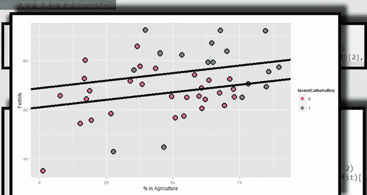
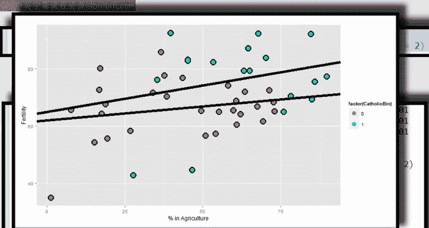
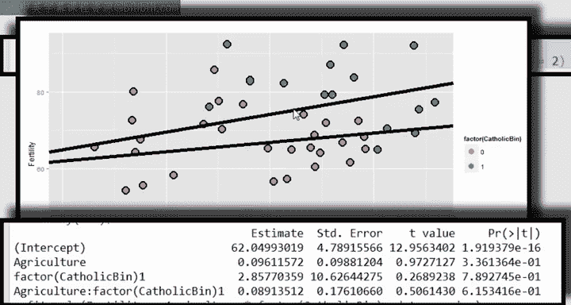
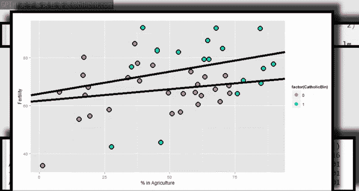

# 066：多元回归示例 第4部分 🧮

在本节课中，我们将通过一个实际案例，学习如何在R语言中拟合和解释包含分类变量的多元线性回归模型。我们将从最简单的模型开始，逐步增加模型的复杂度，并学习如何可视化不同模型的结果。



## 概述



我们将使用一个关于瑞士各省生育率的数据集，探索农业从业人口比例与生育率之间的关系，并考虑宗教（天主教徒比例）是否会影响这种关系。我们将拟合三个模型：一个忽略宗教的模型、一个包含宗教作为平行线效应的模型，以及一个包含交互项的模型。

## 模型拟合与解释







上一节我们介绍了多元回归中分类变量的处理。本节中，我们来看看如何在实际数据中应用这些概念。

首先，我们拟合一个完全不考虑宗教影响的模型。这个模型仅用农业从业人口比例来预测生育率。

```r
# 拟合不考虑宗教的模型
fit <- lm(fertility ~ agriculture, data = swiss)
```

以下是该模型的系数摘要：

```r
summary(fit)$coefficients
```

模型结果显示，截距约为60，农业比例的斜率约为0.19。这条拟合线忽略了图中数据点的颜色（代表宗教）。

接下来，我们拟合一个包含宗教变量的模型，但假设它对斜率没有影响，即拟合两条平行线。

```r
# 拟合包含宗教作为平行线效应的模型
fit <- lm(fertility ~ agriculture + factor(catholic_bin), data = swiss)
```

以下是该模型的系数摘要：

```r
summary(fit)$coefficients
```

在这个模型中，截距代表新教省份的基线生育率，农业比例的斜率对所有省份都相同。`catholic_bin`变量的系数（约7.88）代表天主教省份的截距需要增加的量。

现在，我们拟合一个更复杂的模型，允许宗教影响农业与生育率关系的斜率，即包含交互项。



```r
# 拟合包含交互项的模型
fit_star <- lm(fertility ~ agriculture * factor(catholic_bin), data = swiss)
```

以下是该模型的系数摘要：

```r
summary(fit_star)$coefficients
```

在R语言中，使用星号 `*` 连接两个变量会自动拟合交互项以及所有的主效应。因此，这个模型包含了：
*   新教省份的截距和斜率（农业比例）。
*   天主教省份的截距变化量（`catholic_bin`系数）。
*   天主教省份的斜率变化量（交互项系数）。

## 结果可视化

我们将通过绘图来直观比较这三个模型。

首先，绘制不考虑宗教的模型拟合线。

```r
# 绘制散点图并添加第一条拟合线
g1 <- ggplot(swiss, aes(x = agriculture, y = fertility, color = factor(catholic_bin))) +
  geom_point()
g1 + geom_abline(intercept = coef(fit)[1], slope = coef(fit)[2])
```

其次，在图中添加平行线模型的拟合结果。

```r
# 添加平行线模型的拟合线
# 新教省份的线
g1 + geom_abline(intercept = coef(fit)[1], slope = coef(fit)[2], color = "blue") +
# 天主教省份的线
  geom_abline(intercept = coef(fit)[1] + coef(fit)[3], slope = coef(fit)[2], color = "salmon")
```

最后，绘制包含交互项模型的拟合线，这会得到两条斜率不同的线。



```r
# 添加交互项模型的拟合线
# 新教省份的线
g1 + geom_abline(intercept = coef(fit_star)[1], slope = coef(fit_star)[2], color = "blue") +
# 天主教省份的线
  geom_abline(intercept = coef(fit_star)[1] + coef(fit_star)[3],
              slope = coef(fit_star)[2] + coef(fit_star)[4], color = "salmon")
```

从图中可以看出，交互项模型拟合的两条线并不平行。根据系数判断，截距和斜率都更高的线对应天主教省份（图中鲑鱼色点），而截距和斜率较低的线对应新教省份（蓝色点）。



## 总结



本节课中我们一起学习了多元线性回归中处理分类变量的完整流程。我们从最简单的单变量模型开始，逐步引入了分类变量作为截距变化项（平行线模型），最后引入了交互项以探索分类变量对斜率的影响。我们掌握了在R语言中使用`lm()`函数拟合这些模型、解读系数摘要以及使用`ggplot2`可视化不同模型结果的方法。我们还注意到数据中可能存在一些异常点，这将在下一节关于残差分析和影响诊断的课程中进行探讨。