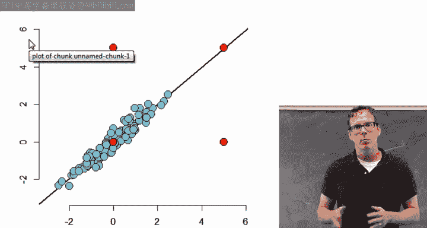

# 068：27_残差和诊断 第1部分 📊


在本节课中，我们将要学习线性回归模型中的残差、诊断和验证。我们将重点讨论如何通过残差分析来评估模型拟合的好坏，并介绍杠杆点和影响点的概念及其诊断方法。


---

上一节我们介绍了线性模型的基本设定。在本节中，我们来看看如何定义和计算残差。


我们从一个线性模型开始。在本讲座中，我们还将假设误差项服从正态分布。请注意，部分结论依赖于这个假设，而部分结论则不依赖。

残差定义为观测值与模型预测值之间的差异。其公式为：


\[
e_i = Y_i - \hat{Y}_i
\]


残差方差的估计值是残差平方和的平均值。为了获得无偏估计，我们使用 \(n - p\) 作为分母，而不是 \(n\)。公式如下：


\[
\hat{\sigma}^2 = \frac{\sum_{i=1}^n e_i^2}{n - p}
\]


---


在R语言中，可以非常方便地绘制残差图以及一系列用于衡量模型拟合优度和缺陷的图形。


以下是加载数据并拟合一个包含所有预测变量的线性模型的步骤：


```r
# 加载数据
data(swiss)
# 拟合包含所有预测变量的线性模型
fit <- lm(Fertility ~ ., data = swiss)
```

使用通用的 `plot` 命令可以直接绘制拟合结果，它会自动生成一系列残差诊断图。


```r
# 设置图形参数，将所有图放在一页
par(mfrow = c(2, 2))
# 绘制诊断图
plot(fit)
```


在本课程中，我们将讲解这些图形的基本含义。为此，我们需要区分影响点和离群点。

---

为了理解杠杆和影响的概念，让我们观察一个散点图。图中大部分数据在预测变量和响应变量之间呈现清晰的线性关系。

图中有四个用橙色标记的点值得讨论。

第一个点位于左下角，处于数据云的中心。它既没有太大的影响力，也没有太高的杠杆作用。


那么，杠杆和影响具体指什么呢？让我们看看右上角的那个点。请记住，回归线必须穿过Y的平均值和X的平均值。我们可以将这两个平均值视为一个“支点”。


回归线就像一根必须穿过这个支点的杠杆。就像物理中的杠杆原理一样，点离支点越远，其杠杆作用就越大。


如果一个数据点远离X值的自然范围，它就具有高杠杆；如果它位于X值的中心，则具有低杠杆。因此，杠杆的概念仅指数据点距离X值中心的远近。


另一方面，影响则是指该点是否选择“运用”其杠杆。那个远离中心但依然紧密遵循回归关系的点，虽然具有高杠杆，但它选择不施加影响。


然而，看看右下角的点。如果这个点被包含在回归分析中，它可能会对回归线产生巨大影响。因为它既远离数据云，又不遵循其他数据所揭示的关系。这个点同时具有高杠杆和高影响。


最后，讨论一下左上角的点。它位于X值的中心，因此具有低杠杆。但是，它完全不遵循数据关系。因此，虽然它是一个离群点，但它不会像右下角的点那样对模型产生同等程度的影响。


---




本节课中我们一起学习了残差的基本定义和计算，了解了杠杆点和影响点的核心区别，并初步认识了如何在R中生成残差诊断图。下一节我们将深入探讨具体的诊断度量方法。