# 070：残差与诊断（第三部分）🔍

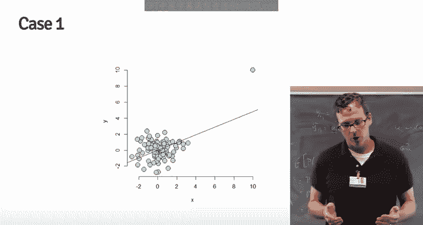

在本节课中，我们将通过模拟实验来理解几种诊断指标的工作原理，并学习如何解读回归诊断图。我们将重点关注**离群点**、**杠杆值**和**DFBETA**等概念，并通过实际案例展示残差图如何揭示模型潜在问题。

---

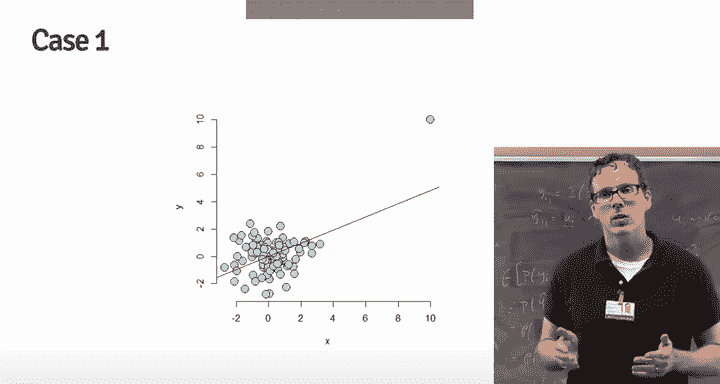

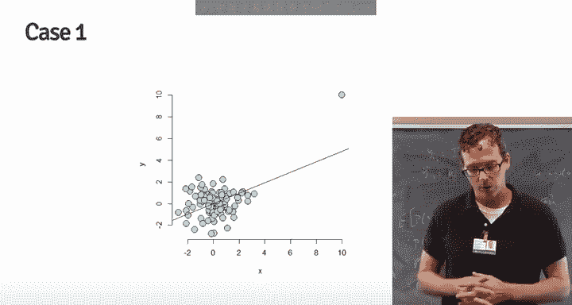

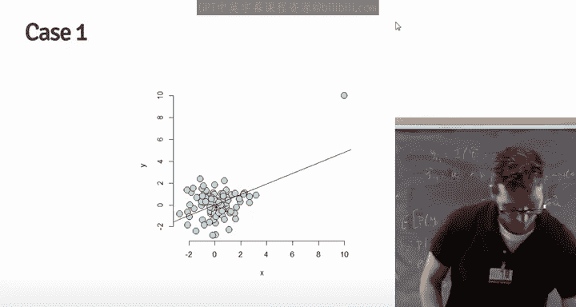

## 模拟实验：理解诊断指标


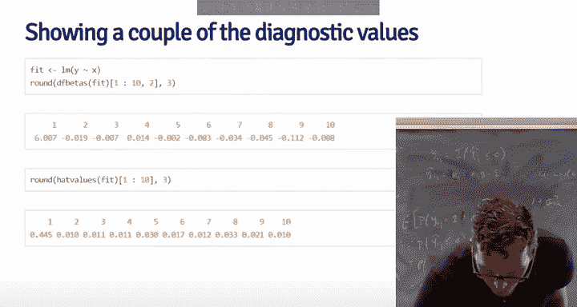

上一节我们介绍了杠杆值和DFBETA等概念，本节中我们通过模拟数据来观察它们在实际中的表现。

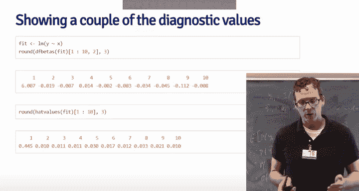

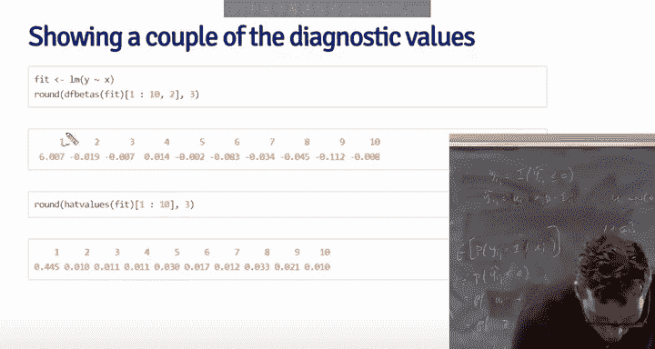

### 实验一：不相关数据中的离群点

首先，我们生成一组不相关的数据点，并添加一个明显的离群点 `(10, 10)`。

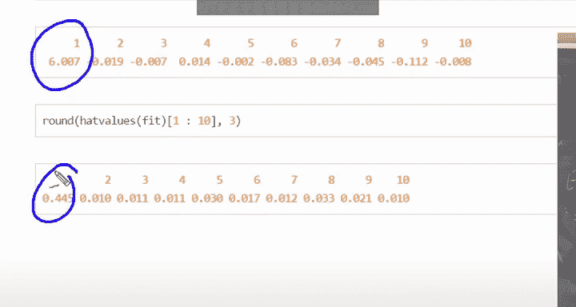

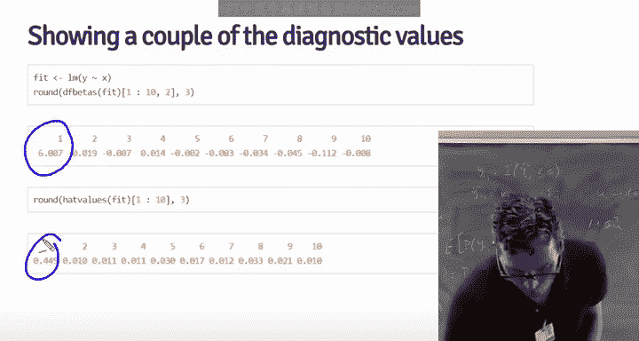

```r
# 生成独立的正态随机数对
x <- rnorm(100)
y <- rnorm(100)
# 添加离群点
x <- c(x, 10)
y <- c(y, 10)
```

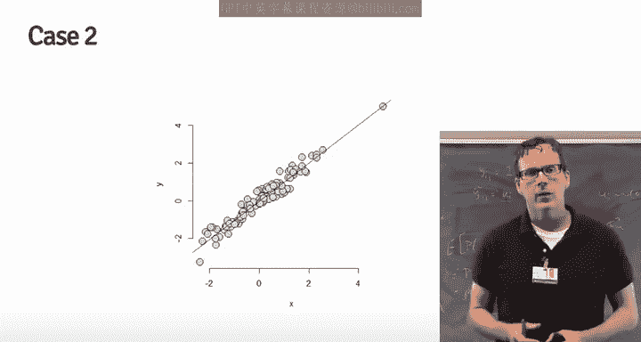

绘制散点图后，我们发现仅因这一个离群点的存在，数据整体呈现出虚假的强相关性，而实际上其余数据点间的相关性应为零。

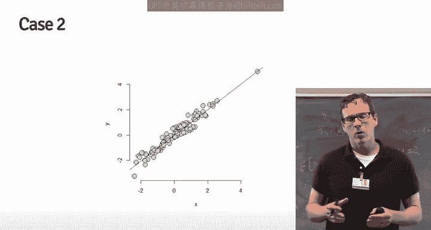

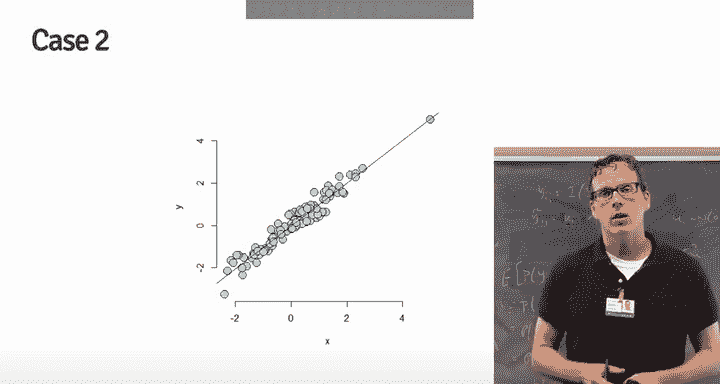

以下是计算出的诊断指标：

*   **DFBETA值**：离群点 `(10, 10)` 的DFBETA值远大于其他所有点。
    ```r
    round(dfbetas(lm(y ~ x)), 3)
    ```
*   **杠杆值 (Hat Value)**：该离群点的杠杆值也显著高于其他点。杠杆值范围在0到1之间。

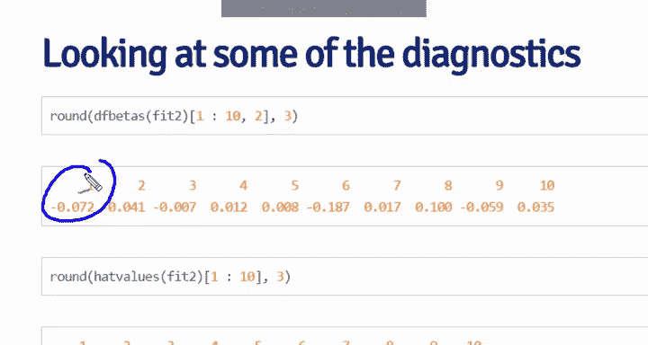

通过这两个指标，我们可以轻易地识别出这个具有高影响力且杠杆值高的离群点。

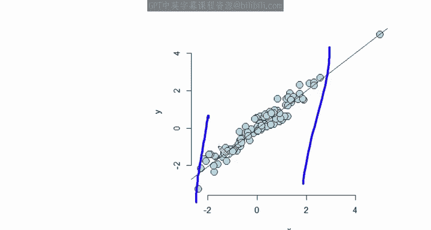

### 实验二：回归线上的离群点

接下来，我们生成一组具有明显线性关系的数据，并添加一个在X方向上远离主体数据，但恰好落在回归线上的点。

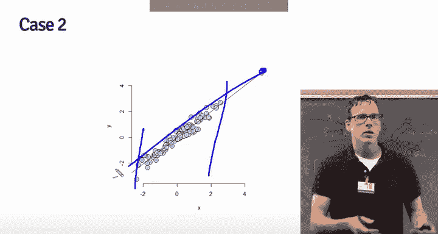

```r
# 生成线性关系数据
x <- 1:100
y <- x + rnorm(100, sd=5)
# 添加一个在X方向远离但在线上的点
x <- c(x, 200)
y <- c(y, 200)
```


在这个案例中，诊断指标的表现有所不同：

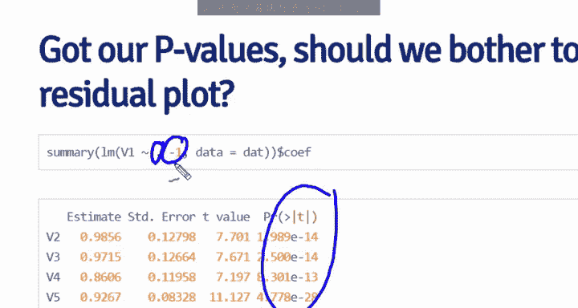

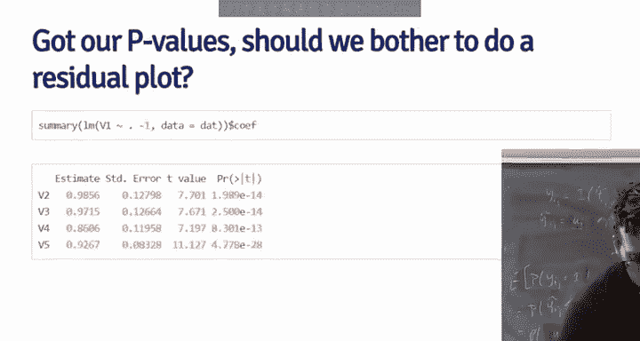

*   **DFBETA值**：这个离群点的DFBETA值虽然较大，但与实验一相比，其突出程度明显降低。这表明它对回归线斜率的影响相对有限。
*   **杠杆值 (Hat Value)**：该点的杠杆值仍然远高于其他点（通常是其他点的10倍以上），因为它位于X值的范围之外。

这个例子说明，一个点可以具有**高杠杆值**（由其在自变量空间中的位置决定），但如果它符合模型的趋势，其**影响力（如DFBETA）** 可能并不大。

---

## 残差图的重要性：Anscombe数据集示例


上述模拟实验向我们展示了为何需要进行残差分析。残差图的核心作用是**放大**模型可能存在的问题。


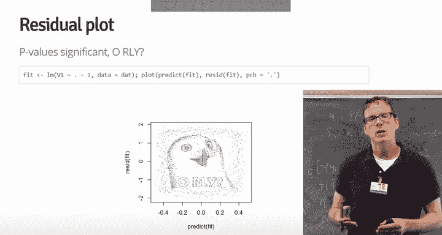

我们以经典的Anscombe数据集为例。如果仅查看配对散点图或线性模型的汇总统计（如P值），所有四个数据集看起来都非常相似且拟合良好。

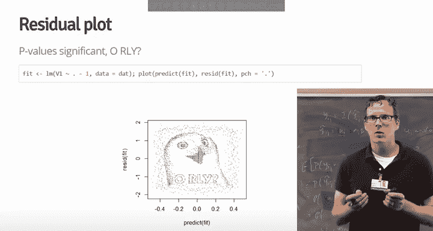

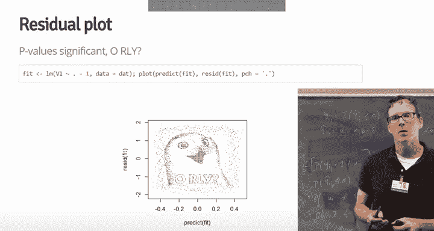

然而，当我们绘制**残差与拟合值图**（对于多变量模型，这是最常见的残差诊断图）时，问题便暴露无遗。

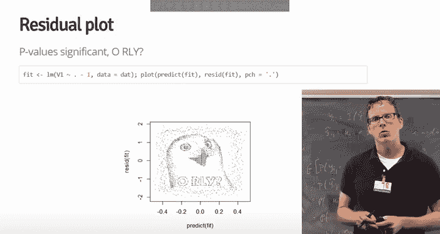

```r
# 绘制残差 vs 拟合值图
plot(lm_object, which = 1)
```

在Anscombe的一个数据集中，残差图显示出一个清晰的、系统性的曲线模式。这强烈表明线性模型未能捕捉数据中的真实结构。**如果不查看残差图，我们将会完全错过这个重要的模型误设信号。** 回归分析的目标是建模系统性的部分，而将无法解释的部分视为随机噪声。残差图中明显的模式正是我们需要建模的系统性信息。

---

## 解读R中的标准诊断图

现在，让我们回到实际的瑞士数据集，解读R语言`plot()`函数为线性模型对象默认生成的诊断图集。

以下是四张标准诊断图及其解读要点：

1.  **残差与拟合值图 (Residuals vs Fitted)**
    *   **目的**：检查残差是否随机分布，以及方差是否恒定（同方差性）。
    *   **解读**：理想情况是点随机均匀分布在水平线y=0周围。如果出现漏斗形、曲线形等模式，则可能暗示异方差性或模型形式错误。

2.  **正态Q-Q图 (Normal Q-Q)**
    *   **目的**：评估误差项是否服从正态分布。
    *   **解读**：点应大致落在对角线上。严重偏离对角线表明残差非正态，可能影响假设检验的可靠性。

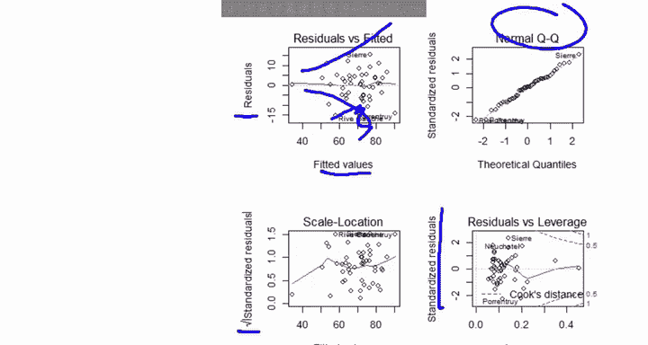

3.  **尺度-位置图 (Scale-Location Plot)**
    *   **目的**：再次检查同方差性，有时比第一张图更敏感。
    *   **解读**：绘制标准化残差的平方根与拟合值的关系。水平红线表示方差恒定。如果出现明显的上升或下降趋势，则表明存在异方差性。

4.  **残差与杠杆图 (Residuals vs Leverage)**
    *   **目的**：识别既有高杠杆又有大残差的强影响点。
    *   **解读**：结合了杠杆值和残差信息。需要特别关注右上角或右下角的点，它们对模型参数估计有强烈影响，且可能是不良影响。图中通常还会添加Cook距离的等高线。

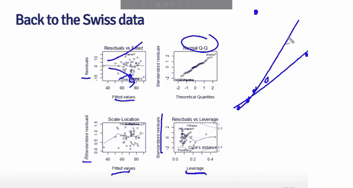

在瑞士数据集的诊断图中，这些图形均未显示出特别严重的问题。在实际分析中，理想的情况是能够与图形交互，例如将鼠标悬停在点上即可显示该点的具体信息（如观测编号），这有助于进一步调查。我们将在后续的数据产品课程中探讨如何创建此类交互式图形。

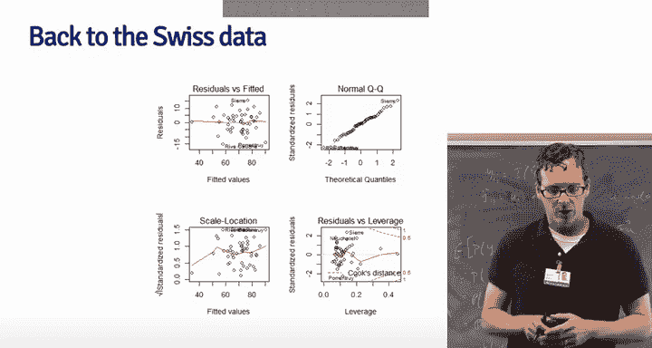

---

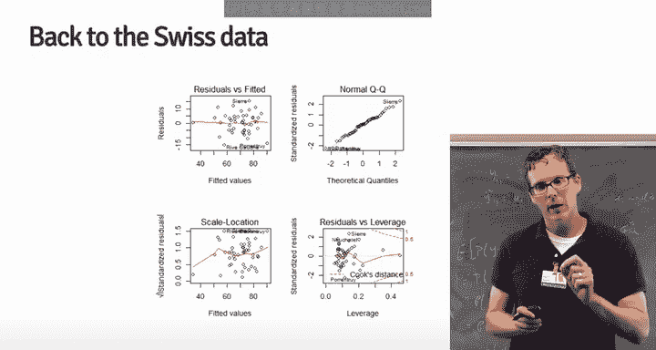

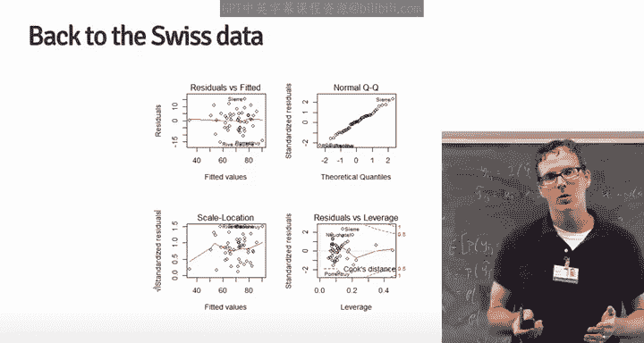

## 总结


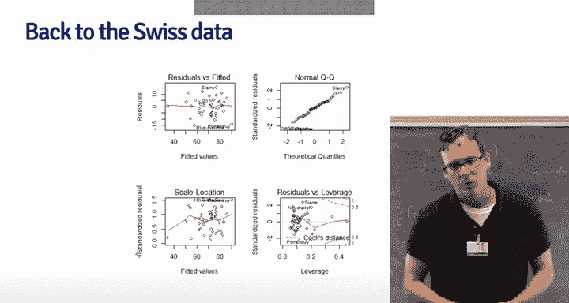

本节课中，我们一起学习了：
1.  通过模拟实验理解了**杠杆值**和**DFBETA**等诊断指标如何帮助识别不同类型的离群点和强影响点。
2.  认识到**残差图**在揭示模型误设（如非线性、异方差性）方面的不可替代作用，Anscombe数据集是极佳的例证。
3.  系统解读了R语言生成的**四张标准回归诊断图**，包括残差与拟合值图、Q-Q图、尺度-位置图和残差与杠杆图，并了解了每张图的诊断目的。

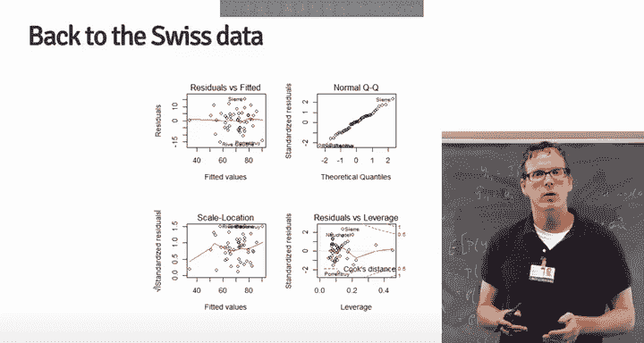


掌握这些诊断工具并将其纳入你的回归分析流程，将极大地帮助你评估模型假设、识别问题数据点，从而建立更稳健、可靠的统计模型。