# 073：模型选择 第3部分 📊


在本节课中，我们将要学习模型选择中关于残差方差估计的影响、自动化模型选择的一般概念，以及一种实用的嵌套模型检验方法。我们还将探讨良好实验设计如何简化模型构建过程。

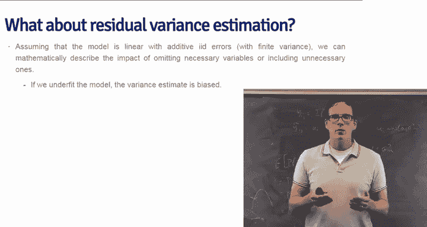

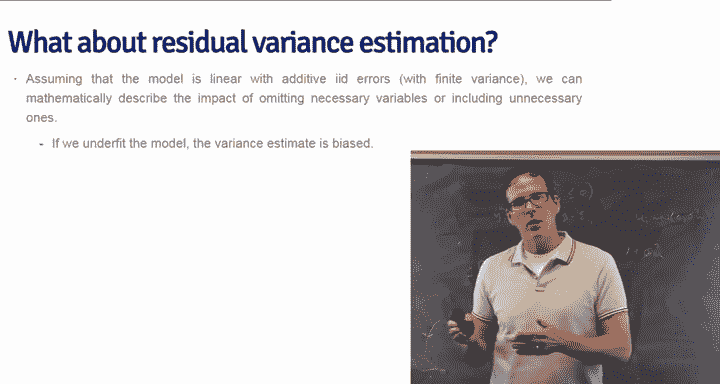

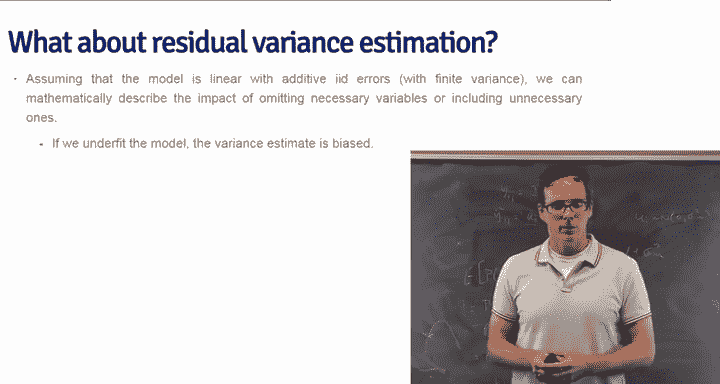

---

## 残差方差估计的影响 📈

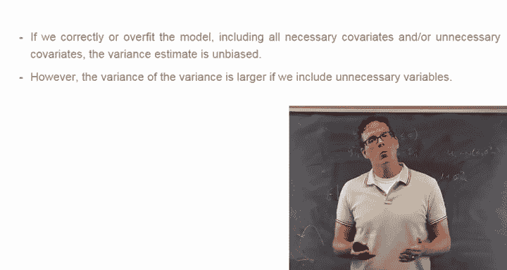

上一节我们讨论了包含或遗漏变量对回归系数的影响。本节中我们来看看它们对另一个重要估计参数——残差方差 **σ²** 的影响。

假设我们的线性模型具有独立同分布误差，且模型形式正确。那么，我们可以从数学上描述遗漏必要变量或包含不必要变量对残差方差估计的影响。

*   **模型欠拟合（遗漏重要变量）**：方差估计 **有偏**。这是因为我们将本应由遗漏协变量系统解释的变异，错误地归因于随机误差。
*   **模型正确拟合或过拟合（包含不必要变量）**：方差估计本身是 **无偏** 的。然而，如果我们包含了不必要变量，方差估计值的 **方差会增大**，导致估计的可靠性下降。

这与之前讨论的系数影响规律类似：遗漏变量导致偏差，包含不必要变量则降低估计的精确度。

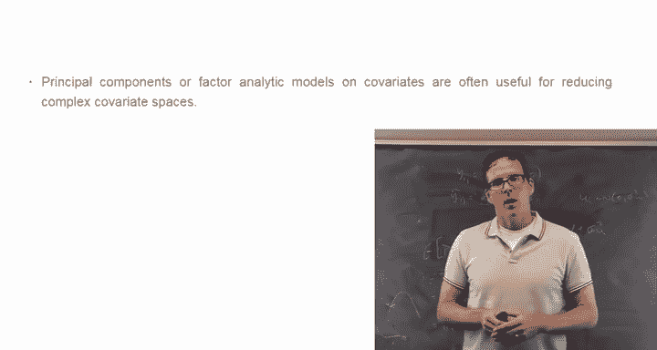

---

## 自动化模型选择概述 🤖


现在，让我们来谈谈自动化模型选择。需要说明的是，自动化模型选择如今更多是机器学习领域的主题，尤其是在自变量很多、并考虑交互项或多项式项时，模型搜索空间会爆炸式增长。

对于自变量较多的情况，可以使用主成分分析等降维技术来缩减协变量空间，但这可能会牺牲变量的可解释性。本课程主要关注自变量数量相对较少的情况，模型选择更依赖于分析者、数据和科学背景之间的高度互动过程。

---

## 良好实验设计的作用 🧪

好的实验设计通常能减少模型选择的复杂性。我们之前讨论过随机化如何使感兴趣的变量与无关的干扰变量不相关。

以下是两种重要的设计策略：


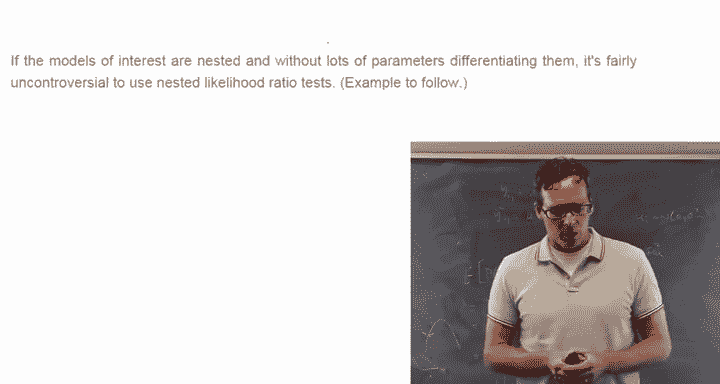

*   **分层随机化**：例如在农田实验中，将田地划分为不同的区块（层），然后在每个区块内随机分配不同的种子。这确保了公平比较，同时控制了区块间的差异。
*   **交叉设计**：在生物统计学中常见。让每个受试者先后接受不同的处理（如两种阿司匹林），并以随机的顺序进行。这样，每个受试者都作为自身的对照，控制了个体间的固有差异。需要注意“残留效应”，可通过设置足够的“洗脱期”来处理。

总之，深思熟虑的实验设计通常可以避免在纯观测性数据建模时遇到的许多问题。

---

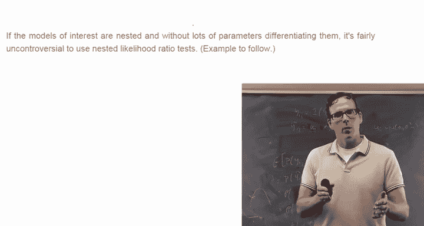

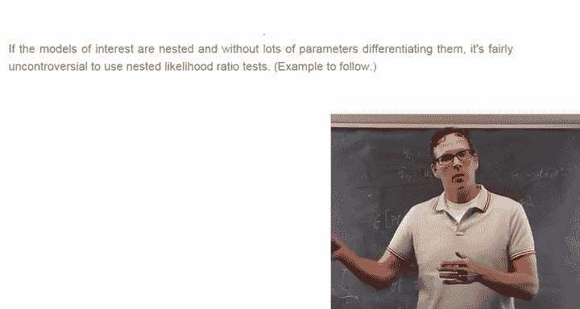

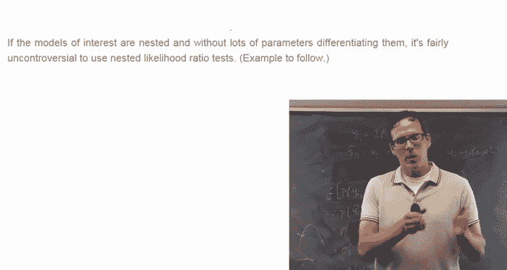

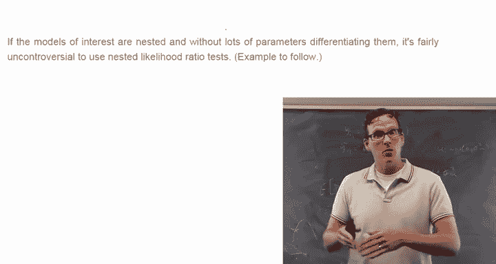

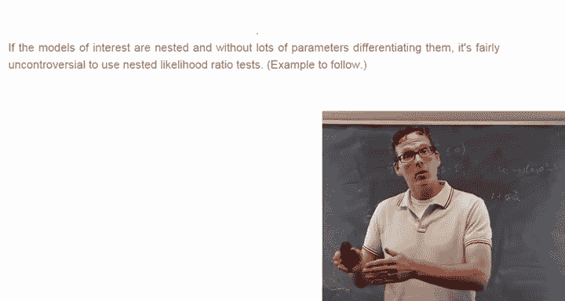

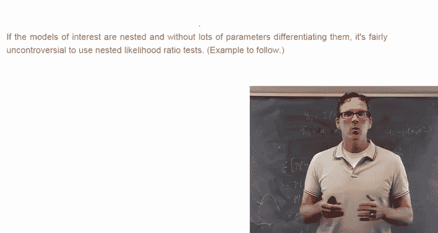

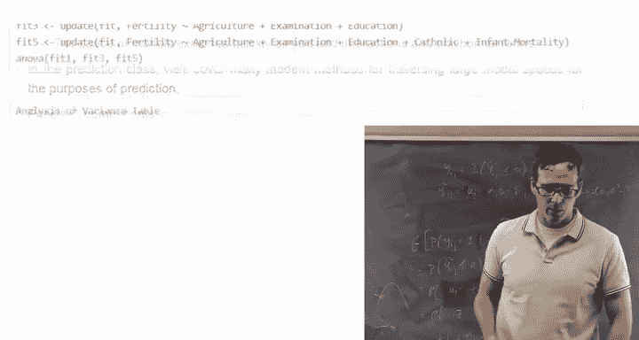

## 嵌套模型检验方法 🔍

最后，介绍一种我个人非常喜欢且实用的自动化模型搜索技术：**嵌套模型检验**。当我特别关注某个核心变量（如某种治疗），但又担心其他变量（如年龄、性别）在组间不平衡会造成混淆时，这种方法非常有用。

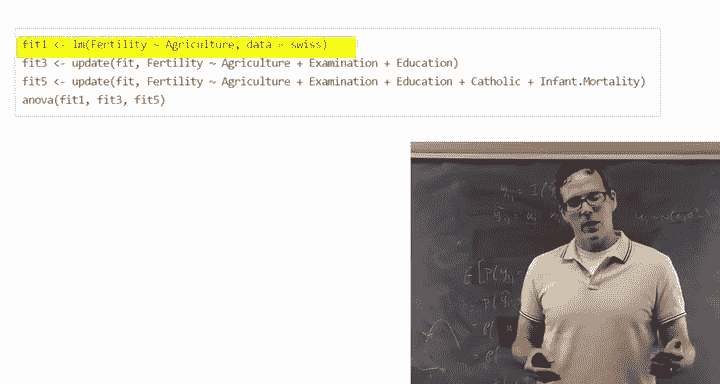

其思路是建立一系列模型，每个后续模型都完全包含前一个模型的所有项，并额外增加一项或一组项。这样，我们可以轻松地检验新增的项是否必要。

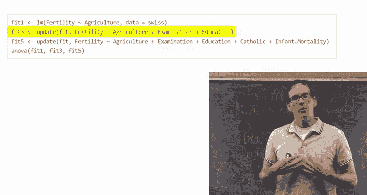

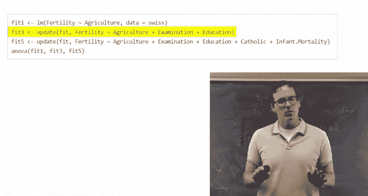

以下是如何在 R 语言中进行嵌套模型检验的示例代码。我们使用瑞士数据集，并建立三个模型：

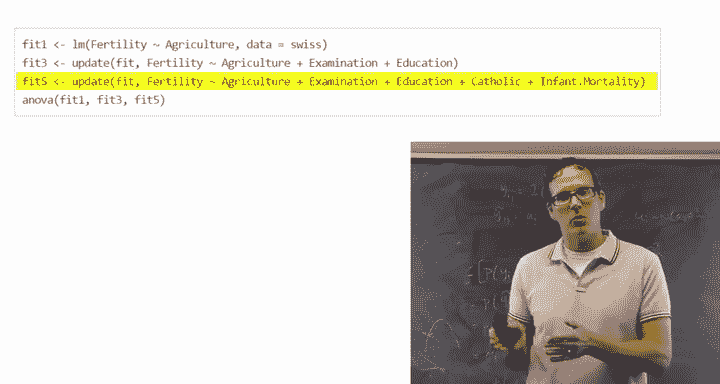

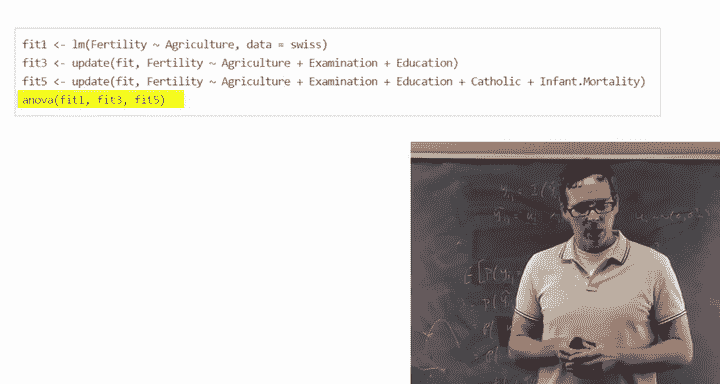

```r
# 拟合三个嵌套线性模型
fit1 <- lm(Fertility ~ Agriculture, data = swiss)
fit3 <- lm(Fertility ~ Agriculture + Examination + Education, data = swiss)
fit5 <- lm(Fertility ~ Agriculture + Examination + Education + Catholic + Infant.Mortality, data = swiss)

# 使用 anova() 函数进行嵌套模型比较
anova(fit1, fit3, fit5)
```

`anova()` 函数会列出每个模型的残差平方和与自由度，并计算 **F 统计量** 和 **P 值**，以检验从简单模型到复杂模型时，新增的变量组是否提供了显著的额外解释力。

这种方法仅在模型是**嵌套**的情况下有效。如果模型之间不是嵌套关系（例如一个模型包含A但不含B，另一个含B但不含A），则需要使用信息准则等其他自动化模型选择方法，这将在预测课程中详细讨论。

---

## 总结与思考 💡

本节课中我们一起学习了：
1.  遗漏或包含变量对残差方差估计的影响：遗漏导致偏差，包含不必要变量降低估计精度。
2.  自动化模型选择的一般概念及其局限性。
3.  良好实验设计（如随机化、分层、交叉设计）在简化模型构建中的重要作用。
4.  一种在嵌套模型场景下非常实用的假设检验方法。

最后，请记住，所有模型都是对现实的简化。正如统计学家乔治·博克斯的名言：“**所有模型都是错的，但有些是有用的。**” 我们的目标不是找到一个“完全正确”的模型，而是构建一个能够帮助我们理解数据、揭示有用真相的“透镜”。

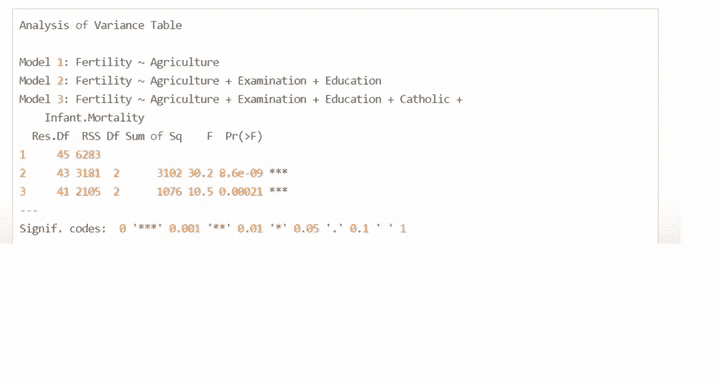

本节课到此结束，我们下节课再见。