# 075：逻辑回归 (第1部分) - 二分类数据的广义线性模型


在本节课中，我们将学习如何处理结果为二元（0或1）随机变量的数据。这类数据在分析中非常常见，例如在生物统计学中，我们经常进行生存分析，研究结束时个体是存活还是死亡。我们将通过一个具体例子——预测橄榄球队的胜负——来理解逻辑回归的核心概念。


---


## 🎯 线性回归的局限性

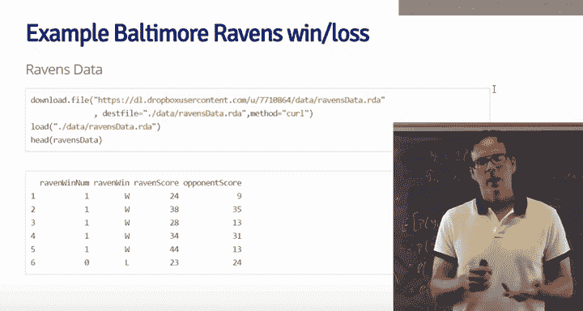

上一节我们介绍了二元数据的特点。本节中我们来看看，为什么直接使用线性回归来建模这类数据可能存在问题。

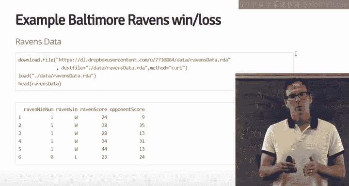

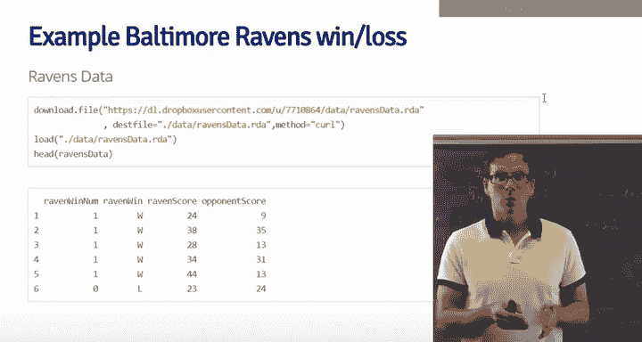


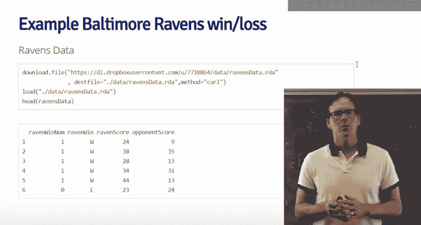

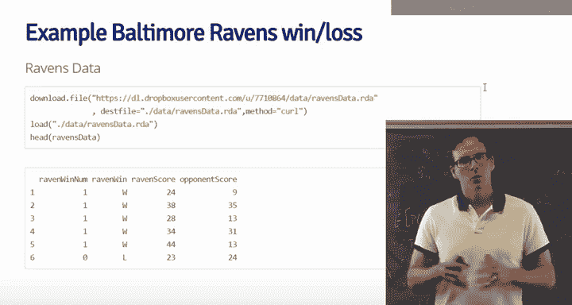

如果我们试图用线性回归模型来预测乌鸦队获胜的概率（将结果编码为1和0），模型的基本假设可能无法满足。通常，线性回归假设误差项服从高斯分布，但对于只能取0或1的结果变量，这一假设并不成立。

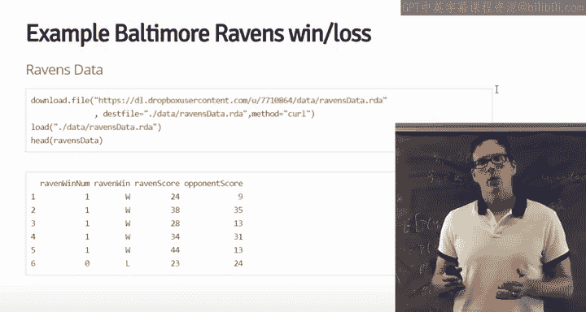

这并不意味着用线性模型拟合二元数据是绝对错误的，它有时可以作为快速分析的初步步骤。但更严谨的做法是使用逻辑回归模型。

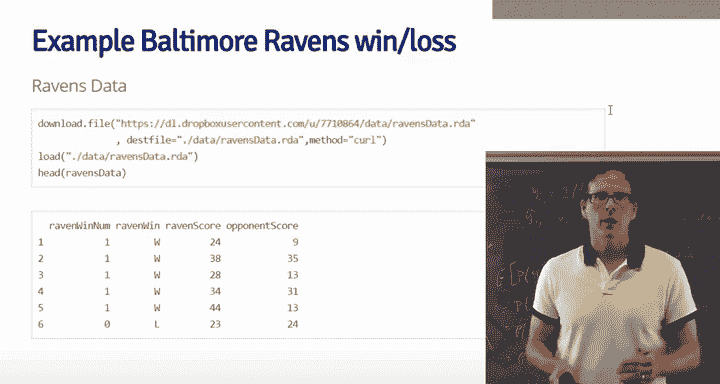

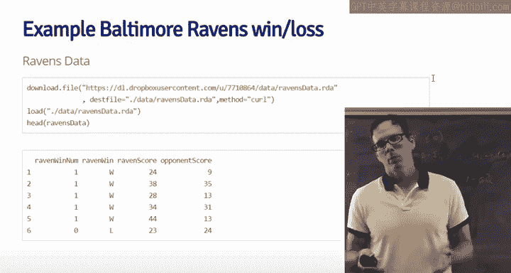

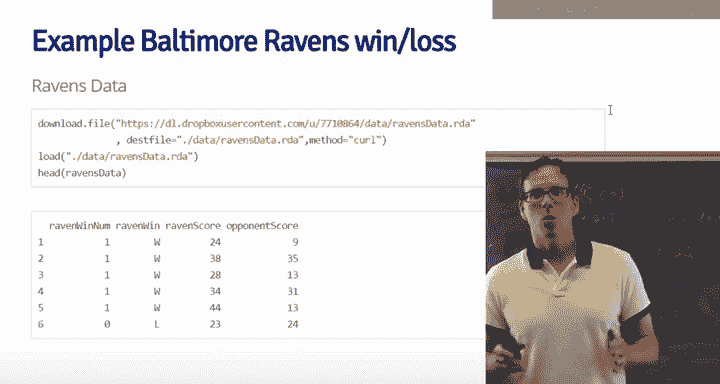

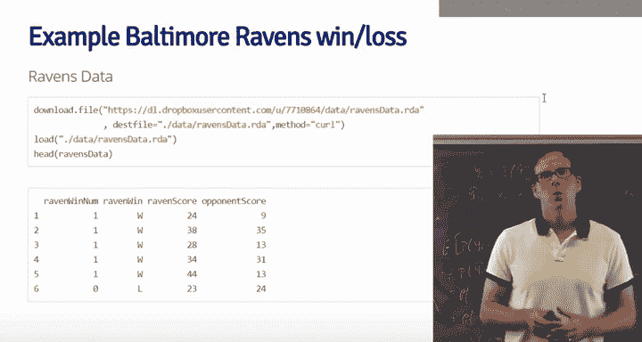

以下是在R中拟合线性回归的示例输出，它试图用斜率来估计乌鸦队获胜的概率。然而，这种模型可能会产生负值或大于1的概率估计值。

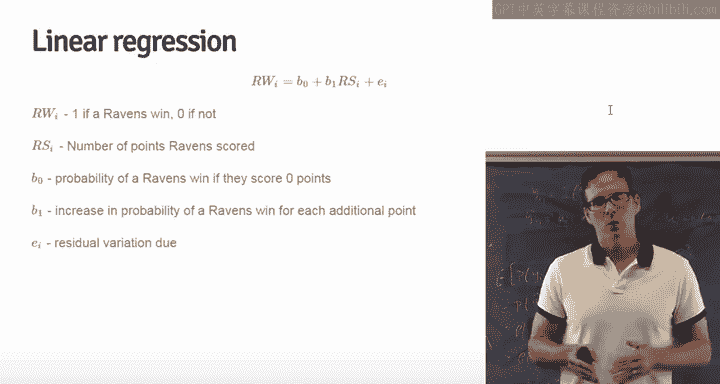

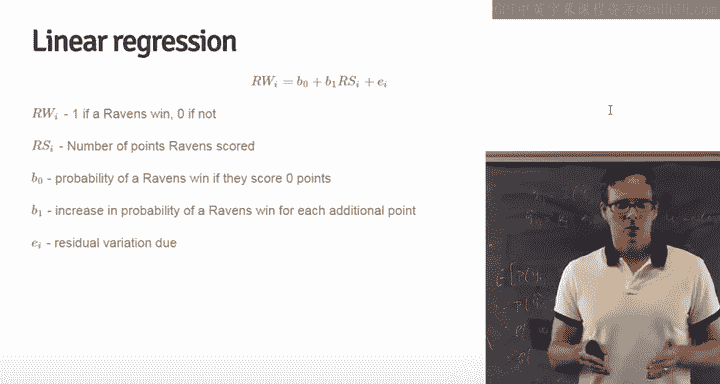

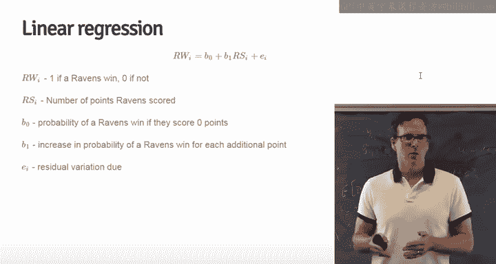

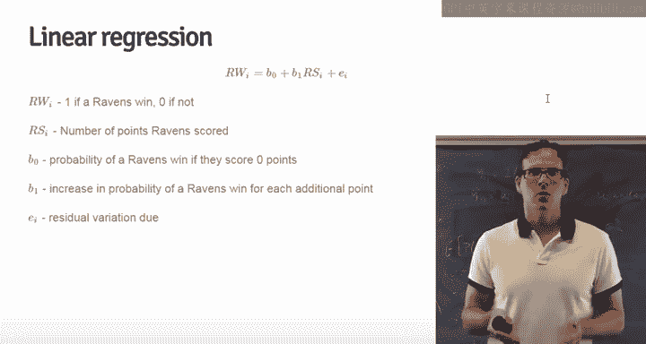

```r
# 示例：线性回归拟合（不推荐用于二元结果）
lm_model <- lm(ravenWinNum ~ ravenScore, data = ravens_data)
summary(lm_model)
```

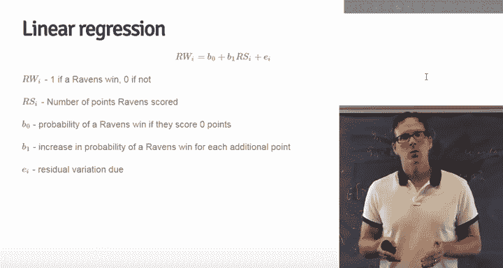

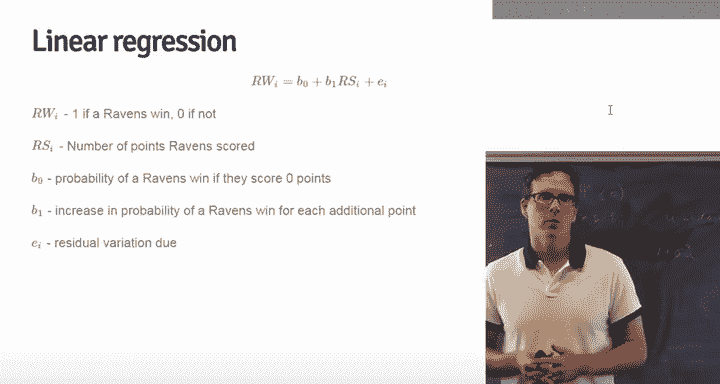

---

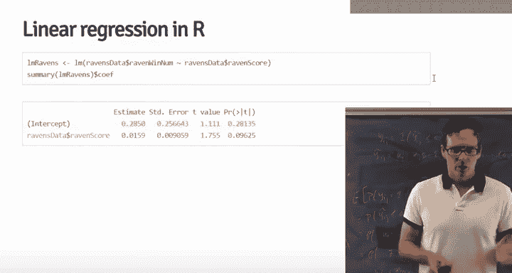

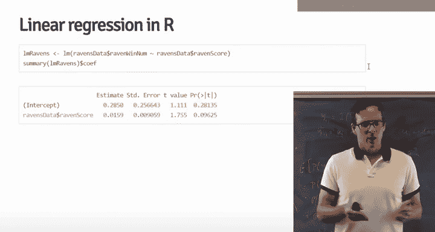

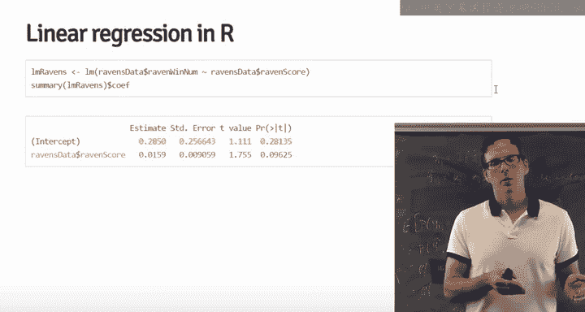

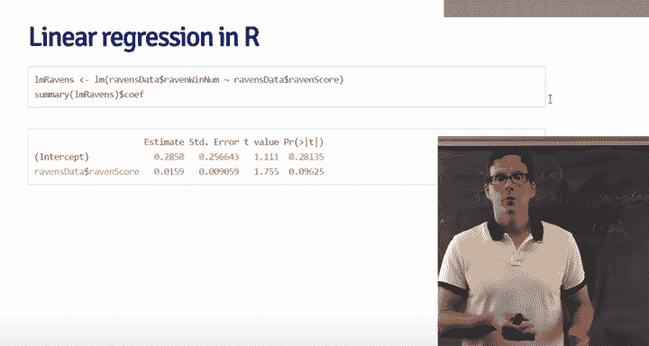

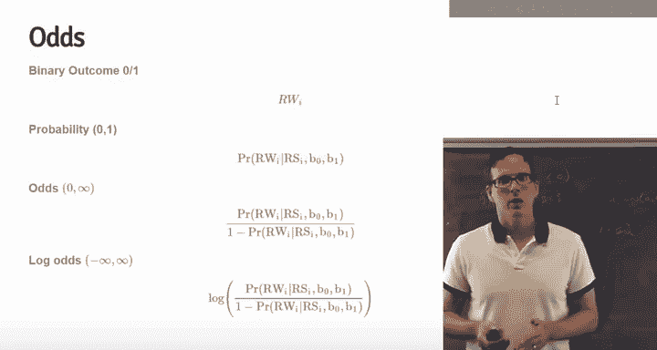

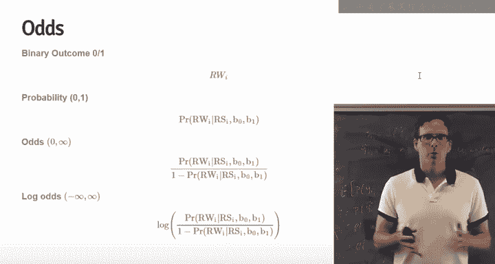

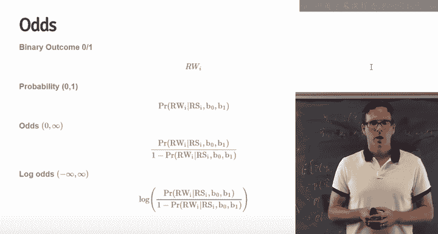

## 🔄 从概率到比值比

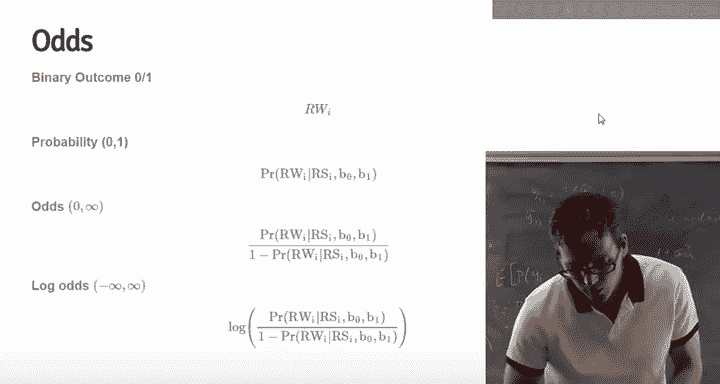

鉴于线性回归的局限性，一个更好的方法是建模**比值比**。

首先，我们来定义几个核心概念。设乌鸦队获胜的概率为 \( p \)。

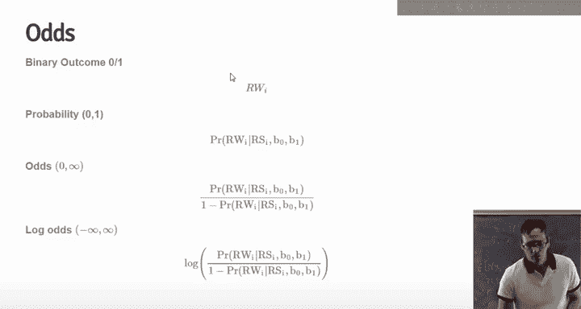

*   **比值比** 定义为：\( \text{Odds} = \frac{p}{1 - p} \)
*   反之，**概率** 可以从比值比推导：\( p = \frac{\text{Odds}}{1 + \text{Odds}} \)
*   **对数比值比** 是比值比取自然对数：\( \text{Logit}(p) = \log\left(\frac{p}{1 - p}\right) \)

逻辑回归的巧妙之处在于：我们不直接对概率 \( p \) 本身建立线性模型，而是对概率的**对数比值比**建立线性模型。模型形式如下：

\[
\log\left(\frac{p_i}{1 - p_i}\right) = \beta_0 + \beta_1 \times \text{RavenScore}_i
\]

其中，\( p_i \) 是第 \( i \) 场比赛乌鸦队获胜的概率。这个函数 \( \text{Logit}(\cdot) \) 将概率 \( p \) (取值范围0到1) 映射到了整个实数轴 \( (-\infty, +\infty) \)，从而可以使用线性模型。

我们可以通过一个称为 **expit** 的函数，将对数比值比转换回概率：
\[
p = \frac{e^{\beta_0 + \beta_1 x}}{1 + e^{\beta_0 + \beta_1 x}}
\]

---

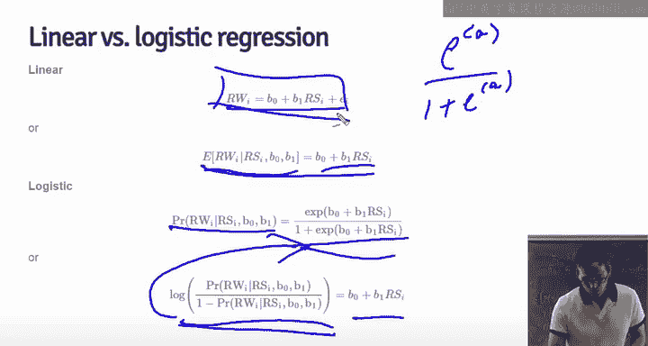

## 📈 逻辑回归系数的解释

理解了模型形式后，本节我们来看看如何解释逻辑回归的系数，这与线性回归有相似之处，也有其独特的地方。

模型中的系数可以这样理解：
*   \( \beta_0 \)：当乌鸦队得分为0时，获胜的**对数比值比**。\( e^{\beta_0} / (1 + e^{\beta_0}) \) 则是模型估计的得0分时的获胜概率。
*   \( \beta_1 \)：乌鸦队得分每增加1分，其获胜的**对数比值比**的增加量（或减少量，如果 \( \beta_1 \) 为负）。

更常用的是对 \( \beta_1 \) 取指数：
*   \( e^{\beta_1} \)：表示**比值比**。它衡量的是，乌鸦队得分每增加1分，其获胜的比值比是原来的多少倍。例如，如果 \( e^{\beta_1} = 1.2 \)，意味着得分每增加1分，获胜的比值比增加20%。

如果模型中包含多个预测变量（如是否为主场），那么 \( e^{\beta_1} \) 的解释需要在**保持其他变量不变**的前提下进行，这与多元线性回归的解释原则一致。

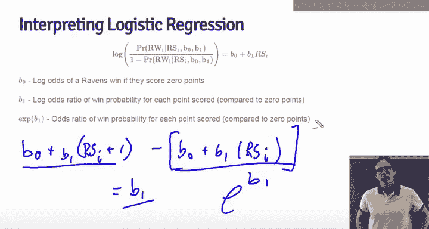

---

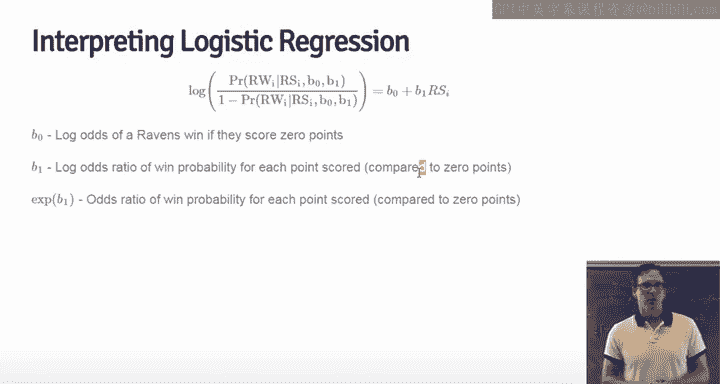

## 🏇 比值比的历史与直觉

为了更直观地理解比值比，我们可以看看它在博弈历史中的应用。

设想一个游戏：抛一枚成功概率为 \( p \) 的硬币。如果正面朝上，你赢 \( X \) 元；如果反面朝上，你输 \( Y \) 元。为了让游戏公平（期望收益为0），需要满足：
\[
\frac{Y}{X} = \frac{p}{1 - p}
\]
等式的右边正是**比值比**。因此，比值比可以理解为：为了赢得1元，你愿意为一次概率为 \( p \) 的机会支付多少对价。

这解释了为什么赛马等博彩中会使用“赔率”（如10比1）。它提供了一种快速计算期望收益的方式。有趣的是，通过动态调整赔率来平衡投注资金，博彩机构能在长期内使赔率反映出马匹获胜的真实频率，同时通过收取手续费确保盈利。

---

## ✨ 总结

本节课中，我们一起学习了逻辑回归的基础知识：
1.  **问题定义**：我们聚焦于结果为二元（0/1）变量的建模问题。
2.  **模型选择**：认识到线性回归用于此类数据的局限性，引入了逻辑回归。
3.  **核心转换**：逻辑回归的核心是对**概率的对数比值比**建立线性模型，使用 `logit` 和 `expit` 函数在概率与线性预测值之间进行转换。
4.  **系数解释**：逻辑回归的系数 \( \beta_1 \) 可以解释为预测变量每增加一个单位，结果的对数比值比的变化量；其指数 \( e^{\beta_1} \) 是具有更直观意义的**比值比**。
5.  **历史背景**：比值比的概念源于公平博弈的设定，有助于我们理解其现实含义。

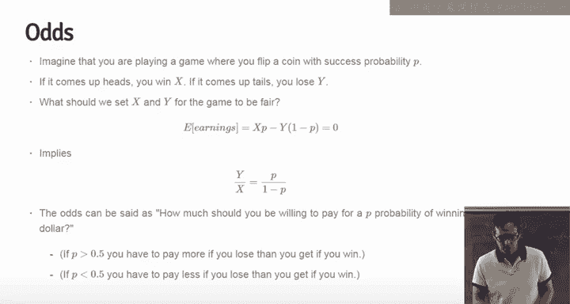

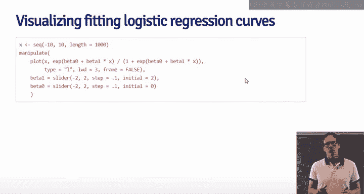

在下一讲中，我们将通过计算机实验，直观地展示如何拟合和可视化逻辑回归曲线。