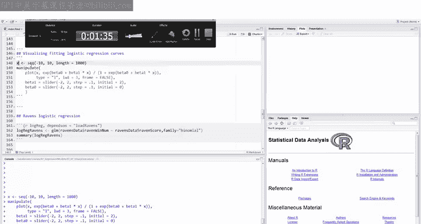
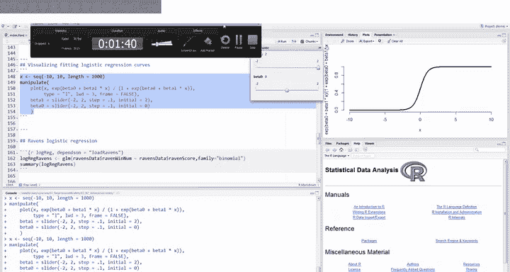
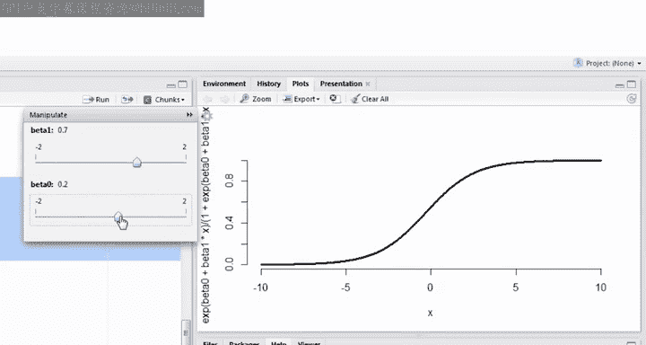
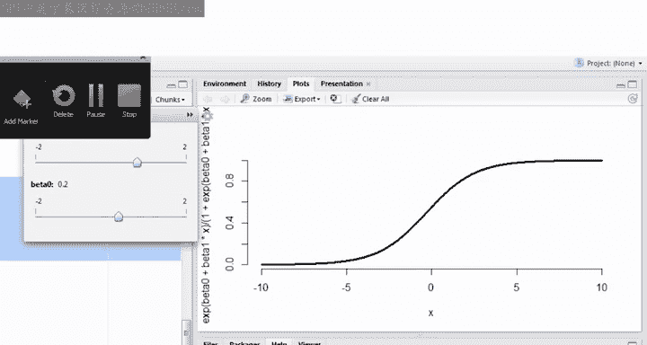
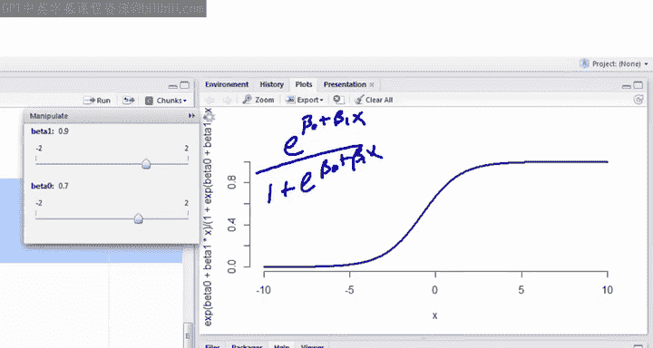

# 076：逻辑回归（第2部分）📊

在本节课中，我们将深入探讨逻辑回归曲线的形态，并理解R语言是如何拟合数据的。我们将通过可视化工具来观察参数变化如何影响曲线，从而直观地理解逻辑回归模型的拟合过程。

---

## 逻辑回归曲线与参数调整 🔧

上一节我们介绍了逻辑回归的基本概念，本节中我们来看看其核心的S形曲线以及如何通过参数控制它。

我将使用R语言中的 `manipulate` 包来动态展示逻辑回归曲线。这里我设置了两个参数：`beta0` 和 `beta1`。

以下是我的逻辑回归曲线，它呈现出一个S形。让我们观察当调整参数时，曲线会发生什么变化。

*   **调整 `beta1` 参数**：当我增大 `beta1` 的值时，曲线变得更加陡峭和“尖峰”。当我将其设为负值时，曲线会翻转过来。
*   **调整 `beta0` 参数**：这个参数的作用是使整个S形曲线向左或向右平移。由于X轴范围固定，这种平移效果可能不太明显，但它确实在水平方向上移动了曲线。

---

## 理解模型的拟合过程 🎯

现在，让我们思考R语言在拟合逻辑回归曲线时究竟在做什么。

想象我们有一组数据点，其中结果变量是0或1。在X轴的某些区域（例如左侧），我们可能观察到大量的0和偶尔的1；而在X轴的其他区域（例如右侧），情况则相反，有大量的1和偶尔的0。

R语言的目标是找到一个最能匹配数据背后概率规律的S形曲线。随着X值增大，结果为1的概率应逐渐增加；随着X值减小，结果为0的概率应逐渐增加。

因此，R语言会尝试所有不同形状的逻辑曲线（通过调整 `beta0` 和 `beta1`），以找到与观测数据关联概率匹配得最好的那一条曲线。这个过程遵循**最大似然估计**原则。如果你学习过数据科学专项课程中的统计推断部分，会对这个概念有更深入的了解。

简而言之，你可以想象数据点固定不动，而R语言通过“滑动” `beta0` 和 `beta1` 这两个“滑块”，来定义出最能拟合数据的S形曲线。这就是逻辑回归所做的一切。

---

## 核心模型公式 📐

最终拟合出的函数，即逻辑回归模型在概率尺度上的表达形式，是以下公式：

**`p(x) = e^(β0 + β1*x) / (1 + e^(β0 + β1*x))`**

这个公式将线性组合 `β0 + β1*x` 通过逻辑函数（或称Sigmoid函数）转换回了概率值（介于0和1之间）。

---

## 总结 ✨

本节课中我们一起学习了：
1.  逻辑回归曲线的S形形态及其如何通过 `beta0`（截距）和 `beta1`（斜率）参数进行控制。
2.  理解了R语言拟合逻辑回归模型的直观过程：通过调整参数，寻找能最好地描述数据中“成功”（结果为1）概率随预测变量X变化趋势的S形曲线。
3.  回顾了逻辑回归将线性预测值转换为概率的核心公式。

希望这能帮助你更好地理解逻辑回归幕后的工作原理。