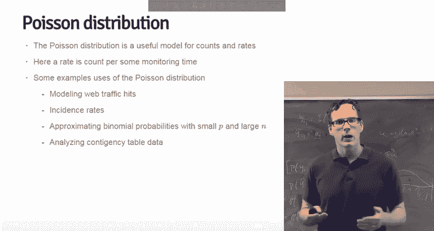
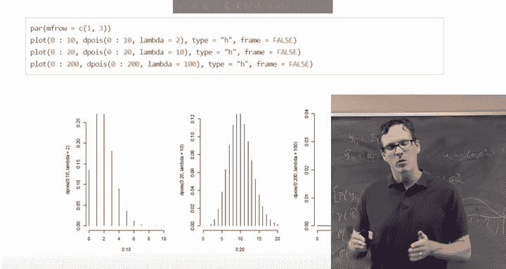
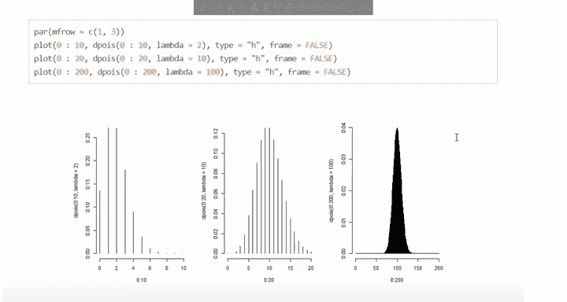
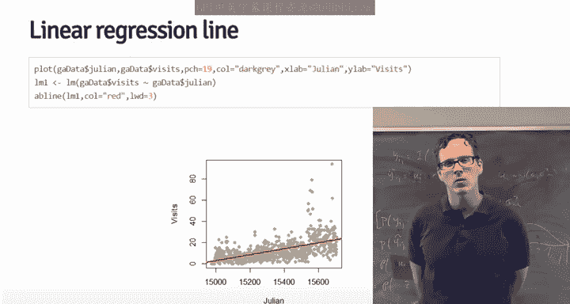
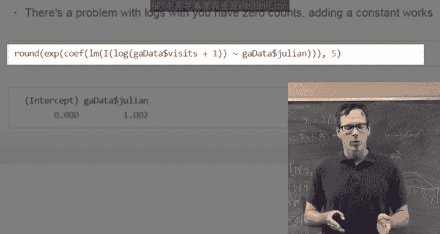
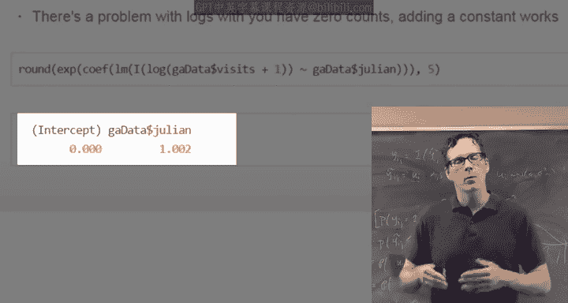

# 078：泊松回归 第 1 部分

在本节课中，我们将学习泊松回归模型。这是一种专门用于处理计数数据和比率数据的广义线性模型。我们将从理解泊松分布的基本性质开始，探讨为何线性回归在处理计数数据时存在局限，并介绍如何通过对数变换来改进模型，以获得更直观的解释。

---

## 🧮 泊松分布简介

上一节我们介绍了广义线性模型（GLM）的基本框架。本节中，我们来看看一种专门用于计数数据的模型——泊松回归。

泊松分布是建模计数和比率的有效工具。比率通常指单位时间内的计数，例如发病率、网站访问量等。泊松分布也常用于近似二项分布，特别是在成功概率很小、试验次数很大的情况下。此外，泊松模型为列联表数据的分析提供了一个优雅的框架。

以下是泊松分布的概率质量函数：

\[
P(X = k) = \frac{(t\lambda)^k e^{-t\lambda}}{k!}
\]



其中：
*   \( \lambda \) 是单位时间的发生率（率参数）。
*   \( t \) 是总观测时间。
*   \( X \) 是观测到的总计数，其期望值为 \( E[X] = t\lambda \)。


因此，发生率 \( \lambda \) 的一个自然估计量是 \( \hat{\lambda} = X / t \)。可以证明，这个估计量是无偏的，即 \( E[\hat{\lambda}] = \lambda \)。


泊松分布的一个重要特性是**均值等于方差**：\( \text{Var}(X) = t\lambda \)。这个假设在建模时需要检验。另一个有用的性质是，当均值 \( t\lambda \) 变得很大时，泊松分布会趋近于正态分布。

---



## 📈 案例分析：网站访问量



让我们通过一个具体例子来理解如何应用这些概念。我们将分析 Jeff Leek 教授的网站（`www.biostat.jhsph.edu/~jleek`）的每日访问量数据。

首先，我们加载并查看数据。数据包含日期、访问次数等字段。为了方便建模，我们将日期转换为“儒略日”（即自1970年1月1日以来的天数），这是一个连续的计数变量。

```r
# 示例代码：加载和查看数据
data <- read.csv("web_traffic.csv")
head(data)
```


以下是数据的前几行示例：
| 日期 | 访问次数 | 儒略日 |
| :--- | :--- | :--- |
| 2012-01-01 | 0 | 15340 |
| 2012-01-02 | 0 | 15341 |
| ... | ... | ... |

如果我们直接以访问次数（NH）为因变量，儒略日（JD）为自变量建立普通线性回归模型：

\[
\text{NH} = \beta_0 + \beta_1 \times \text{JD} + \epsilon
\]

这个模型存在一些问题：它预测的访问次数可能是负数，这不符合实际；并且它将变化解释为**绝对增量**（例如每天增加2次访问），而我们通常更关心**相对变化**（例如每天增长0.5%）。

---

## 🔄 对数变换模型

为了解决上述问题，一个常见的做法是对因变量（访问次数）取自然对数。我们建立如下模型：



\[
\log(\text{NH} + 1) = \beta_0 + \beta_1 \times \text{JD} + \epsilon
\]

这里对 `NH` 加 1 是为了处理访问次数为 0 的情况（因为 `log(0)` 无定义）。

这个变换带来了关键的解读优势：模型系数在经过指数运算后，可以解释为**几何均值**的相对变化。
*   \( e^{\beta_0} \) 可以解释为起始日（儒略日为0时）访问次数的估计几何均值。为了使截距更具实际意义，通常会对预测变量进行中心化处理。
*   \( e^{\beta_1} \) 可以解释为**每日访问次数几何均值的相对变化率**。

例如，如果我们得到 \( \hat{\beta}_1 = 0.002 \)，那么 \( e^{0.002} \approx 1.002 \)。这意味着模型估计网站访问量**平均每天增长约 0.2%**。如果模型中还有其他协变量，这个解释就是在保持其他变量不变的情况下，日期每增加一天所带来的相对变化。

这种相对变化的解释在商业、流行病学等领域通常比绝对变化更有意义。

---

## 📝 本节总结

本节课中我们一起学习了泊松回归的基础。我们首先回顾了泊松分布的性质，它适用于对计数和比率数据进行建模。接着，我们通过网站流量数据的例子，指出了直接使用线性回归处理计数数据的局限性，例如可能预测出负值以及解释性不佳。最后，我们介绍通过对数变换来改进线性模型的方法，这使得模型系数能够解释为几何均值的相对变化，为理解数据提供了更直观的视角。





在下一部分，我们将正式引入泊松回归这一广义线性模型，它将为我们提供更强大、更自然的框架来直接建模计数数据，并解决对数线性模型的一些剩余问题。