# 083：构建机器学习算法的步骤与权衡 ⚖️

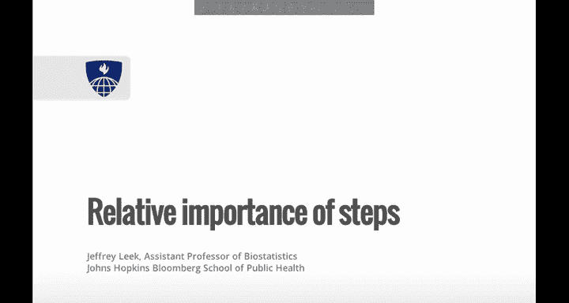

在本节课中，我们将学习构建一个机器学习算法时，各个组成部分的相对重要性以及它们之间的权衡。我们将探讨从定义问题到选择算法的完整流程，并理解为何有时“数据”比“算法”本身更为关键。

---

上一节我们介绍了构建机器学习算法的基本框架。本节中，我们来看看这个流程中各个步骤的相对重要性。

构建一个机器学习算法通常包含以下几个核心步骤：
1.  **定义问题**：提出一个具体、明确的问题。
2.  **收集数据**：获取用于构建和后续应用算法的数据。
3.  **创建特征**：将原始数据压缩、转化为可用于预测的特征集。
4.  **选择算法**：将特征输入算法，用于进行预测。

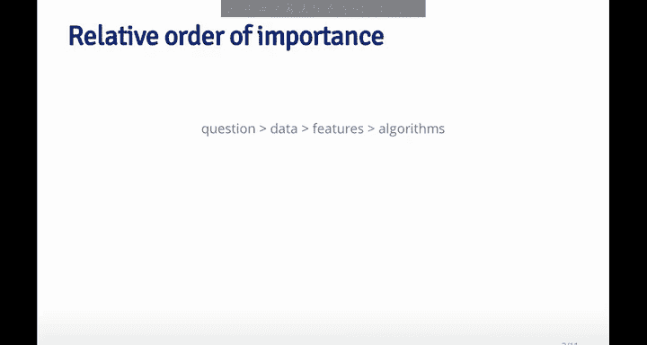

根据经验，各步骤的重要性排序通常如下：
*   **问题**是最重要的组成部分。一个具体、可收集数据的问题是成功的基础。
*   **数据**是第二重要的。你真正想回答的问题，其数据可能无法获得，或者只能以间接形式获得。
*   **特征**的创建也非常关键。如果数据压缩方式不当，可能会丢失所有相关且有价值的信息。
*   **算法**往往是相对最不重要的部分。当然，根据数据类型（如图像、语音），特定算法也可能至关重要。

---

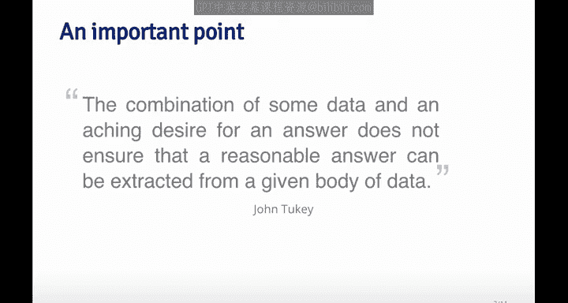

## 数据的核心地位 📊

一个值得反复强调的重要观点，最初由约翰·图基提出，即：**“拥有一些数据和对答案的强烈渴望，并不能确保能从给定数据体中提取出合理的答案。”** 换句话说，知道何时放弃是预测能力的重要组成部分——当你拥有的数据根本不足以回答你想解决的问题时。

做出这个决定时需要记住的关键点是：**垃圾进，垃圾出**。如果你收集的数据质量很差，或者对进行预测没什么用处，那么无论你的机器学习算法有多好，通常都会得到很差的结果。

一般来说，最容易预测的情况是，你拥有与你试图预测的事物完全一致的数据。例如，在Netflix竞赛中，他们试图根据用户过去的电影评分来预测新的电影评分。这是一种非常直接的关系。

在我的研究领域，你可能会收集基因表达等分子测量数据，并用它来预测人们对疾病的反应。这里也存在一条从分子信息到疾病状态的想象路径。

通常，你收集的数据与你试图预测的目标越相似，你就越有可能实现高预测精度。

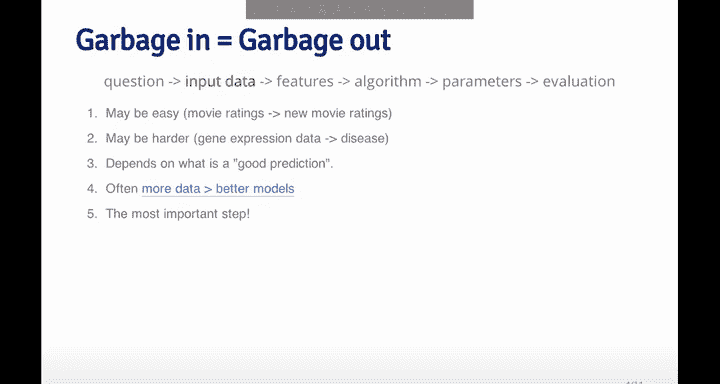

这里有一个链接指向一个讨论“数据的不可思议的有效性”的视频。其核心观点是：**在几乎所有情况下，获得更多数据通常比获得更好的统计或机器学习模型更有效**。因此，在定义问题之后，开发机器学习算法最重要的一步就是收集正确的、与你的问题相关的数据。

---

## 特征的重要性 🧩

特征也很重要。好的特征应具备以下重要属性：
*   它们能以简单的方式压缩数据，使预测计算成为可能，并且可能比复杂的原始数据更具可解释性。
*   好的特征在压缩数据的同时，保留了所有相关信息。这通常是一个难以把握的平衡。

特征通常需要借助专家的应用知识来创建。社区中对此存在争论：是自动创建特征更好，还是利用专家领域知识更好？总的来说，在许多应用中，专家领域知识能提供很大帮助，因此在为机器学习算法构建特征时应予以考虑。

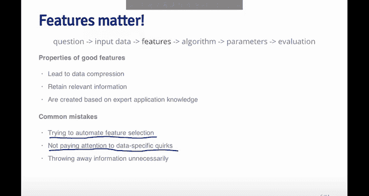

以下是创建特征时的一些常见错误：
*   试图以无法理解特征如何实际用于预测的方式来自动化特征选择。“黑箱”预测可能非常有用且准确，但如果我们不关注这些特征如何预测结果，它们也可能瞬间失效。
*   不关注数据特有的问题。例如，某些数据可能存在异常值或特定特征的奇怪行为，不理解这些会导致问题。
*   不必要地丢弃信息显然不是好主意。

---

## 算法的相对次要性 ⚙️

算法的重要性可能比你想象的要低，这有时会让人感到惊讶和沮丧。

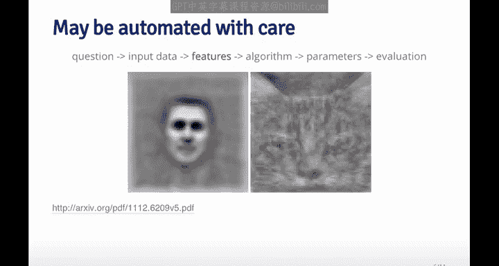

有一项研究尝试预测多种不同的任务（如分割任务、预测美国众议院投票、预测波形等）。他们使用了两种方法：一种是基础的**线性判别分析**，另一种是为每个数据集寻找的**最佳预测算法**。

结果显示，最佳算法的预测误差总是比线性判别分析稍好一点，但差距并不大。例如，在一项预测中，最佳方法的误差是0.19，而线性判别分析的误差是0.22。这表明，反复使用同一种方法确实会使预测误差变差，但并没有差得离谱。

这在许多应用中非常典型：使用一个非常合理的方法就能在很大程度上解决问题，而获得绝对最佳的方法可以带来改进，但这种改进通常不会比大多数好的、合理的方法高出太多。

---

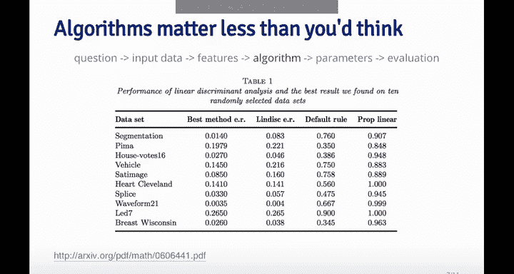

## 构建算法时的其他考量 🤔

构建机器学习算法时，还需要考虑一些其他问题，涉及不同的方面：

以下是需要考虑的几个关键属性：
*   **可解释性**：如果你的算法需要展示给医生或公司CEO，你可能希望它是可解释的，以便他们能够理解。可解释性通常意味着简单，易于解释往往比复杂难懂更好。
*   **准确性与权衡**：追求可解释性和简单性可能会降低准确性。问题在于，这种降低是否值得？为了获得可解释性或简单性，放弃多少准确性是可以接受的？
*   **可扩展性与速度**：“快速”意味着易于构建模型和在小型样本上测试模型。“可扩展”意味着易于应用于大型数据集，这可能是因为算法本身非常快，或者可以跨多个样本并行处理。

---

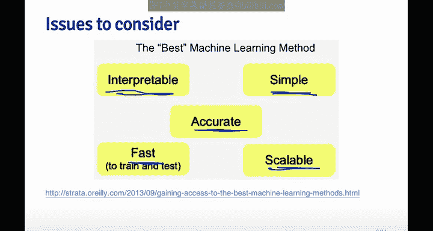

## 权衡的艺术：准确性与其他属性 ⚖️

总的来说，预测是关于**准确性的权衡**。有时，你会为了可解释性而牺牲很多或一点准确性；有时，你会为了速度、简单性或可扩展性而进行权衡。你的目标是在预测算法的其他重要属性与你所需的准确性之间找到正确的平衡。

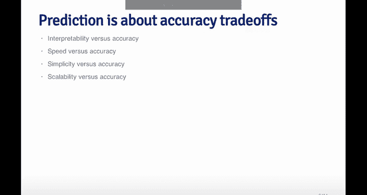

**可解释性**通常很重要。例如，在医学研究中，一些医生更喜欢类似决策树的预测规则（例如，“如果总胆固醇高于某值且吸烟，则…”）。这种“如果-那么”的陈述对某些人来说非常容易理解。可解释性可以防止出现像“谷歌流感趋势”那样的问题，当时人们并不真正理解特征是如何与流感发病率直接关联的。如果你不理解特征如何工作，当算法开始出现问题或失败时，你就会措手不及。

**可扩展性**也很重要。Netflix挑战赛的一个有趣之处在于，虽然许多团队开发出了比Netflix原算法预测准确得多的复杂算法，但Netflix最终并未在生产系统中实施最终的获胜算法。原因是该算法的可扩展性不好，它是多种机器学习算法的混合体，在Netflix收集的海量数据集上计算耗时很长。因此，他们最终选择了一个准确性稍低但可扩展性更强的方案。这告诉我们，在构建预测算法时，准确性并非总是唯一或最好的决策因素，尽管它通常是最受关注的。

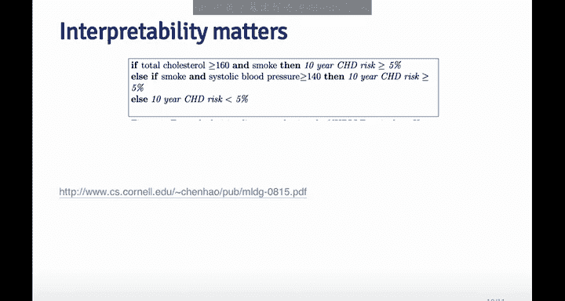

---

## 总结 📝

本节课中，我们一起学习了构建机器学习算法时各步骤的相对重要性。我们了解到：
1.  **明确定义问题**和**收集高质量、相关的数据**是成功构建算法的基石，其重要性通常超过选择复杂的算法。
2.  **特征工程**是连接数据和算法的桥梁，好的特征应能有效压缩信息并保留预测价值。
3.  **算法选择**虽然关键，但在许多情况下，一个合理、简单的算法与一个复杂的最佳算法之间的性能差距可能并不巨大。
4.  在实际应用中，需要在**准确性、可解释性、速度和可扩展性**之间进行权衡，根据具体目标找到最佳平衡点。

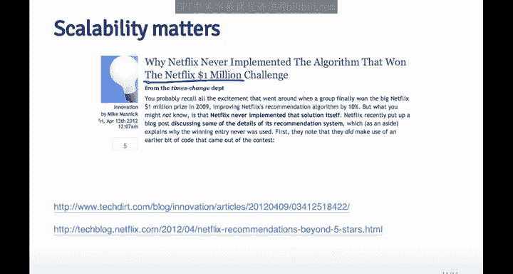

记住，一个有效的机器学习解决方案是这些组件协同工作的结果，而不仅仅是选择一个强大的算法。