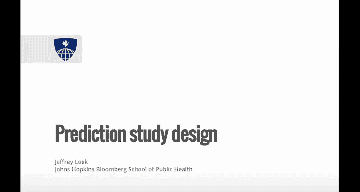
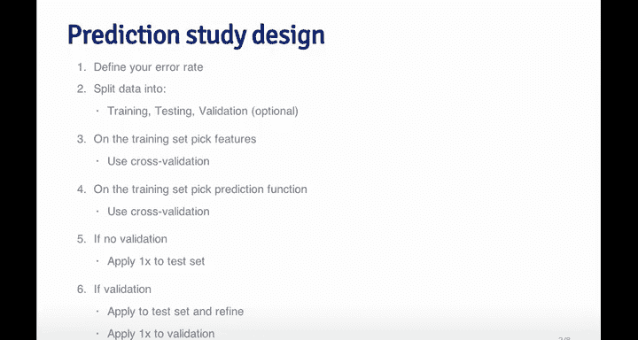
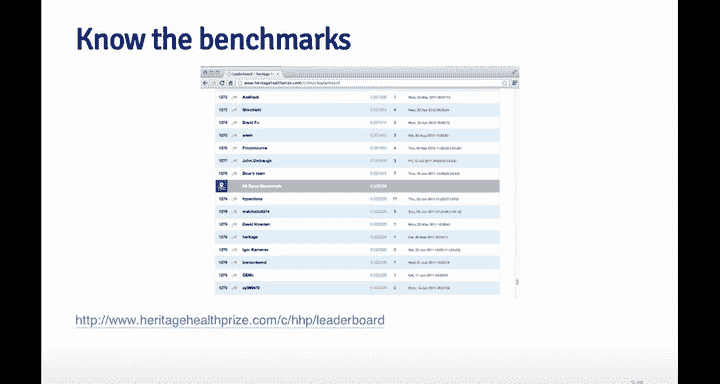
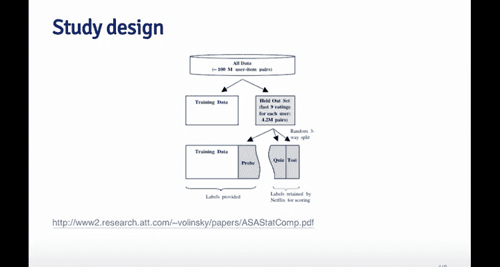
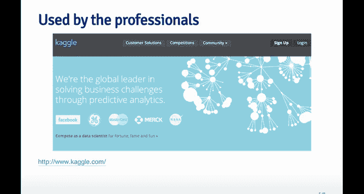
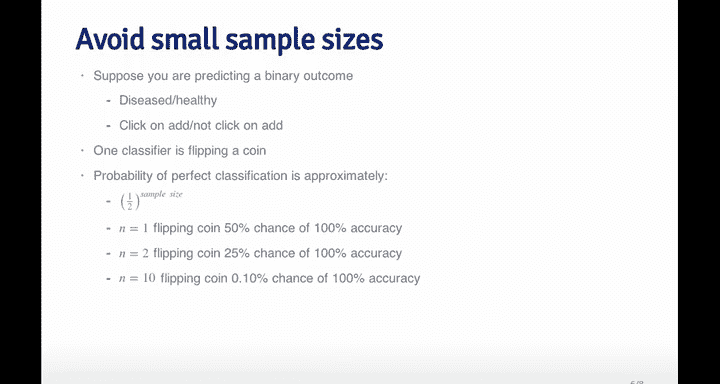
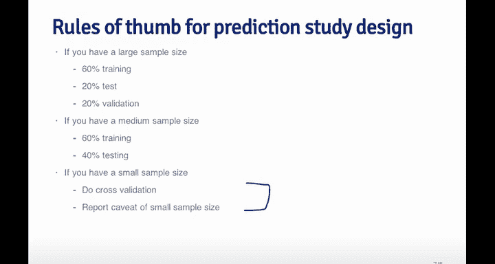
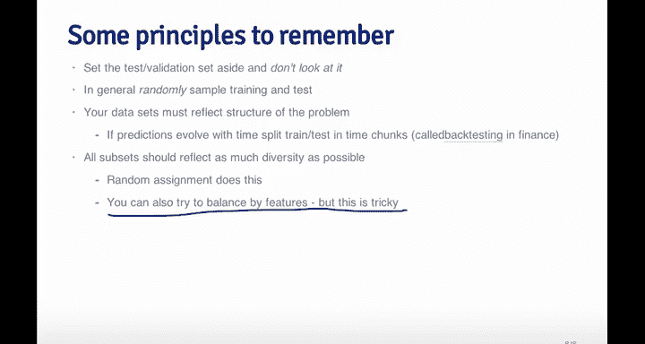

# 085：预测研究设计 📊

## 概述

在本节课中，我们将学习预测研究设计，即如何通过合理的数据划分和模型评估流程，最小化样本内误差与样本外误差带来的问题。我们将重点讨论如何定义误差率、划分数据集，并遵循关键原则来获得对模型泛化能力的可靠估计。

---

## 从误差到数据划分

上一节我们介绍了样本内误差、样本外误差以及过拟合的概念。本节中，我们来看看如何通过预测研究设计来减少这些问题。

在预测研究设计中，首先要做的是定义误差率。本节课我们使用一个通用的误差率概念，下一节课将详细讨论可供选择的不同误差率类型。

接着，你需要将用于构建和验证模型的数据分割成三个部分（其中一个是可选的）。以下是这三个部分：

*   **训练集**：必须创建，用于构建模型。
*   **测试集**：用于评估模型。
*   **验证集**：可选，也用于验证模型。

---

## 模型构建与评估流程

以下是使用这些数据集的标准流程：

首先，在训练集上，使用例如交叉验证等技术来选择对模型最重要的特征。交叉验证的具体内容将在后续课程中介绍，其基本思想是利用训练集来筛选特征。

接着，使用同样的技术来选择预测函数，并估计所有感兴趣的参数。我们利用训练集来构建模型。

**如果没有验证集**，那么我们将最佳模型在测试集上应用**恰好一次**。为什么只应用一次？因为如果我们应用多个模型到测试集并选择最佳的那个，在某种意义上我们就是在利用测试集来训练模型。换句话说，我们仍然会得到模型在新数据集上误差的乐观估计。因此，预测模型应仅在测试集上应用一次。

**如果同时有验证集和测试集**，那么你可以将多个最佳预测模型都应用到测试集上，并进行一些微调。你可能会发现某些特征在样本外预测时效果不佳，从而对模型进行一些调整和优化。但正如之前所说，此时测试集误差对于真实的样本外误差来说仍然是偏乐观的。因此，我们接下来会将（经过测试集微调后的）最佳模型在验证集上应用**恰好一次**，以获得最终的预测误差估计。

总而言之，核心思想是从一开始就预留出一个数据集，你只将一个最终模型应用其上，且从未用它进行任何训练、调优或测试。这将为你提供一个对样本外误差率的良好估计。

---

## 了解基准线的重要性

在进行预测时，记住了解基准线非常重要。下图是一个Kaggle竞赛排行榜的例子，图中灰色标记的基准线显示了例如“将所有预测值设为零”这样的简单策略的结果。

了解预测基准线是个好主意，因为有时如果你的预测算法表现远好于或远差于预期，基准线能提示你可能哪里出了问题，并告诉你预测算法是否偏离了正轨。

---

## 案例研究：Netflix竞赛

Netflix竞赛使用了经典的研究设计。他们拥有1亿个用户-电影评分对，并将其分割如下：

*   **训练集**：提供给参赛者用于构建模型。
*   **探索集**：参赛者可用其评估模型样本外误差，然后提交给Netflix。
*   **测验集**：参赛者看不到，但Netflix会用其评估提交的模型，参赛者可多次提交并根据排行榜调整模型。
*   **测试集**：在竞赛最后阶段，Netflix将每个团队的最终模型应用到这个从未公开的数据集上**一次**，以获得无偏的样本外误差估计。

这个设计非常重要。事实证明，一些在测验集上表现更好的团队在最终测试集上反而不那么出色，因为他们对测验集产生了过拟合。这个案例给我们的重要启示是：构建预测模型时，必须始终预留一个完全独立的数据集，在建模过程中绝不使用。

如今，像Kaggle这样的专业平台也采用类似模式。他们提供排行榜（基于验证集），但用于最终评估的数据集会一直保留到最后，每个参赛者只能应用其算法一次。

---

## 警惕小样本问题

需要记住的是，将数据集分割为训练集、测试集和验证集时，它们可能会变得很小，但你需要避免样本量过小，特别是测试集。

原因如下：假设你在预测一个二分类结果（例如，患病/健康，点击广告/不点击）。一个最简单的分类器就是抛硬币：正面预测为一类，反面预测为另一类。

使用这个简单算法获得完美分类的概率是 `(1/2)^n`，其中 `n` 是样本量。换句话说，仅凭运气（抛硬币），你每次预测正确的概率是1/2。

*   如果测试集只有1个样本，你约有50%的机会猜对。即使你在测试集上获得了100%的准确率，用抛硬币也有50%的概率得到这个结果。
*   当 `n=2` 时，获得100%准确率的概率是25%。
*   当 `n=10` 时，获得100%准确率的概率只有约0.1%。

因此，如果测试集样本量足够大，当你看到高准确率时，才会更有信心这不是随机现象。这提示我们，应确保测试集（和验证集）的规模相对较大，以避免因偶然性得到好的预测结果。

---

## 数据划分的经验法则

以下是一些经验法则，并非铁律，但它们是合理且常用的指导原则：

*   **大样本量**：可将数据的60%作为训练集，20%作为测试集，20%作为验证集。这假设了测试集和验证集不会太小。
*   **中等样本量**：可将60%的数据作为训练集，40%作为测试集。这意味着你没有机会在测试集上微调模型后再应用到验证集，但可以保证测试集有足够的规模。
*   **小样本量**：首先，你可能需要重新考虑是否有足够样本构建预测算法。如果坚持要构建，可以考虑使用交叉验证，并报告样本量小以及从未在独立测试集上进行预测的局限性。

---

## 关键原则总结

最后，记住以下预测研究设计的关键原则：

1.  **独立预留**：测试集或验证集必须预留，在构建模型时绝不查看。必须有一个数据集，你只将一个模型应用其上一次，且该数据集完全独立于任何用于构建预测模型的数据。
2.  **随机抽样**：通常希望随机抽取训练集和测试集。“随机”的方式取决于问题类型。例如，对于时间序列数据，你可能希望在随机的时间块上构建训练集和测试集。
3.  **反映数据结构**：数据划分必须反映问题的结构。如果数据存在时间或空间上的依赖性，你需要按数据块（例如时间块）进行抽样。这在金融中称为回测。
4.  **保持多样性**：划分应尽可能反映数据的多样性。随机分配通常能做到这一点。你也可以尝试根据特征进行平衡划分，这虽然有些复杂，但通常是个有用的想法。

---

## 总结

本节课中，我们一起学习了预测研究设计的核心内容。我们了解了如何通过定义误差率、将数据划分为训练集、测试集和验证集来系统地进行模型开发和评估。我们强调了将最终测试集完全独立预留的重要性，并讨论了避免小样本陷阱的经验法则。最后，通过Netflix竞赛的案例，我们看到了这些原则在实际中的成功应用。遵循这些设计原则，能帮助我们更可靠地评估预测模型的真实泛化能力。