# 086：误差类型 📊

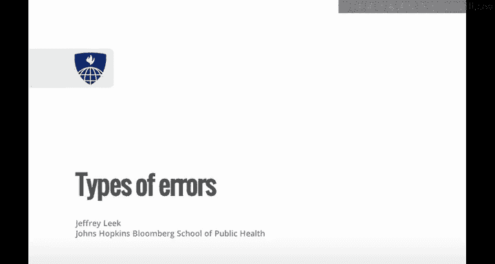

在本节课中，我们将学习在构建预测模型时可能遇到的不同类型的误差。我们将重点讨论二分类预测问题中的误差，并介绍如何评估预测函数。理解这些误差类型对于正确解读模型结果至关重要。

---

## 二分类预测中的误差类型 🔍

上一节我们介绍了课程主题，本节中我们来看看在二分类预测问题中可能出现的误差类型。二分类预测是指将样本预测为两个类别之一的问题。

在讨论误差时，我们通常使用以下术语：真阳性、真阴性、假阳性和假阴性。理解这些术语是分析预测性能的基础。

以下是这些术语的定义：
*   **阳性/阴性**：指算法做出的**预测**。阳性表示算法预测样本属于目标类别，阴性表示预测不属于。
*   **真/假**：指样本的**真实状态**。真表示样本确实属于目标类别，假表示确实不属于。

因此，我们可以这样理解：
*   **真阳性**：预测为阳性，且真实情况也是阳性（预测正确）。
*   **假阳性**：预测为阳性，但真实情况是阴性（预测错误）。
*   **真阴性**：预测为阴性，且真实情况也是阴性（预测正确）。
*   **假阴性**：预测为阴性，但真实情况是阳性（预测错误）。

---

## 一个医学检测的例子 🏥

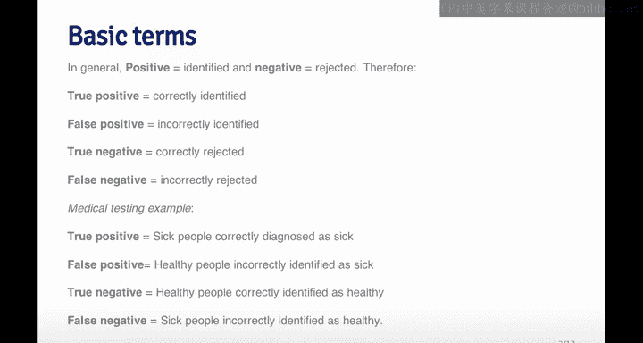

为了让概念更具体，我们来看一个医学检测的例子。假设我们使用一种筛查测试（如乳腺X光检查）来识别患病者。

在这个例子中：
*   **真实状态**：指一个人是否真的生病。
*   **预测结果**：指测试判断其是否生病。

那么：
*   **真阳性**：患者被正确诊断为患病。
*   **假阳性**：健康人被错误诊断为患病。
*   **真阴性**：健康人被正确诊断为健康。
*   **假阴性**：患者被错误诊断为健康。

你可以通过下方的维基百科链接了解更多关于灵敏度和特异性的信息。

---

## 混淆矩阵与关键指标 📈

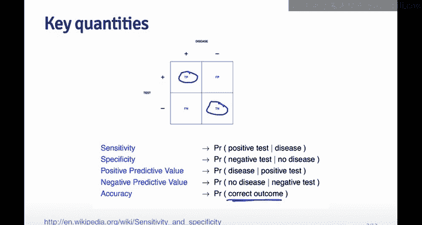

上一节我们通过例子理解了基本概念，本节中我们来看看如何用表格和公式量化这些误差。这些指标通常通过一个称为“混淆矩阵”或“2x2列联表”的表格来总结。

表格的列代表真实状态，行代表预测结果。

| 预测\真实 | 患病（阳性） | 健康（阴性） |
| :--- | :--- | :--- |
| **预测患病（阳性）** | 真阳性 (TP) | 假阳性 (FP) |
| **预测健康（阴性）** | 假阴性 (FN) | 真阴性 (TN) |

基于这个表格，我们可以定义几个关键的评价指标：

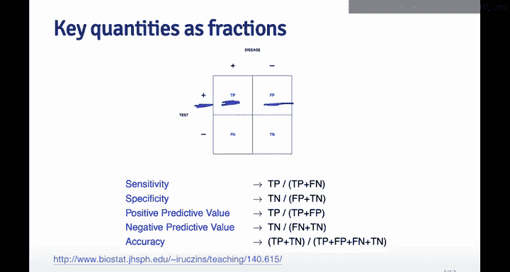

以下是常用的评价指标：
*   **灵敏度**：在真实患病的人群中，被正确预测为患病的概率。它衡量的是检测发现真实患者的能力。
    *   **公式**：`灵敏度 = TP / (TP + FN)`
*   **特异度**：在真实健康的人群中，被正确预测为健康的概率。它衡量的是检测排除非患者的能力。
    *   **公式**：`特异度 = TN / (TN + FP)`
*   **阳性预测值**：在预测为患病的人群中，真正患病的概率。
    *   **公式**：`阳性预测值 = TP / (TP + FP)`
*   **阴性预测值**：在预测为健康的人群中，真正健康的概率。
    *   **公式**：`阴性预测值 = TN / (TN + FN)`
*   **准确率**：所有预测中正确的比例。
    *   **公式**：`准确率 = (TP + TN) / (TP + TN + FP + FN)`

---

## 罕见事件对预测的影响 ⚠️

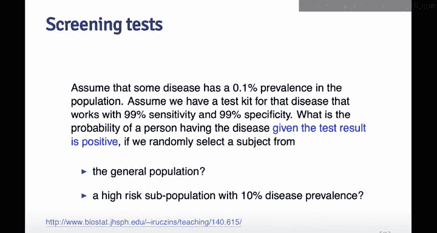

理解这些指标后，我们需要关注一个关键问题：当目标事件（如患病）非常罕见时，即使测试本身性能很好，阳性预测值也可能很低。

假设一种疾病的患病率仅为1%，我们有一个非常优秀的检测方法，其灵敏度和特异度均为99%。

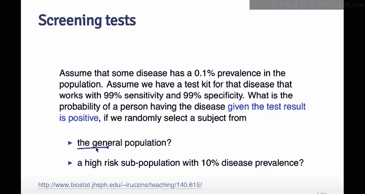

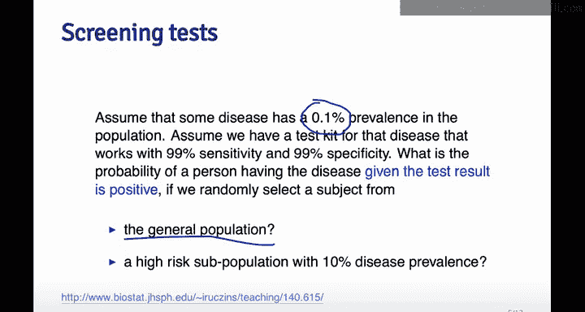

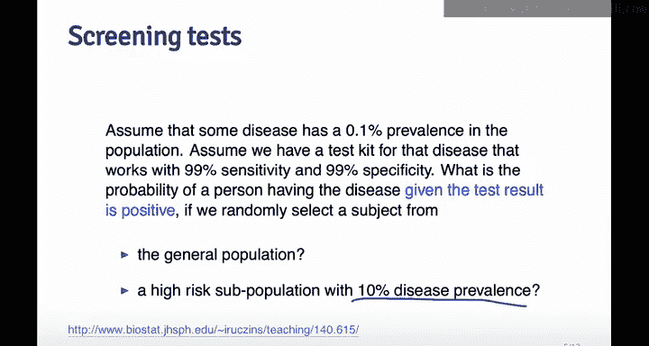

在一个包含100，000人的总体中：
*   真实患病者：1，000人 (1%)
*   真实健康者：99，000人 (99%)

根据99%的灵敏度，在1，000名患者中，有990人会被正确检出（真阳性），10人被漏检（假阴性）。
根据99%的特异度，在99，000名健康者中，有98，010人会被正确排除（真阴性），990人会被误判为患病（假阳性）。

现在，如果一个人检测结果为阳性，他真正患病的概率（阳性预测值）是多少？
*   所有阳性结果总数 = 真阳性 + 假阳性 = 990 + 990 = 1，980
*   其中真正患病人数 = 990
*   **阳性预测值 = 990 / 1，980 = 50%**

这意味着，即使检测方法非常准确（99%），在患病率很低（1%）的人群中，一个阳性结果也只有50%的概率是真正的患者。另一半的阳性结果是假警报（假阳性）。

---

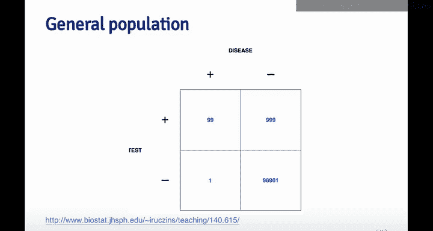

## 患病率变化的影响 🔄

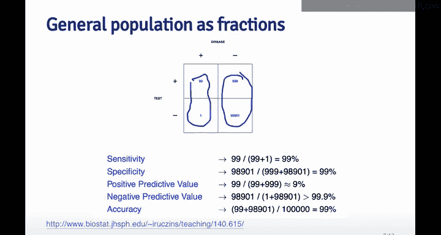

如果疾病更常见，情况会大不相同。假设患病率为10%，同样使用灵敏度和特异度均为99%的检测。

在100，000人中：
*   真实患病者：10，000人
*   真实健康者：90，000人
*   真阳性：9，900人 (10，000 * 99%)
*   假阳性：900人 (90，000 * 1%)
*   阳性预测值 = 9，900 / (9，900 + 900) ≈ 91.7%

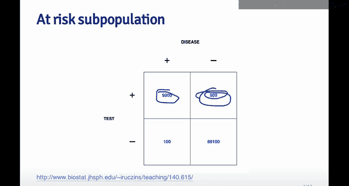

此时，阳性结果的可靠性大大增加。

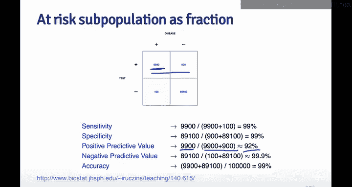

这个例子说明，在预测罕见事件时，必须意识到事件的罕见程度会极大影响预测结果的可信度。这回到了构建预测模型时需要了解样本所属总体特征的核心思想。这也是乳腺X光检查和前列腺癌筛查等公共卫生议题中争论的关键点，因为疾病相对罕见，即使筛查机制良好，也可能产生大量假阳性。

---

## 连续型数据的误差衡量 📏

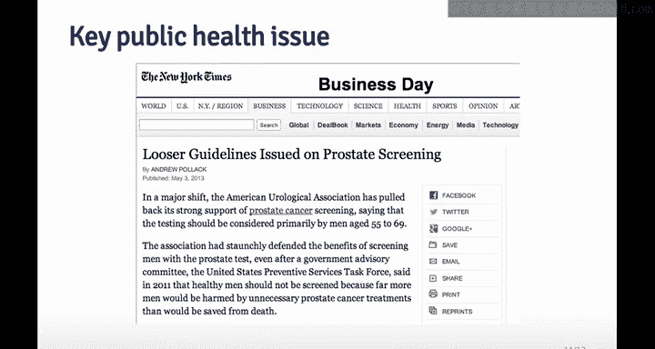

以上讨论的是二分类数据。对于连续型数据（如预测房价、温度），我们没有简单的“阳性/阴性”分类，误差衡量目标是看预测值有多接近真实值。

最常用的方法是**均方误差**。其思想是，对于每个样本，计算预测值与真实值之差的平方，然后对所有样本的这些平方差求平均值。
*   **公式**：`MSE = (1/n) * Σ(预测值_i - 真实值_i)^2`

MSE的一个缺点是，由于对误差进行了平方，其量纲与原始数据不同，不易直接解释。因此，人们常使用其平方根，即**均方根误差**。
*   **公式**：`RMSE = sqrt(MSE)`

RMSE可能是连续型数据中最常用的误差度量。

---

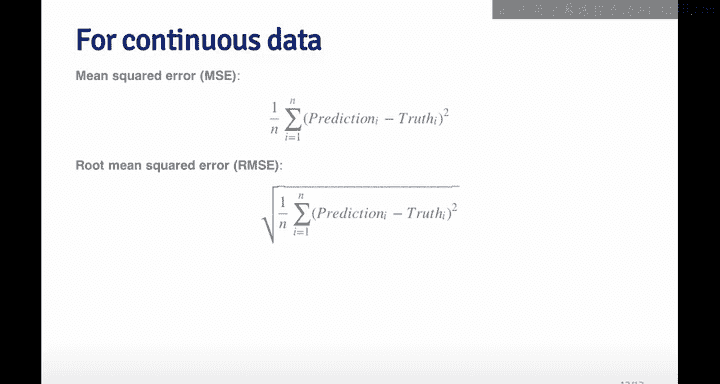

## 其他误差度量方法 📝

均方误差和均方根误差虽然常用，但对异常值敏感。如果数据中存在极大值或变量尺度差异很大，它们可能会被显著拉高。

在这种情况下，人们常使用**中位数绝对偏差**。它计算预测值与真实值之差的绝对值的中位数，对异常值更稳健。
*   **公式**：`MAD = median(|预测值_i - 真实值_i|)`

对于分类问题：
*   **灵敏度和特异度**：在医学检测等领域非常常用，特别是在你更关心某一类错误（如漏诊）时。
*   **准确率**：平等对待假阳性和假阴性。当正负样本数量极不平衡时，需要谨慎使用。
*   **一致性度量**：对于多分类问题，可以使用如Kappa系数等多种一致性度量方法，它们各有不同的特性。

---

## 总结 🎯

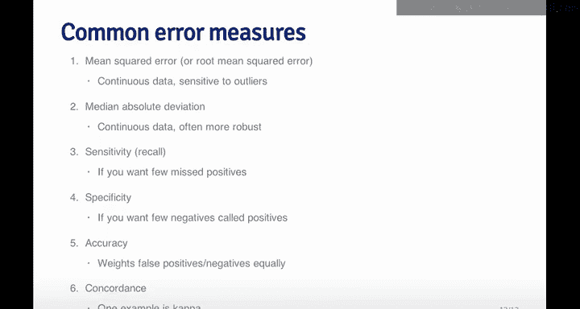

本节课中，我们一起学习了预测模型中的误差类型及其评估方法。
我们首先深入探讨了二分类问题中的真阳性、假阳性、真阴性和假阴性等核心概念，并通过医学检测的例子使其具体化。
接着，我们学习了如何利用混淆矩阵计算灵敏度、特异度、预测值和准确率等关键指标。
我们重点分析了目标事件罕见性对预测结果可信度（特别是阳性预测值）的巨大影响，这是在实际应用中必须警惕的问题。
最后，我们扩展到了连续型数据的误差衡量，介绍了均方误差、均方根误差以及更稳健的中位数绝对偏差，并简要提及了其他分类场景下的度量方法。
理解这些误差类型和评估指标，是构建、选择和解释任何预测模型的基础。