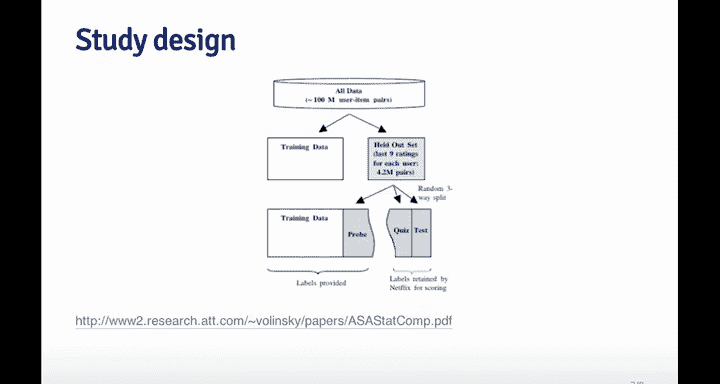
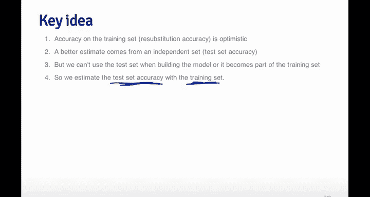
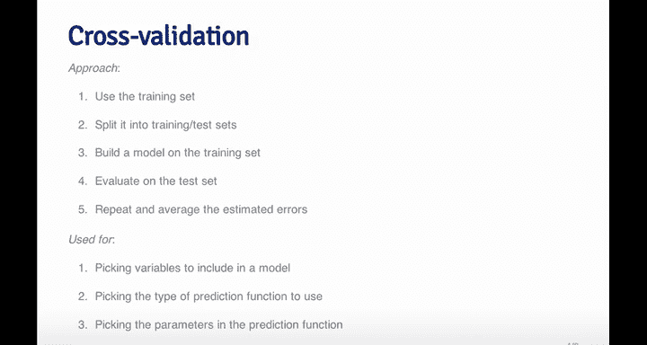
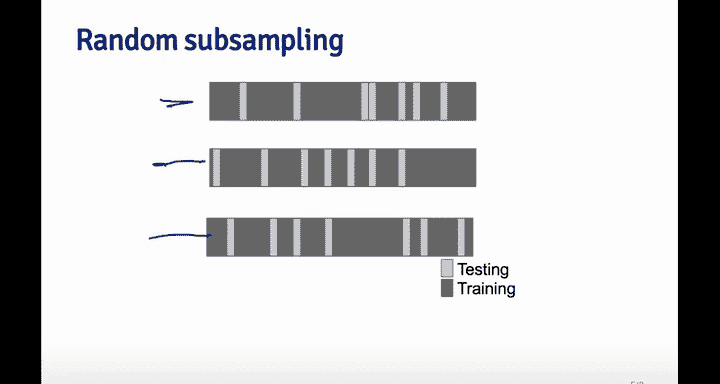
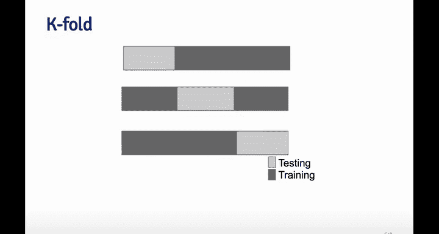
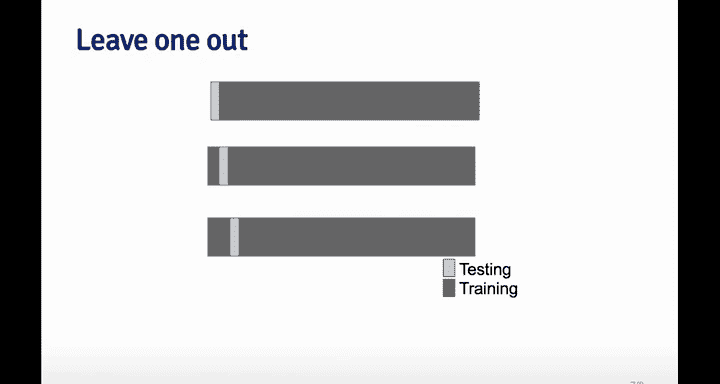
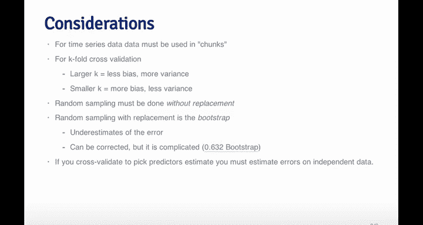

# 088：交叉验证 📊


在本节课中，我们将要学习交叉验证。交叉验证是机器学习中用于检测相关特征、构建模型以及估计模型参数时最广泛使用的工具之一。

## 概述

在构建和评估机器学习算法时，一个常见的研究设计是将数据集划分为训练集和测试集。所有模型的构建和评估都在训练集上进行，最终才在测试集上应用模型。然而，训练集上的准确率（或称“重抽样准确率”）通常是乐观的，因为它可能过度拟合了训练数据的特定特征，不能准确反映模型在新样本上的预测性能。

因此，我们需要一个更好的方法来估计模型在未见数据上的表现，同时又不“污染”最终的独立测试集。交叉验证正是解决这一问题的核心方法。



## 交叉验证的基本思想

上一节我们介绍了训练集评估的局限性，本节中我们来看看交叉验证如何解决这个问题。

交叉验证的核心思想是：**仅使用训练集本身来模拟测试过程**。具体做法是，将原始训练集进一步划分为多个子训练集和子测试集。在子训练集上构建模型，在子测试集上评估模型，并重复此过程多次，最后将多次评估的误差进行平均。这个平均误差可以作为模型在最终独立测试集上表现的估计。



这种方法非常有用，原因如下：
*   它可以用于**选择模型中应包含的变量**。
*   它可以用于**选择预测函数的类型**（即不同的算法）。
*   它可以用于**估计预测函数中的参数**。

最重要的是，在整个交叉验证过程中，原始的独立测试集完全未被使用。因此，当我们最终将选出的最佳模型应用于测试集时，得到的准确率仍然是对样本外准确率的无偏估计。

## 常见的交叉验证方法

以下是几种常见的交叉验证实现方式。

### 1. 随机子抽样法

这种方法在训练集内进行多次随机划分。




在每次迭代中，我们从训练集中随机抽取一部分样本作为子测试集（图中浅灰色部分），剩余部分作为子训练集（深灰色部分）。在子训练集上构建模型，并在子测试集上评估。重复此过程多次，最后将所有迭代的评估结果取平均值。

### 2. K折交叉验证

这是最常用的方法之一，它提供了更系统化的数据划分方式。




其步骤如下：
1.  将训练集随机、平均地分成K个大小相似的子集（或称“折”）。
2.  对于第i次迭代（i从1到K）：
    *   将第i个子集作为**子测试集**。
    *   将剩余的K-1个子集合并，作为**子训练集**。
    *   在子训练集上训练模型，并在子测试集上评估。
3.  重复K次，确保每个子集都被用作一次测试集。
4.  计算K次评估结果的平均值，作为模型性能的估计。

公式表示为：
`CV误差 = (1/K) * Σ(第i折的测试误差)`

### 3. 留一法交叉验证

留一法是K折交叉验证的一个特例，其中K等于样本总数N。




在每次迭代中，我们只留下一个样本作为测试集，用其余所有N-1个样本训练模型，并对留下的那个样本进行预测。这个过程对数据集中的每一个样本都重复一次。最后，用所有N次预测的误差来计算平均误差。



代码逻辑描述如下：
```
for i in range(1, N+1):
    训练集 = 所有样本中除第i个以外的样本
    测试集 = 第i个样本
    用训练集训练模型
    用模型预测测试集，并记录误差
最终误差 = 所有记录误差的平均值
```

## 重要考量与注意事项

在应用交叉验证时，需要注意以下几点。

### 数据类型的考量

对于时间序列数据，不能简单地随机抽取样本进行交叉验证。因为时间点之间存在依赖关系（如自相关性）。通常需要使用“块”或“滚动窗口”的方法，确保训练集和测试集在时间上是连续的块，以保留数据的时间结构。

### 偏差与方差的权衡

在K折交叉验证中，K的选择是一个权衡：
*   **K值较大**（如留一法）：使用的训练数据更多，估计的**偏差较小**，但不同划分方式间的结果**方差较大**。
*   **K值较小**（如2折）：每次训练使用的数据较少，估计的**偏差较大**，但结果**方差较小**。

### 抽样方式

标准的交叉验证（随机子抽样、K折）进行的是**无放回抽样**，即每个样本在每次划分中只出现一次。如果进行**有放回抽样**，则称为**自助法**。自助法通常会**低估误差率**，因为同一个样本可能在训练集中出现多次，导致模型对这些重复样本的预测过于乐观。有一种修正方法称为“0.632自助法”，可以部分纠正这种偏差。

### 最终评估

**至关重要的一点是**：即使使用交叉验证来选择模型或调整参数，由此得到的交叉验证误差率本身，由于我们总是选择在交叉验证中表现最好的模型，可能仍然不是真实样本外误差率的完美估计。要获得最可靠的评估，**必须将最终选定的模型在完全独立的测试集上仅应用一次**。

## 总结



本节课中我们一起学习了交叉验证。我们了解到，交叉验证通过在训练集内部模拟训练-测试过程，为解决模型选择、参数调优和性能估计提供了强大的工具。我们介绍了随机子抽样、K折交叉验证和留一法等具体方法，并讨论了在应用时需要注意的数据类型、偏差-方差权衡以及最终独立测试的重要性。掌握交叉验证是进行可靠机器学习建模的关键一步。