# 089：8_你应该使用什么数据 📊

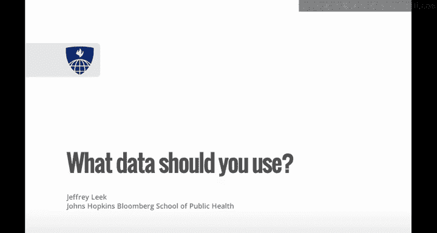

在本节课中，我们将要学习在机器学习项目中，如何选择最合适的数据来构建预测模型。核心原则是：**尽可能使用与预测目标最直接相关的数据**。

---

在明确了研究问题之后，最重要的一步就是确定数据。正确的数据能让你利用机器学习算法做出尽可能准确的预测。

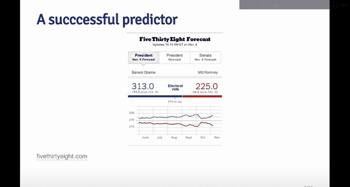

## 成功预测案例：538选举预测模型 🗳️

一个在美国非常成功的预测案例是名为“538”的博客。该博客旨在建立一个选举预测模型，以预测美国总统大选及其他选举的结果。

为了实现这一目标，538背后的统计学家——全球最著名的统计学家之一内特·西尔弗——使用了来自各种渠道的民意调查信息。他将这些数据汇总并取平均值，试图对谁将赢得选举、各州的投票情况以及最终的投票结果做出最佳预测。他在预测2008年和2012年大选方面非常成功。

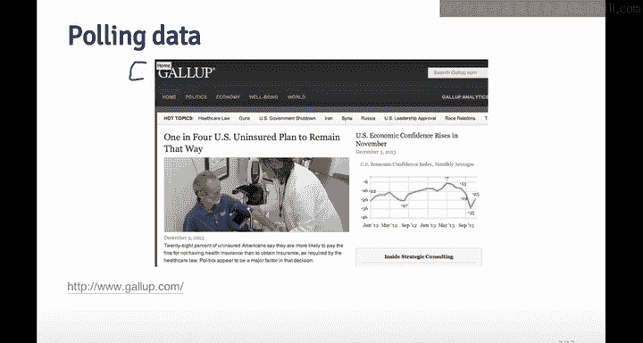

这是一个“用同类数据预测同类结果”的典型例子。他使用了来自盖洛普等美国民调机构的数据，这些数据直接询问人们在即将到来的选举中可能会投票给谁。换句话说，他使用的数据所提的问题，与人们走进投票站时被问到的问题是**完全相同**的。

他做的一个巧妙之处在于，他认识到了数据的实际质量。他意识到某些民调可能存在偏向性，即特定的民调机构提出的问题可能会引导人们更多地表示会投票给某一位候选人，即使他们真正投票时未必如此。

因此，他的做法是根据民调的**无偏性或准确性**来对它们进行加权。这个例子表明，找到正确的数据集，并结合对科学本质的简单理解，可以在做出强预测方面获得最大收益。

## 核心原则：用同类数据预测同类结果 🔄

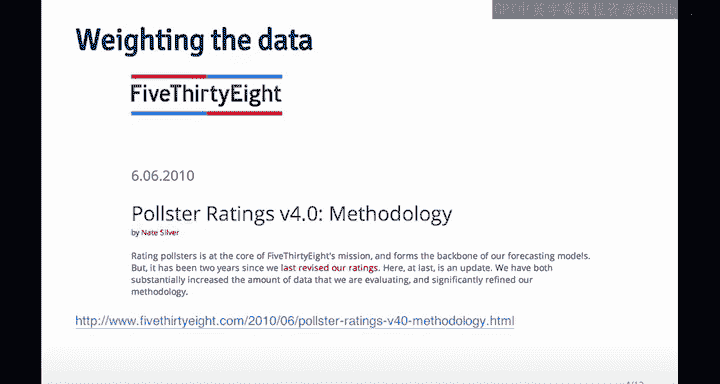

这里的关键思想是：**如果你想预测关于X的事情，就使用与X尽可能密切相关的数据**。

这个原则在许多其他例子中都有体现。

### 案例一：点球成金（Moneyball）⚾

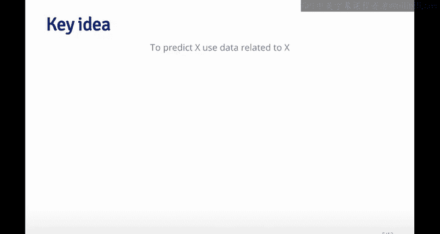

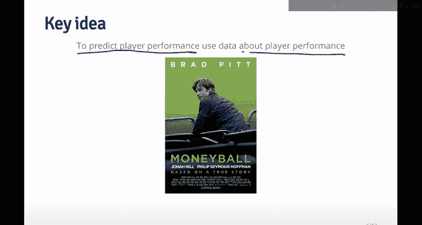

这个案例后来被改编成了由布拉德·皮特主演的电影。最初，一些人试图预测棒球运动员的表现，特别是他们能为美国棒球队赢得多少场比赛。他们的做法是利用该球员过去的表现数据，以及其他类似球员的历史数据，来预测该球员未来的表现。这同样是“用同类数据预测同类结果”。

### 案例二：Netflix大奖赛 🎬

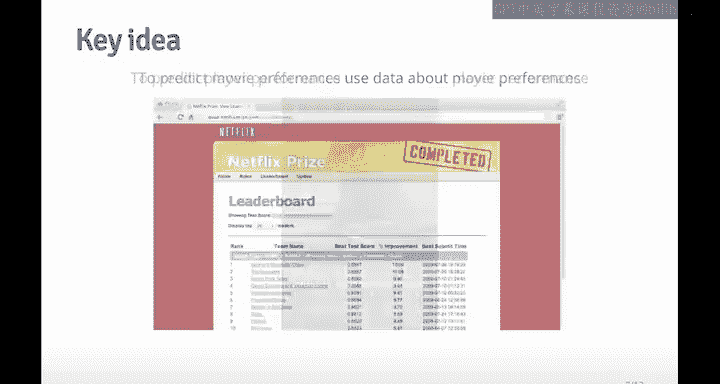

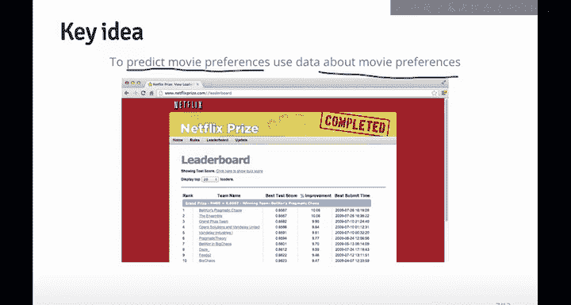

这个主题在Netflix大奖赛中再次出现。参赛者试图预测用户的电影偏好，即用户会喜欢哪些电影。他们基于用户**过去的电影偏好数据**来进行预测。换句话说，他们找到了电影偏好数据，并用它来预测未来的电影偏好数据。

### 案例三：Heritage健康奖 🏥

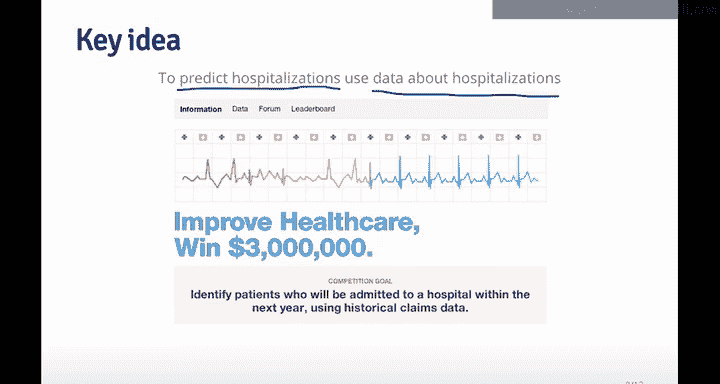

Heritage健康奖的背景也是如此。其目标是预测哪些人将会住院。他们使用了**关于既往住院情况的数据**，再次利用了与他们试图预测的未来过程**完全相同**的数据。

因此，你使用的数据与你所关心的实际过程越接近，你的预测效果往往就越好。

## 关联性较弱的数据与潜在风险 ⚠️

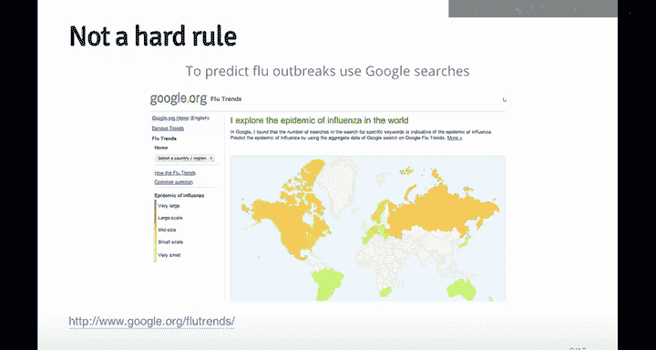

这并非一条绝对的硬性规则。例如，人们曾尝试使用谷歌搜索数据来预测流感爆发。但最近有人指出这种方法存在重大缺陷：如果人们的搜索习惯改变，或者这些搜索与流感之间的关联性质发生变化，他们的预测就会产生很大偏差。一些人认为，谷歌流感趋势并非估计流感流行程度的可靠方法。

**关联性越弱，预测的难度可能就越大**。

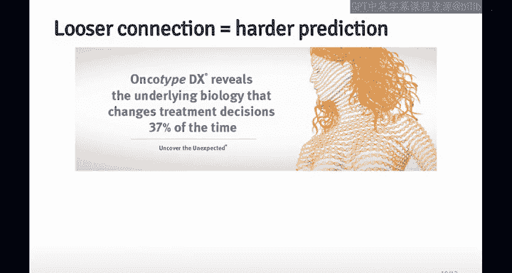

例如，Oncotype DX是一种基于基因表达的预测算法。基因表达是测量体内分子（实际上是体内一部分分子）的指标。他们用这个来预测乳腺癌患者在不同疗法下的生存期或疗效。这里的关联性就稍弱一些，但你仍然可以在逻辑上建立这种联系。

## 数据特性至关重要 📈

数据的特性确实很重要。例如，如果你测量的是流感样症状高发的人群，你可以使用美国疾病控制与预防中心（CDC）或“你附近的流感”等数据。而像谷歌流感趋势这样的算法，如果某些因素导致人们搜索与流感症状无关但搜索词相似的词汇，就可能会高估流感病例数。这个例子说明，了解数据如何与你试图预测的事物相关联是至关重要的。

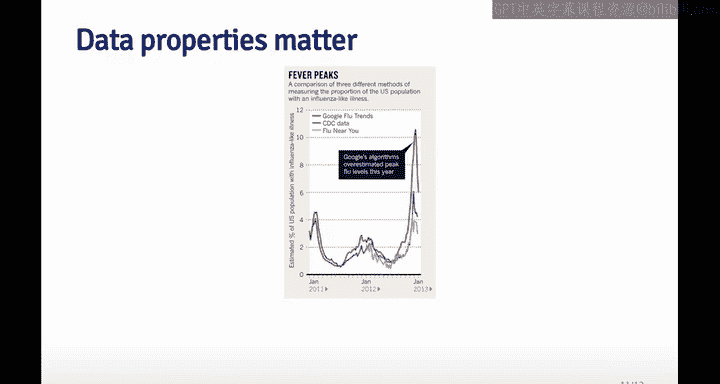

## 机器学习中最常见的错误 🚫

事实上，**这是机器学习中最常见的错误**。机器学习常常被视为计算机科学家创造的一个“黑箱”过程：他们在一端输入数据，另一端就输出预测结果。

这里有一个略显荒谬的预测例子。它来自《新英格兰医学杂志》上的一篇论文。作者在X轴上绘制了人均年巧克力消费量（公斤），在Y轴上绘制了每千万人口中的诺贝尔奖获得者数量。

你可以看到这里存在一种趋势：随着巧克力消费量的增加，每百万人口中的诺贝尔奖获得者数量也倾向于增加。论文报告了R平方和P值，表明这是一种高度显著的关系。

但你可以想到，有许多其他变量可能将这两件事联系起来。例如，如果你来自欧洲，你可能吃更多的巧克力（图中数据点大多是欧洲国家），而诺贝尔奖是由一个欧洲机构颁发的。因此，你可能会认为更多的欧洲人也获得了诺贝尔奖。这与巧克力消费量本身预测你是否能获得诺贝尔奖的能力**毫无关系**。

因此，这个例子表明，如果你只是天真地构建一个预测算法，你可能会声称自己能够很好地预测。但如果相关特征发生变化——例如，如果诺贝尔委员会开始将更多奖项颁发给亚洲国家而非欧洲国家——你会发现这个预测算法将不再有效。

---

### 总结 📝

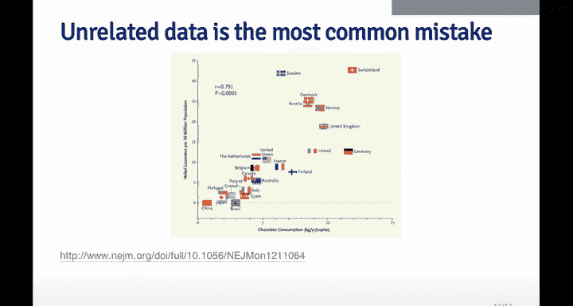

本节课中，我们一起学习了选择机器学习数据的关键原则。核心要点是：**尽可能使用“同类数据预测同类结果”**。当你使用关联性不强的数据时，必须非常谨慎地解释你的预测算法为何有效或无效。理解数据与预测目标之间的本质联系，是构建稳健、可靠模型的基础。