# 092：训练选项详解 🎛️


在本节课中，我们将学习使用 `caret` 包训练模型时，可用的各种训练控制选项。我们将通过一个垃圾邮件分类的示例，详细讲解如何设置预处理参数、评估指标、重采样方法以及随机数种子，以确保模型训练过程的可控性和可重复性。

---

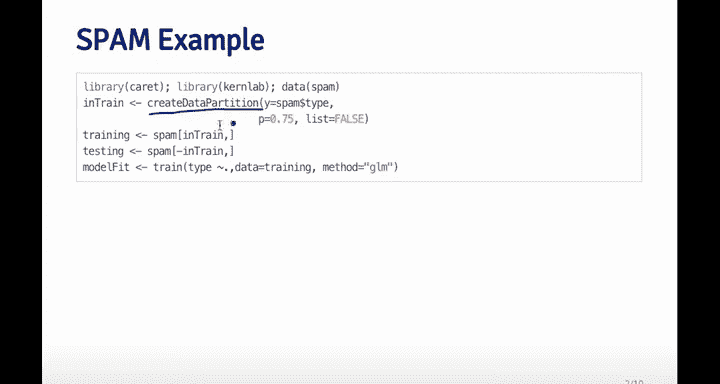

## 数据准备与基础模型训练 📊

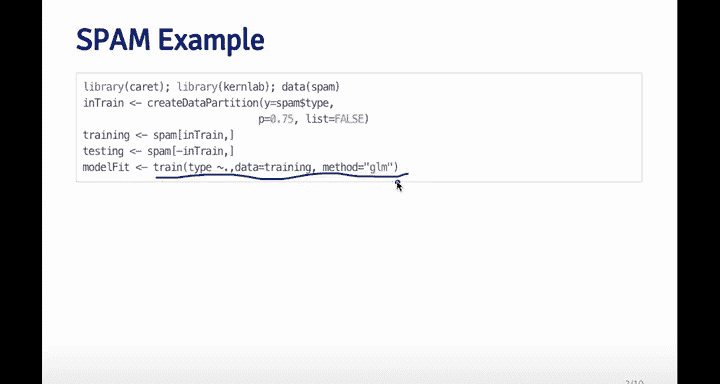

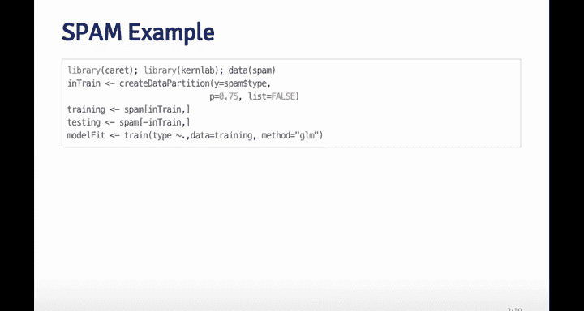

我们将再次使用垃圾邮件数据集来演示这些概念的具体应用。

首先，加载必要的R包和数据，并划分训练集与测试集。

```r
library(caret)
library(kernlab)
data(spam)

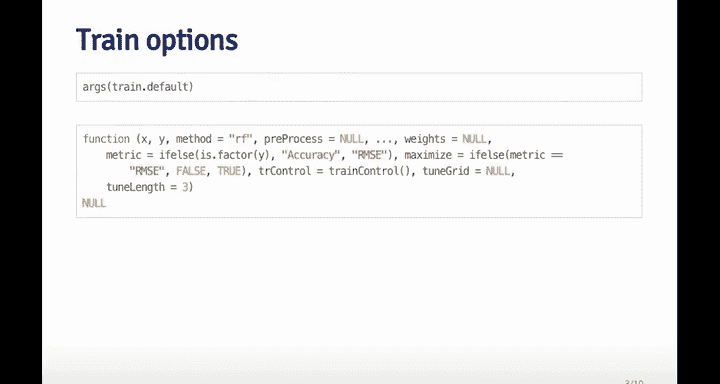

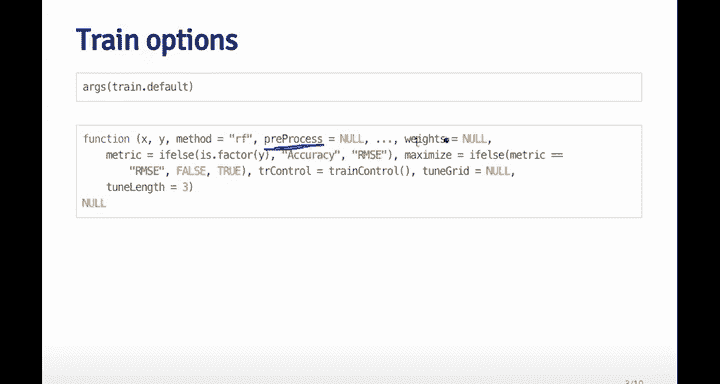

set.seed(123)
inTrain <- createDataPartition(y=spam$type, p=0.75, list=FALSE)
training <- spam[inTrain, ]
testing <- spam[-inTrain, ]
```

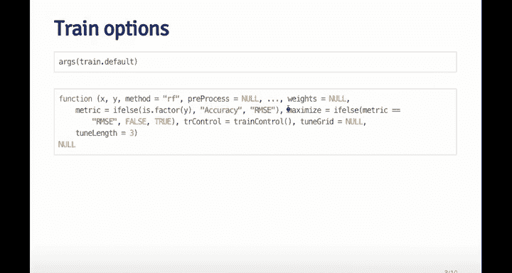

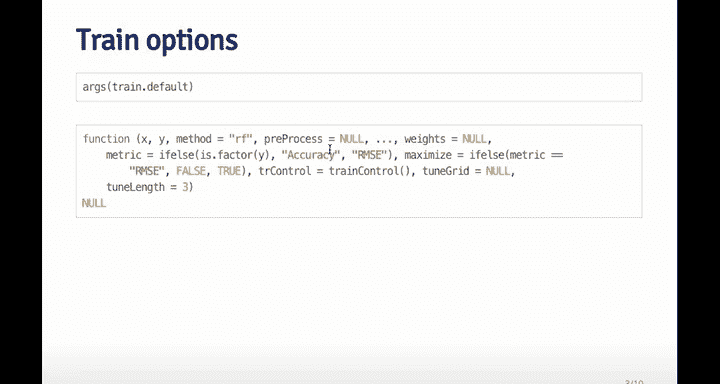

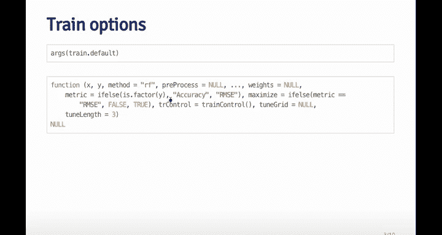

通常，我们使用 `train` 函数拟合模型时，会采用其默认设置，只需指定方法和数据。

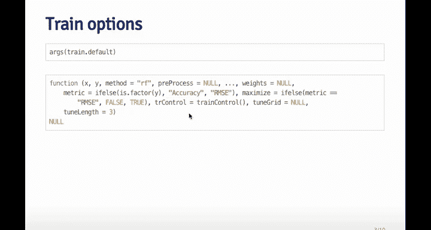

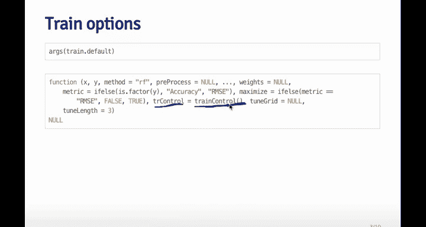

```r
modelFit <- train(type ~ ., data=training, method="glm")
```

---

## 高级训练选项 ⚙️

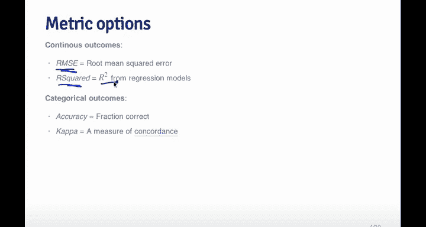

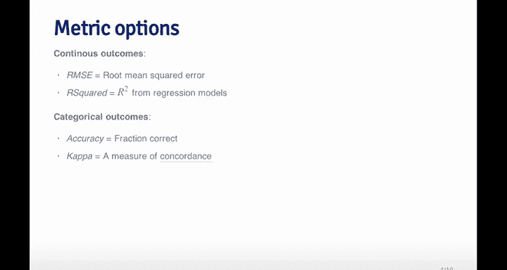

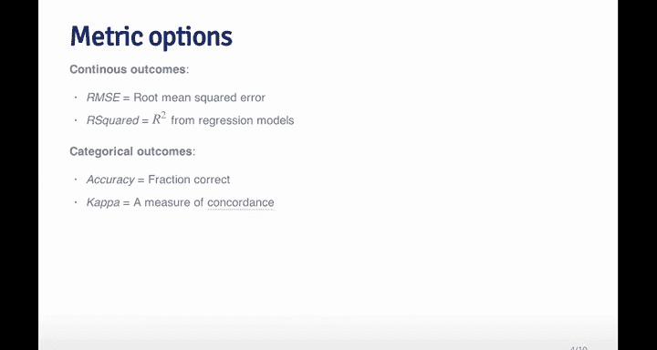

然而，我们可以通过 `train` 函数的参数进行更精细的控制。以下是几个关键选项。

### 预处理与权重设置

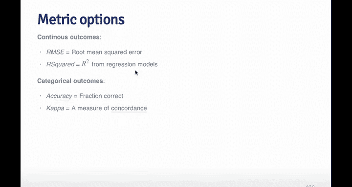

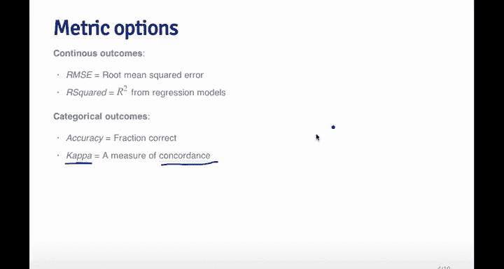

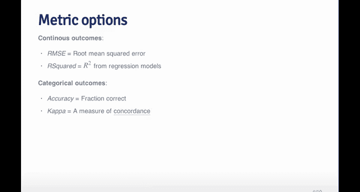

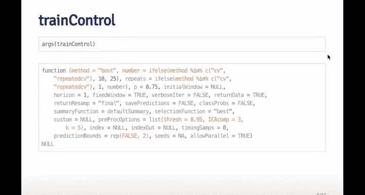

`preProcess` 参数允许我们设置一系列数据预处理选项，这将在后续课程中详细讨论。`weights` 参数则允许我们对特定观测值进行加权，这在处理类别不平衡的训练集时非常有用。

### 评估指标选择

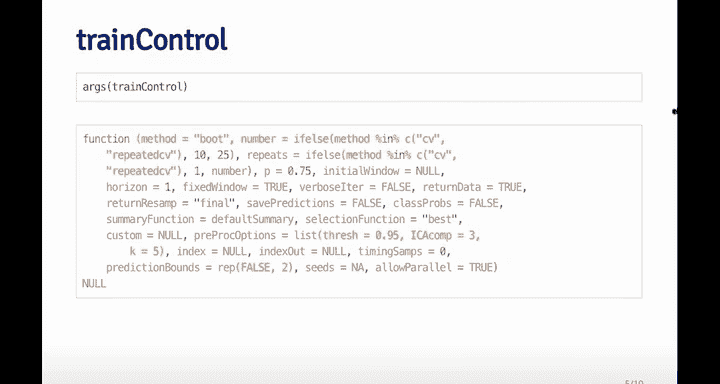

`metric` 参数用于设定模型评估的指标。对于分类问题（因子变量），默认指标是**准确率**。对于回归问题（连续变量），默认指标是**均方根误差**。

以下是内置的评估指标选项：
*   **连续型结果**：可选择 `RMSE`（均方根误差）或 `Rsquared`（R平方）。R平方衡量线性回归中预测变量与响应变量之间的线性相关程度，对于线性模型很有用，但对于随机森林等非线性模型可能不那么适用。
*   **分类型结果**：可选择 `Accuracy`（准确率，即预测正确的比例）或 `Kappa`（科恩卡帕系数）。Kappa系数是一种衡量一致性的更复杂指标，常用于Kaggle等数据科学竞赛。

---

## 使用 `trainControl` 进行精细控制 🎯

`trainControl` 函数通过 `trControl` 参数传递给 `train` 函数，它允许我们对模型训练方式进行更精确的控制。

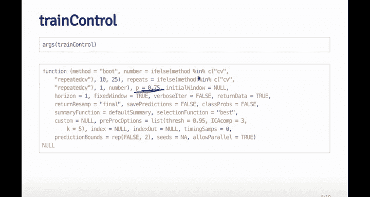

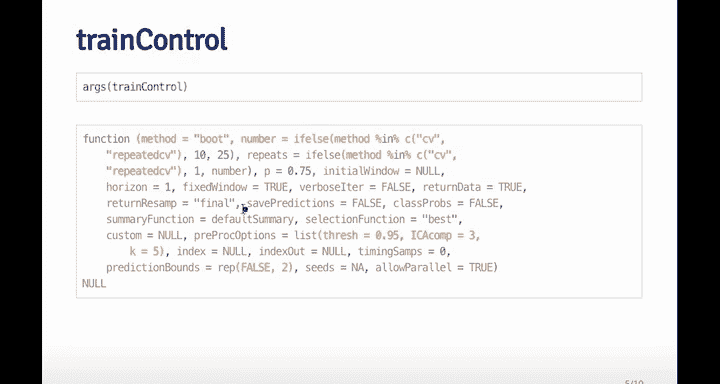

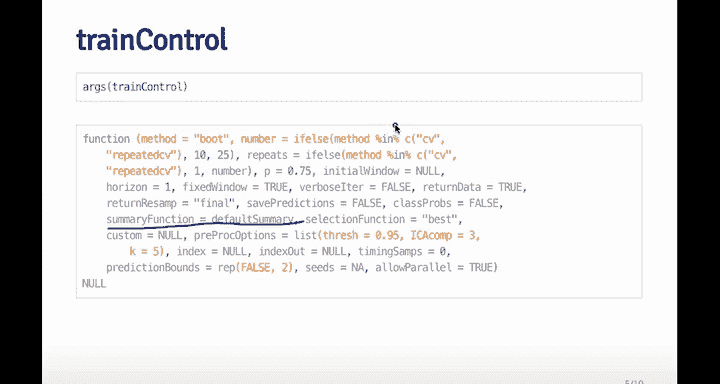

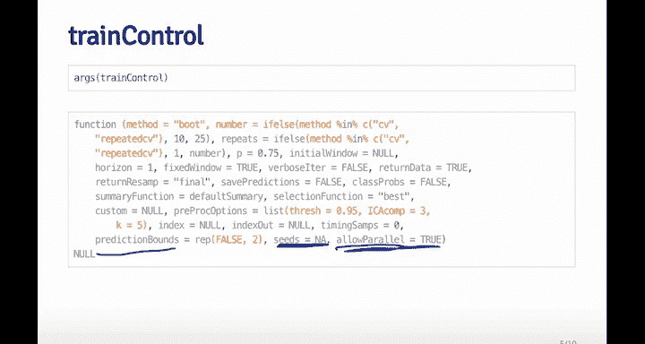

以下是 `trainControl` 的一些核心参数：


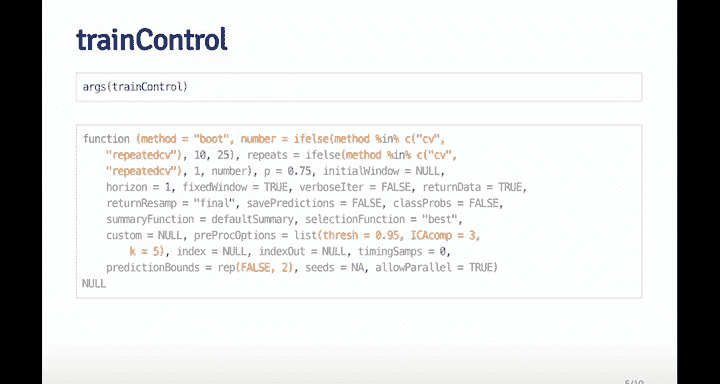

*   `method`：指定重采样方法，例如 `"boot"`（自助法）、`"cv"`（交叉验证）或 `"repeatedcv"`（重复交叉验证）。
*   `number`：指定自助法或交叉验证的重复次数（例如，交叉验证的折数）。
*   `repeats`：指定重复整个重采样过程的次数（适用于重复交叉验证）。
*   `p`：指定训练集的比例。
*   `summaryFunction`：指定一个自定义的函数来汇总重采样结果，而非使用默认函数。
*   `seeds`：为每一层重采样设置随机数种子，这在并行计算中尤为重要，可以确保结果的可重复性。
*   **时间序列数据专用参数**：例如 `initialWindow`（训练窗口大小）和 `horizon`（预测步长）。

---

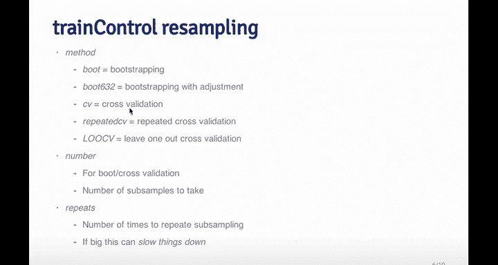

## 重采样方法详解 🔄

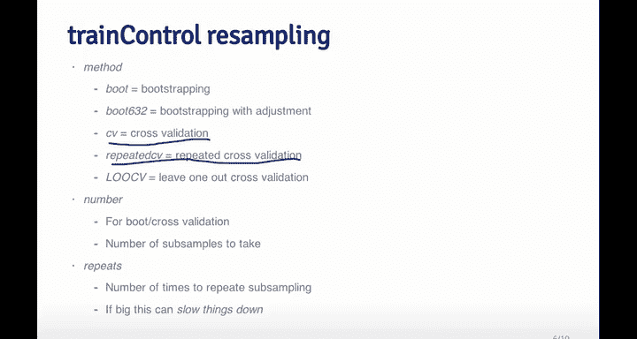

`trainControl` 提供了多种重采样方法，以下是主要选项：

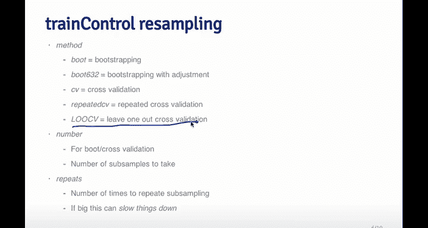

*   `boot`：标准自助法。
*   `boot632`：一种调整后的自助法，可以减少因重复采样带来的偏差。
*   `cv`：K折交叉验证。
*   `repeatedcv`：重复K折交叉验证，使用不同的随机划分进行多次交叉验证。
*   `LOOCV`：留一法交叉验证。需要注意的是，在交叉验证中，折数的多少（K值大小）存在偏差-方差的权衡。

你可以通过 `number` 和 `repeats` 等参数控制重采样的具体次数。默认设置通常效果良好，但如果你的样本量很大，或者模型需要在大量参数上进行精细调优，你可能需要增加重采样（如交叉验证或自助法）的次数。

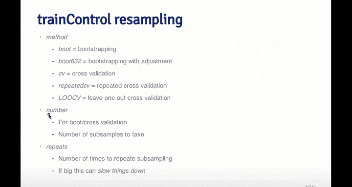


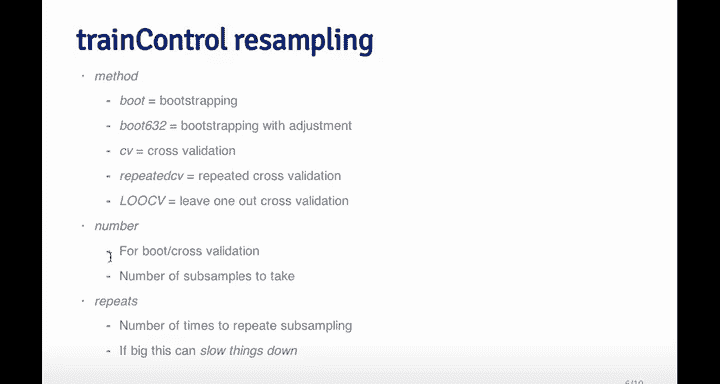

---

## 设置随机数种子确保可重复性 🌱

大多数重采样过程依赖于数据的随机划分。如果不设置种子，每次运行代码可能会得到略有不同的结果，因为每次都会生成不同的随机划分。


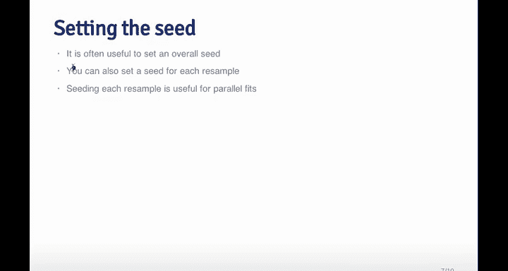

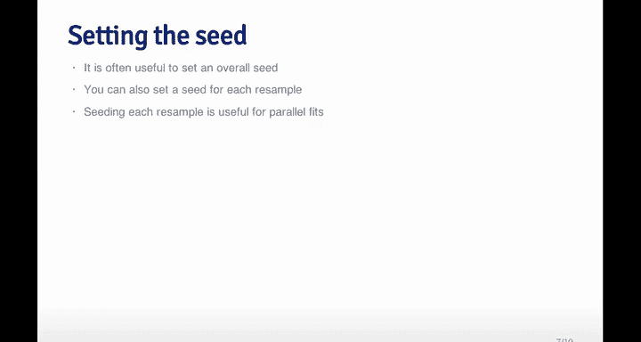

设置随机数种子可以确保计算机生成相同的伪随机数序列，从而使结果可重复。这对于分享代码和确保他人能复现你的分析结果至关重要。

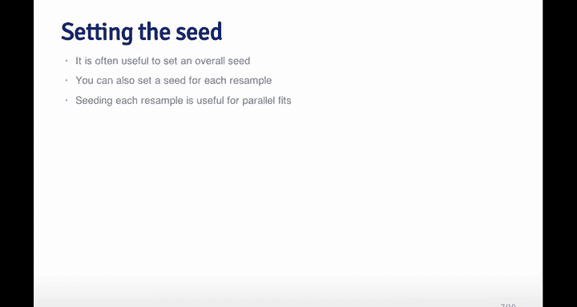

*   **设置全局种子**：使用 `set.seed()` 函数为整个分析过程设置种子，这是获得可重复结果最常用的方法。
*   **为每次重采样设置种子**：通过 `trainControl` 函数的 `seeds` 参数实现，这在并行拟合模型时特别有用，但对于非并行处理通常不是必需的。


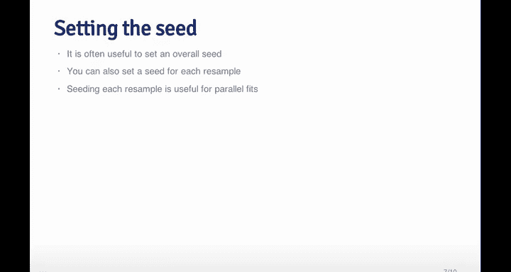

以下是一个示例：

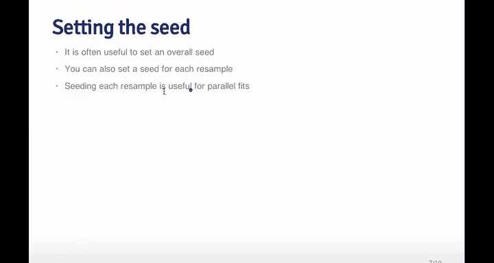


```r
# 第一次运行，设置种子
set.seed(123)
modelFit2 <- train(type ~ ., data=training, method="glm", trControl=trainControl(method="boot", number=25))

# 重置相同的种子后再次运行
set.seed(123)
modelFit3 <- train(type ~ ., data=training, method="glm", trControl=trainControl(method="boot", number=25))
# modelFit2 和 modelFit3 的结果将完全一致
```

---

## 总结 📝

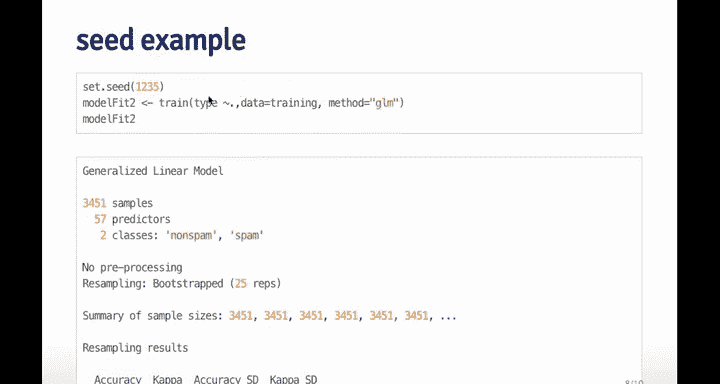

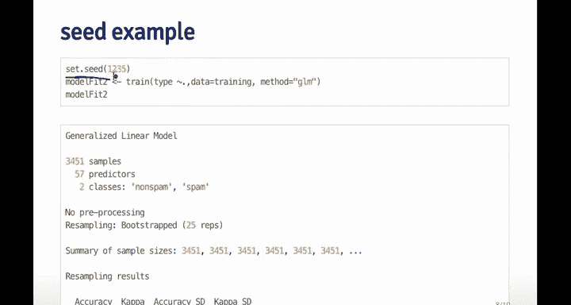

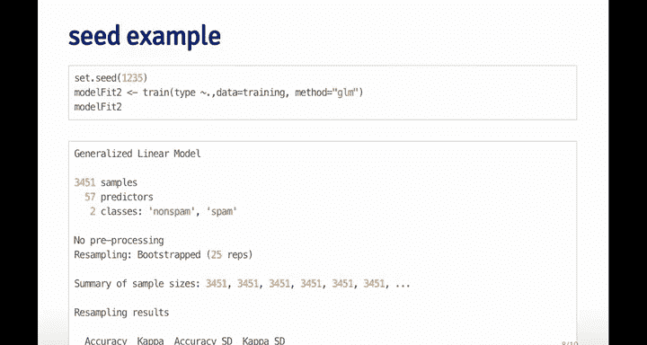


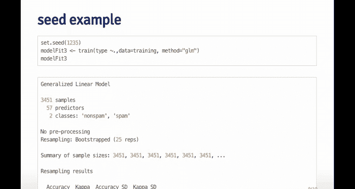

本节课我们一起学习了 `caret` 包中丰富的模型训练控制选项。我们了解了如何通过 `preProcess` 和 `weights` 参数处理数据和样本权重，如何为不同问题选择合适的评估指标（`metric`）。重点掌握了使用 `trainControl` 函数来精细控制重采样方法（如交叉验证、自助法）、次数以及如何通过设置随机数种子来确保实验的完全可重复性。合理利用这些选项，可以帮助我们构建更稳健、可靠的机器学习模型。

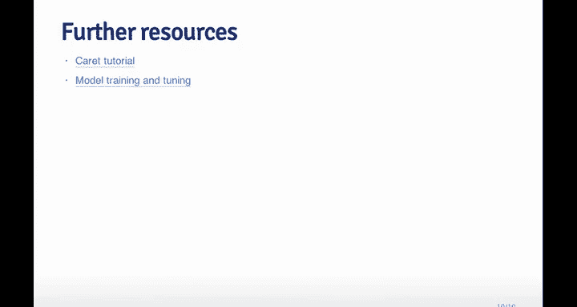

关于 `caret` 包更详细的信息，可以参考其官方教程和关于模型训练与调优的文档。