# 093：绘制预测变量 📊

在本节课中，我们将学习如何通过绘制数据来理解预测变量（特征）的分布、相互关系以及它们与预测目标（如工资）之间的关联。这是构建机器学习算法或预测模型前至关重要的一步，能帮助我们洞察数据模式、发现潜在问题并指导后续建模。


---

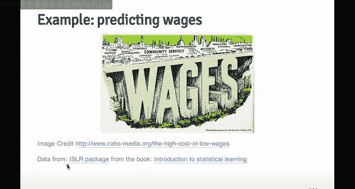

## 数据介绍与准备

我们将使用来自《统计学习导论》一书的`Wage`数据集，该数据集包含在R语言的`ISLR`包中。数据记录了美国大西洋中部地区男性的工资及其他个人信息，如年龄、教育程度、工作类别等。

首先，我们需要加载必要的R包并查看数据摘要。

```r
# 安装并加载必要的包
install.packages("ISLR")
install.packages("ggplot2")
install.packages("caret")
library(ISLR)
library(ggplot2)
library(caret)

# 加载数据
data(Wage)
summary(Wage)
```

从摘要中，我们可以快速了解数据的结构，例如所有样本均为男性，且均来自大西洋中部地区。

---

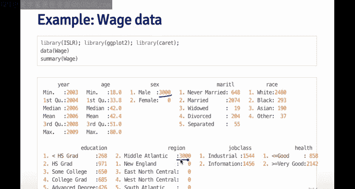

## 划分训练集与测试集

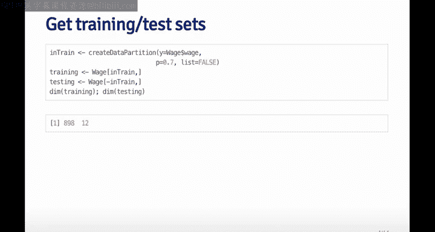

在开始任何数据探索之前，我们必须先将数据划分为训练集和测试集。这是为了防止信息从测试集“泄露”到模型构建过程中，从而避免过拟合。我们将仅使用训练集进行探索性分析。

```r
# 创建数据分区索引
set.seed(123) # 确保结果可重现
trainIndex <- createDataPartition(Wage$wage, p = 0.7, list = FALSE)

# 创建训练集和测试集
training <- Wage[trainIndex, ]
testing <- Wage[-trainIndex, ]
```

---

## 探索预测变量

上一节我们准备好了数据，本节中我们来看看如何通过可视化来探索预测变量。

### 特征图

`caret`包中的`featurePlot`函数可以快速绘制所有预测变量两两之间以及它们与结果变量（工资）的关系图。

```r
featurePlot(x = training[, c("age", "education", "jobclass")],
            y = training$wage,
            plot = "pairs")
```

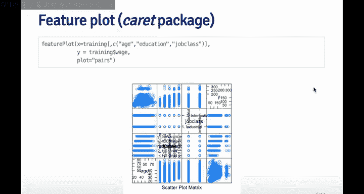

这张图虽然信息密集，但能帮助我们初步发现趋势。例如，我们可能观察到教育程度与工资之间存在明显的正相关关系。

### 散点图与颜色编码

使用`ggplot2`绘制基础散点图是探索连续变量关系的有效方法。

```r
# 绘制年龄与工资的散点图
qplot(age, wage, data = training)
```

从图中我们可能发现一个异常模式：在高工资区域聚集了一组与主体趋势不同的点。为了探究原因，我们可以用颜色根据`jobclass`（工作类别）来区分这些点。

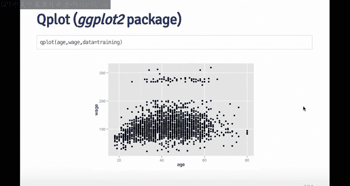

```r
# 用工作类别着色
qplot(age, wage, colour = jobclass, data = training)
```

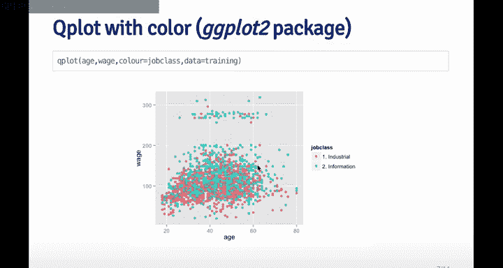

着色后，我们发现那些高工资的异常点大多来自“信息类”工作，而“工业类”工作的工资普遍较低。这解释了数据中的分组现象，并提示`jobclass`可能是一个重要的预测变量。

### 添加平滑曲线

为了更清晰地观察不同组别内的趋势，我们可以为散点图添加按组分组的平滑曲线。

```r
# 按教育程度着色并添加线性平滑器
qplot(age, wage, colour = education, data = training) +
  geom_smooth(method = 'lm', formula = y ~ x)
```

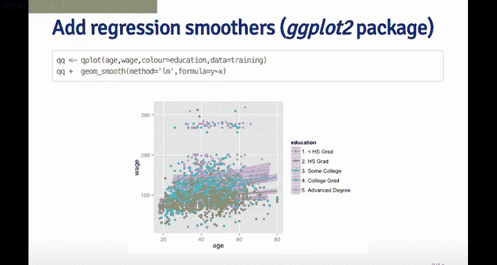

这张图显示了不同教育水平的人群，其年龄与工资的关系线（斜率）可能不同，这暗示了交互作用的存在。

---

## 处理连续变量

有时，将连续的结果变量（如工资）转换为分类变量（因子）能让我们更直观地发现模式。

### 数据分箱

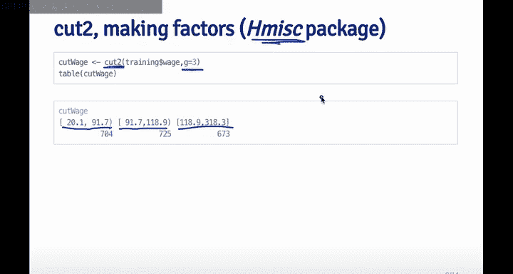

我们可以使用`Hmisc`包中的`cut2`函数，基于分位数将连续变量切割成几个组。

```r
library(Hmisc)
training$wageCut <- cut2(training$wage, g = 3) # 分为3组
table(training$wageCut)
```

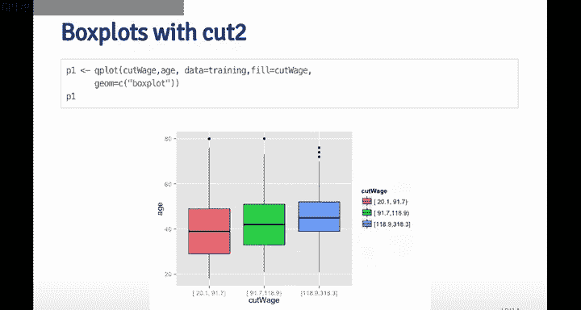

### 箱线图

将工资分组后，我们可以绘制箱线图来观察不同工资组别与年龄的关系。

```r
qplot(wageCut, age, data = training, geom = c("boxplot"))
```

箱线图能更清晰地展示中位数、四分位数和异常值，使我们更容易看到年龄随工资组别上升而增加的趋势。

### 结合原始数据点

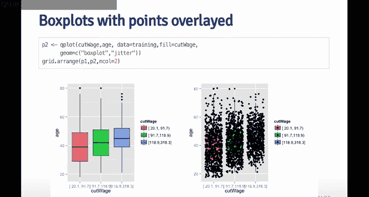

箱线图有时会掩盖数据点的真实数量。我们可以将原始数据点（经过轻微抖动以避免重叠）叠加在箱线图上。

```r
p1 <- qplot(wageCut, age, data = training, geom = c("boxplot"))
p2 <- qplot(wageCut, age, data = training, geom = c("boxplot", "jitter"))
# 使用gridExtra包并排显示两张图
library(gridExtra)
grid.arrange(p1, p2, ncol = 2)
```

通过对比，我们可以确认每个工资组别都有足够多的数据点，观察到的趋势是可靠的。

---

## 交叉表与比例

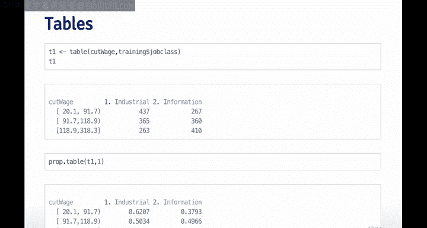

使用分箱后的变量，我们可以创建交叉表来量化不同类别之间的关系。

```r
# 创建工资分组与工作类别的交叉表
t1 <- table(training$wageCut, training$jobclass)
print(t1)

# 计算行比例（每个工资组别内工作类别的分布）
prop.table(t1, 1)
```

从比例表中，我们可以清晰地看到，在低工资组中，工业类工作的比例更高；而在高工资组中，信息类工作的比例更高。

---

## 密度图

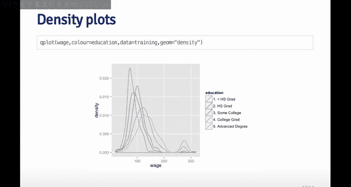

密度图是展示连续变量分布的另一种强大工具，特别适合比较多个组的分布。

```r
# 绘制按教育程度分组的工资密度图
qplot(wage, colour = education, data = training, geom = "density")
```

这张图显示了不同教育背景人群的工资分布。例如，高中学历者的工资分布更集中在低端，而拥有高等学历者的分布则向右偏移，且在高工资区域存在一个子群。密度图能揭示箱线图难以展现的分布细节和多峰现象。

---

## 绘图注意事项与总结

在结束之前，我们必须牢记几个关键原则：
1.  **仅在训练集上绘图**：绝不要使用测试集进行探索性分析，这等同于在测试集上训练模型，会导致过拟合和过于乐观的性能估计。
2.  **寻找关键信息**：在图中应寻找以下模式：
    *   **不平衡**：预测变量或结果变量在各类别间是否严重不平衡？这会影响分类器的性能。
    *   **强预测信号**：某个预测变量是否在不同结果组间显示出明显不同的值？
    *   **异常值与奇怪分组**：是否存在无法用现有变量解释的数据点群？这可能暗示有缺失的重要变量。
    *   **偏态分布**：对于回归类模型，严重偏态的预测变量可能需要进行变换（如对数变换）。

**本节课中我们一起学习了**如何通过多种图形（特征图、散点图、箱线图、密度图等）来探索和可视化预测变量。这些技巧能帮助我们在正式建立模型前，深入理解数据的内在结构、发现潜在问题并形成初步的建模假设，是数据科学工作流程中不可或缺的一环。

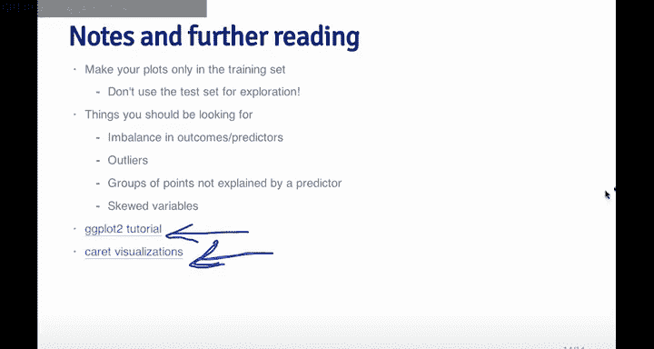

如需进一步学习绘图，可以参考`ggplot2`教程、本数据科学专项课程中的“探索性数据分析”课程，或`caret`包的可视化教程，后者提供了更多针对预测建模的专用图形。