# 098：使用多个协变量进行回归预测 📈

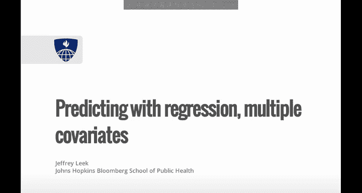

在本节课中，我们将学习如何使用包含多个协变量的回归模型进行预测。更重要的是，我们将探索一个数据集，并尝试识别哪些预测变量对于构建预测模型最为关键。

---

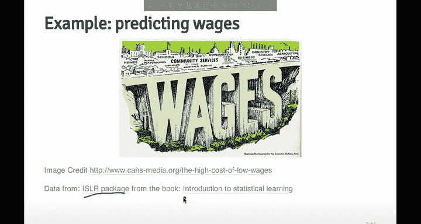

## 数据加载与初步探索

首先，我们需要加载数据集并进行初步观察。我们将使用来自ISLR包的`Wage`数据集，该数据集包含了美国中大西洋地区一群男性的工资信息。

```r
# 加载必要的包和数据
library(ISLR)
library(ggplot2)
library(caret)
data(Wage)

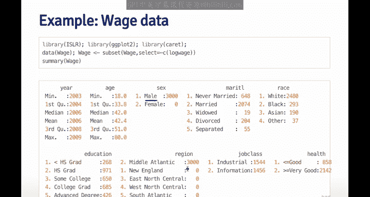

# 将预测目标变量‘logwage’分离出来，以便后续分析
Wage <- subset(Wage, select = -c(logwage))
```

我们可以查看数据的摘要信息，以了解其基本结构。例如，数据集中只包含男性，且所有人都来自中大西洋地区。

---

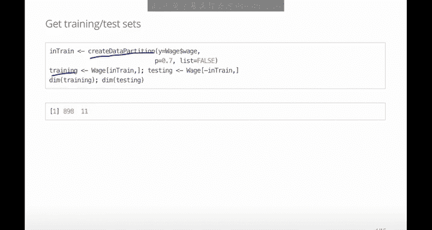

## 划分训练集与测试集

在构建模型之前，我们必须将数据划分为训练集和测试集。所有模型的探索和构建都应在训练集上进行，以确保评估的公正性。

```r
# 创建数据分区
set.seed(123)
trainIndex <- createDataPartition(Wage$wage, p = .8, list = FALSE)
training <- Wage[trainIndex, ]
testing <- Wage[-trainIndex, ]
```

上一节我们介绍了数据的基本情况，本节中我们来看看如何通过可视化进行深入探索。

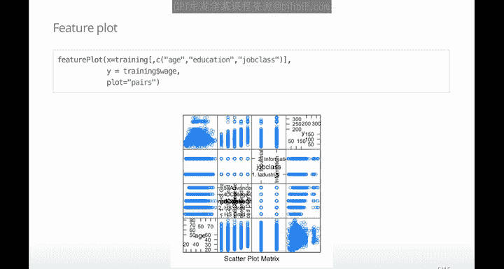

---

## 探索性数据分析

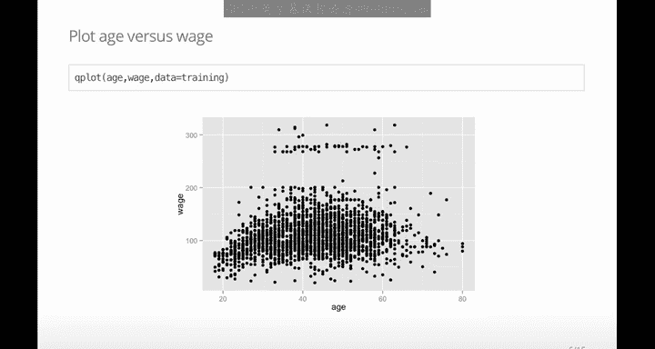

以下是几种探索数据关系的方法：

首先，我们可以使用特征图来观察变量之间的整体关系。虽然有时图表会显得拥挤，但它能提供变量间关联的初步印象。

```r
# 特征图示例
featurePlot(x = training[, c("age", "education", "jobclass")],
            y = training$wage,
            plot = "pairs")
```

其次，绘制单个预测变量与结果的关系图非常有用。例如，绘制工资与年龄的关系图，我们可以发现数据中似乎存在一个高工资的离群点群。

```r
# 绘制工资 vs 年龄
ggplot(training, aes(x = age, y = wage)) +
  geom_point()
```

为了探究这些离群点的成因，我们可以用其他变量为散点图上色。例如，用`jobclass`（工作类别）着色后，我们发现高工资点大多属于“信息类”工作。

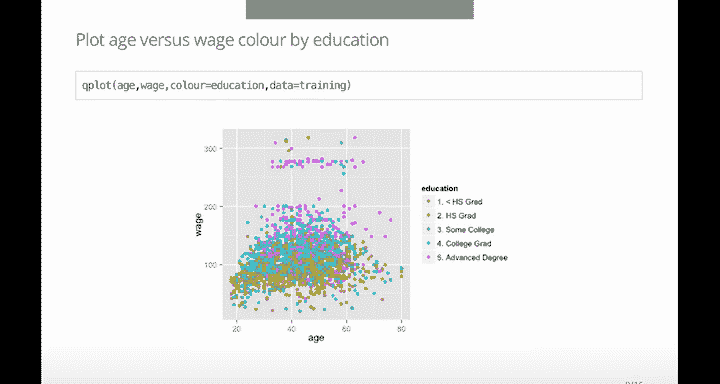

```r
# 用工作类别着色
ggplot(training, aes(x = age, y = wage, color = jobclass)) +
  geom_point()
```

同样，用`education`（教育程度）着色也能解释这部分高工资的变异，这表明教育程度和工作类别的某种组合影响了年龄与工资的关系。

---

## 构建多元线性回归模型

探索之后，我们可以构建一个包含多个预测变量的线性回归模型。模型不仅包含截距项和年龄的影响，还通过**指示变量**来纳入分类变量（如工作类别和教育程度）。

**指示变量公式**：
对于二分类变量（如工作类别），我们创建一个变量：
`I(jobclass_i = “Information”)`，当第i个人的工作类别为“信息”时值为1，否则为0。

对于多分类变量（如教育程度），我们为每个类别K创建一个指示变量：
`I(education_i = level_k)`，当第i个人的教育程度为第k级时值为1，否则为0。

在R中，我们可以使用`caret`包的`train`函数方便地拟合模型：

```r
# 拟合包含年龄、工作类别和教育程度的模型
model <- train(wage ~ age + jobclass + education,
               data = training,
               method = "lm")
```

查看最终模型，你会发现尽管公式中只写了三个变量名，但模型实际上包含了10个预测因子，这是因为分类变量被自动转换成了多个指示变量。

---

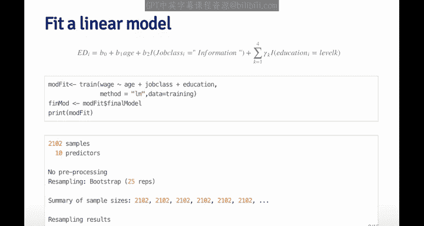

## 模型诊断与残差分析

拟合模型后，进行诊断至关重要。以下是关键的诊断步骤：

首先，绘制拟合值与残差的关系图。理想情况下，残差应随机分布在0线附近。

```r
# 计算训练集的预测值和残差
train_pred <- predict(model, newdata = training)
train_resid <- training$wage - train_pred

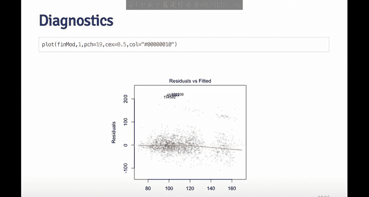

# 绘制拟合值 vs 残差图
ggplot(data = NULL, aes(x = train_pred, y = train_resid)) +
  geom_point() +
  geom_hline(yintercept = 0, linetype = "dashed")
```

图中若存在明显的离群点或模式，则说明模型可能遗漏了重要变量。

其次，我们可以用**未包含在模型中的变量**为残差图上色，以发现潜在模式。例如，用`race`（种族）着色后，可能发现某些离群点与种族有关。

```r
# 用种族为残差图上色
ggplot(data = training, aes(x = train_pred, y = train_resid, color = race)) +
  geom_point()
```

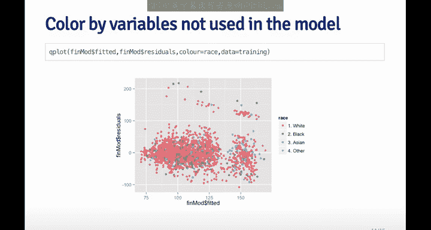

另一种有用的方法是绘制残差与数据**索引**（即数据行的原始顺序）的关系图。如果残差在索引的某个区间呈现趋势或聚集，则暗示数据可能按时间、年龄等连续变量排序，而该变量未被纳入模型。

```r
# 绘制残差 vs 索引图
ggplot(data = NULL, aes(x = seq_along(train_resid), y = train_resid)) +
  geom_point()
```

---

## 在测试集上评估与探索

模型构建完成后，我们在测试集上评估其表现。

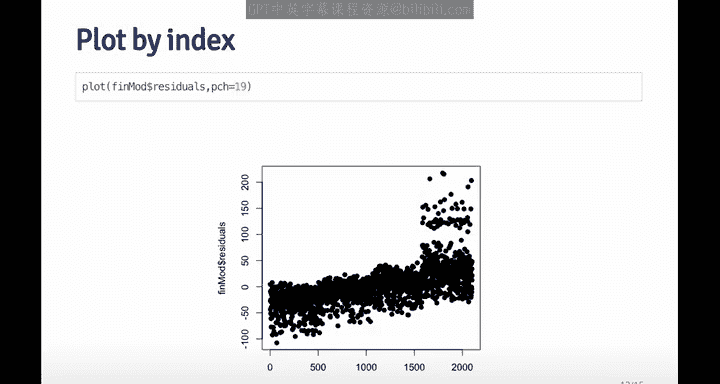

```r
# 在测试集上进行预测
test_pred <- predict(model, newdata = testing)

# 绘制测试集真实值 vs 预测值
ggplot(data = NULL, aes(x = testing$wage, y = test_pred)) +
  geom_point() +
  geom_abline(slope = 1, intercept = 0) # 添加45度参考线
```

理想情况下，点应紧密分布在45度线附近。我们也可以在测试集上探索模型残差与其他变量（如数据收集年份）的关系，但这仅用于事后分析，**绝不能**根据测试集的发现返回去修改训练集模型。

---

## 使用所有变量进行建模

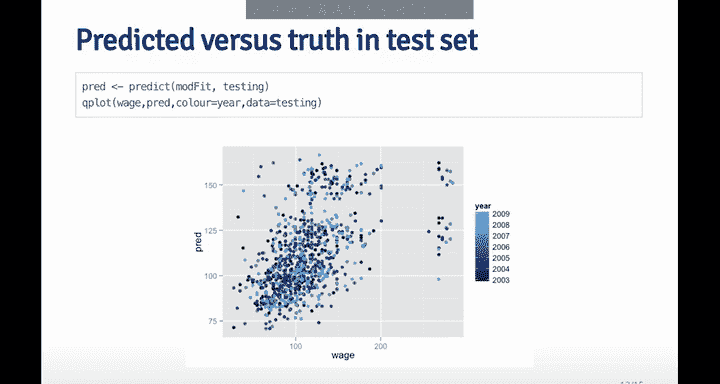

如果你希望一次性使用所有可用变量进行建模，可以在公式中使用点号`.`。

```r
# 使用所有变量拟合模型
model_all <- train(wage ~ ., data = training, method = "lm")
```

这通常能捕获更多变异，但可能包含不必要或冗余的变量。

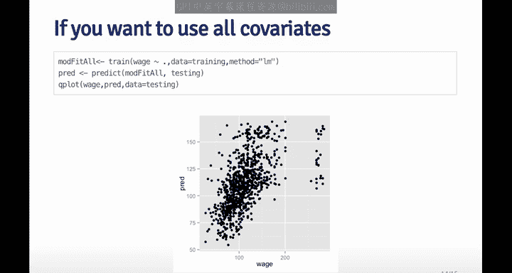

---

## 总结与拓展

本节课中我们一起学习了多元线性回归预测的核心流程。

*   **线性回归**是一个基础但强大的工具，它假设预测变量与结果呈线性关系。当关系非线性时，其预测能力会受限，此时可考虑与其他模型结合使用。
*   **探索性数据分析**对于回归建模至关重要。通过绘制残差图并按不同特征着色，我们可以识别数据中的模式，发现被遗漏的重要预测变量。
*   **模型评估**必须在独立的测试集上进行，以确保结果的可靠性。

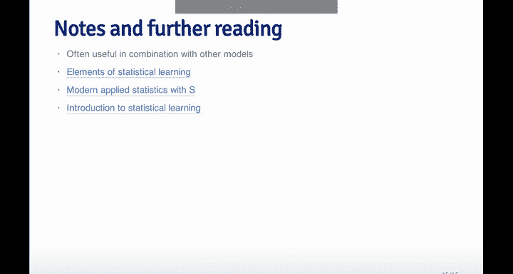

如果你想深入了解回归预测建模，可以参考《An Introduction to Statistical Learning》、《Elements of Statistical Learning》和《Applied Predictive Modeling》等书籍。