# 099：18_使用树进行预测 🌳


在本节课中，我们将学习如何使用决策树进行预测。决策树是一种直观且强大的预测模型，它通过一系列规则将数据分割成不同的组，从而对结果进行分类或回归预测。我们将探讨其基本概念、构建算法、优缺点，并通过一个实际案例来演示其应用。

---

## 决策树的基本概念

决策树的核心思想是，利用一系列变量（特征）对结果（目标变量）进行递归分割，直到每个子组内的结果足够“纯净”或子组足够小为止。这个过程类似于一个流程图，每个节点代表一个决策点（基于某个变量的条件判断），每个分支代表一个决策结果，而每个叶节点则代表一个最终的预测类别或值。

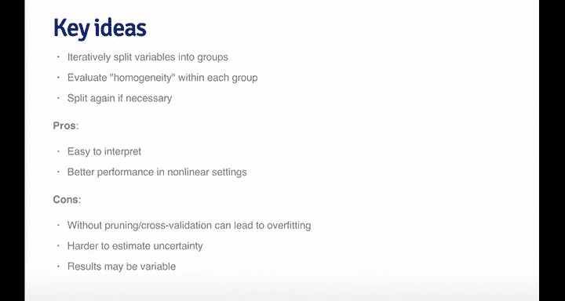

上一节我们介绍了预测模型的基本概念，本节中我们来看看决策树的具体工作原理。

---

## 决策树的示例

为了更好地理解决策树，我们来看一个具体的例子。下图展示了一个在2008年美国总统大选期间，《纽约时报》用于预测各县投票倾向的决策树。


这个决策树试图预测一个县是投票给巴拉克·奥巴马还是希拉里·克林顿。其构建过程如下：

1.  首先，算法找到最佳分割变量。在这个例子中，最佳分割点是“非裔美国人比例是否超过20%”。如果是，则该县更可能投票给奥巴马；如果不是，则更可能投票给希拉里。
2.  然后，在每个子组（分支）内，算法继续寻找下一个最佳分割变量。例如，在“非裔美国人比例≤20%”的分支中，下一个问题是“高中毕业率是否大于78%？”。
3.  这个过程持续进行，直到将数据分割成足够纯净或足够小的子组（叶节点）。在每个叶节点中，预测结果变得非常明确，例如“奥巴马赢得了该组中约450个县中的383个”。

通过这个例子，我们可以看到决策树如何将复杂的预测问题分解为一系列简单的“是/否”问题。

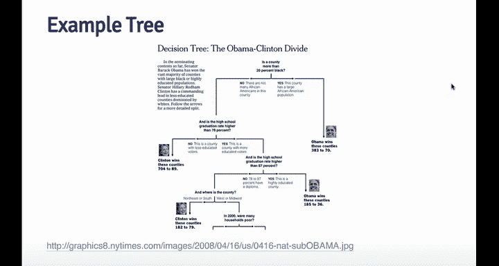

---

## 决策树的构建算法

决策树的构建遵循一个系统性的算法。以下是构建一棵分类树的基本步骤：

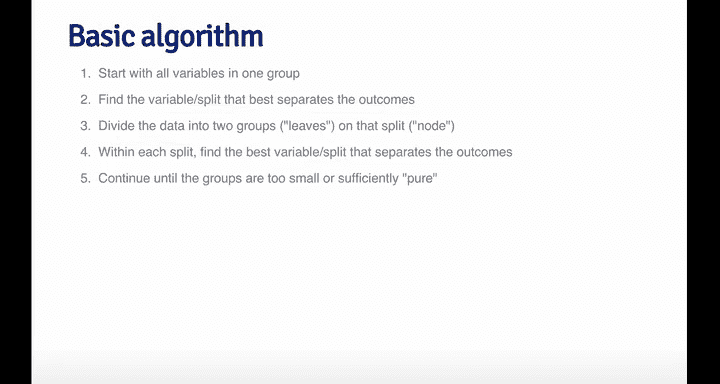

1.  **开始**：将所有数据视为一个单一的组（根节点）。
2.  **寻找最佳分割**：遍历所有变量，找到能够将当前组内的结果分割成两个最“纯净”（即同质性最高）子组的变量和分割点。这个分割点成为一个**节点**。
3.  **创建分支**：根据上一步找到的分割点，将数据分成两个子组，形成两个**叶节点**（此时它们是新的待分割组）。
4.  **递归分割**：在每个新形成的叶节点上，重复步骤2和步骤3，继续寻找最佳分割变量。
5.  **停止条件**：当满足以下任一条件时，停止分割：
    *   组内的样本数量太少。
    *   组内的结果已经足够“纯净”（例如，所有样本都属于同一类）。
    *   达到预设的树深度。

这个算法通过不断提纯每个子组内的结果，最终构建出一个树状结构的预测模型。

---

## 衡量“不纯度”的指标

在寻找最佳分割点时，我们需要一个量化标准来衡量分割后子组的“纯净度”或“不纯度”。以下是三种常用的不纯度指标：

以下是三种核心的不纯度衡量公式：

*   **误分类误差 (Misclassification Error)**：
    `1 - max_k(p̂_mk)`
    其中 `p̂_mk` 是第 `m` 个叶节点中属于第 `k` 类的样本比例。该值越小，说明该叶节点越纯净。

*   **基尼指数 (Gini Index)**：
    `1 - Σ_k (p̂_mk)^2`
    基尼指数衡量的是从节点中随机抽取两个样本，它们属于不同类别的概率。该值越小，纯度越高。

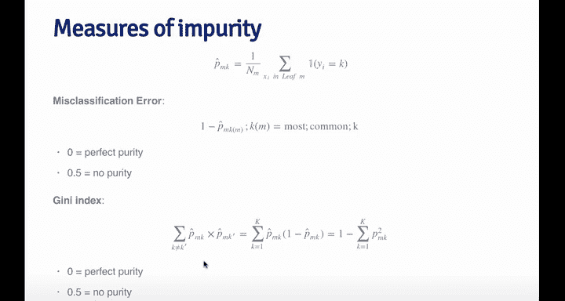

*   **交叉熵/信息增益 (Cross-Entropy / Information Gain)**：
    `- Σ_k p̂_mk * log(p̂_mk)`
    当使用以2为底的对数时，常称为信息增益。该值越小，表示节点越纯净。

**指标对比示例**：
假设一个叶节点有16个样本，其中15个为蓝色，1个为红色。
*   误分类误差 = 1/16 = 0.0625 （很低，很纯净）
*   基尼指数 = 1 - [(15/16)² + (1/16)²] ≈ 0.117 （很低）
*   信息增益 = -[ (15/16)*log₂(15/16) + (1/16)*log₂(1/16) ] ≈ 0.337 （较低）

相反，如果一个叶节点中蓝红样本各占一半（8个 vs 8个），则所有不纯度指标都会接近其最大值（如误分类误差=0.5，基尼指数=0.5，信息增益=1），表明这是一个非常糟糕的、不纯净的分割。

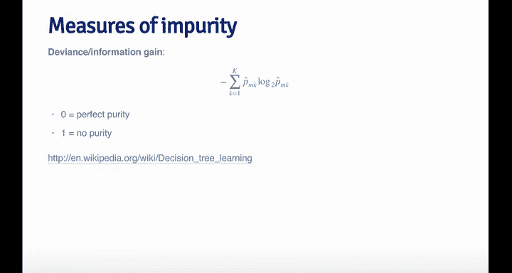

---

## 实战案例：鸢尾花分类

现在，让我们通过一个经典的鸢尾花数据集来实际演示如何构建和应用决策树。

### 1. 加载与探索数据

我们使用R语言中的`iris`数据集，它包含鸢尾花的四个特征（萼片长度、萼片宽度、花瓣长度、花瓣宽度）和一个目标变量（物种：Setosa, Versicolor, Virginica）。

```r
# 加载数据和绘图库
data(iris)
library(ggplot2)
```

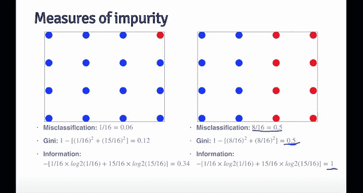

首先，我们将数据分为训练集和测试集，用于构建模型和评估性能。

```r
# 创建训练集索引（使用75%的数据）
set.seed(123) # 确保结果可重现
inTrain <- createDataPartition(y=iris$Species, p=0.75, list=FALSE)
training <- iris[inTrain, ]
testing <- iris[-inTrain, ]
```

我们可以先可视化两个特征（如花瓣宽度和萼片宽度）与物种之间的关系，可以看到明显的聚类。

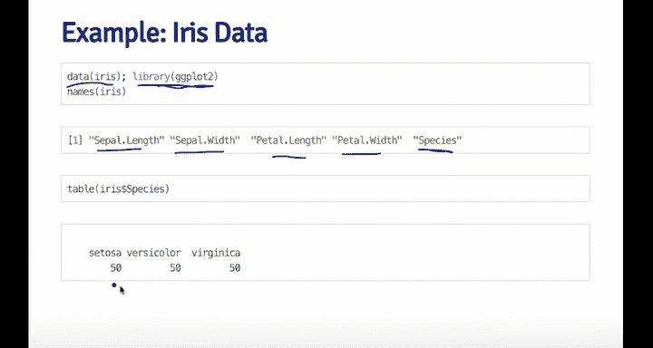

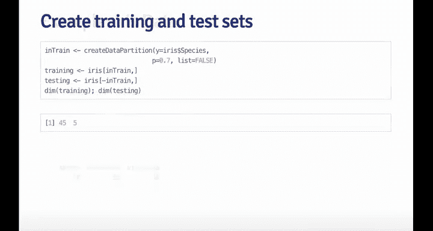


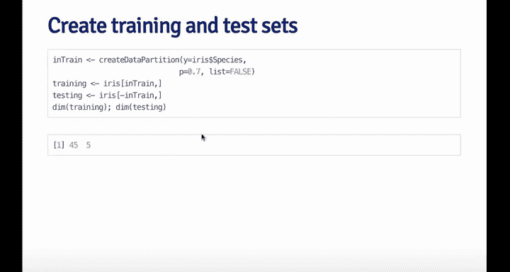

### 2. 训练决策树模型

我们使用`caret`包中的`train`函数和`rpart`方法（递归分割）来构建分类树。

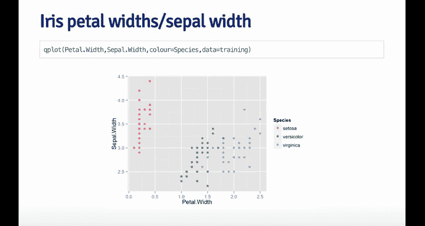

```r
library(caret)
# 训练决策树模型
modFit <- train(Species ~ ., method="rpart", data=training)
```

查看最终的模型，我们可以看到具体的分割规则。

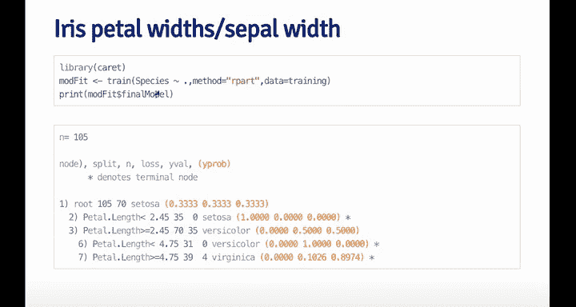

```r
# 打印模型细节
print(modFit$finalModel)
```
输出会显示类似这样的规则：`如果花瓣长度 < 2.45，则预测为Setosa；否则，进入下一个判断...`。

### 3. 可视化决策树

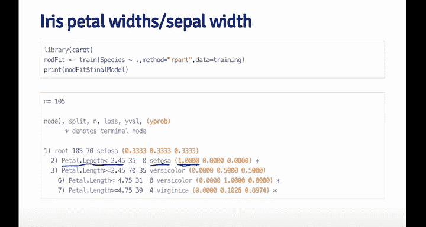

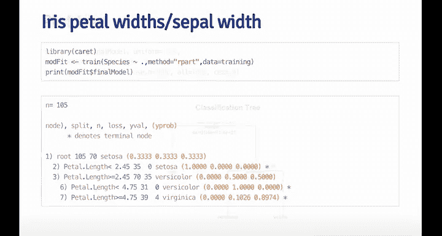

我们可以绘制决策树的结构图，使其更直观。

```r
# 基础绘图（可能不美观）
plot(modFit$finalModel)
text(modFit$finalModel)

# 使用rattle包绘制更美观的图形
library(rattle)
fancyRpartPlot(modFit$finalModel)
```

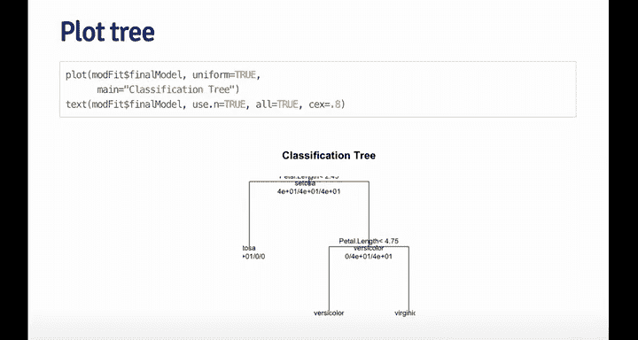

从图中可以清晰地看到决策路径：首先根据花瓣长度进行分割，然后根据花瓣宽度或其他特征进行后续分割，最终将样本分到三个物种对应的叶节点。


### 4. 进行预测

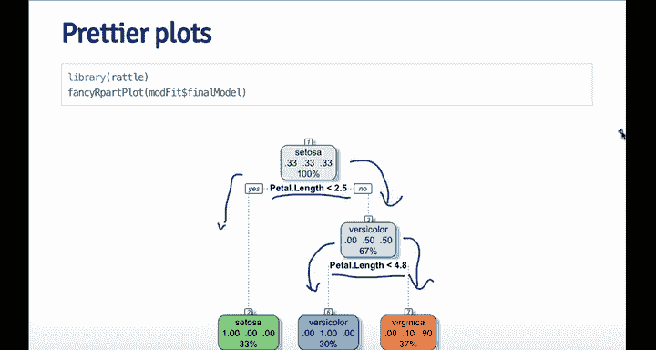

使用训练好的模型对测试集进行预测。

```r
# 对测试集进行预测
predictions <- predict(modFit, newdata=testing)

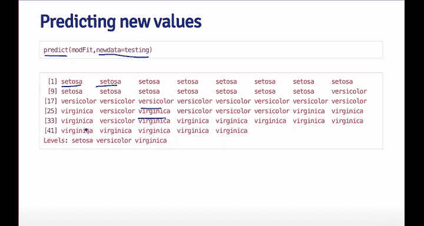

# 查看预测结果
print(predictions)

# 可以生成混淆矩阵来评估性能
confusionMatrix(predictions, testing$Species)
```

`predict`函数会为测试集中的每一条数据输出预测的物种类别。

---

## 决策树的注意事项与总结

在本节课中，我们一起学习了如何使用决策树进行预测。以下是需要记住的几个关键点：

*   **优点**：决策树模型**易于解释和可视化**，其规则就像流程图一样清晰。它们能**自动处理特征间的交互作用**，并且在**非线性关系**的数据上通常比简单的线性回归表现更好。
*   **缺点**：决策树**容易过拟合**，特别是当树生长得过深时。可以通过“剪枝”或使用交叉验证来缓解。此外，与线性模型相比，**估计预测的不确定性更为复杂**。模型的**结果可能对数据和参数设置比较敏感**，稳定性稍差。
*   **其他特性**：
    *   决策树可以同时用于**分类**和**回归**问题（回归树使用如均方误差作为不纯度指标）。
    *   对连续变量进行**单调变换**（如对数变换）通常不会改变树的最终结构，因为分割只依赖于值的顺序。
    *   R语言中有多个包可用于构建决策树，如`rpart`、`party`、`tree`等。

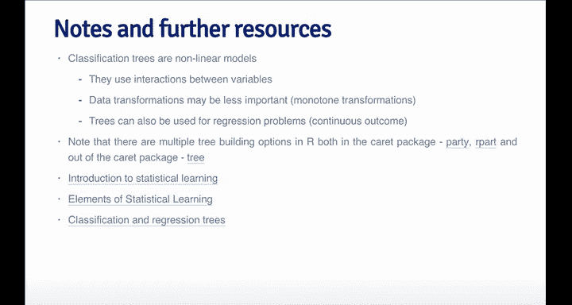

决策树是机器学习工具箱中的一个基础且重要的工具，它也是构建随机森林、梯度提升树等更强大集成模型的基础。理解其原理是迈向更复杂模型的关键一步。