# 100：19_装袋法 🎒

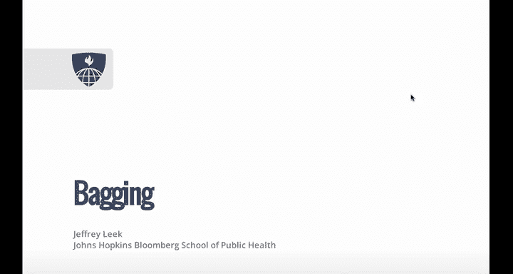

在本节课中，我们将要学习一种名为“装袋法”的机器学习技术。装袋法是“自助聚合”的简称，其核心思想是通过组合多个模型来获得更稳定、更准确的预测结果。

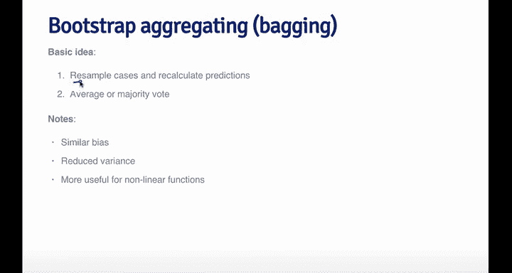

## 概述 📋

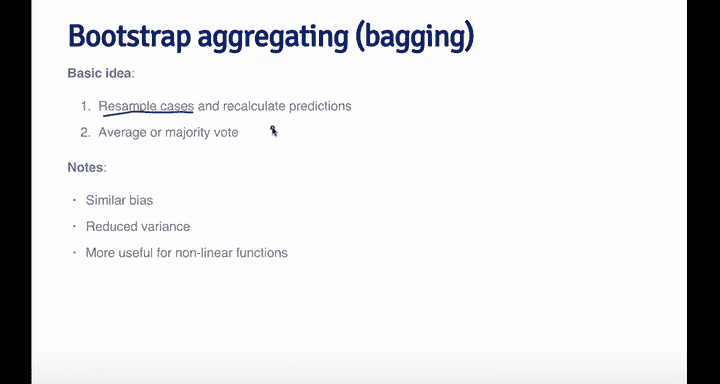

装袋法的基本理念是：当你拟合复杂的模型时，如果将这些模型的预测结果进行平均，通常会得到一个更平滑、更稳健的模型。这有助于在模型的**偏差**和**方差**之间取得更好的平衡。

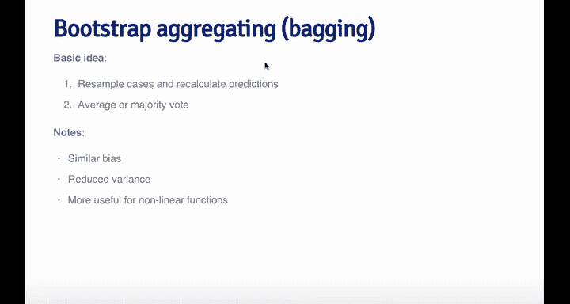

上一节我们介绍了模型评估的概念，本节中我们来看看如何通过集成方法来提升模型性能。

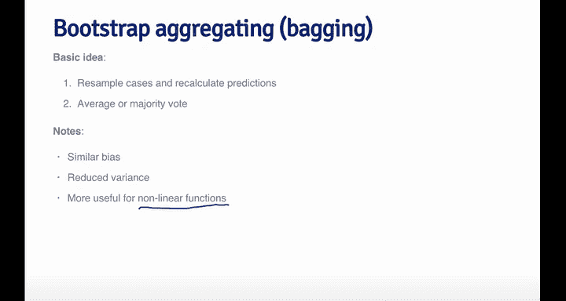

## 装袋法的核心思想 💡

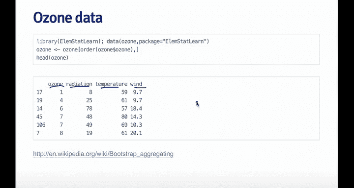

装袋法有一个非常简单的操作流程。

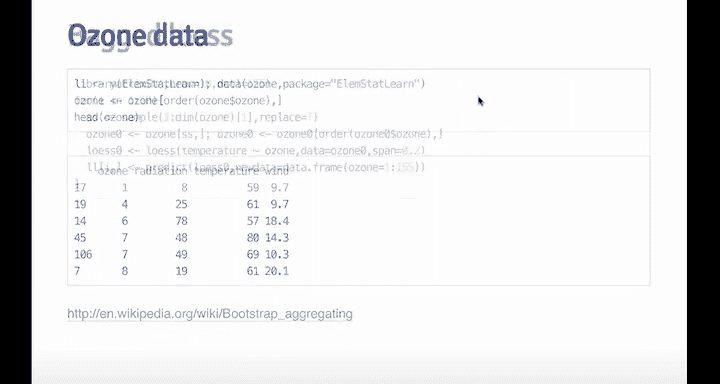

以下是其基本步骤：
1.  **自助重采样**：从原始数据集中进行有放回的随机抽样，生成多个新的训练子集。这个过程类似于你在推断课程中学到的“自助法”。
2.  **模型训练**：在每个重采样的子集上独立地训练一个预测模型（例如决策树、平滑曲线等）。
3.  **结果聚合**：
    *   对于**回归**问题，将所有模型的预测结果进行**平均**。
    *   对于**分类**问题，则采用**多数投票**等策略来确定最终类别。

这样做的结果是，最终模型与单个子模型具有相似的**偏差**，但由于对多个不同预测器的结果进行了平均，因此显著降低了**方差**。这种方法对非线性模型特别有效。

## 一个实例：臭氧数据预测 🌡️

为了具体说明装袋法如何工作，我们将使用一个实例。我们回到臭氧数据集，它位于 `ElemStatLearn` 包中。

首先，我们加载数据并查看其结构。数据集包含四个变量：`ozone`（臭氧浓度）、`radiation`（辐射）、`temperature`（温度）和 `wind`（风速）。在本例中，我们的目标是使用 `ozone` 来预测 `temperature`。

以下是演示装袋法流程的代码步骤：

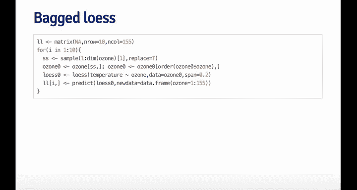

```r
# 加载数据
library(ElemStatLearn)
data(ozone)

# 为了绘图清晰，按臭氧浓度排序
ozone <- ozone[order(ozone$ozone), ]

# 创建一个矩阵来存储多次重采样拟合的预测结果
ll <- matrix(NA, nrow=10, ncol=155)

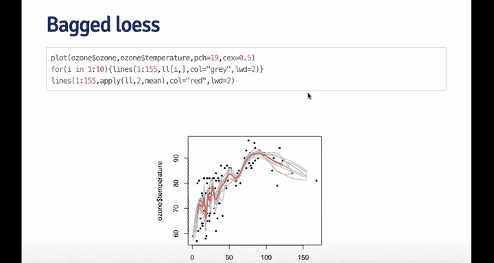

# 进行10次自助重采样和模型拟合
for(i in 1:10){
    # 1. 有放回地重采样
    ss <- sample(1:dim(ozone)[1], replace=TRUE)
    ozone0 <- ozone[ss, ]
    ozone0 <- ozone0[order(ozone0$ozone), ]
    
    # 2. 在每个子集上拟合一个平滑曲线（loess模型）
    loess0 <- loess(temperature ~ ozone, data=ozone0, span=0.2)
    
    # 3. 对固定的臭氧值序列进行预测，并存储结果
    ll[i, ] <- predict(loess0, newdata=data.frame(ozone=1:155))
}
```

通过上述循环，我们得到了10条基于不同数据子集拟合的平滑曲线。每条曲线都试图捕捉数据中的关系，但可能因为数据子集的随机性而显得波动较大。

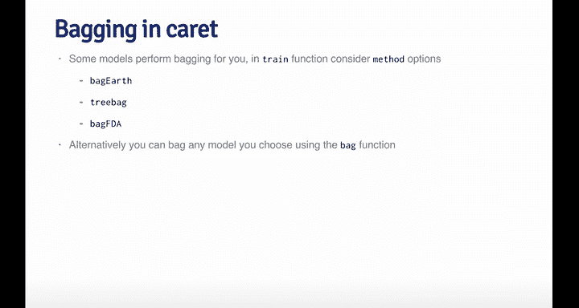

## 可视化装袋效果 📊

现在，让我们通过绘图来直观理解装袋法的作用。


在图中：
*   X轴是观测到的臭氧值，Y轴是温度值。
*   每个黑点代表一个原始观测数据。
*   每条灰色曲线代表基于一个重采样数据集拟合的 `loess` 模型。可以看到，这些灰线非常曲折，捕捉了大量细节，但也可能包含了过多的噪声（过拟合）。
*   **红色曲线**是装袋后的 `loess` 曲线，即对所有灰色曲线的预测值进行平均的结果。

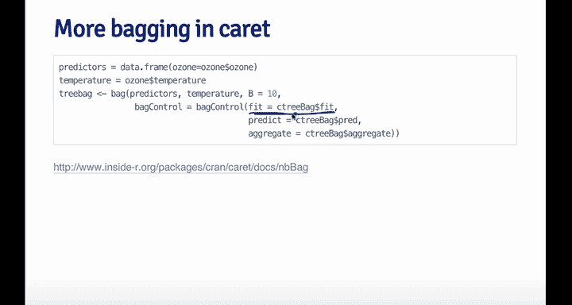

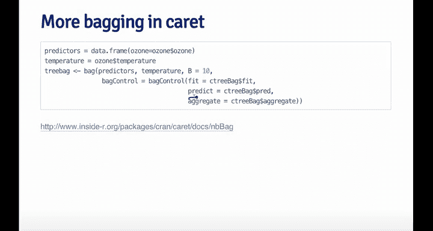

红色曲线更平滑，更接近数据的中心趋势。它保留了数据的主要模式，同时过滤掉了由于单个数据子集的随机性带来的剧烈波动。这证明了装袋法可以降低方差，获得更稳健的模型。

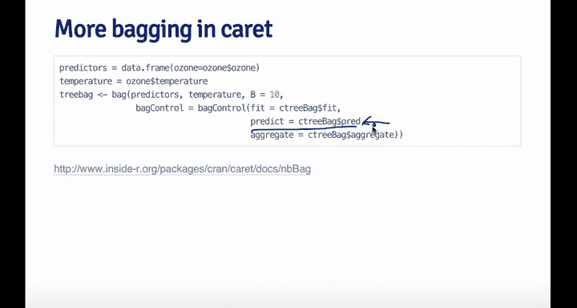

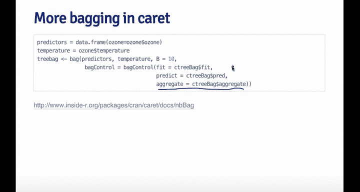

## 使用 `caret` 包实现装袋法 🛠️

在实际应用中，我们不需要每次都手动编写循环。`caret` 包提供了内置的装袋法模型。

以下是 `caret` 包中一些支持装袋的模型方法：
*   `bagEarth`：装袋后的多元自适应回归样条。
*   `treebag`：装袋决策树。
*   `bagFDA`：装袋后的灵活判别分析。


你可以直接在 `train` 函数中设置 `method` 参数为上述选项之一。

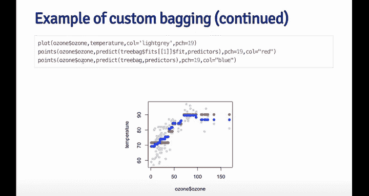

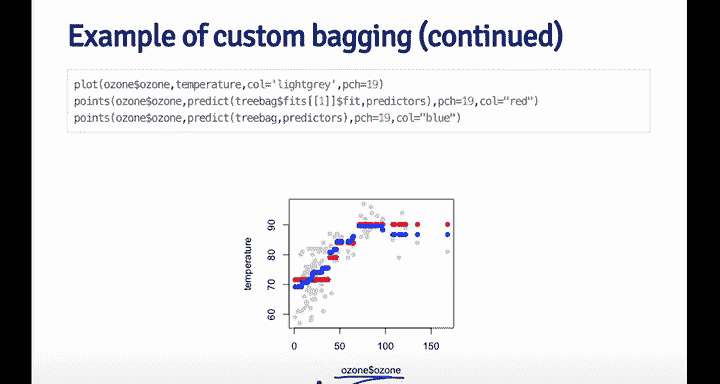

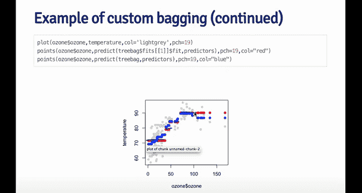

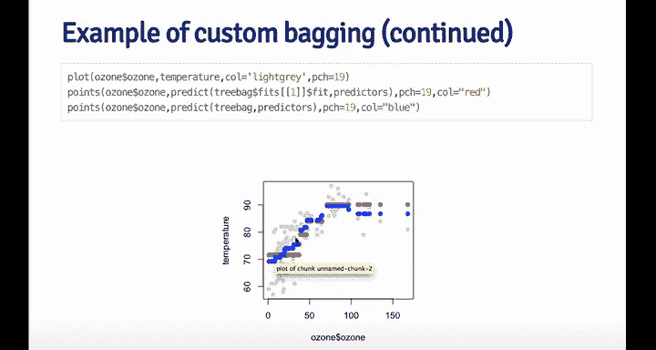

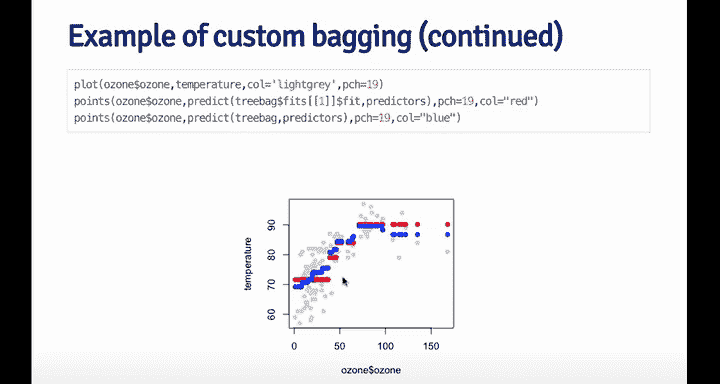

此外，`caret` 包也允许你为任何自定义的模型创建装袋流程，但这属于更高级的用法。其核心是使用 `bag` 函数，并指定三个关键组件：
1.  `fit`：用于在每个数据子集上训练模型的函数。
2.  `predict`：用于根据训练好的模型进行预测的函数。
3.  `aggregate`：用于聚合多个模型预测结果的函数（如求平均）。

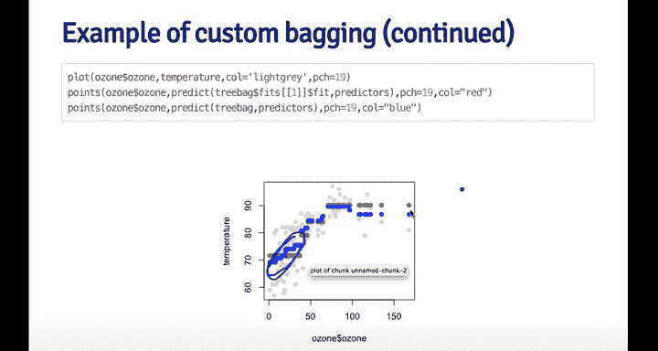

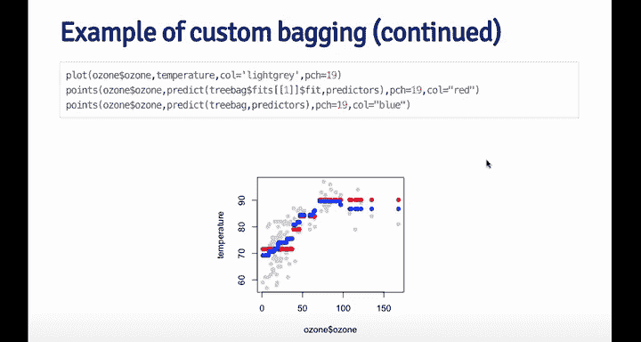

例如，以下代码展示了如何为条件回归树创建自定义装袋函数：

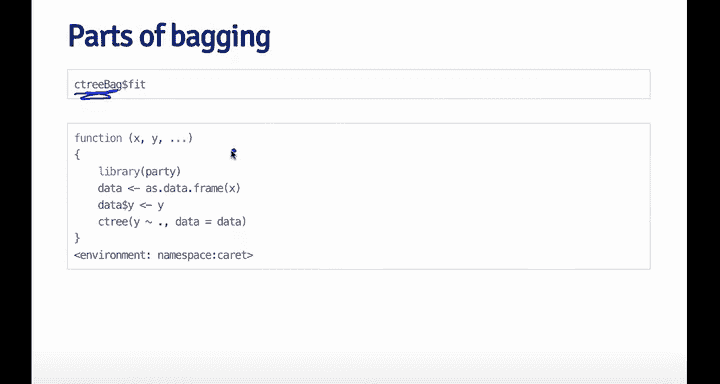

```r
# 创建预测变量数据框和结果变量
predictors = data.frame(ozone=ozone$ozone)
temperature = ozone$temperature

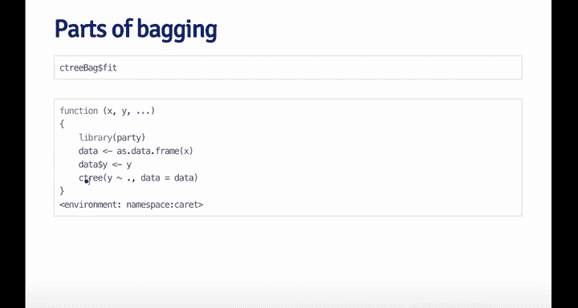

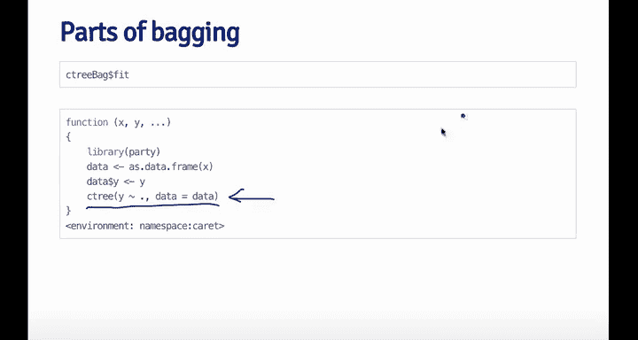

# 使用bag函数进行装袋
treebag <- bag(predictors, temperature, B = 10,
                bagControl = bagControl(fit = ctreeBag$fit,
                                        predict = ctreeBag$pred,
                                        aggregate = ctreeBag$aggregate))
```

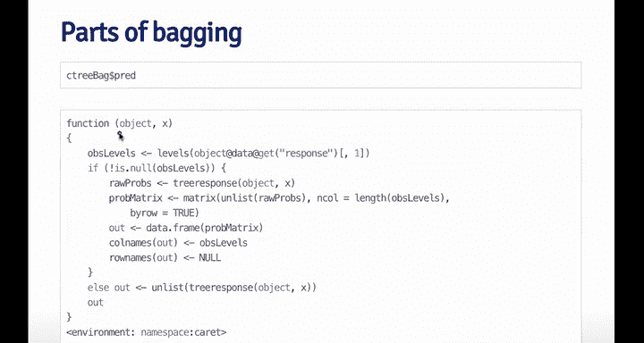

在这个例子中，`ctreeBag$fit`、`ctreeBag$pred` 和 `ctreeBag$aggregate` 是预定义的函数，分别负责拟合条件回归树、进行预测以及通过取**中位数**来聚合结果。

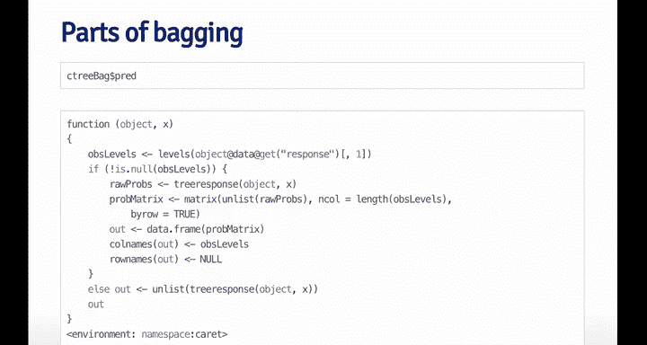

通过对比装袋前后的拟合曲线（例如，单个条件回归树的红色拟合线 vs. 装袋后的蓝色拟合线），可以再次看到装袋法能够更好地捕捉数据的整体趋势。

## 装袋法的应用与扩展 🚀

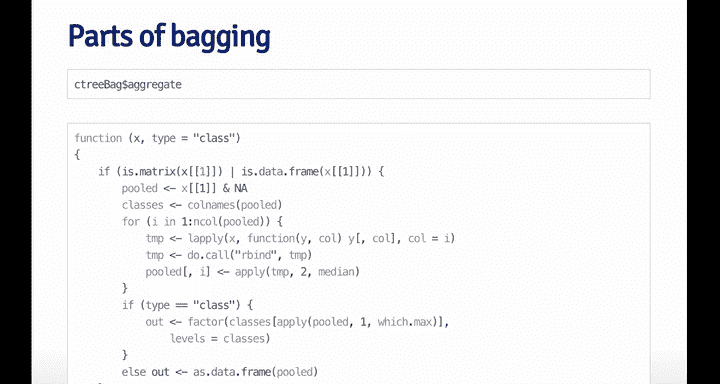

装袋法被广泛应用于各种非线性模型，尤其是在决策树模型中效果显著。一个著名的扩展就是**随机森林**，我们将在后续课程中详细讨论。

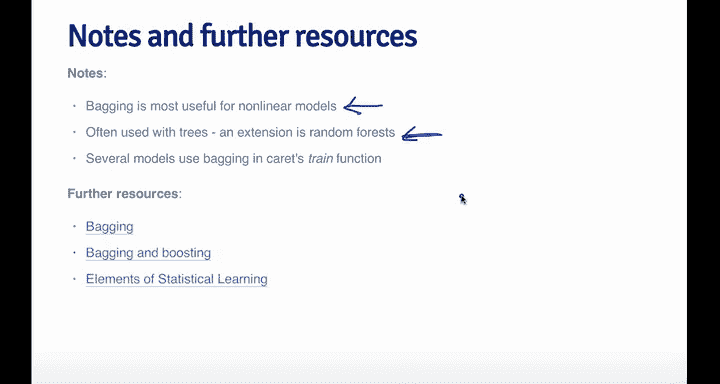

许多集成模型都基于装袋思想。你可以使用 `caret` 包中的内置函数，也可以为你喜欢的任何分类或回归算法构建自己的装袋流程。

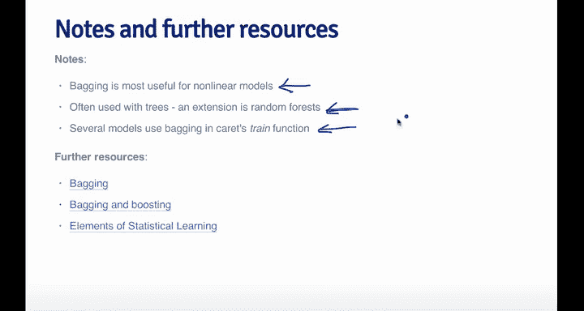

## 总结 🎯

本节课中我们一起学习了装袋法。我们了解到：
1.  装袋法通过**自助重采样**构建多个训练集，并训练多个基模型。
2.  通过**平均**（回归）或**投票**（分类）来聚合这些模型的预测结果。
3.  其核心优势在于保持偏差基本不变的同时，有效**降低预测结果的方差**，从而获得更稳健、更通用的模型。
4.  装袋法特别适用于**非线性模型**（如决策树、平滑曲线），并且是构建更强大集成模型（如随机森林）的基础。


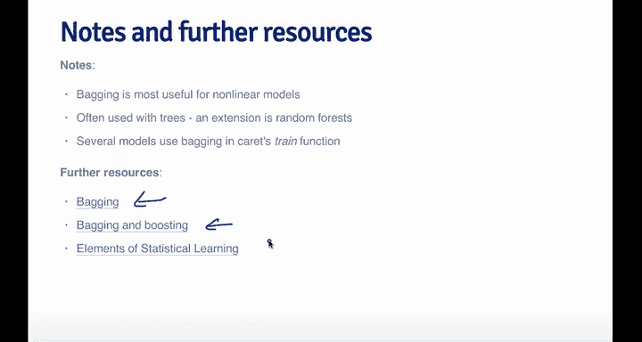

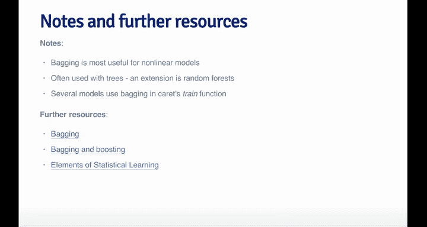

记住，装袋法的基本思想就是：重采样数据，重新拟合模型，然后对多次拟合的结果进行平均，从而得到一个比任何单次拟合都更平滑、更可靠的模型。