# 102：提升法 (Boosting) 🚀


在本节课中，我们将要学习一种强大的机器学习方法——提升法 (Boosting)。提升法与随机森林一样，是众多“开箱即用”的分类器中准确率最高的方法之一。

## 核心思想 💡

提升法的基本思想是，组合大量可能较弱的预测器，通过加权的方式利用它们的优势，并将它们的结果相加。

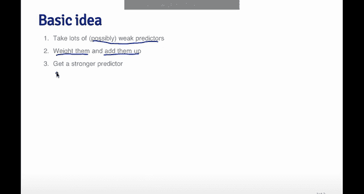

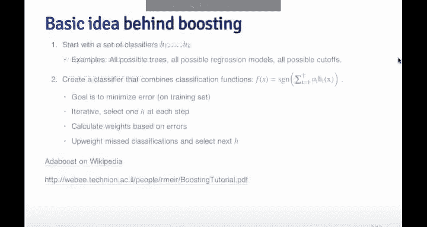

当我们对它们进行加权和相加时，其思路类似于回归树的装袋法或随机森林。我们取大量分类器，对它们进行某种平均，通过这种平均，我们得到一个更强的预测器。

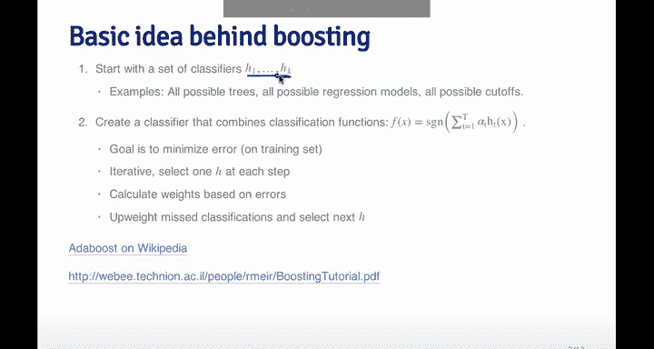

## 算法原理 ⚙️

上一节我们介绍了核心思想，本节中我们来看看其数学形式。

基本思路是取 K 个分类器，这些分类器通常来自同一类模型。

例如，可以使用所有可能的分类树、所有可能的回归模型，或者所有可能将数据划分为不同区域的简单分割点。

然后，创建一个分类器，将这些分类函数组合并加权在一起。

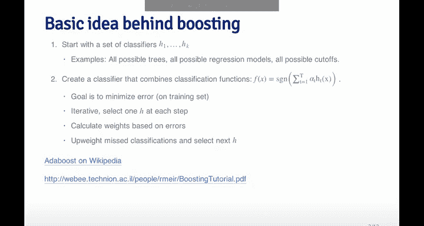

其公式可以表示为：
`f(x) = Σ α_t * h_t(x)`
其中，`α_t` 是权重，`h_t(x)` 是第 t 个分类器。这个加权的分类器集合给出了对新数据点 `x` 的预测 `f(x)`。

算法的目标是最小化训练集上的误差。这是一个迭代过程：每一步我们选择一个分类器 `h`，根据该分类器产生的误差计算下一步的权重，然后增加被错误分类样本的权重，并选择下一个分类器 `h`，如此继续。

最著名的提升算法可能是 AdaBoost。你可以在维基百科上阅读相关内容，也可以参考一份非常详细的提升法教程，该教程也为本讲义的后续内容提供了素材。

## 一个简单示例 📊

为了理解提升法如何工作，我们来看一个非常简单的例子。

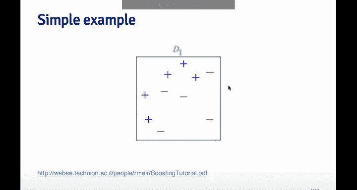

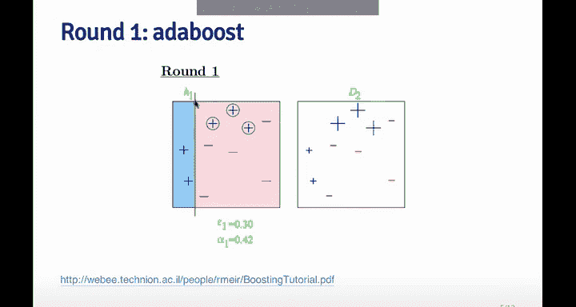

假设我们试图用两个变量来区分蓝色的加号（+）和红色的减号（-）。变量1在 x 轴，变量2在 y 轴。

我们的目标是构建一个能区分这两类点的分类器。

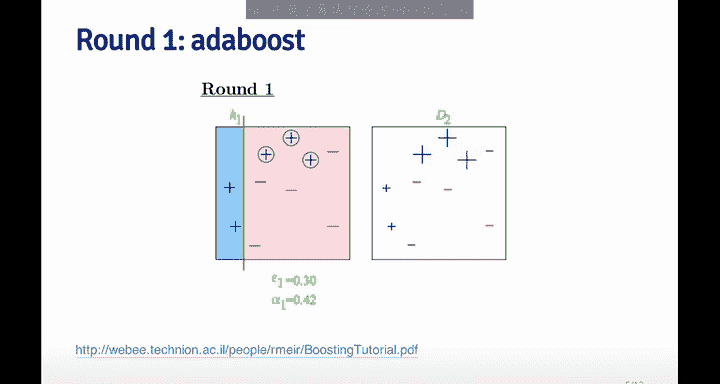

我们可以从一个非常简单的分类器开始：画一条垂直线，并规定这条线左边的所有点是蓝色加号，右边的是红色减号。

可以看到，我们错误分类了右上角的这三个点。

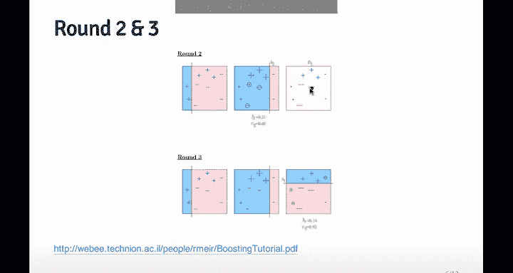

以下是构建提升模型的关键步骤：

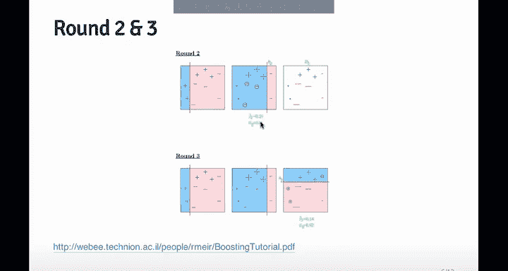

1.  构建第一个分类器并计算错误率（本例中约为30%）。
2.  增加被错误分类点的权重（在图中通过放大显示来表示）。
3.  基于新的权重构建下一个分类器（例如，另一条垂直线）。
4.  再次计算错误率并更新权重。
5.  第三个分类器会特意尝试正确分类前几轮被错误分类的点（例如，画一条水平线）。
6.  最后，将这些分类器加权组合：`0.42 * (第一个分类器) + 0.65 * (第二个分类器) + 0.92 * (第三个分类器)`。

虽然每个单独的分类器（只是一条分割线）非常简单甚至“幼稚”，但当将它们加权相加后，我们最终得到了一个强大得多的分类器，能够正确区分所有点。

## 提升法的变体与R语言实现 🛠️

提升法可以与任何分类器子集结合使用。也就是说，你可以从任何一组弱分类器开始。

一个非常大的类别是梯度提升 (Gradient Boosting)。R语言有多个实现提升法的程序包，它们主要依赖于不同类型的分类函数和组合规则。

以下是几个主要的R包：

*   **`gbm`包**：用于基于树的提升。
*   **`mboost`包**：用于基于模型的提升。
*   **`ada`包**：用于加性逻辑回归提升。
*   **`GAMBoost`包**：用于广义加性模型的提升。

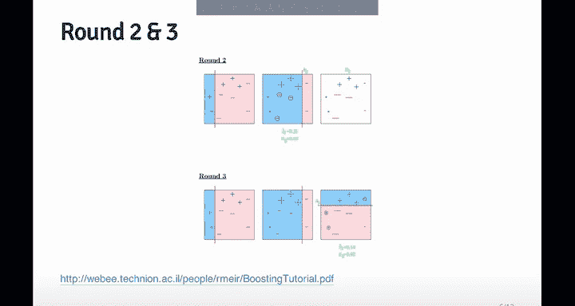

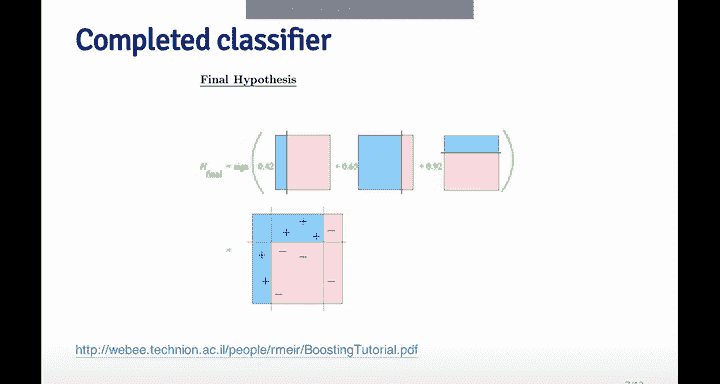

这些包大多可以通过 `caret` 包调用，因此你可以直接使用 `caret` 中的 `train` 函数来应用它们。

## 实战案例：预测工资 💰

现在，我们使用工资数据的例子来说明如何应用提升算法。

首先，加载必要的库和数据。

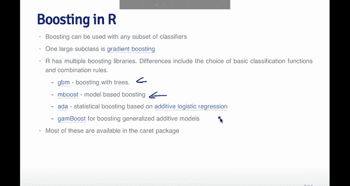

```r
library(ISLR) # 包含工资数据
library(ggplot2)
library(caret)
data(Wage)
```

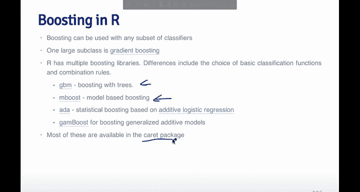

然后，创建数据集，移除我们想要预测的变量（即对数工资 `logwage`），并划分训练集和测试集。

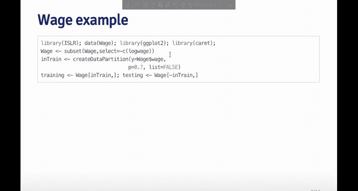

```r
# 移除预测目标，保留其他所有变量作为特征
wage_data <- subset(Wage, select = -logwage)
# 划分训练集和测试集
set.seed(123)
train_index <- createDataPartition(Wage$wage, p=0.7, list=FALSE)
train_data <- wage_data[train_index, ]
test_data <- wage_data[-train_index, ]
train_wage <- Wage$wage[train_index]
test_wage <- Wage$wage[-train_index]
```

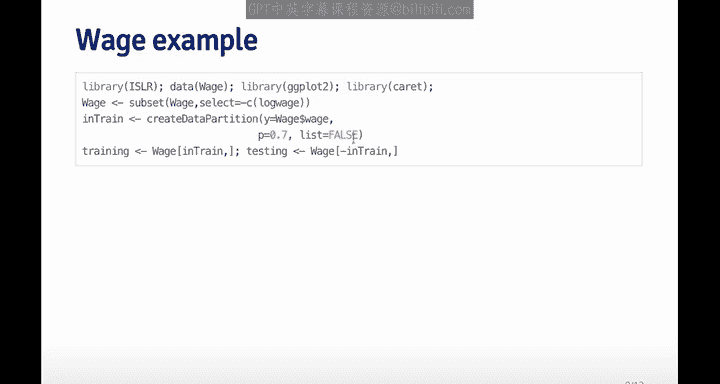

接下来，使用 `gbm` 方法（基于树的提升）进行建模。

```r
# 使用caret训练提升模型
model_fit <- train(wage ~ ., # 用所有其他变量预测wage
                   data = cbind(train_data, wage = train_wage),
                   method = "gbm",
                   verbose = FALSE) # 避免过多输出
print(model_fit)
```

打印模型拟合结果，可以看到使用了不同数量的树和不同的交互深度，它们共同构建了一个提升版的回归树模型。

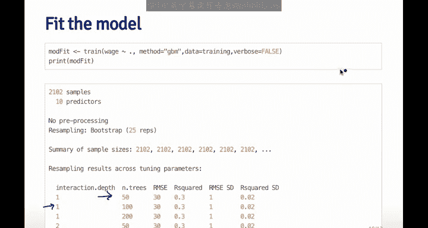

最后，在测试集上评估预测效果。

```r
# 在测试集上进行预测
predictions <- predict(model_fit, newdata = test_data)
# 绘制预测值与真实值的对比图
qplot(test_wage, predictions) +
  geom_abline(intercept=0, slope=1, color="red") +
  xlab("真实工资") +
  ylab("预测工资")
```

从散点图与对角线的接近程度可以看出，我们得到了一个相对较好的预测，尽管仍然存在相当的变异性。拟合提升算法（或任何提升模型）的基本思想，就是将这些弱分类器加权平均在一起，从而获得一个更好的分类器或预测器。

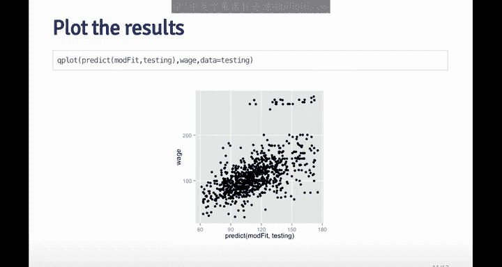

## 延伸阅读与总结 📚

本节课中我们一起学习了提升法的原理、简单示例和R语言实现。

本讲座中的许多信息都可以在相关教程中找到，如果你感兴趣，那里还有更深入的信息。此外，还有一些关于提升法和随机森林的更技术性的介绍和文章。这些文章实际上是一些竞赛的总结，这些竞赛通过结合随机森林和提升法，达到了极高的预测精度。

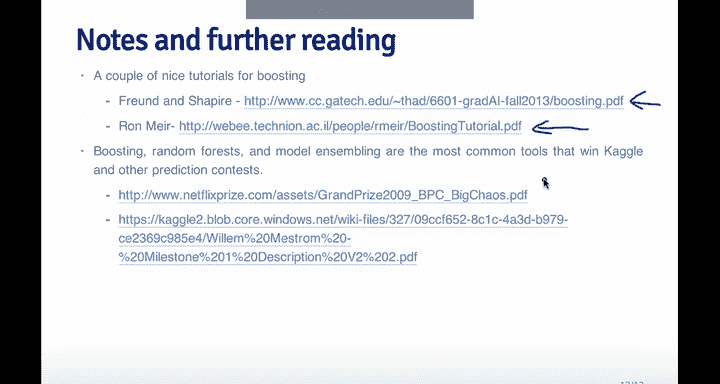

总而言之，提升法是一种通过集成多个弱模型来构建强模型的强大技术，在实践中广泛应用于分类和回归问题，并常常能取得出色的性能。