# 103：基于模型的预测 📊

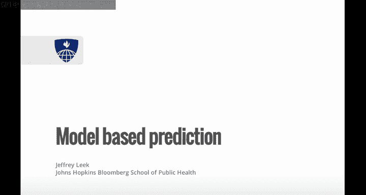

在本节课中，我们将学习基于模型的预测方法。其核心思想是假设数据遵循特定的概率模型，然后利用贝叶斯定理，基于该模型构建最优的分类器。

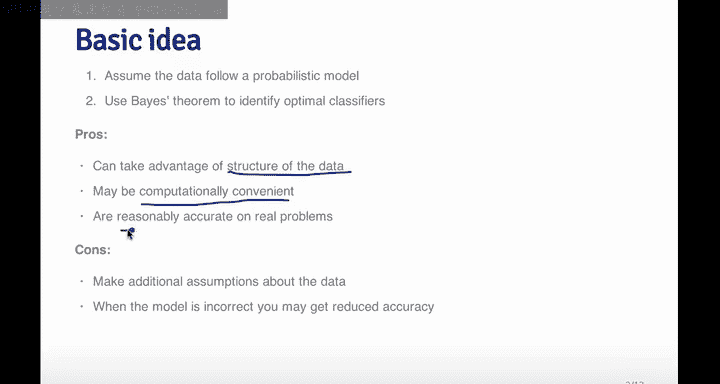

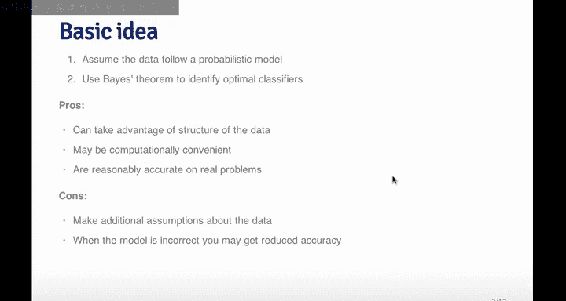

## 概述

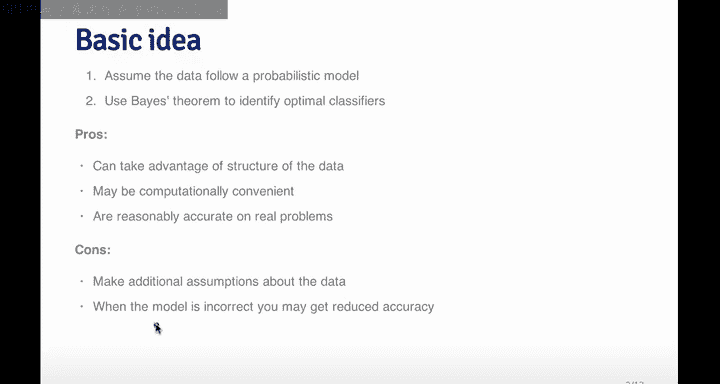

基于模型的预测方法假设数据服从特定的概率分布。这种方法能利用数据中可能存在的结构（例如特定的分布），从而带来计算上的便利，并在实际问题中保持合理的准确性，尤其是当问题数据符合我们所假设的底层分布时。

然而，这种方法需要对数据做出额外的假设。虽然这些假设无需被完美满足，预测算法也能良好工作，但如果假设与实际情况偏差过大，算法可能会失效，导致准确性下降。

## 模型方法详解

我们的目标是建立一个参数化模型，用于描述在给定预测变量 `X = x` 的条件下，结果 `Y` 属于特定类别 `k` 的条件概率分布，即 `P(Y = k | X = x)`。

一个典型的方法是应用贝叶斯定理。我们想知道在观察到变量 `X` 后，`Y` 来自类别 `k` 的概率。根据贝叶斯定理，这可以写为：

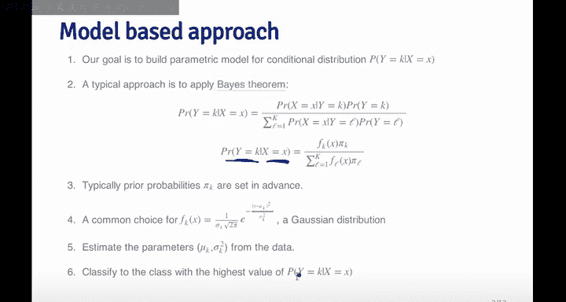

`P(Y = k | X = x) = [P(X = x | Y = k) * P(Y = k)] / Σ_j [P(X = x | Y = j) * P(Y = j)]`

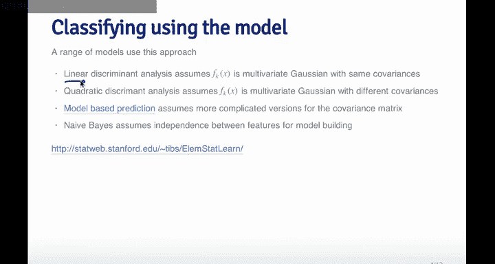

我们为给定类别下的特征分布假设一个参数模型，即上式中的 `P(X = x | Y = k)`，记作 `f_k(x)`。同时，我们假设一个先验概率 `P(Y = k)`，记作 `π_k`。


因此，我们可以将后验概率建模为：

`P(Y = k | X = x) ∝ f_k(x) * π_k`

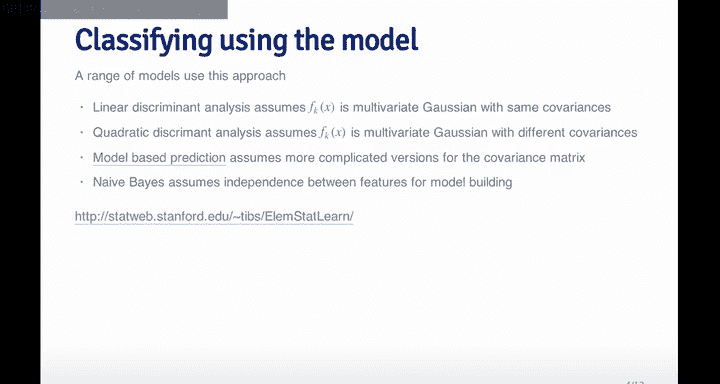

先验概率 `π_k` 通常根据数据预先设定。`f_k(x)` 的一个常见选择是高斯（正态）分布。如果存在多个 `X` 变量，则使用多元高斯分布。接着，我们从数据中估计参数（如均值 `μ_k` 和协方差矩阵 `Σ_k`）。

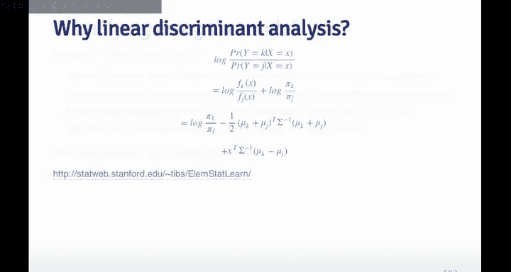

一旦估计出这些参数，只要观察到预测变量，我们就可以计算 `Y` 属于任一类别的概率，并将观测值分类到具有最高后验概率的类别。

## 常见模型类型

以下是几种采用此方法的常见模型：

*   **线性判别分析 (LDA)**：假设 `f_k(x)` 是多元高斯分布，且所有类别共享**相同的**协方差矩阵。这最终会在数据的特征空间中绘制出**线性**决策边界。
*   **二次判别分析 (QDA)**：与 LDA 类似，但允许每个类别有**不同的**协方差矩阵。这会产生**二次**曲线作为决策边界。
*   **朴素贝叶斯分类器**：在建模过程中，假设所有预测变量（特征）之间是**相互独立**的。尽管这个“朴素”的假设通常不成立，但它简化了计算，并且在许多应用中（尤其是特征数量众多或为分类变量时，如文本分类）仍然表现良好。

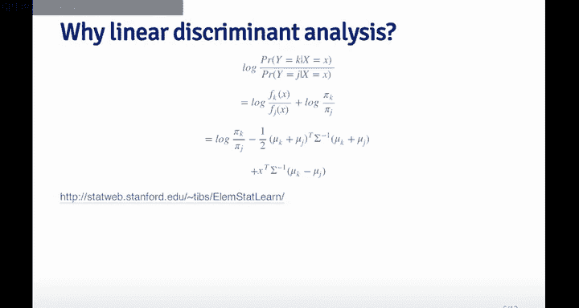

## 深入理解 LDA

为什么 LDA 是“线性”的？如果我们考虑两个类别 `k` 和 `j` 的后验概率之比的对数：

`log[P(Y=k|X=x) / P(Y=j|X=x)] = log[π_k/π_j] + ... + (线性项)`

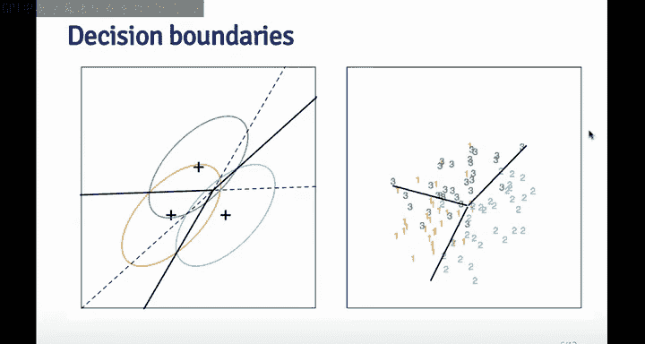

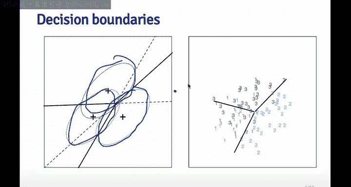

经过推导，这个表达式最终包含一个关于 `x` 的**线性项**。因此，决策边界是线性的：如果一个观测点落在边界的一侧，则更可能属于类别 `k`；落在另一侧，则更可能属于类别 `j`。

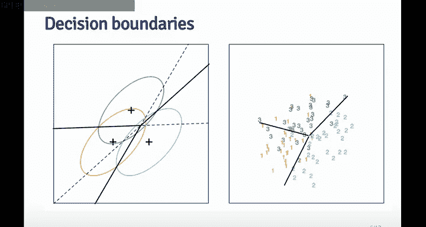

在实践中，我们使用一个**判别函数** `δ_k(x)` 来进行分类：


`δ_k(x) = x^T Σ^{-1} μ_k - (1/2) μ_k^T Σ^{-1} μ_k + log(π_k)`

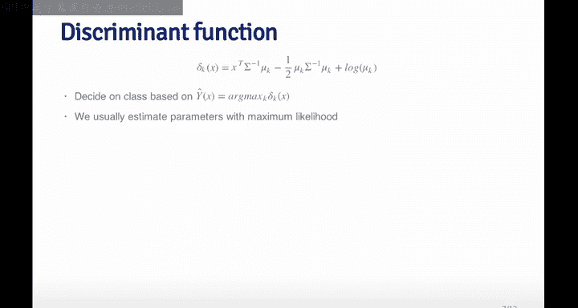

我们将新的数据点 `x` 代入每个类别的判别函数，然后选择使 `δ_k(x)` 值最大的那个类别 `k` 作为预测结果。这些参数通常通过最大似然估计法从数据中学习得到。

## 朴素贝叶斯的独立性假设

朴素贝叶斯的核心简化在于独立性假设。根据贝叶斯定理，我们希望最大化：

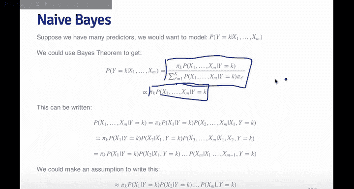

`P(Y=k | X) ∝ P(Y=k) * P(X | Y=k)`

在没有独立性假设时，`P(X | Y=k)` 是联合概率，计算复杂。如果假设所有 `p` 个特征 `X_1, X_2, ..., X_p` 在给定类别下条件独立，那么联合概率可以分解为单个概率的乘积：


`P(X | Y=k) = P(X_1 | Y=k) * P(X_2 | Y=k) * ... * P(X_p | Y=k)`


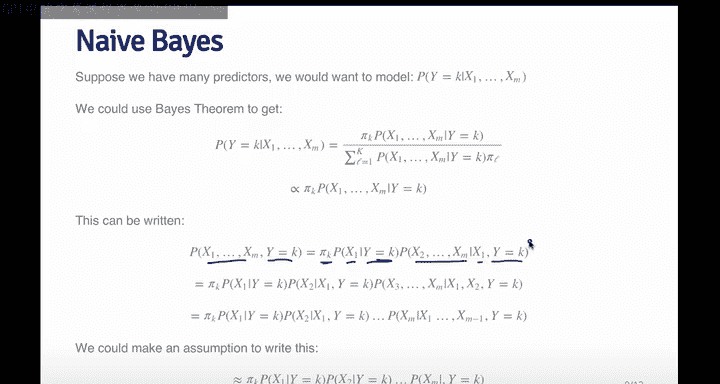

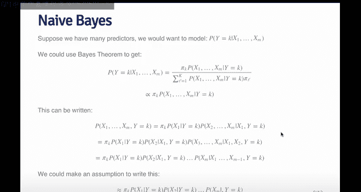

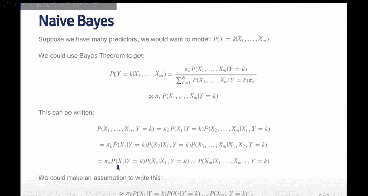

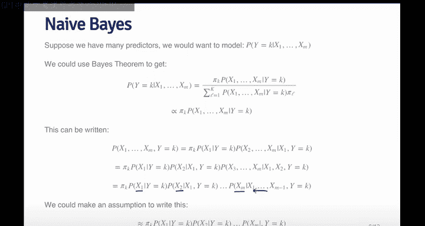


这使得模型训练和预测变得非常简单高效，尽管独立性假设在现实中很少完全成立。

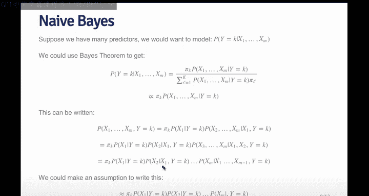

## 实战示例

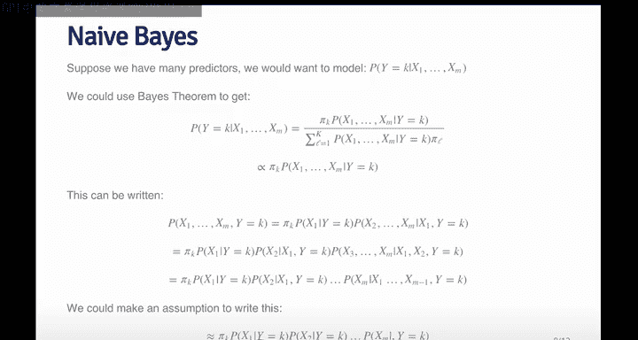

我们使用经典的鸢尾花数据集进行演示，目标是基于花瓣和萼片的测量值预测鸢尾花的种类。

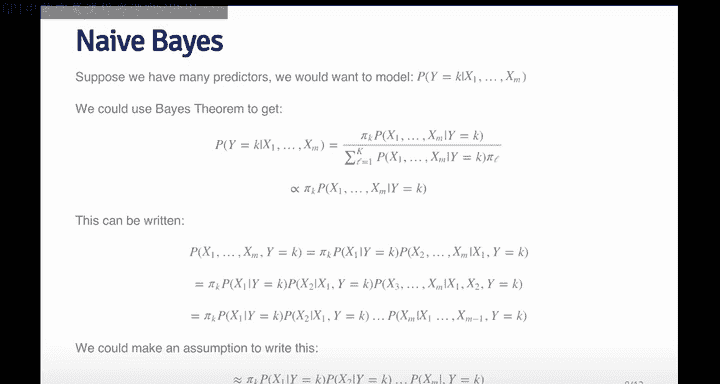

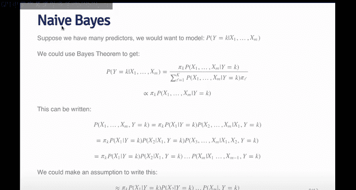


首先，我们加载必要的库并准备数据，将其分为训练集和测试集。


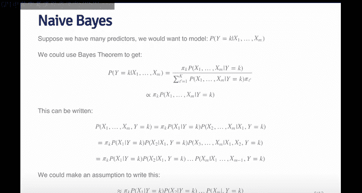

```r
library(ggplot2)
library(caret)
data(iris)
set.seed(123)
inTrain <- createDataPartition(y=iris$Species, p=0.7, list=FALSE)
training <- iris[inTrain,]
testing <- iris[-inTrain,]
```

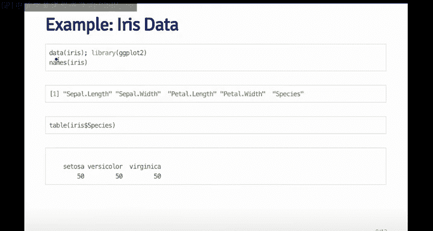

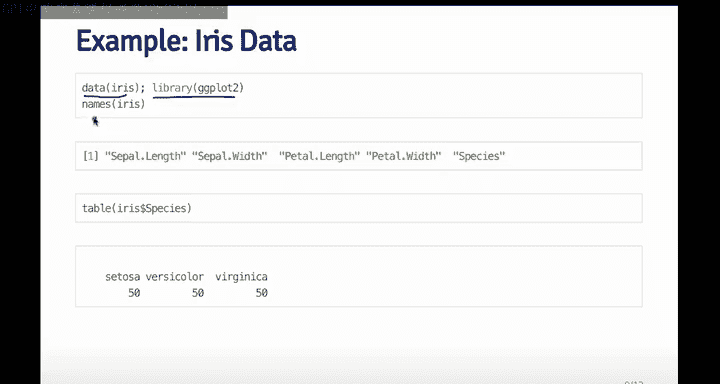

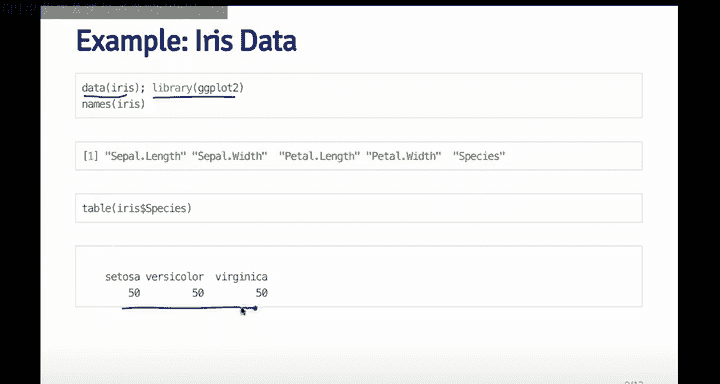

接下来，我们使用 `caret` 包的 `train` 函数分别训练 LDA 和朴素贝叶斯模型。

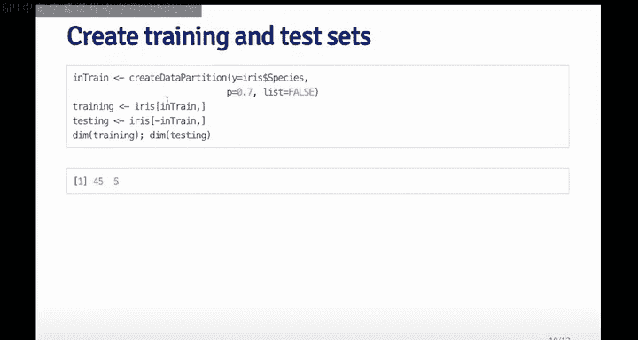

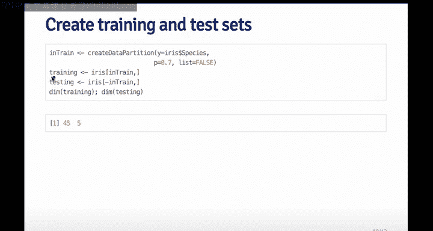

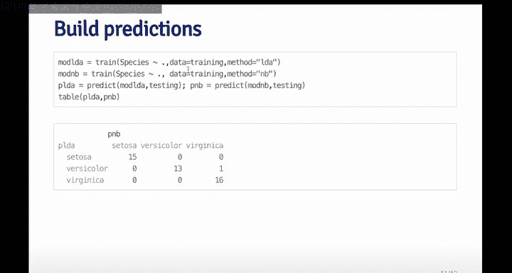

```r
# 训练线性判别分析模型
modLda <- train(Species ~ ., data=training, method="lda")
# 训练朴素贝叶斯模型
modNb <- train(Species ~ ., data=training, method="nb")
```

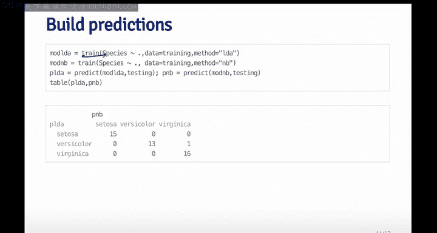

然后，我们在测试集上进行预测，并比较结果。


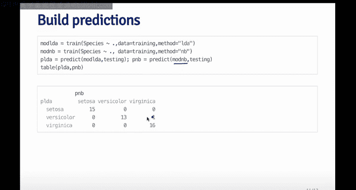

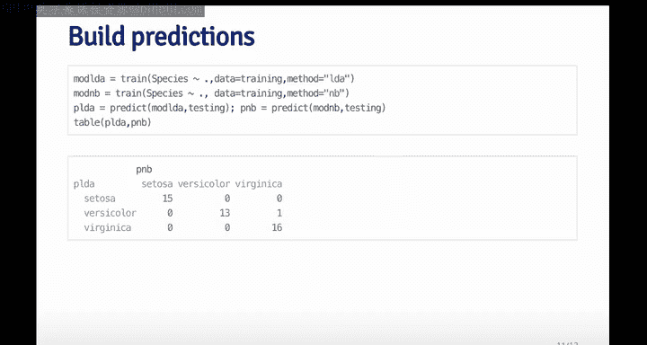

```r
predLda <- predict(modLda, testing)
predNb <- predict(modNb, testing)
table(predLda, predNb)
```

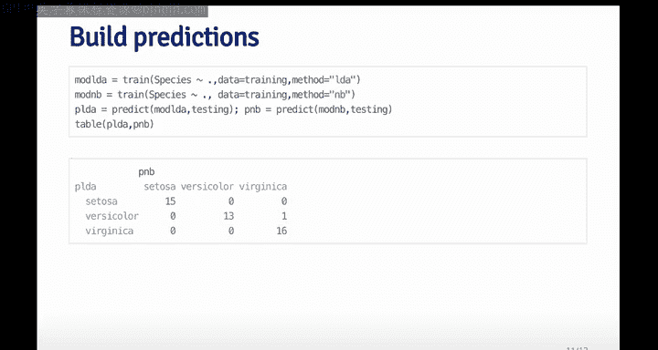

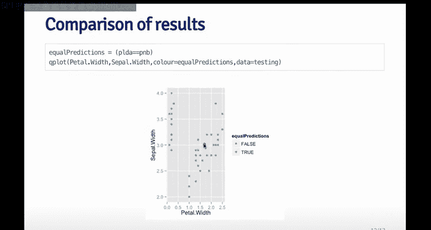

在这个例子中，尽管我们知道特征之间并不独立，但朴素贝叶斯分类器的预测结果与 LDA 模型几乎完全一致，只有一个观测值的分类存在分歧。这表明两种方法在该数据集上表现非常相似。

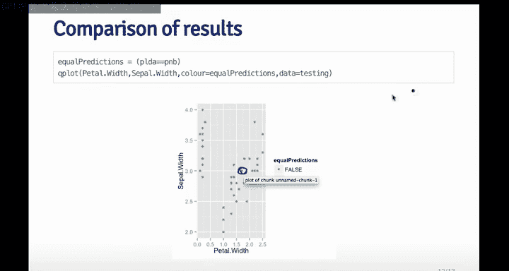

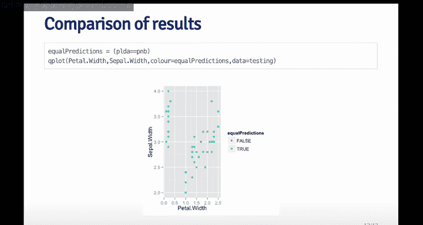

## 总结

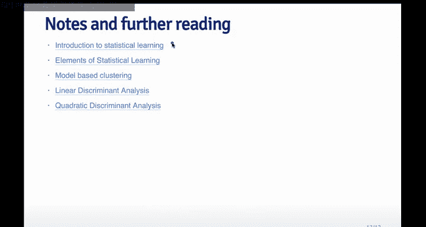

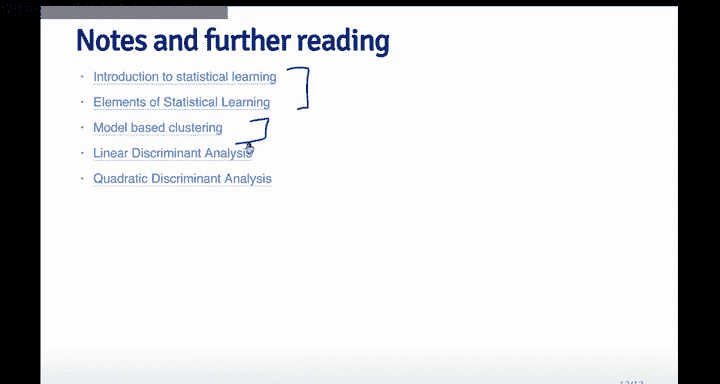

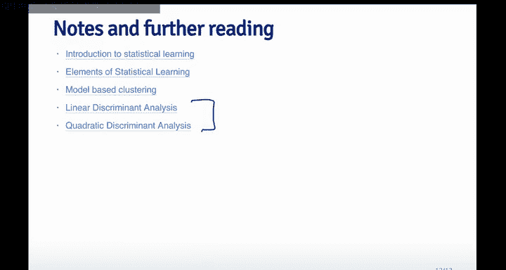

本节课我们一起学习了基于模型的预测方法。我们从基本思想出发，介绍了如何利用贝叶斯定理和概率模型（如高斯分布）来构建分类器。我们详细探讨了**线性判别分析**、**二次判别分析**和**朴素贝叶斯分类器**这三种典型模型，理解了它们的核心假设（如LDA的等协方差、朴素贝叶斯的特征独立性）及其如何影响决策边界的形状。最后，通过鸢尾花数据集的实战演示，我们看到了这些模型的具体应用和比较。基于模型的方法为分类问题提供了一个强大且具有理论解释性的框架。