# 104：正则化回归 🧮

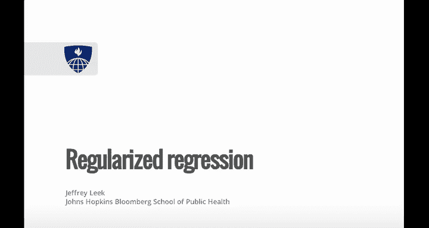

在本节课中，我们将学习正则化回归。这是一种通过惩罚或“收缩”回归模型中预测变量的系数，来改进模型预测性能的技术。

---

## 概述

上一节我们介绍了线性回归和广义线性回归。本节中，我们将探讨一种改进这些模型的方法——正则化回归。其核心思想是，在拟合回归模型后，对某些预测变量的大系数施加惩罚或进行收缩。

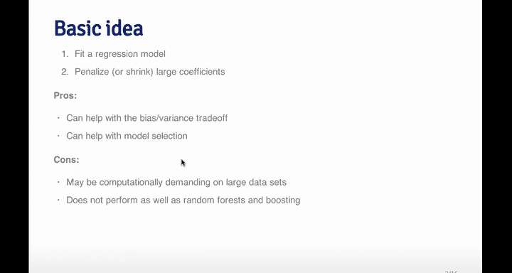

我们这样做，主要是为了在**偏差-方差权衡**中取得更好的平衡。例如，当某些变量高度相关时，将它们同时纳入线性模型可能会导致很高的方差。此时，若剔除其中一个变量，模型可能会产生轻微偏差，从而损失一点预测能力，但能显著降低方差，最终改善整体预测误差。在某些情况下，像**Lasso**这样的正则化技术还能辅助进行变量选择。

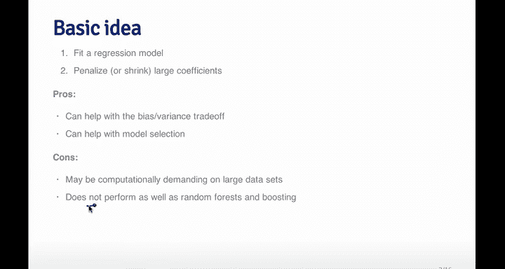

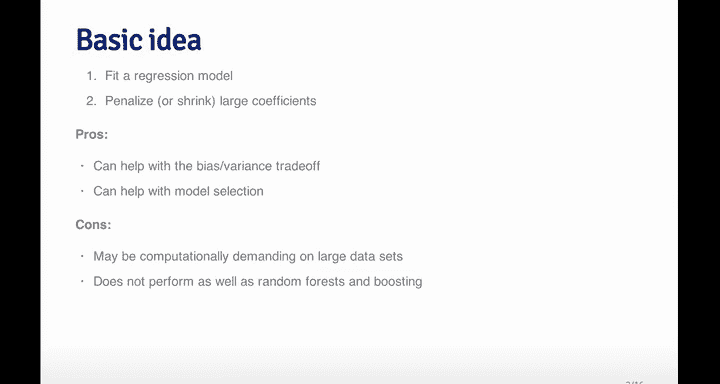

然而，正则化回归在大数据集上计算量可能较大。并且，在实际预测任务（如Kaggle竞赛）中，其表现通常不如随机森林或提升（Boosting）等方法。

---

## 动机示例

为了理解正则化的动机，我们来看一个简单的例子。

假设我们拟合一个简单的回归模型，有一个结果变量 **y**，我们试图用两个协变量 **x1** 和 **x2** 来预测它。模型形式如下：

`y = β₀ + β₁*x₁ + β₂*x₂`

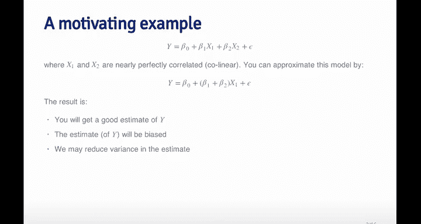

现在，假设 **x1** 和 **x2** 几乎完全相关，在线性建模中，这通常被称为**共线性**。

那么，我们可以用一个更简单的模型来近似这个复杂模型：只包含 **x1**，并将其系数设为 **β₁** 和 **β₂** 的和。虽然这不完全准确（因为 **x1** 和 **x2** 并非完全相同），但如果它们非常相似，这个近似会非常接近真实情况。

这样做的结果是，你仍然能得到对 **y** 的很好估计，几乎与包含两个预测变量的模型一样好。虽然因为剔除了一个预测变量而引入了一点偏差，但如果这两个变量高度相关，我们可能会显著降低模型的方差。

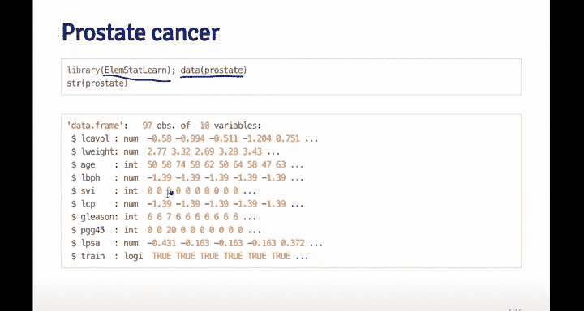

---

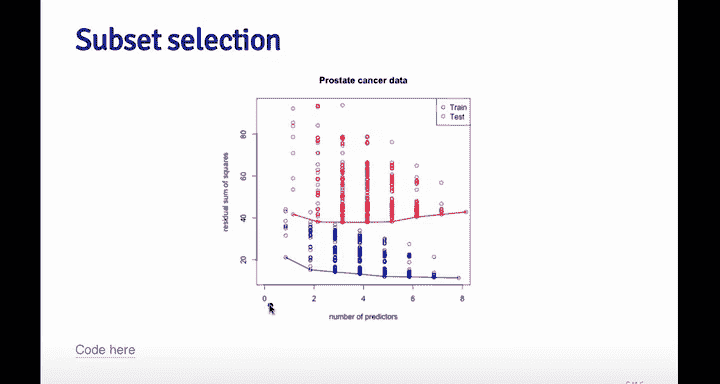

## 过拟合与模型复杂度

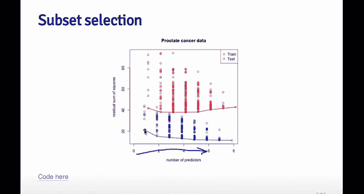

让我们通过一个实际数据例子，看看模型复杂度的影响。

以下是使用《统计学习基础》库中前列腺癌数据的示例。该数据有97个观测值和10个变量。我们的目标是根据多个预测变量来预测前列腺癌指标PSA。

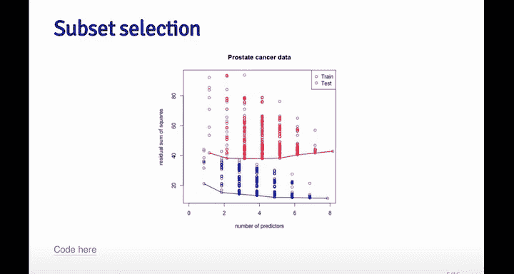

假设我们尝试用所有可能的预测变量组合来构建线性回归模型。随着模型中预测变量数量从左到右增加，训练集误差总是下降（因为加入更多变量总能更好地拟合训练数据）。

但测试集误差呈现出典型模式：随着预测变量增加，误差先下降，达到一个平台期后，又开始上升。这是因为我们最终对训练数据**过拟合**了，模型可能不需要包含那么多预测变量。

这是一个极其常见的模式。基本上，以模型复杂度为X轴，以期望残差平方和或预测误差为Y轴，你几乎总是看到：训练集误差单调下降，而测试集误差先下降，达到最小值后，随着模型变得过于复杂并过拟合数据，误差再次开始上升。

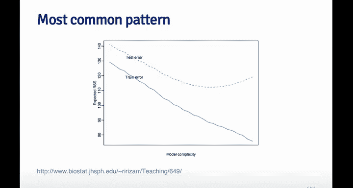

---

## 应对过拟合的经典方法

一般来说，最佳方法是：当你有足够的数据和计算时间时，进行**样本分割**。

具体思路是将数据分为**训练集**、**测试集**和**验证集**。你将验证集视为测试数据，在训练集上训练所有可能的竞争模型（例如所有可能的变量子集），然后挑选在验证集上表现最好的模型。

但是，既然我们已经使用验证集来“训练”（即选择模型），我们就需要一个完全独立的数据集来评估最终模型的误差率。因此，我们将最终选定的模型应用于**测试集**的新数据，以恰当评估其性能。

有时，你可能会多次重复这种分割和分析过程，以获得对样本外误差率更好的平均估计。但这种方法有两个常见问题：
1.  **数据有限**：将数据集分成三部分后，可能没有足够的数据来获得很好的模型拟合。
2.  **计算复杂性**：如果你尝试所有可能的模型子集，计算会非常复杂，尤其是在预测变量很多的情况下。

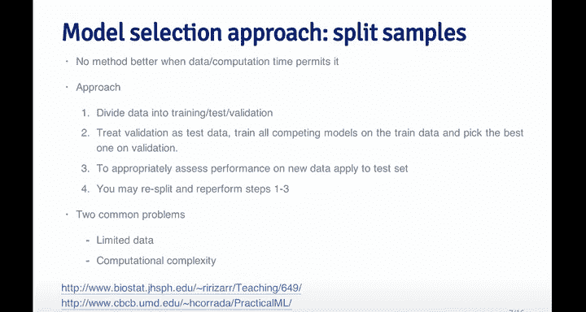

---

## 预测误差分解

另一种思路是尝试分解预测误差，看看是否有更直接的方法来确定模型中需要包含哪些变量。

假设变量 **y** 可以预测为 **x** 的函数加上误差项：`y = f(x) + ε`。

那么，期望预测误差就是结果与结果预测值之间差异平方的期望值：`E[(y - f̂_λ(x))²]`。其中，`f̂_λ` 是使用特定调优参数 **λ** 在训练集上得到的估计。

对于一个新数据点，观察到的结果与预测值之间的距离，经过一些代数运算，可以分解为：
*   **不可约误差** (σ²)：数据中固有的噪声，通常无法减少。
*   **偏差²**：我们的预测期望值与真实值之间的差异。
*   **方差**：我们的估计值的方差。

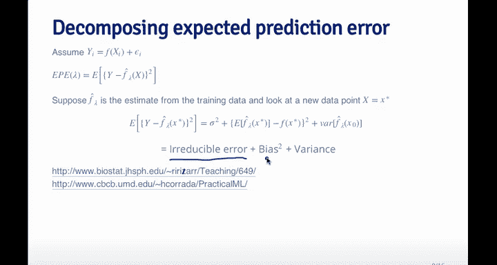

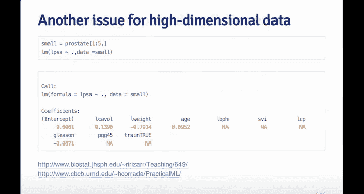

构建预测模型时，目标就是减少这个整体数量（期望均方误差）。不可约误差通常无法减少，但我们可以权衡**偏差**和**方差**。这正是正则化回归背后的核心思想。

---

## 高维数据挑战

对于高维数据，还存在另一个问题。

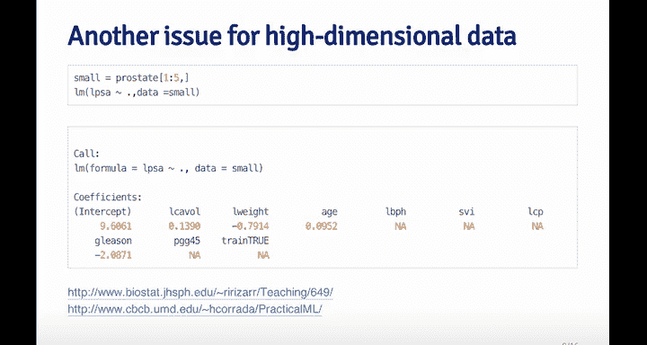

假设训练集中只有5个观测值，但预测变量超过5个。当我们拟合一个将结果与所有这些预测变量关联起来的线性模型时，有些系数会得到估计值，但有些会是 `NA`。换句话说，R 将无法估计它们，因为你的预测变量数量超过了样本数量，导致设计矩阵不可逆。

处理这个问题的一种方法是，假设模型具有线性形式，并约束只有 **λ** 个系数非零。但问题在于，选定 **λ** 后（比如设定只有3个非零系数），我们必须尝试所有可能的3个非零系数的组合，然后拟合最佳模型，这计算量仍然很大。

---

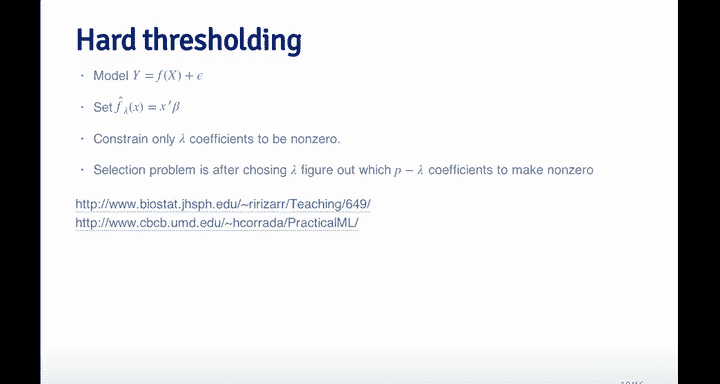

## 正则化回归原理

另一种方法是使用**正则化回归**。

如果我们线性模型中的系数 **βⱼ** 不受约束（即不要求它们具有任何特定形式），那么当使用高度相关的变量进行预测时，这些系数可能会“爆炸”，导致高方差，从而使得预测不准确。

为了控制方差，我们可能会对系数进行**正则化**或**收缩**。我们想要最小化的是我们的结果与线性模型拟合值之间的距离（残差平方和），但同时增加一个**惩罚项**。这个惩罚项基本上是说：如果 **β** 系数太大，就把它们“拉回来”。

惩罚项通常用于降低模型复杂度、减少方差，如果设置得当，还能尊重问题的某些结构。

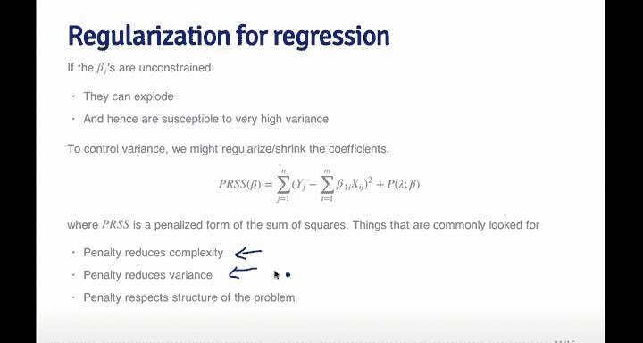

---

## 岭回归 (Ridge Regression)

在这种惩罚回归中，第一种常用的方法是**岭回归**。

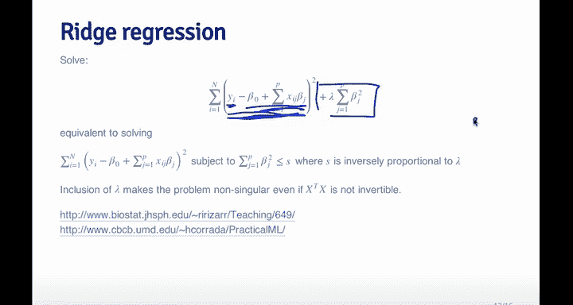

我们最小化的目标函数是：残差平方和 + **λ** × (所有 **βⱼ** 的平方和)。

这意味着什么？如果 **βⱼ** 的平方很大，那么惩罚项就会变得很大，导致整个目标函数值很大，拟合效果就不好。因此，它本质上要求一些 **βⱼ** 的值要小。

这等价于在约束条件 `∑βⱼ² ≤ s` 下，求解最小二乘问题。

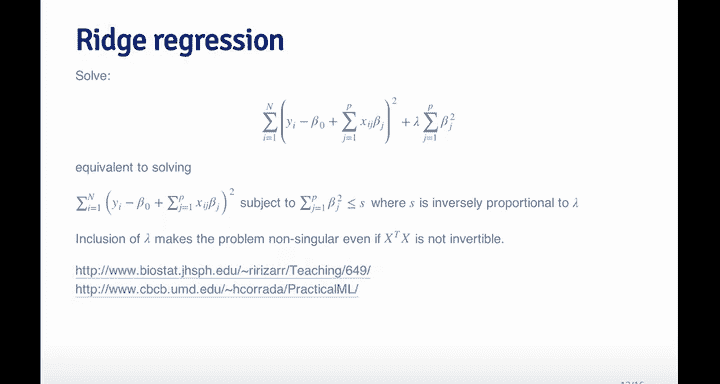

包含 **λ** 系数甚至可以使问题在 `XᵀX` 不可逆时（即预测变量多于观测值的情况）仍有解，岭回归模型仍然可以拟合。

随着惩罚参数 **λ** 增大，我们对大系数的惩罚越来越重。当 **λ = 0** 时，就是标准线性回归的解。随着 **λ** 增加，所有系数都向零收缩。

**λ** 控制着系数的大小和正则化的程度：
*   **λ → 0**：回到最小二乘解（标准线性模型）。
*   **λ → ∞**：所有系数都趋向于零。

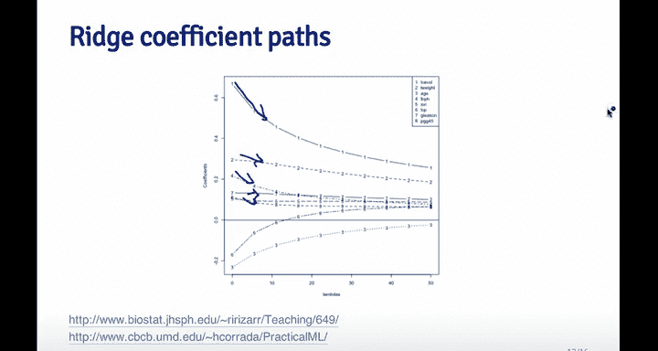

可以通过交叉验证等技术来选择最优的 **λ**，以在偏差和方差之间取得最佳权衡。

---

## Lasso 回归

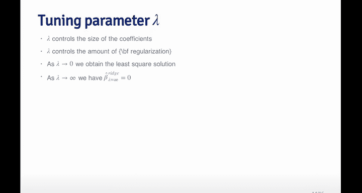

类似的方法可以通过稍微改变惩罚项来实现，这就是**Lasso回归**。

我们求解的问题是在约束条件 `∑|βⱼ| ≤ s` 下的最小二乘问题。也可以写成惩罚回归的形式：残差平方和 + **λ** × (所有 **|βⱼ|** 的和)。

对于正交设计矩阵，Lasso有一个封闭形式的解。其解是：取最小二乘估计值 **β̂ⱼ** 的绝对值，减去一个 **γ** 值，然后只取正数部分（即如果结果为负则设为零）。如果为正，则将其缩小 **γ** 的量，再乘以原始系数的符号。

**Lasso 做了什么？** 它收缩所有系数，并将其中一些**精确地设为零**。许多人喜欢这种方法，因为它既能收缩系数，又能通过将某些系数设为零来提前进行变量选择。

---

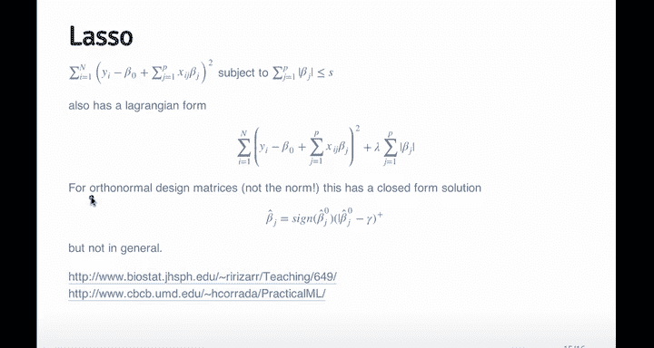

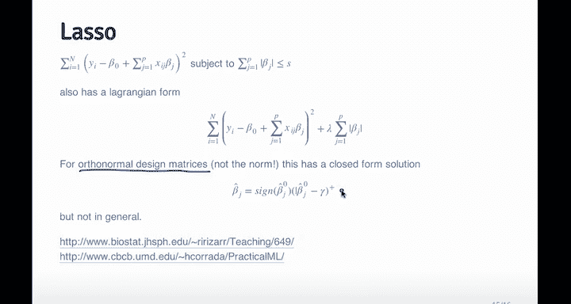

## 延伸学习与工具

Hector Corrada Bravo 有一套非常好的讲义，详细介绍了这些内容。此外，《统计学习基础》一书也相当详细地涵盖了惩罚回归的思想。

如果你想在 R 中拟合这些模型，可以使用 `glmnet` 包，并通过设置 `method` 参数为 `ridge`、`lasso` 或 `relaxo` 来拟合不同类型的惩罚回归模型。

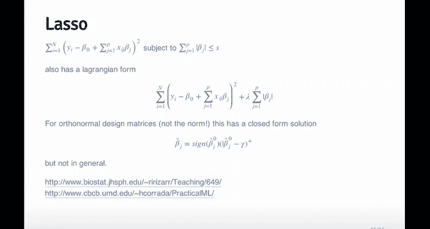

---

## 总结

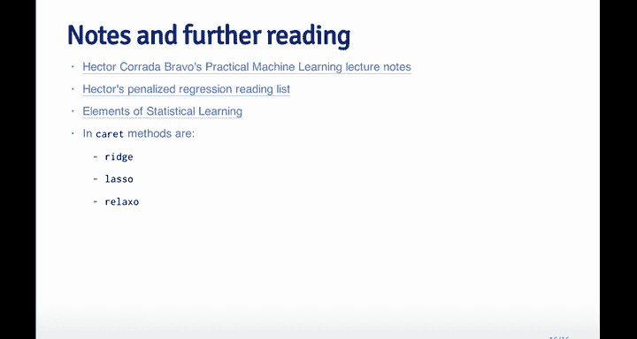

本节课中，我们一起学习了正则化回归。我们了解了过拟合与模型复杂度的关系，以及如何通过偏差-方差权衡来理解模型性能。我们重点介绍了两种主要的正则化技术：**岭回归**（通过惩罚系数平方和来收缩系数）和**Lasso回归**（通过惩罚系数绝对值和来收缩系数并实现变量选择）。这些方法通过引入惩罚项来控制模型复杂度，有助于在高维数据或共线性情况下获得更稳定、泛化能力更好的预测模型。