# 106：预测 📈

在本节课中，我们将要学习预测，这是一种特定类型的预测问题，通常应用于时间序列数据。

预测问题引入了一些非常特定的依赖结构，以及在进行预测时必须考虑的一些额外挑战。


## 时间序列数据的特点

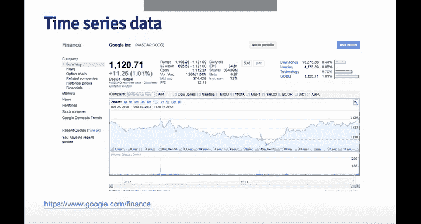

上一节我们介绍了预测的基本概念，本节中我们来看看时间序列数据的特点。

时间序列数据在时间上是相互依赖的，这使得预测比处理独立样本更具挑战性。此外，数据中可能存在一些特定的模式类型，需要特别关注。

以下是几种常见的时间序列模式：
*   **趋势**：例如长期上涨或下跌。
*   **季节性模式**：在这类数据中非常常见，例如按周、月、年等周期重复出现的模式。
*   **周期性**：周期超过一年的周期性起伏模式，例如经济周期。

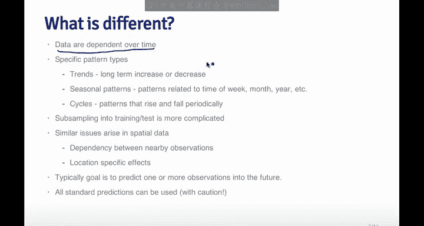


## 训练集与测试集的划分

由于数据在时间上存在依赖性，划分训练集和测试集会变得稍微复杂一些。

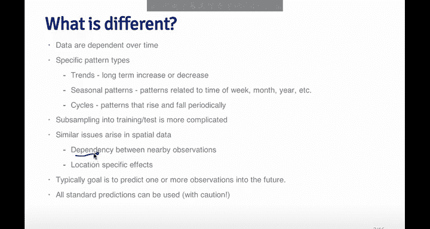

你不能简单地将样本随机分配到训练集和测试集。你必须利用数据是按特定时间点采样且点与点之间存在时间依赖这一事实。类似的问题也出现在空间数据的预测中，例如，邻近观测值之间存在依赖关系，并且在预测时可能需要建模特定位置的影响。

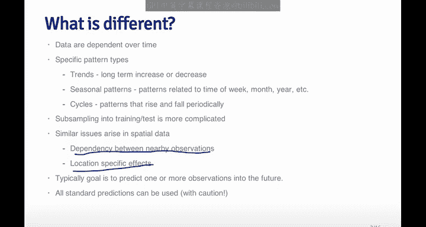


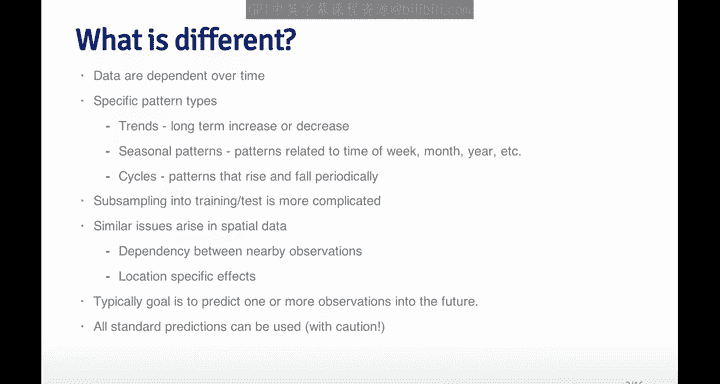

## 预测的目标与挑战

预测的典型目标是预测未来一个或多个观测值。所有标准的预测算法都可以使用，但在使用时需要谨慎。

以下是需要注意的几个挑战：

*   **虚假相关性**：时间序列常常因为某些原因而相关，但这些原因并不足以使一个序列能很好地预测另一个。例如，谷歌股价（蓝色）与“Solitaire network”搜索频率（红色）之间可能存在很高的相关性，但它们实际上可能毫无关联。在未来，它们可能会大幅偏离，因为它们本质上并不相关。
    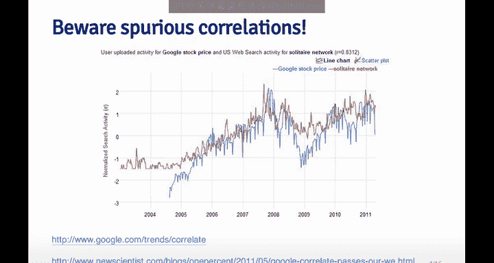
*   **地理分析中的常见现象**：基于人口的热力图通常形状相似，因为人口密集区（如美国东海岸）会出现在各种数据的热力图中，例如特定网站的用户、杂志订阅者等。
    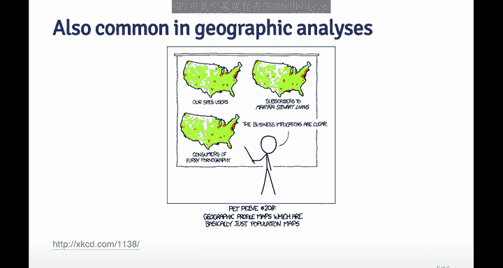
*   **外推法的风险**：如果不谨慎考虑未来可能发生的情况，外推时间序列可能会得出荒谬的结论。例如，有研究根据奥运会赛跑成绩的历史数据外推，预测女性将在2156年短跑中超越男性，甚至最终男性和女性的100米成绩都会被预测为负数。这说明了外推数据时需非常小心。
    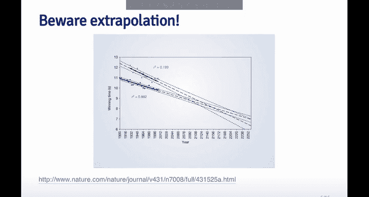

## 预测实践示例


现在，我们来看一个使用 `quantmod` 包和谷歌数据进行预测的快速示例。

首先，加载 `quantmod` 包并获取谷歌股票数据。

```r
library(quantmod)
getSymbols("GOOG", src = "google", from = '2008-01-01', to = '2013-12-31')
```

变量 `GOOG` 包含了2008年1月1日至2013年12月31日期间谷歌股票的开盘价、最高价、最低价、收盘价和成交量信息。


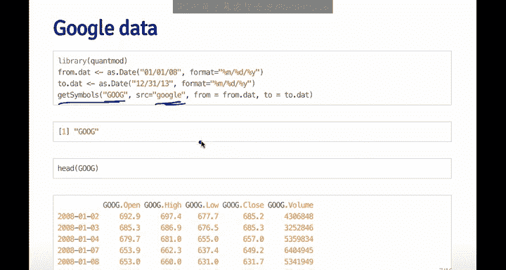
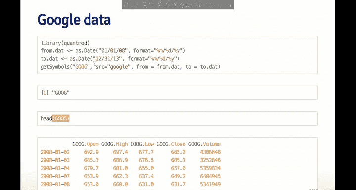

接着，我们可以将数据按月汇总并转换为时间序列对象。

```r
# 使用 to.monthly 汇总，并提取开盘价
googOpen <- Op(to.monthly(GOOG))
# 创建时间序列对象
tsGoog <- ts(googOpen, frequency=12)
plot(tsGoog)
```

绘图后，可以看到谷歌股票在七年间的月度开盘价。

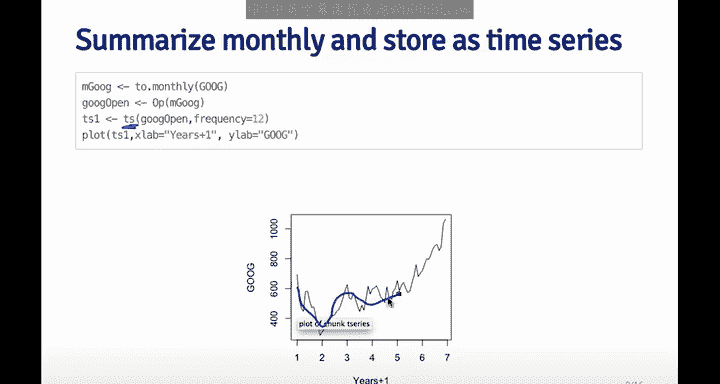

## 时间序列分解


时间序列分解旨在将序列分解为趋势、季节性和周期性等成分。

在R中，可以使用 `decompose` 函数进行加法分解。

```r
# 加法模型分解
decomposeResult <- decompose(tsGoog, type="additive")
plot(decomposeResult)
```


分解结果显示，谷歌股价存在向上的**趋势**、**季节性**模式以及更随机的**周期性**波动。


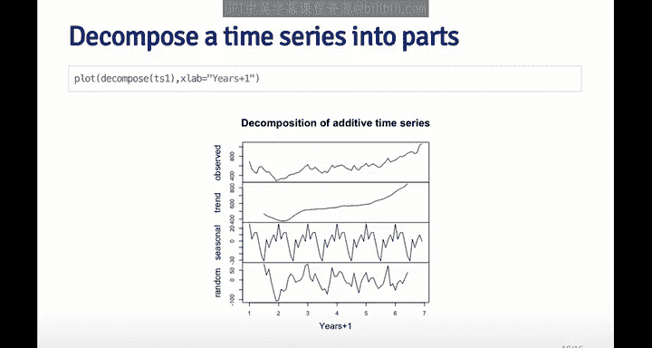

## 构建训练集与测试集


对于时间序列，训练集和测试集必须由连续的时间点构成。

以下是构建方法示例：
```r
# 假设 tsGoog 有84个月数据（7年）
train <- window(tsGoog, start=1, end=60) # 前5年作为训练集
test <- window(tsGoog, start=61, end=84) # 后2年作为测试集
```

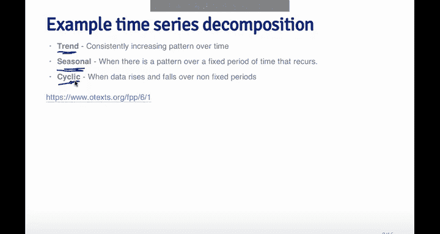

这样，我们可以用具有连续时间点、展现数据中相同趋势的训练集来预测测试集。

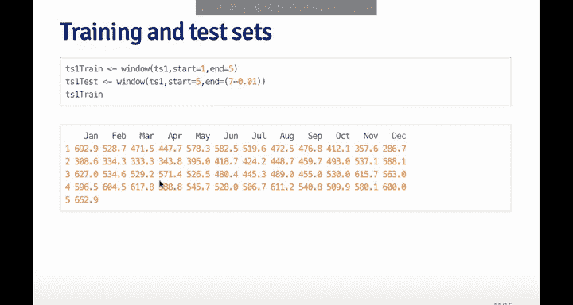
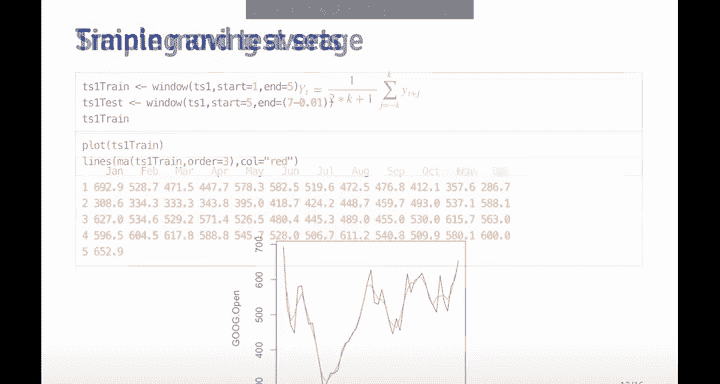

## 预测方法


有几种不同的预测方法。

*   **简单移动平均法**：预测值是截至特定时间点之前所有观测值的平均值。
    **公式**：`预测值_t = (观测值_{t-1} + 观测值_{t-2} + ... + 观测值_{t-n}) / n`
    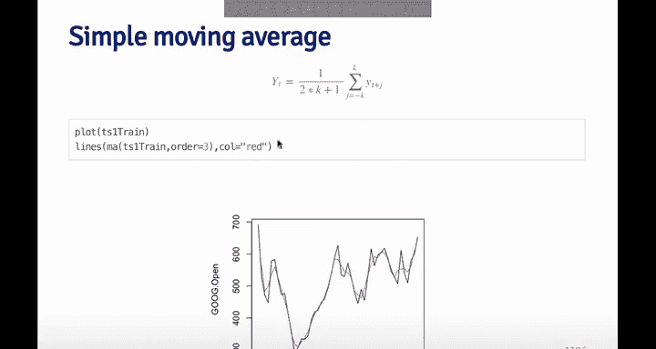
*   **指数平滑法**：对近期的时间点赋予更高的权重，对较远的时间点赋予较低的权重。存在多种不同类型的平滑模型可供选择。
    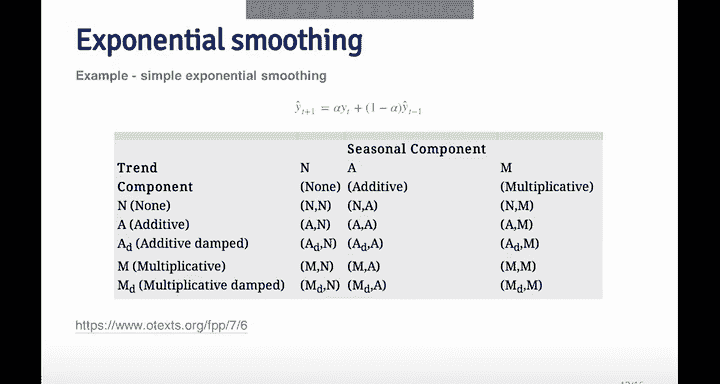

对于指数平滑，你可以拟合一个模型，并为想要拟合的趋势类型选择不同参数。


```r
library(forecast)
# 使用 ets 函数拟合指数平滑模型
fit <- ets(train, model="AAA") # AAA 代表加法误差、加法趋势、加法季节性
# 进行预测
fc <- forecast(fit, h=length(test))
plot(fc)
```

使用 `forecast` 函数可以得到预测值以及预测区间（可能取值的范围）。


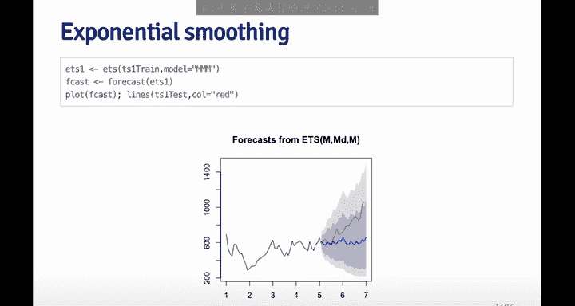

## 评估预测精度


你可以使用 `accuracy` 函数来评估预测的准确性。

```r
# 计算预测精度指标
accuracy(fc, test)
```

该函数会给出均方根误差等更适合用于评估预测的指标。


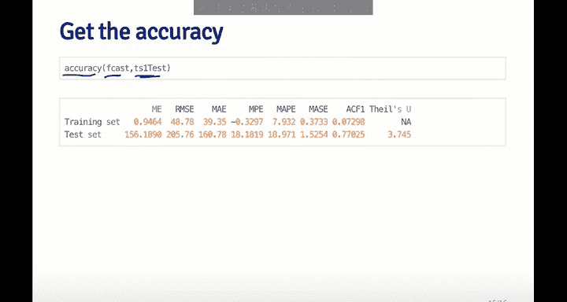


## 总结与延伸阅读

本节课中我们一起学习了时间序列预测的核心概念、挑战和实践方法。

预测是一个专门的领域，如果你想了解更多信息，强烈推荐 Rob Hyndman 的《预测：原理与实践》。这是一本免费的在线书籍，内容非常出色，提供了大量关于如何开始进行预测的信息。

需要牢记的注意事项包括：警惕虚假相关性，在外推法预测未来时需非常谨慎，以及注意随时间变化的季节性效应等依赖关系。

如果你对金融预测和金融预报感兴趣，`quantmod` 和 `Quandl` 包在该领域也非常有用。

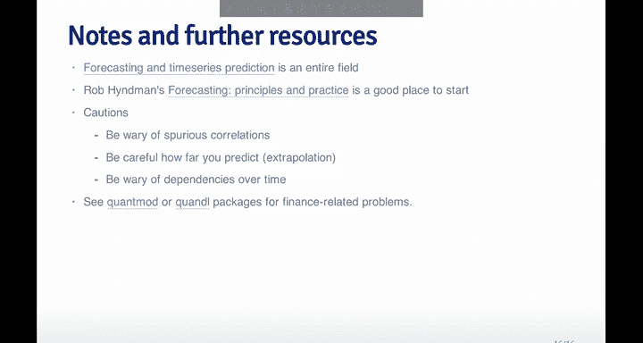

