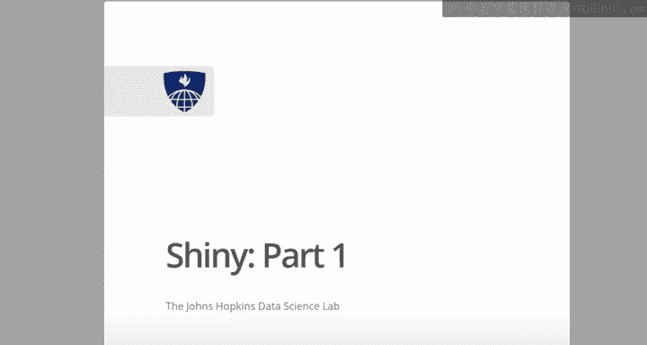
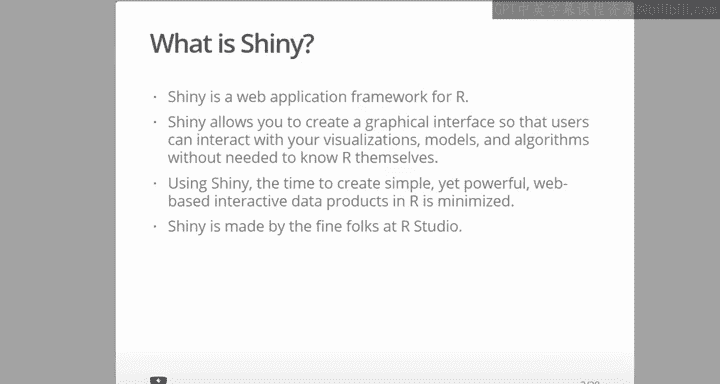
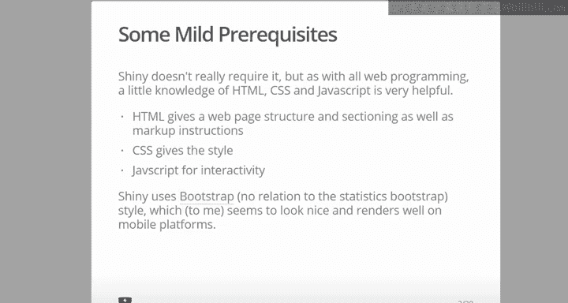
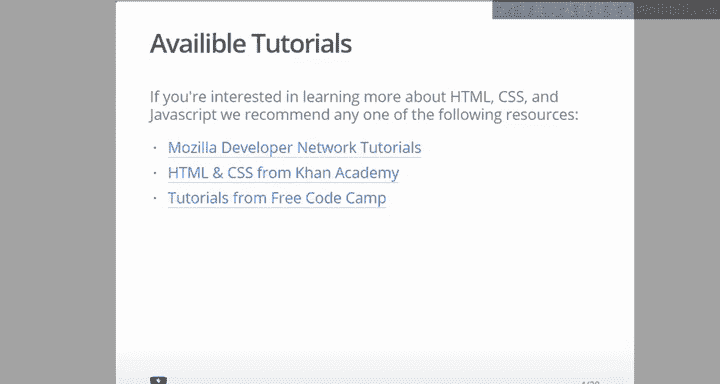
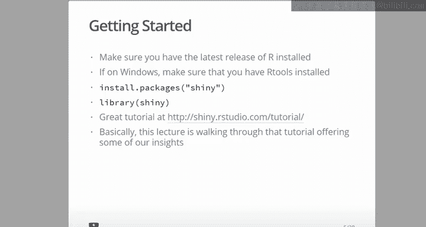
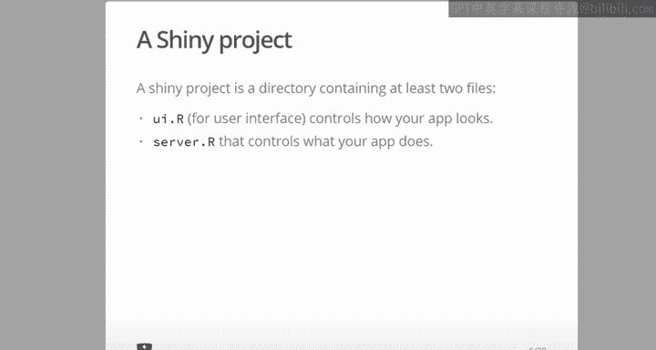
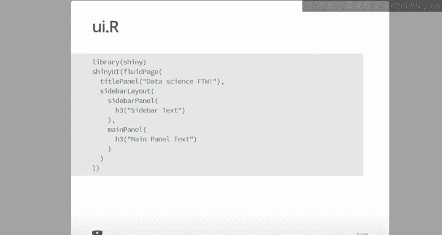

# 109：Shiny 入门 1 🚀



在本节课中，我们将要学习 Shiny 的基础知识。Shiny 是 R 语言中的一个 Web 应用开发框架，它允许我们仅使用 R 语言来创建交互式的数据产品。我们将了解 Shiny 的核心概念、基本结构以及如何开始构建你的第一个 Shiny 应用。

---

## Shiny 简介

Shiny 是 R 语言中的一个 Web 开发框架。它的优势在于，你只需要了解 R 语言，就可以使用它来开发数据产品。你可以在后端使用 R 进行数据处理，同时使用 R 来编写用户界面，而无需掌握 JavaScript、HTML 等传统的 Web 开发工具。

上一节我们介绍了 Shiny 的基本定位，本节中我们来看看它在数据科学领域的意义。

对于专注于 R 语言、算法开发和分析的数据科学家而言，Shiny 带来了一场小小的变革。它是一个极佳的工具，用于快速原型化潜在的数据产品，或为小型组织创建可直接部署的应用。对于大型组织，它也可以作为原型，供其他团队转化为更专业的解决方案。

Shiny 由 RStudio 开发，是一个免费的开源 R 包。应用本身是免费的，但你需要一个服务器来托管和运行 Shiny 应用。RStudio 提供了免费的托管服务，我们将在本课程中使用它。其他选项包括在 AWS 等云服务上搭建自己的服务器，或使用 Shiny 的付费托管服务。

此外，你可以在本地创建和测试 Shiny 应用，并分享给其他 R 用户，他们可以在 RStudio 中直接运行。但 Shiny 最有趣的部分在于，它能让你创建一个任何人都可以通过网页浏览器访问的 Web 服务器，来展示你的数据分析或预测算法。

---

## 预备知识

如前所述，Shiny 的一切都在 R 中完成。虽然理论上你不需要了解 HTML、CSS 或 JavaScript 就能使用 Shiny，但掌握一些 HTML 基础知识将非常有帮助，它能让你理解 R 命令在背后实际做了什么。网上有无数 HTML 教程，找一个学习创建基本网页和常用标签即可。

Shiny 使用了 Bootstrap 前端框架（与统计学中的“Bootstrap”重采样方法无关）。这个由 Twitter 团队开发的框架提供了美观且响应式的界面组件（如按钮），能确保应用在不同尺寸的设备上良好显示。如果你不熟悉这类 Web 开发，直接使用 Shiny 内置的 Bootstrap 主题是一个好选择。

以下是构成我们这类应用前端的三个核心组件：
*   **HTML**：定义网页的结构和内容。
*   **CSS**：控制网页的样式和外观。
*   **JavaScript**：为网页添加交互性和动态行为。



最重要的是，先完成一些 HTML 基础学习。

---

## 开始使用 Shiny

要开始使用 Shiny，首先需要安装 `shiny` 包。在 R 中使用以下命令：
```r
install.packages("shiny")
```
在每次使用 Shiny 时，确保加载这个包：
```r
library(shiny)
```
在开始本课程之前，你也可以考虑先阅读 RStudio 官方的 Shiny 教程。本讲座的大部分内容将围绕该教程展开。



---

## Shiny 应用的基本结构



一个 Shiny 项目需要两个核心文件：
1.  **`ui.R`**：这个文件定义了**用户界面**，它决定了你的应用看起来是什么样子。
2.  **`server.R`**：这个文件定义了**服务器逻辑**，它控制你的应用具体做什么。



这两个文件共同构成了一个完整的 Shiny 应用。`ui.R` 负责布局和输入输出控件，而 `server.R` 则包含响应这些输入、进行计算并更新输出的 R 代码。

---





本节课中我们一起学习了 Shiny 的基本概念、优势、预备知识以及其核心的两文件结构（`ui.R` 和 `server.R`）。在接下来的课程中，我们将通过代码演示，带你从零开始构建一个运行在 Web 服务器上的 Shiny 应用。