# 110：创建你的第一个 Shiny 应用 🚀

在本节课中，我们将学习如何使用 R 语言的 Shiny 包来创建你的第一个交互式 Web 应用。我们将从创建一个基础应用开始，了解其核心文件结构，并学习如何运行它。

## 创建第一个应用

首先，你需要一个相对较新版本的 RStudio。以下是创建应用的步骤。

以下是创建新 Shiny 应用的具体方法：

1.  在 RStudio 中，通过菜单栏选择 **File** -> **New File** -> **Shiny Web App**。
2.  在弹出的对话框中，为你的应用命名（例如 `my_app`）。
3.  选择应用的文件结构。有两种选项：
    *   **Single file (app.R)**：将所有代码放在一个文件中。
    *   **Multiple files (ui.R & server.R)**：将用户界面代码和服务器逻辑代码分开存放。
4.  建议选择 **Multiple files** 选项。这种方式将代码模块化，便于管理和维护，尤其当应用功能变得复杂时。

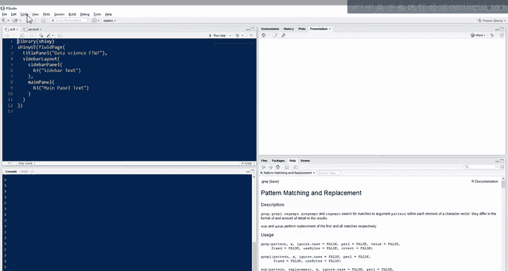


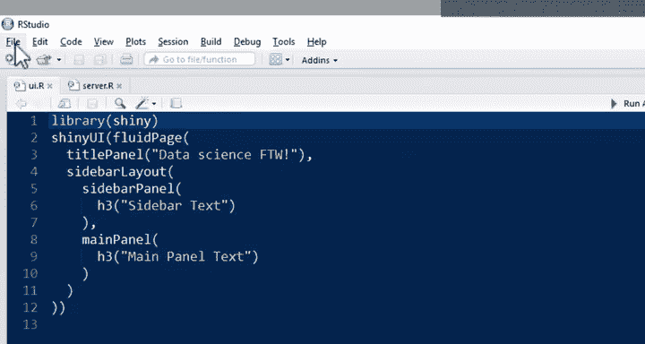
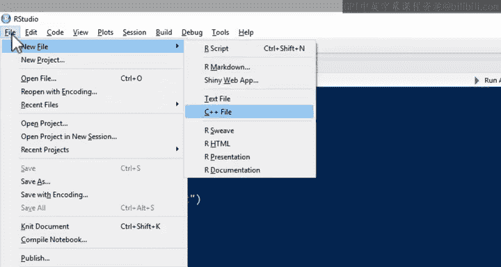


创建完成后，RStudio 会在指定目录下生成两个核心文件：`ui.R` 和 `server.R`。Shiny 框架依赖的是这两个文件中定义的特定函数，而非文件名本身。

## 理解核心文件结构

上一节我们创建了应用文件，本节我们来详细看看这两个文件的内容和作用。

### `ui.R` 文件

`ui.R` 文件负责定义应用的用户界面。其核心是 `shinyUI` 函数。

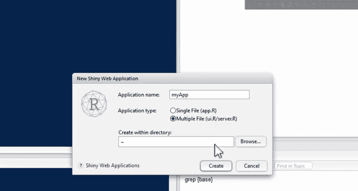

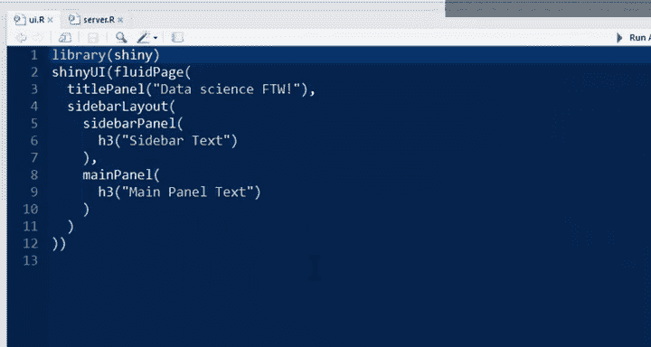

```r
library(shiny)

shinyUI(fluidPage(
  titlePanel("Data Science for the Win"),
  sidebarLayout(
    sidebarPanel(
      h3("Sidebar Text")
    ),
    mainPanel(
      h3("Main Panel Text")
    )
  )
))
```

*   `library(shiny)`：加载 Shiny 包。
*   `shinyUI(...)`：定义用户界面的主函数。
*   `fluidPage(...)`：创建一个自适应页面布局，这是默认且推荐的布局方式。
*   `titlePanel("...")`：设置应用标题，将显示在浏览器标签页或应用顶部。
*   `sidebarLayout(...)`：定义一个带有侧边栏的经典布局。
    *   `sidebarPanel(...)`：定义侧边栏区域的内容。这里使用 `h3("Sidebar Text")` 添加一个三级标题。
    *   `mainPanel(...)`：定义主内容区域。这里同样使用 `h3("Main Panel Text")` 添加一个三级标题。

`h3` 是 HTML 标签，代表三级标题，字体大小小于 `h2` 和 `h1`。


### `server.R` 文件

`server.R` 文件负责定义应用的服务器端逻辑，处理计算和反应。

```r
library(shiny)

shinyServer(function(input, output) {
  # 服务器逻辑将在这里编写
  # 目前这是一个空函数，应用不会执行任何计算
})
```

*   `shinyServer(function(input, output) {...})`：定义服务器逻辑的主函数。`input` 对象接收来自用户界面的输入，`output` 对象用于向用户界面发送输出。目前这是一个空函数。

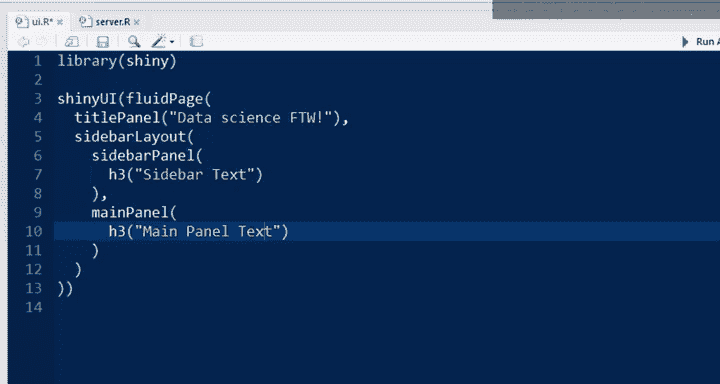
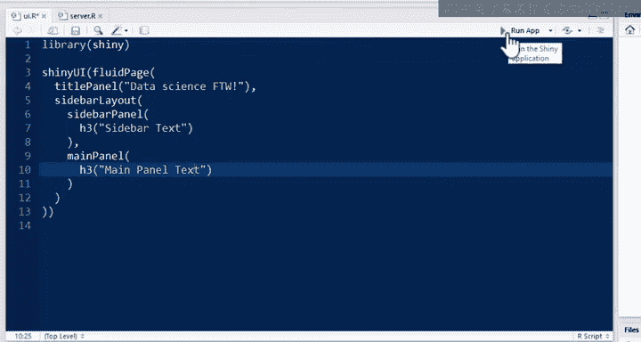

## 运行你的 Shiny 应用

现在我们已经定义了基本的界面和服务器结构，本节来看看如何运行这个应用。


有两种主要方式可以运行 Shiny 应用。


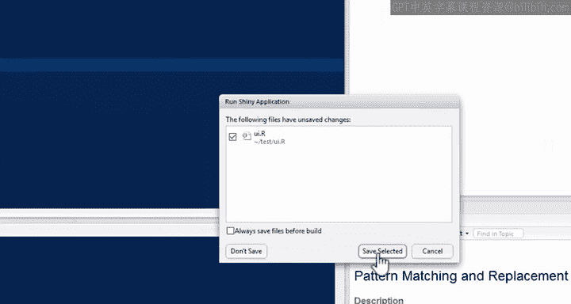

### 方法一：使用 RStudio 的 “Run App” 按钮（推荐）

这是最简单的方法，适用于较新版本的 RStudio。

1.  确保 `ui.R` 和 `server.R` 文件已保存。
2.  在 RStudio 中打开这两个文件中的任意一个。
3.  点击编辑器窗口右上角的 **Run App** 按钮。


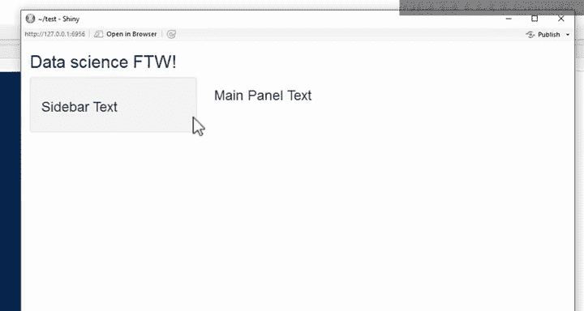

应用将在一个新窗口或 RStudio 的内置查看器中启动。你将看到标题 “Data Science for the Win”、侧边栏的 “Sidebar Text” 和主面板的 “Main Panel Text”。

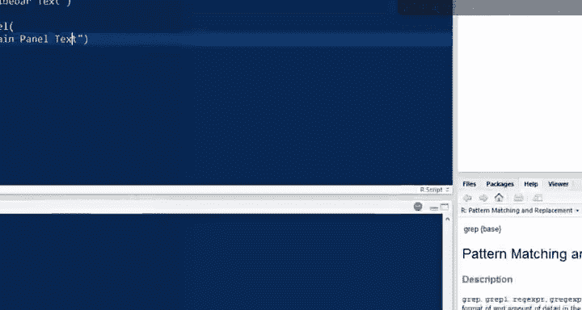

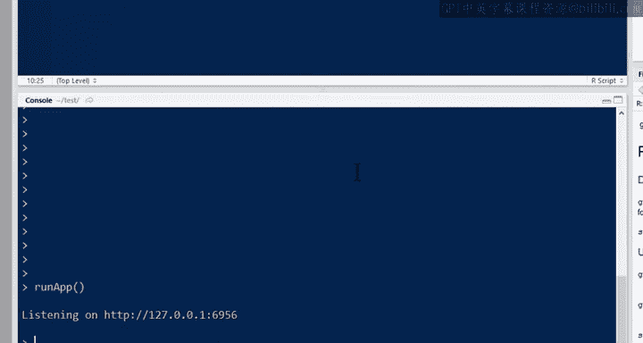

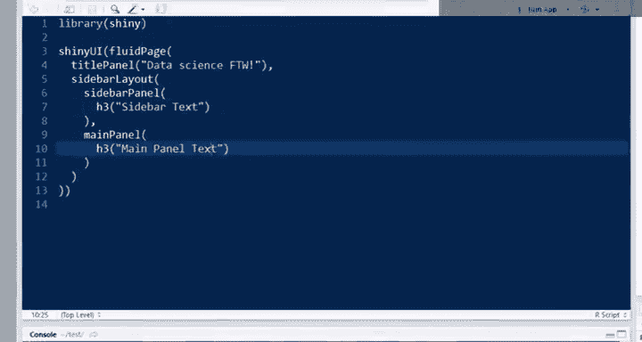

### 方法二：使用 `runApp()` 函数

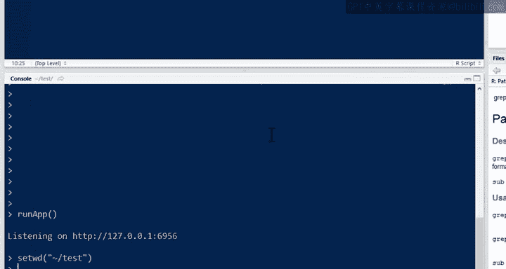

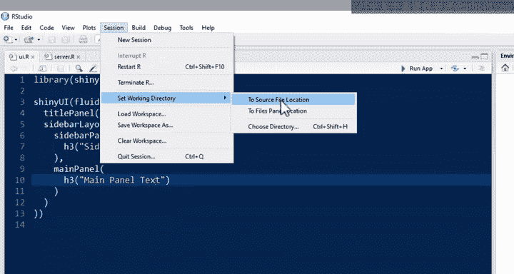


你也可以通过 R 控制台手动运行应用。

1.  **设置工作目录**：首先，需要将 R 的工作目录切换到包含 `ui.R` 和 `server.R` 的文件夹。
    *   在 RStudio 中，你可以通过菜单 **Session** -> **Set Working Directory** -> **To Source File Location** 快速设置。
    *   或者在控制台使用 `setwd()` 函数指定路径。
2.  **运行应用**：在控制台中输入 `runApp()` 并执行。

```r
# 示例：如果应用文件夹在桌面
setwd("~/Desktop/my_app_directory")
runApp()
```

你还可以直接在 `runApp()` 中指定应用目录的完整路径，这样就不必先切换工作目录。

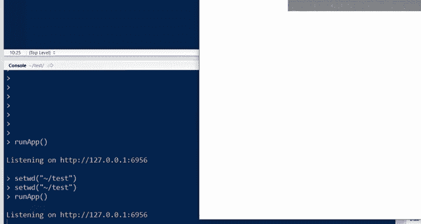


```r
runApp("~/Desktop/my_app_directory")
```

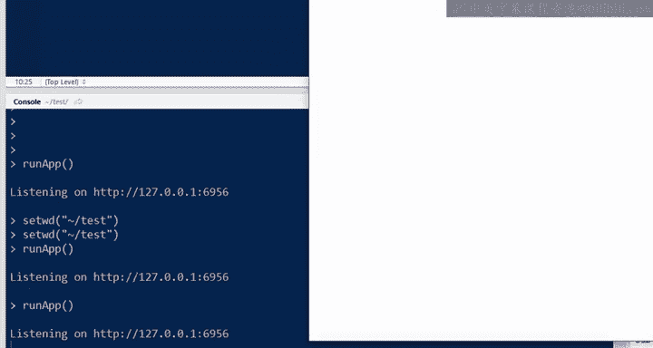


运行后，控制台会显示类似 `Listening on http://127.0.0.1:XXXX` 的信息。这表示 Shiny 在你的电脑本地启动了一个小型 Web 服务器。RStudio 内置的浏览器正在访问这个本地服务器来展示应用。


**本地运行与部署**：目前应用仅在本地运行。要将应用分享给他人，最简单的方式是提供 `ui.R`、`server.R` 以及相关数据或函数文件，他们可以在自己的 R 环境中运行。最终，我们的目标是将应用部署到公共网络服务器（如 [shinyapps.io](http://shinyapps.io)），让任何人通过网页浏览器都能访问。

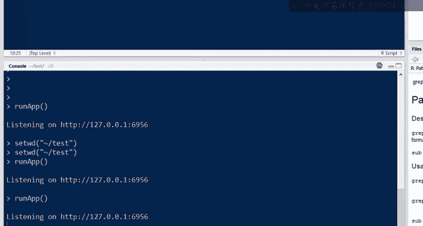

## 总结


本节课中我们一起学习了 Shiny 应用开发的第一步。我们创建了一个基础的双文件结构应用，理解了 `ui.R` 文件如何通过 `shinyUI`、`fluidPage`、`sidebarLayout` 等函数构建用户界面，以及 `server.R` 文件如何通过 `shinyServer` 函数预留服务器逻辑。我们还掌握了在 RStudio 中通过点击按钮或使用 `runApp()` 函数来运行应用的两种方法。这为后续添加交互控件和动态内容打下了坚实的基础。