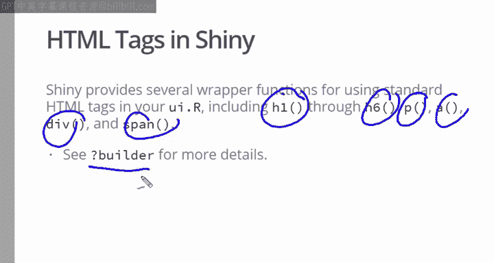
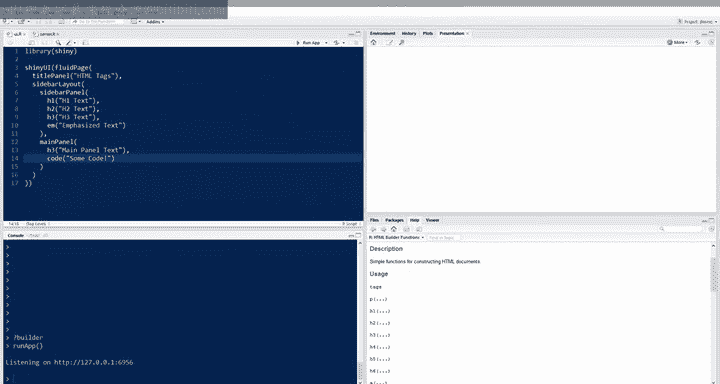
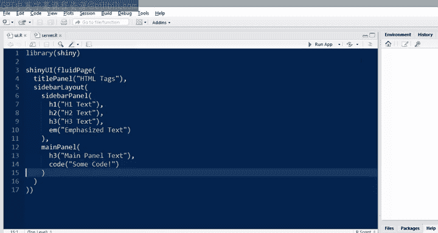
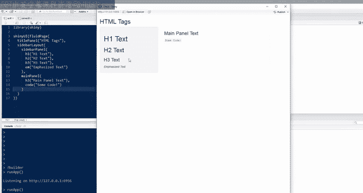
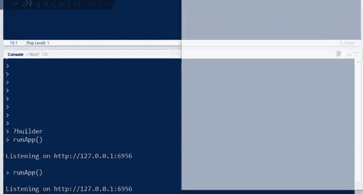
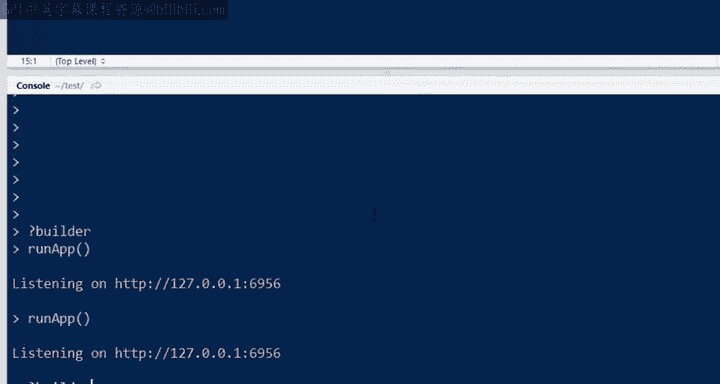
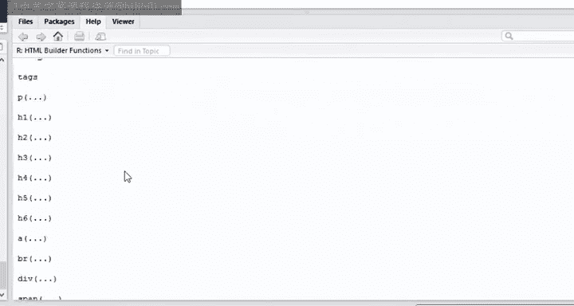
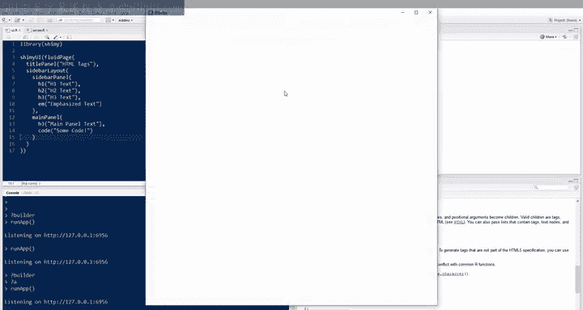
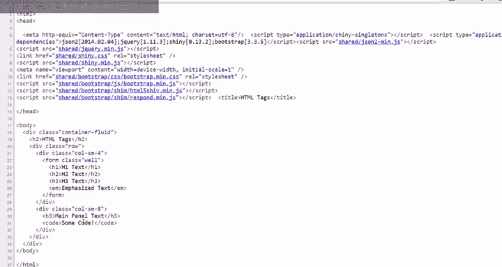

# 111：Shiny 应用中的 HTML 标签使用

在本节课中，我们将学习如何在 Shiny 应用中使用内置的 HTML 标签函数来构建用户界面。我们将了解如何通过 R 代码生成标准的 HTML 元素，并查看这些代码最终如何被渲染成网页。

---

## 🏗️ 使用内置函数构建界面

上一节我们介绍了 Shiny 应用的基本结构。本节中我们来看看如何使用 Shiny 提供的内置函数来创建 HTML 元素。

在默认的工作流程中，我们使用 R 函数来插入 HTML 元素。Shiny 包含了绝大多数标准的 HTML 标签函数。



例如，所有标题标签（H1 到 H6）、段落标签、超链接、`div` 和 `span` 等常见标签都有对应的函数。

你可以通过运行 `?builder` 来查看完整的可用 HTML 标签函数列表。



---

## 📝 代码示例：展示不同 HTML 标签

以下是一个简单的 UI 代码示例，展示了如何使用不同的 HTML 标签函数。



```r
# 在 ui.R 的 fluidPage 或 sidebarLayout 函数内
h1("这是一级标题")
h2("这是二级标题")
h3("这是三级标题")
p("这是一个段落。")
em("这是强调文本。")
code("这是用于显示代码的等宽字体文本。")
```

在这段代码中：
*   `h1()`, `h2()`, `h3()` 函数创建了不同层级的标题。
*   `p()` 函数创建段落。
*   `em()` 函数创建强调文本（通常显示为斜体）。
*   `code()` 函数创建等宽字体的文本，适用于显示代码。







运行这个 Shiny 应用，你将在界面中看到这些不同格式的文本元素。

---

## 🔍 查看生成的 HTML 源代码

理解 Shiny 如何将 R 代码转换为网页是很有帮助的。

运行应用后，在浏览器中打开它，然后使用浏览器的“查看页面源代码”功能（通常是右键点击页面并选择相应选项，或按 `Ctrl+U`）。





在源代码中，你可以看到：
*   Shiny 加载的 JavaScript 库和 CSS 样式表（如 Twitter Bootstrap），它们负责页面的样式和交互功能。
*   在 `<body>` 部分，你可以找到由你的 `ui.R` 代码生成的 HTML 结构。

这个过程清晰地展示了 Shiny 如何将你的 `ui.R` 函数调用翻译成标准的 HTML 代码。这对于调试，尤其是当你开始为按钮等元素命名并需要在 HTML 中定位它们时，非常有用。

---

## 💡 练习与下一步

即使你对 HTML 不熟悉，通过观察 Shiny 生成的代码，也可以逐渐理解其结构。

建议你尝试以下练习：
*   使用不同的 HTML 标签函数，构建一个没有交互性的简单静态页面。
*   运行应用并查看生成的源代码，将 R 函数与最终的 HTML 标签对应起来。

在接下来的课程中，我们将开始为页面添加交互性，包括按钮、滑块和图形，并学习如何在后端调用 R 代码进行计算和绘图，这些是 Shiny 的核心功能。

---

## 📚 本节课总结

本节课中我们一起学习了：
1.  Shiny 提供了内置函数来生成常见的 HTML 标签。
2.  通过代码示例，我们实践了如何使用 `h1()`、`p()`、`em()`、`code()` 等函数。
3.  我们了解了如何通过查看浏览器源代码来理解 Shiny 如何将 R 界面代码转换为实际的 HTML 页面。
4.  这种查看生成 HTML 的方式有助于调试和未来自定义更复杂的网页。



掌握这些基础是创建更丰富、更具交互性 Shiny 应用的第一步。