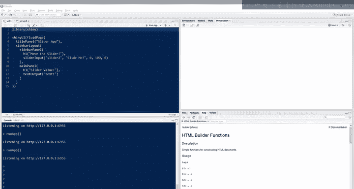
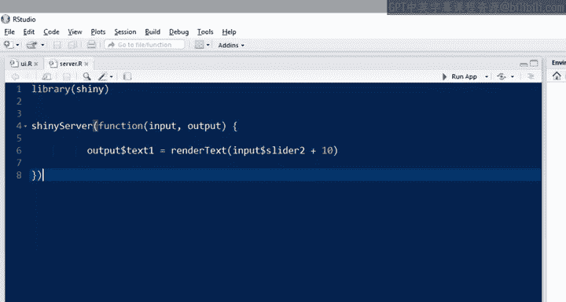
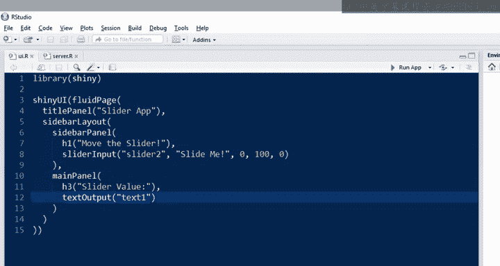
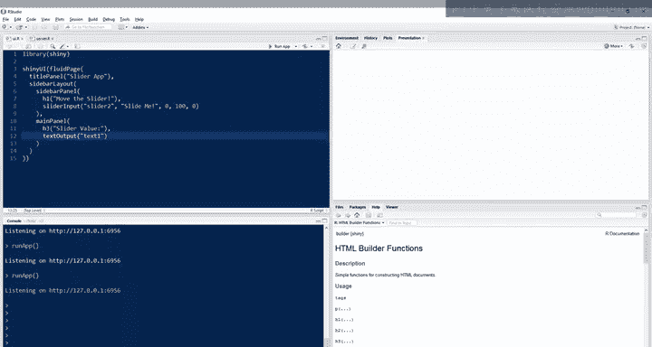
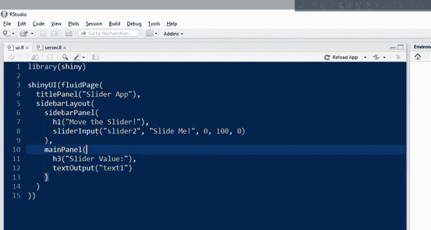
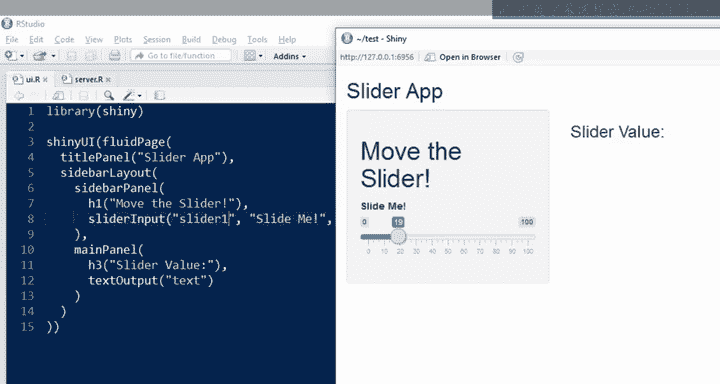
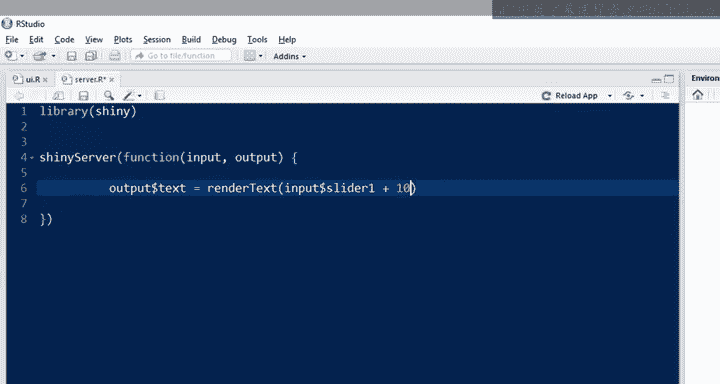

# 112：Shiny 应用输入与响应式输出 🎚️➡️📊

在本节课中，我们将学习如何构建一个能够接收用户输入、进行R语言计算并显示结果的Shiny应用。我们将重点创建一个滑块输入控件，并理解数据如何在用户界面和服务器函数之间传递。

## 概述


一个有用的Shiny应用需要能够接收用户的输入值，通过R语言进行计算，并将结果输出。本节课的核心是学习如何接收输入值。我们将通过一个简单的代码演示来实现：在用户界面创建一个滑块，用户选择的值将被传递到服务器函数，然后服务器函数再将这个值原样返回给用户界面进行显示。这是一个基础构建练习，我们暂时不对输入值进行处理，只是将其显示出来。



## 创建滑块输入

上一节我们概述了目标，本节中我们来看看如何在用户界面中创建滑块。

以下是创建滑块输入的代码步骤，位于 `ui.R` 文件中：

```r
shinyUI(fluidPage(
  sidebarLayout(
    sidebarPanel(
      # 创建滑块
      sliderInput("slider2", "移动滑块:", min = 0, max = 100, value = 0)
    ),
    mainPanel(
      # 显示滑块值的位置
      textOutput("text1")
    )
  )
))
```

*   **`sliderInput` 函数**：用于创建滑块。参数 `"slider2"` 是该输入控件的唯一ID，`"移动滑块:"` 是用户看到的提示文字，`min` 和 `max` 定义了滑块范围，`value` 设置了初始值。
*   **`textOutput` 函数**：在主要面板预留一个位置，用于显示服务器返回的文本，其ID `"text1"` 需要与服务器输出对应。



## 配置服务器函数

现在我们已经有了用户界面，本节中我们来看看服务器函数如何接收和处理输入。

以下是服务器函数 `server.R` 的代码：

```r
shinyServer(function(input, output) {
  # 接收名为“slider2”的输入，并赋值给输出“text1”
  output$text1 <- renderText({
    input$slider2
  })
})
```



*   **`shinyServer` 函数**：定义了服务器逻辑。它接收 `input` 和 `output` 两个参数。
*   **`input$slider2`**：通过 `$` 符号访问从用户界面传递过来的、ID为 `slider2` 的输入值。
*   **`renderText` 函数**：这是一个**响应式渲染函数**。它监听 `input$slider2` 的变化。每当滑块值改变，它内部的代码（这里只是返回输入值本身）就会重新执行。
*   **`output$text1`**：将 `renderText` 生成的结果赋值给名为 `text1` 的输出对象，这个对象会被发送回用户界面。




## 运行与理解响应式流程

让我们运行这个应用，并理解其背后的响应式工作流程。

1.  用户通过滑块选择一个值（例如 50）。
2.  用户界面将这个值以 `input$slider2` 的形式发送给服务器。
3.  服务器中的 `renderText({ input$slider2 })` 函数捕获到这个变化，执行并生成新的文本“50”。
4.  服务器将这个结果赋值给 `output$text1`。
5.  用户界面中的 `textOutput("text1")` 接收到更新后的 `output$text1` 值，并在网页上显示“50”。

整个过程是**响应式**的。这意味着每当滑块的值发生变化，从步骤2到步骤5的整个链条会自动、即时地重新执行，无需手动刷新页面。这与传统的线性执行R脚本的思维方式不同。

## 注意事项与调试




在构建Shiny应用时，确保组件正确连接至关重要。以下是两个关键点：

1.  **ID必须匹配**：用户界面中 `sliderInput` 的ID（如 `"slider2"`）必须与服务器中 `input$` 后访问的名称（如 `input$slider2`）完全一致。同样，服务器中 `output$` 分配的名称（如 `output$text1`）必须与用户界面中 `textOutput` 的ID（如 `"text1"`）匹配。如果不匹配，信息将无法传递，应用可能无显示或出错。
2.  **布局的灵活性**：滑块 (`sliderInput`) 和输出显示 (`textOutput`) 在 `sidebarPanel` 和 `mainPanel` 中的位置可以任意安排。它们的逻辑连接由ID决定，与在代码中的物理顺序或布局位置无关。

## 进行简单的计算




最后，我们来对输入值进行一个简单的计算，而不仅仅是显示它。


修改 `server.R` 中的代码如下：

```r
shinyServer(function(input, output) {
  output$text1 <- renderText({
    # 对输入值进行运算：加上10
    input$slider2 + 10
  })
})
```

现在，当用户选择滑块值为29时，服务器会计算 `29 + 10`，然后将结果39通过 `output$text1` 发送到用户界面显示。这演示了如何利用R代码在服务器端处理用户输入。



## 总结


本节课中我们一起学习了Shiny应用数据流的核心机制。我们创建了一个带滑块的用户界面，并编写了服务器函数来接收滑块输入值。我们理解了**响应式编程**的概念，即输入变化会自动触发相关的输出更新。我们还强调了确保输入/输出ID匹配的重要性，并尝试了对输入值进行简单的R运算（加10）。请尝试创建其他类型的输入控件（如下拉框、按钮），并实现类似的输入-输出回显功能，为下一步构建更复杂的预测算法应用打下基础。