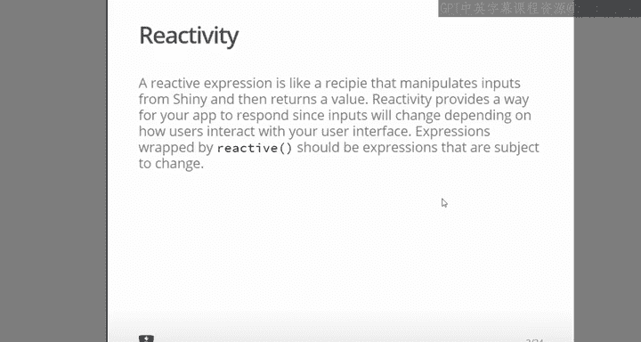
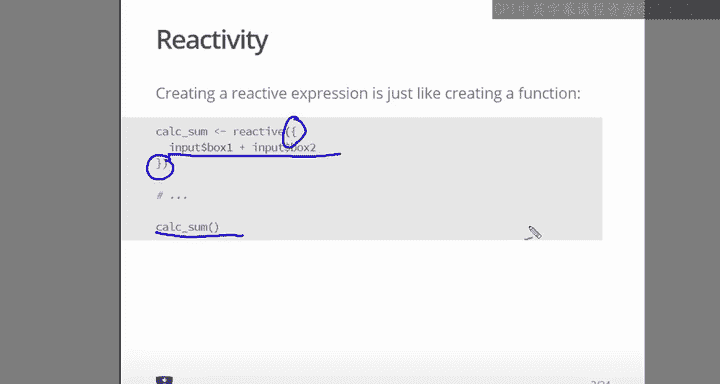

# 114：Shiny 应用中的响应式表达式 🧮

在本节课中，我们将学习 Shiny 应用中的核心概念——响应式表达式。我们将通过一个具体的编码示例，理解如何创建和使用响应式表达式，使你的 Shiny 应用能够根据用户输入动态执行复杂的计算并更新输出。

---


## 什么是响应式表达式？

上一节我们介绍了如何创建基础的交互式图形。本节中我们来看看如何让服务器端的计算更加复杂和有意义，这引出了响应式编程的主题。

响应式表达式本质上是一个“配方”，它处理来自 Shiny 的输入值，然后返回一个结果。它引入了一些在标准 R 编码中不太常见的语法，但这些语法完全符合 Shiny 框架的规范。

如果你想创建能够响应用户界面（`ui.R`）输入的独立表达式，你需要用 `reactive({})` 函数将其包裹起来。

## 响应式表达式的基本结构



以下是响应式表达式的一个基本示例。假设我们在用户界面中有两个输入框，分别标记为 `box1` 和 `box2`。

在服务器函数中，如果我们想将 `box1` 和 `box2` 的值相加，并且希望每次输入值改变时都重新执行这个计算，我们就需要使用响应式表达式。

```r
calc_sum <- reactive({
    input$box1 + input$box2
})
```

请注意这里的语法：`reactive()` 函数后跟着包含实际计算代码的花括号 `{}`。这里创建的 `calc_sum` 并不是一个简单的变量，而是一个函数。之后在代码中引用它时，需要像调用函数一样使用 `calc_sum()`。

## 构建一个响应式应用示例

接下来，我们将通过一个相对简单的编码示例，演示如何在 Shiny 中创建响应式环境。掌握这个示例后，你将几乎拥有创建各种 Shiny 应用所需的完整技能。

例如，你可以创建一个机器学习算法应用，让用户输入一组参数，应用实时计算并输出预测结果及可能的预测误差。

## 条件响应式执行

在本节课的最后，我们还将展示如何实现条件响应式。即，让用户必须点击一个按钮后，服务器端的命令才会执行。这对于那些计算非常耗时的算法非常有用，可以避免不必要的重复计算。

---

### 总结



本节课中我们一起学习了 Shiny 响应式表达式的核心概念和基本用法。我们了解到，通过 `reactive({})` 函数可以将依赖于输入的计算逻辑封装起来，实现数据的动态响应。我们还预览了如何通过条件控制来优化耗时操作的执行体验。掌握这些知识后，你将能够构建功能强大且交互流畅的 Shiny 应用程序。