# 115：Shiny 应用中的反应式表达式 🧪

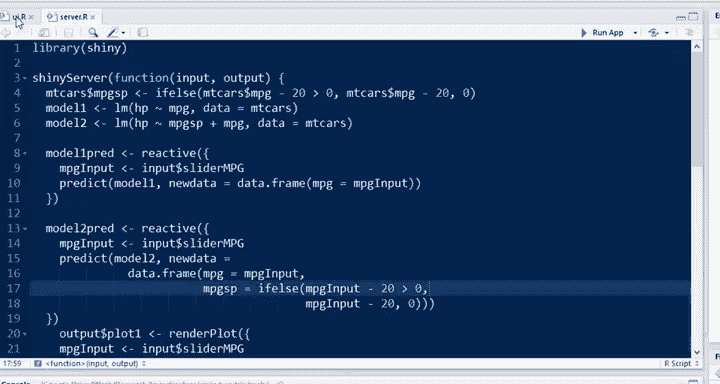

在本节课中，我们将学习如何在 Shiny 应用中创建和使用**反应式表达式**。我们将通过一个具体的例子，展示如何根据用户输入动态更新图表和预测值，并理解 Shiny 中用户界面与服务器逻辑的交互方式。

---

## 用户界面设计

上一节我们介绍了 Shiny 应用的基本结构，本节中我们来看看如何构建一个包含输入控件和输出区域的用户界面。

我们的目标是创建一个应用，允许用户通过滑块选择汽车的每加仑英里数，并显示基于两个不同模型的马力预测值。

以下是用户界面的核心代码结构：

```r
library(shiny)

shinyUI(fluidPage(
  titlePanel("汽车马力预测"),
  sidebarLayout(
    sidebarPanel(
      sliderInput("sliderMPG", "选择每加仑英里数 (MPG):", 10, 35, value = 20),
      checkboxInput("showModel1", "显示/隐藏 模型 1", value = TRUE),
      checkboxInput("showModel2", "显示/隐藏 模型 2", value = TRUE)
    ),
    mainPanel(
      plotOutput("plot1"),
      h3("模型 1 预测值:"),
      textOutput("pred1"),
      h3("模型 2 预测值:"),
      textOutput("pred2")
    )
  )
))
```

在这个界面中：
*   `sliderInput` 创建了一个名为 `sliderMPG` 的滑块，用于输入 MPG 值。
*   `checkboxInput` 创建了两个复选框，用于控制是否在图表中显示对应模型的拟合线。
*   `mainPanel` 中的 `plotOutput` 和 `textOutput` 指定了服务器端需要生成并返回的图表和文本内容。

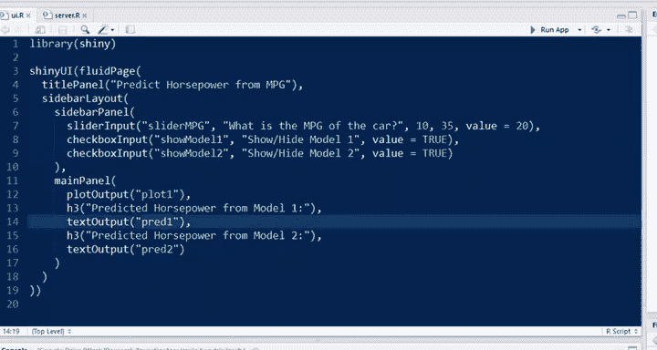

---

## 服务器端逻辑与数据处理

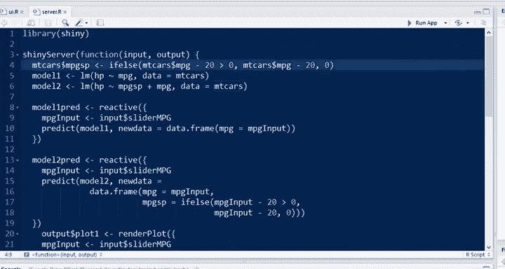

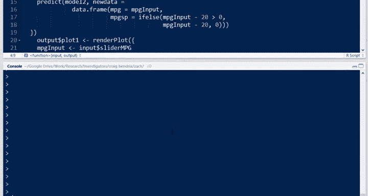

用户界面负责收集输入和展示输出，而所有计算和数据处理都在服务器端完成。现在，让我们深入服务器端的代码。

首先，我们加载并准备数据。这里使用了 R 内置的 `mtcars` 数据集。

```r
shinyServer(function(input, output) {
  # 加载数据
  data(mtcars)
  
  # 创建一个分段变量
  mtcars$mpgsp <- ifelse(mtcars$mpg - 20 > 0, mtcars$mpg - 20, 0)
  
  # 拟合两个线性模型
  model1 <- lm(hp ~ mpg, data = mtcars)
  model2 <- lm(hp ~ mpg + mpgsp, data = mtcars)
```

我们创建了一个分段变量 `mpgsp`，用于构建一个在 MPG=20 处存在转折点的“分段线性模型”。`model1` 是简单的线性模型，而 `model2` 是包含分段项的更复杂模型。

---

## 创建反应式表达式

服务器端的关键是创建**反应式表达式**。这些表达式会监听输入值的变化，并自动重新计算其值，从而驱动输出的更新。

以下是创建反应式预测值的代码：

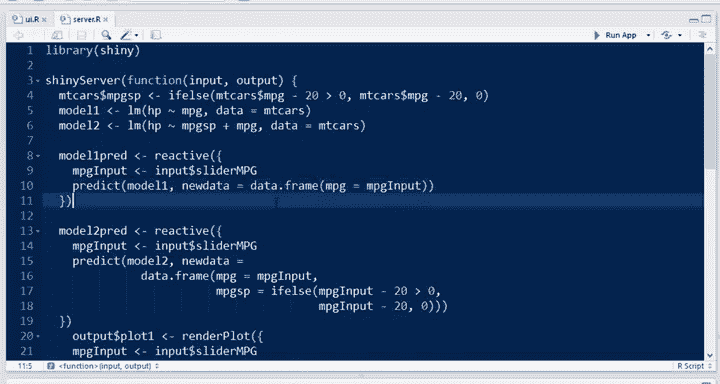

```r
  # 反应式表达式：根据输入值进行预测
  model1pred <- reactive({
    mpgInput <- input$sliderMPG
    predict(model1, newdata = data.frame(mpg = mpgInput))
  })
  
  model2pred <- reactive({
    mpgInput <- input$sliderMPG
    predict(model2, newdata = data.frame(mpg = mpgInput,
                                         mpgsp = ifelse(mpgInput - 20 > 0,
                                                        mpgInput - 20, 0)))
  })
```

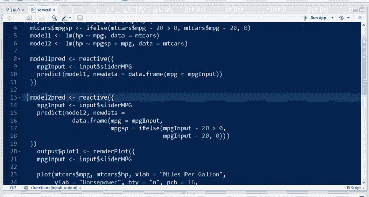

`reactive({...})` 块定义了一个反应式表达式。当用户移动滑块时，`input$sliderMPG` 的值改变，这会触发 `model1pred` 和 `model2pred` 重新计算预测值。

---

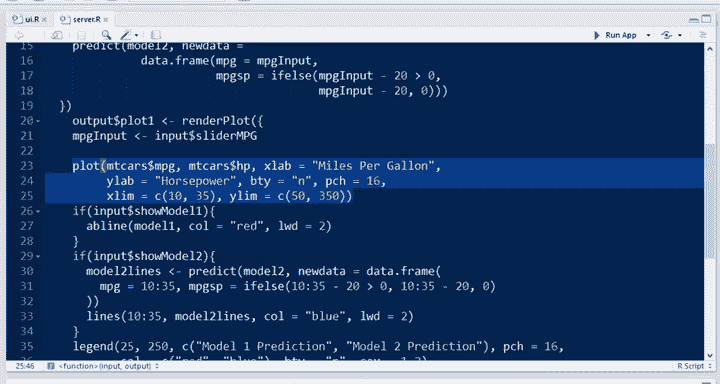

## 生成动态输出

定义了反应式数据后，我们需要使用 `render*` 函数族来生成具体的输出对象，并赋值给 `output$` 列表。

首先，我们生成动态图表：

```r
  output$plot1 <- renderPlot({
    mpgInput <- input$sliderMPG
    
    plot(mtcars$mpg, mtcars$hp, xlab = "每加仑英里数 (MPG)",
         ylab = "马力 (HP)", bty = "n", pch = 16,
         xlim = c(10, 35), ylim = c(50, 350))
    
    # 根据复选框条件添加拟合线
    if(input$showModel1){
      abline(model1, col = "red", lwd = 2)
    }
    if(input$showModel2){
      model2lines <- predict(model2, newdata = data.frame(
        mpg = 10:35,
        mpgsp = ifelse(10:35 - 20 > 0, 10:35 - 20, 0)
      ))
      lines(10:35, model2lines, col = "blue", lwd = 2)
    }
    
    legend(25, 250, c("模型 1 预测", "模型 2 预测"), pch = 16,
           col = c("red", "blue"), bty = "n", cex = 1.2)
    
    # 在图表上添加预测点
    points(mpgInput, model1pred(), col = "red", pch = 16, cex = 2)
    points(mpgInput, model2pred(), col = "blue", pch = 16, cex = 2)
  })
```

`renderPlot({...})` 函数生成图表。注意，我们在添加预测点时，调用反应式表达式需要加上括号，如 `model1pred()`，以获取其计算出的数值，而不是函数本身。

接着，我们生成文本预测输出：

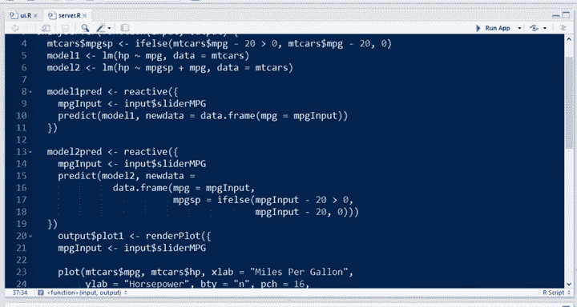

```r
  output$pred1 <- renderText({
    model1pred()
  })
  
  output$pred2 <- renderText({
    model2pred()
  })
})
```

`renderText({...})` 函数生成文本。这里直接返回反应式表达式的值。

---

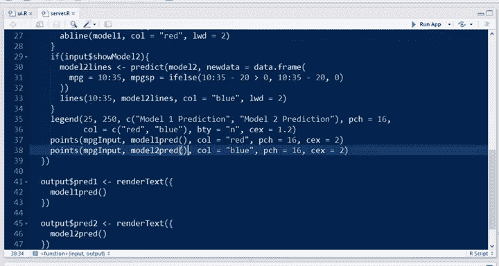

## 应用运行与交互

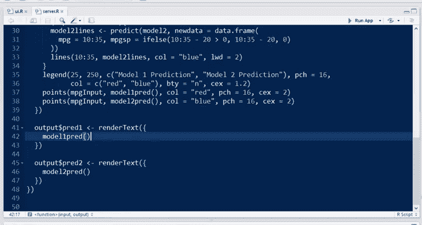

当代码运行后，将出现一个交互式网页应用。用户可以：
1.  拖动滑块改变 MPG 值。
2.  观察图表中两个预测点（红色和蓝色）的实时移动。
3.  通过复选框显示或隐藏任一模型的拟合线。
4.  在图表下方查看两个模型给出的具体马力预测数值。

这个例子清晰地展示了反应式编程的核心：输入 (`input`) 的变化自动触发反应式表达式重新计算，进而更新所有依赖该表达式的输出 (`output`)。

---

## 总结

本节课中我们一起学习了 Shiny 应用中**反应式表达式**的构建和使用。我们通过一个汽车数据预测的例子，实践了如何：
1.  设计包含滑块和复选框的用户界面。
2.  在服务器端拟合统计模型并创建反应式表达式来进行动态预测。
3.  使用 `renderPlot` 和 `renderText` 函数生成依赖输入值和反应式表达式的动态输出。
4.  理解并应用了 `reactive({...})` 块来封装需要响应输入变化的计算逻辑。

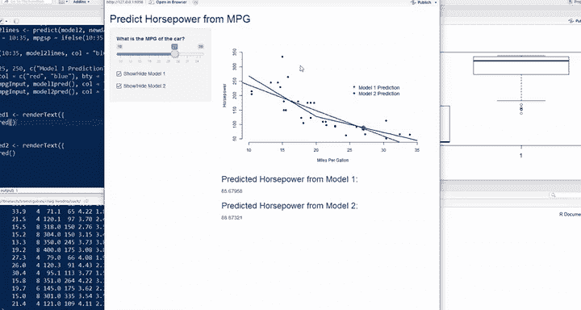

掌握反应式表达式是构建复杂、交互式 Shiny 应用的关键。通过本课的学习，你已经具备了创建实用 Shiny 应用组件的基础。在接下来的课程中，我们将探讨如何添加更复杂的控制逻辑，例如根据按钮点击来执行操作。