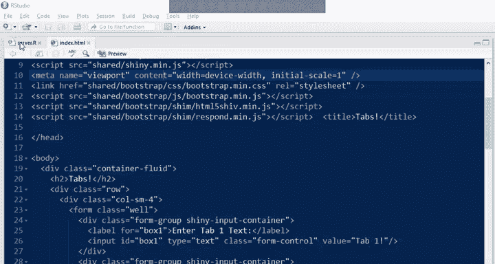
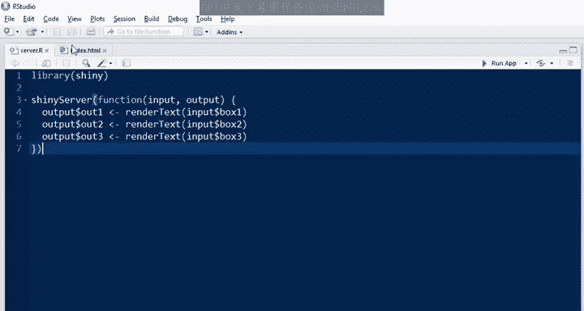
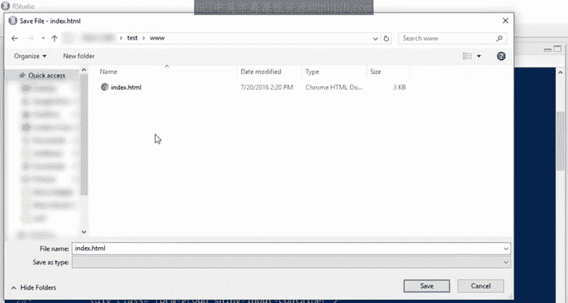
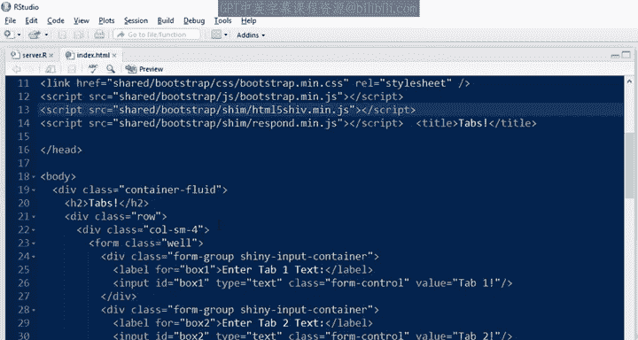
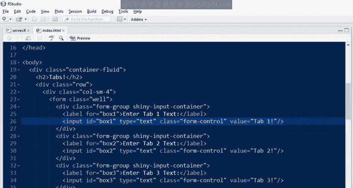
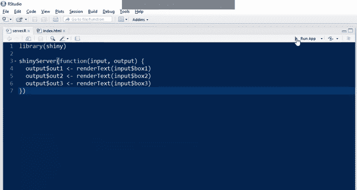
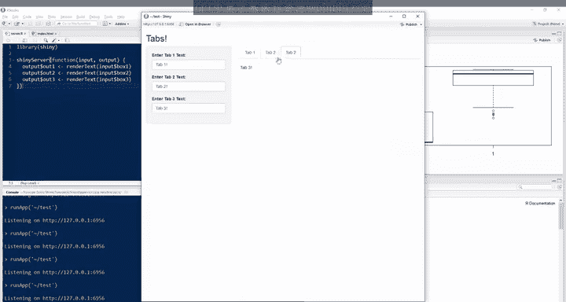
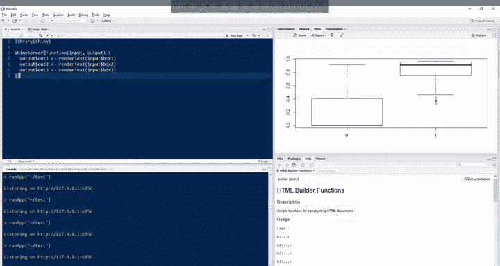

# 118：使用自定义HTML构建Shiny应用 🎨



在本节课中，我们将学习如何在Shiny应用中直接使用自定义的HTML文件，而不是完全依赖R代码来构建用户界面。这种方法特别适合熟悉网页开发的用户，可以提供更大的灵活性和控制力。

上一节我们介绍了Shiny应用的基本结构，本节中我们来看看如何将自定义HTML文件集成到Shiny应用中。

## 准备工作 📁

首先，我们需要创建一个特定的目录结构来存放HTML文件。





以下是创建目录和文件的步骤：

1.  在Shiny应用的主目录下，创建一个名为 `www` 的子目录。
2.  将你的自定义HTML文件命名为 `index.html`，并放入 `www` 目录中。
3.  确保你的 `server.R` 文件位于应用的主目录下。

例如，一个简单的项目结构如下所示：
```
my_shiny_app/
├── server.R
└── www/
    └── index.html
```

## 获取初始HTML模板 🔄

如果你不熟悉Shiny生成的HTML结构，一个简单的方法是先创建一个基础的Shiny应用，然后获取其生成的HTML代码作为起点。



以下是获取初始HTML模板的方法：

*   在R中构建一个简单的Shiny应用原型。
*   在浏览器中运行该应用。
*   使用浏览器的“查看页面源代码”功能（通常是 `Ctrl+U` 或右键点击选择）。
*   将获取的HTML代码复制并保存到 `www/index.html` 文件中。

## 理解HTML文件结构 🏗️

Shiny生成的HTML文件包含了一些引导样式（Bootstrap）的前置代码。你可以根据需求简化或修改这些样式。

在自定义的 `index.html` 文件中，输入控件和输出控件的定义方式与标准HTML一致，但需要遵循Shiny的特定命名规则。

以下是关键元素的定义方式：



*   **输入控件**：使用 `id` 属性进行标识，例如 `<input id="box1" ...>`。这个 `id` 与在 `ui.R` 文件中定义的标签作用相同。
*   **输出控件**：使用特定的CSS类来标识。例如，一个文本输出区域通常被定义为 `<div class="shiny-text-output" id="out1"></div>`。

通过分析原型应用生成的HTML，你可以快速了解这些必要的类名和结构，例如“shiny-text-output”就是输出区域所需的类。

## 运行自定义HTML应用 🚀

完成以上步骤后，运行你的Shiny应用。Shiny会自动加载 `www` 目录下的 `index.html` 文件作为界面。

此时，应用的外观和功能与你之前构建的原型应用完全相同，因为你使用了相同的HTML代码。这验证了自定义HTML方法的有效性。

## 优势与适用场景 💡





这种方法为熟悉网页开发（HTML， CSS， JavaScript）的用户提供了极大的便利。

以下是主要优势：

*   **直接控制**：可以直接编写和修改HTML、CSS和JavaScript代码，无需通过R作为中介。
*   **灵活设计**：可以完全自由地设计应用界面和交互，不受Shiny默认样式的限制。
*   **提高效率**：对于前端开发者而言，使用熟悉的工具链进行开发通常比学习R的UI语法更高效。



本节课中我们一起学习了如何在Shiny应用中使用自定义的HTML文件。我们了解了如何创建目录结构、获取初始模板、理解Shiny特定的HTML元素定义，以及这种方法的优势。掌握这项技能可以让你在开发复杂或定制化程度高的Shiny应用时拥有更大的自由度。